# 问学 WenXue — 架构文档（ARCHITECTURE）

> 模块、依赖、契约、目录布局的**唯一权威**。新增/重命名/移动模块或调整依赖方向，必须先改本文，再改代码（同一个 commit）。
> 上游：`PRD.md`（行为）。本文不重复需求，只回答"怎么拆"。
> 2026-09-25 路线校准：本文继续描述现有 Electron + CfT 实现，Chromium 重构域已废弃。PRD §6 新增的自动下载/Windows 安装目标尚未实现；本文件现有 `manual-unsigned` 契约在发布计划 P2 登记变更后，再由后续阶段实现，不能把需求目标视为当前能力。

## 0. 阅读指引

§1 定义名词与系统不变量（I1–I5，排查问题时引用）；§2 用卡片定义每个模块的边界（"不负责"是边界的灵魂）；§3 锁定依赖方向与跨模块签名；§4–§6 回答数据、测试、目录的归属。写代码前先在 §2/§3 里找到改动的归属，找不到就先改本文。基础设施（CfT 供应链、打包、CI、签名）的权威是同目录 `TECH-INFRA.md`，分工见 §9。

## 1. 领域模型（Domain Model）

### 1.1 实体

| 实体                     | 关键字段                                                                                                                                                                                                 | 关系                                                                                                           | 持久化与生命周期                                                                                                                                                        |
| ------------------------ | -------------------------------------------------------------------------------------------------------------------------------------------------------------------------------------------------------- | -------------------------------------------------------------------------------------------------------------- | ----------------------------------------------------------------------------------------------------------------------------------------------------------------------- |
| BrowserProfile           | id（目录名）、accountNamespace（仅磁盘/主进程）、displayName、type、colorKey、createdAt、lastUsedAt、userDataDir                                                                                         | 1:1 → 画像目录；1:0/1 → 运行中的浏览器实例（瞬态）；N:1 → CloudBase 用户账号                                   | 是：账号归属元数据 `<userData>/browsers.json` + 磁盘目录 `<userData>/profiles/<id>`；退出账号只卸载/隐藏，不删除目录或 Profile 内扩展 IndexedDB                         |
| BrowserRuntimeDescriptor | version、platform、binaryPath                                                                                                                                                                            | 被 LaunchConfig / 版本查询消费                                                                                 | 是：打包资源 + `apps/desktop/browser.lock.json`，随 App 发版变更                                                                                                        |
| ModelConfig              | selectedModelId、visionModelId、customModels[]（id、provider、providerName?、baseURL、apiKey、model）、运行时 llmConfig（baseURL、apiKey、model）、language、uiLanguage、logRetentionDays、logMaxEntries | 被 Agent 循环、插件 UI 与 Logging 消费                                                                         | 是：`chrome.storage.local`；自定义 BYO-Key 模型 Key 仅本机，内置模型只存网关 baseURL / 空 apiKey，运行时注入插件侧用户 access token；不再保留内置本地直连兜底           |
| AgentTask                | id、instruction、status、startedAt、finishedAt                                                                                                                                                           | 1:N → AgentActivity                                                                                            | 是：插件 IndexedDB，用户可删                                                                                                                                            |
| AgentActivity            | taskId、type、payload、ts                                                                                                                                                                                | 属于 AgentTask                                                                                                 | 是：插件 IndexedDB，随任务删除                                                                                                                                          |
| QuickLink                | id、title、url、icon?                                                                                                                                                                                    | 属于 NewTabHome 仪表盘                                                                                         | 是：chrome.storage.local（newtabQuickLinks，仅本机，I2）                                                                                                                |
| LogEntry                 | id、ts、level、source、context、browserId、message、data?                                                                                                                                                | 由插件各运行时产生，由 Logging / LauncherLogStore 管理                                                         | 插件侧 IndexedDB + 启动器侧 `<userData>/launcher-logs.json`；按保留天数与条数上限自动清理，用户可导出/清空                                                              |
| LauncherSettings         | launch、behavior、logs、kernel、本地资料等设置组                                                                                                                                                         | 被启动器 UI、BrowserSupervisor、LauncherLogStore 消费                                                          | 是：`<userData>/settings.json`，即时保存                                                                                                                                |
| TokenUsageRecord         | id、ts、browserId?、uid?、model、inputTokens、outputTokens、totalTokens、estimatedCostCny?、latencyMs?                                                                                                   | 由已脱敏日志遥测或 CloudBase LLM Gateway 计量生成                                                              | 本地缓存：`<userData>/token-usage.json`；云端权威：`token_usage`；云端 uid 为 CloudBase 用户 id；均不包含提示词正文、API Key、access token、refresh token 或敏感头      |
| UserSession              | userId、accessToken、refreshToken、expiresAt、gatewayBaseUrl                                                                                                                                             | 桌面登录后同步给主进程并交接扩展；扩展用 access token 调网关并用 refresh token 刷新                            | 桌面主进程仅内存持有当前 session；插件 `chrome.storage.local` 的 `WenXueUserSession`；CloudBase Web SDK 负责桌面登录态持久化                                            |
| CloudTokenUsage          | \_id、ts、uid、browserId?、model、inputTokens、outputTokens、totalTokens、latencyMs、createdAt                                                                                                           | 由 CloudBase LLM Gateway 从 DashScope usage 生成                                                               | 是：CloudBase NoSQL `token_usage`；PRIVATE；不含正文、Key、Authorization/Bearer                                                                                         |
| CloudBaseAuthUser        | sub/uid、email、nickname、avatar、status（`ACTIVE` / `BLOCKED`）                                                                                                                                         | Web Auth SDK 在邮箱验证及资料提交后创建；邮箱验证码/密码登录；网关逐请求读取 `/auth/v1/user/me`                | 是：CloudBase Auth；`status=ACTIVE` 是网关放行的唯一账号状态权威，`BLOCKED` 拒绝调用                                                                                    |
| UserAccount              | \_id/uid、active、firstSeenAt、lastSeenAt、createdAt、updatedAt、note?                                                                                                                                   | AdminApi 按 Auth UID 关联的历史业务观测与备注                                                                  | 是：CloudBase NoSQL `user_accounts`；不参与账号授权或用户枚举；账号列表来自 Auth，封禁使用 TCB `ModifyUser`                                                             |
| AdminUser                | \_id(uid)、role、status、displayName?、createdAt?、updatedAt?                                                                                                                                            | CloudBase Auth 内部账号对应的后台授权记录                                                                      | 是：CloudBase NoSQL `admin_users`；只有 active 管理员/查看者可访问 AdminApi                                                                                             |
| UserPermissionAudit      | \_id、operationId、userId、adminUid、before、after、reason?、outcome、createdAt                                                                                                                          | 由 AdminApi 在 Auth 状态和备注调整时追加；状态操作先记录 requested，确认后记录 applied，未确认记录 unconfirmed | 是：CloudBase NoSQL `user_permission_audit`；不含 access token、refresh token、提示词正文或厂商 Key                                                                     |
| ClientAnnouncement       | \_id、status、importance、title、body、detailUrl?、audience、publishedAt、expiresAt                                                                                                                      | 1:N → AnnouncementReceipt；由 AdminApi 发布/撤回                                                               | 是：CloudBase NoSQL `client_announcements`；ADMINONLY；正文和目标 UID 不进入 signal                                                                                     |
| AnnouncementReceipt      | \_id=`announcementId:uid`、announcementId、uid、acknowledgedAt、expiresAt                                                                                                                                | N:1 → ClientAnnouncement；同一账号跨设备共享                                                                   | 是：CloudBase NoSQL `client_announcement_receipts`；ADMINONLY；`expiresAt` 为公告到期后 24 小时的 BSON Date，由 TTL 主清理并以限量清理兜底；客户端仅经鉴权 API 幂等写入 |
| ReleaseCandidate         | \_id、runtime、version、channel、manifestUrl/signature、artifacts、sourceCoordinates（含 releasePublicKeyFingerprint）、distribution.mode=`manual-unsigned`、tests、status                               | 由可信发布工具注册；1:N → ReleaseRollout                                                                               | 是：CloudBase NoSQL `desktop_release_candidates`；ADMINONLY；版本候选不可覆盖                                                                                           |
| ReleaseRollout           | \_id、runtime、channel、releaseId、status、percentage、mode、minSupportedVersion?、title、notes、publishedAt                                                                                             | N:1 → ReleaseCandidate；同 runtime/channel 仅一个 active                                                       | 是：CloudBase NoSQL `desktop_release_rollouts`；ADMINONLY；策略变化增加公开 release signal revision                                                                     |
| ReleaseChannelSlot       | \_id=`release-slot:<runtime>:<channel>`、recordType=`release-slot`、currentRolloutId?、activeRolloutId?、highestVersion?、updatedAt                                                                      | 每 runtime/channel 一个；与 rollout/signal/audit 在同一交易内变更                                              | 是：与 rollout 共用 `desktop_release_rollouts`；内部保留文档，API/后台历史必须过滤；原子维护活动互斥与版本单调门禁                                                      |

扩展侧 `WenXueUserSession` 另保存可选 `browserId`，由启动器在校验账号与画像归属后交接；
刷新登录凭据保留此 ID。内置模型的 `customFetch` 将其作为网关统计维度，普通 Agent 创建时
继续传递该配置；视觉与解题模型复用同一运行时配置。画像名称只由 ConsoleUI 在本机映射。

### 1.2 派生概念（非持久化）

- **BrowserStatus 状态机**：`idle | launching | running | error`，由 BrowserSupervisor 对子进程事件归约，仅存于主进程内存，经 IPC 事件推送 UI。
- **DOM 快照**：page-controller 每轮 Agent 循环对页面的文本化表示，用完即弃。
- **VisualObservation**：Agent 以 Observe mode 调用 `visual_observe` 后，由当前可见视口截图经视觉模型生成的结构化 JSON；图片本体用完即弃，不进入历史、IndexedDB 或日志，JSON 作为工具结果进入任务历史。
- **VisualCapabilityResult**：Agent 显式调用 `visual_observe` capability mode 后，由注册能力返回的判别式 JSON；`question_solver` 结果包含有界的题目文本/图片标签摘要、结构化答案、证据、状态和完整计数，不含 screenshot/data URL、DOM 引用、attempt 原值、embedded answer 原始对象或页面响应正文；总 wire budget 为 96 KiB，截断时保留完整 counts。
- **版本三元组**（app / browser / extension）：由打包资源与 lock 文件即时计算；插件优先取
  `manifest.version_name` 供界面显示，缺失时回退数值 `version`。
- **AnnouncementQueue**：当前账号待展示消息的内存队列；重要消息优先，同级按发布时间从旧到新；登出即清空。
- **UpdateState 状态机**：`idle | checking | available | downloading | ready | opening | handedOff | error`，由
  DesktopUpdateService 持有，经 DesktopBridge 单向推送 ConsoleUI。

### 1.3 不变量（任何模块都必须维护）

- **I1.** 同一画像目录同一时刻至多一个浏览器实例（BrowserSupervisor 状态机为主，CfT ProcessSingleton 兜底）。
- **I2.** 内置模型的用户提示词/对话经自有 CloudBase LLM Gateway 转发至百炼；网关只透传与计量，不持久化提示词/响应正文。厂商 API Key 仅存网关服务端环境变量，永不下发插件、桌面或打包产物；插件日志仍可在本机 IndexedDB 保存已脱敏的对话与 LLM 请求/响应正文。自定义 BYO-Key 模型维持本机直连。CloudBase 用户 access token 是内置网关凭据，仅允许在一次性 handoff 与网关 `Authorization` 头中使用；refresh token 仅允许用于插件刷新 session。API Key、`Authorization` 头、`Bearer` 凭据、access token 与 refresh token 绝不持久化到日志、tokens 记录或打包产物；进入桌面域、AdminApi 或云端计量的数据不得包含 API Key、敏感头、access token、refresh token 或提示词正文。
- **I3.** Demo 阶段桌面域与插件域无运行时控制通信。豁免仅限两类：插件域可通过 Chrome Native Messaging 向桌面域单向发送已脱敏日志 / tokens 遥测；启动器可经一次性 localhost `externally_connectable` 页面向插件域交接用户 session 与用量归属 browserId。桌面域禁止通过这些通道向 Agent 发送控制指令。
- **I4.** 插件域只经 OpenAI-compatible HTTP 接口调用 LLM；更换供应商/接入网关只允许改配置（baseURL/key/model），不允许改 Agent 核心代码。
- **I5.** vendor 的 `@page-agent/*` 四包保持上游包名、目录结构与版权头；任何本地改动必须登记 `UPSTREAM.md`（ROADMAP M1 建立）。
- **I6.** 应用内消息正文与目标 UID 只能经鉴权客户端 API 返回给匹配账号，signal 只承载 revision；当前
  Electron 更新只接受可信发布工具注册、Ed25519 清单与 SHA-512/size 验证均通过且标记 `manual-unsigned` 的
  不可变候选，后台不得上传或改写二进制。
- **I7.** 浏览器画像及其中的 Cookie、网站状态、扩展 IndexedDB、AI 历史与记忆按当前 CloudBase
  `userId` 对应的 `AccountNamespace` 隔离。主进程必须用内置网关和 access token 调 `/v1/auth/activate`
  校验真实 uid 后才提交 session；所有画像 IPC 从该 session 推导账号并同时校验账号与 profileId，renderer
  不得指定账号。退出先停止该账号全部画像再清 session，磁盘数据保留；Cloud signOut 结果未知或已提交后
  的本地收尾失败必须保持画像保护。无账号归属的旧画像失败关闭且元数据保留；新 ID 不复用旧/孤儿目录。
  首次接受账号 session 前必须确认其他账号或无归属的遗留运行画像已关闭；无法安全关闭或确认时拒绝
  提交新 session。Electron 单实例与跨进程启动标记覆盖 CfT 建锁前窗口。该行为仅为同设备本地恢复，
  不构成云同步或 OS 用户间安全边界。

## 2. 模块清单

> 每个模块一张卡片。**"不负责"是卡片的灵魂**。按依赖层级从低到高排列（低层不依赖高层）。
> 系统分两个进程域：**桌面域**（Electron 主/渲染进程）与**插件域**（CfT 内的 MV3 扩展）。跨域无依赖边（I3）。

### 2.1 桌面域（apps/desktop）

#### Layer 0 — 基础设施

```
## 模块名：AppPaths
- 职责：集中定义 <userData> 下的目录布局（profiles/、logs/）并确保存在
- 不负责：不读写业务数据；不理解"画像/浏览器"语义
- 输入：Electron app.getPath('userData')
- 输出：所有上层模块
- 关键类型/接口：profilesRoot(): string · logsDir(): string
- 持有状态：无
```

```
## 模块名：AppLogger
- 职责：滚动文件日志（main.log、browser-<profile>.log），接管 CfT stdout/stderr，并把主进程系统事件镜像写入 LauncherLogStore
- 不负责：不上报云端；不解析 LLM 载荷；不记录敏感值（I2）
- 输入：各模块日志调用；BrowserSupervisor 转交的子进程流
- 输出：`<userData>/logs/`；`<userData>/launcher-logs.json` 的 system/background 事件
- 关键类型/接口：log(scope, level, msg) · attachStream(profileId, readable)
- 持有状态：文件句柄
```

#### Layer 1 — 资源定位（纯）

```
## 模块名：BrowserResources
- 职责：定位 CfT 二进制与插件构建产物；读 browser.lock.json 提供版本号
- 不负责：不下载（构建期脚本的事）；不校验完整性（M5 冒烟的事）；不 spawn
- 输入：process.resourcesPath（生产）/ .browsers 与 ../extension/.output（开发）
- 输出：LaunchConfig 调用方、BrowserSupervisor、版本查询
- 关键类型/接口：browserBinary(): string · extensionDir(): string · browserVersion(): string
- 持有状态：无（纯函数）
```

#### Layer 2 — 纯计算

```
## 模块名：LaunchConfig
- 职责：由 { userDataDir, extensionDir, startUrls?, debugPipe? } 组装 CfT argv；有序 URL 中首项为
  前台标签，其余为后台标签
  （--disable-extensions-except、--load-extension、--no-first-run 等全集见 TECH-INFRA §4.3）
- 不负责：不触文件系统；不 spawn；不持状态
- 输入：调用方传入的路径参数
- 输出：string[]（给 BrowserSupervisor）
- 关键类型/接口：buildArgv(opts: LaunchOptions): string[]
- 持有状态：无。守护 I1/I3 的参数面（默认不开调试通道）
```

#### Layer 3 — 有状态服务

```
## 模块名：ProfileStore
- 职责：画像目录创建/枚举/定位；以独占 mkdir 建新目录；维护 spawn 前跨进程近期启动标记，并与 POSIX
  `SingletonLock` / Windows `lockfile` 一起判断画像占用；仅在 Developer Mode 尚未开启且画像未占用时，
  以保留权限的临时文件 + fsync + 原子 rename 设置 `extensions.ui.developer_mode`
- 不负责：不管理画像 cookie/登录态；不在画像被 CfT 占用时修改 Chrome Preferences；已完成迁移的运行中画像只读短路，可继续走既有聚焦链
- 输入：AppPaths
- 输出：BrowserSupervisor、MainBootstrap
- 关键类型/接口：ensureProfile/createProfile/profilePath · markProfileLaunching/clearProfileLaunching ·
  isProfileInUse · listProfiles
- 持有状态：无内存状态（磁盘即状态）
```

```
## 模块名：BrowserProfileStore
- 职责：按 `AccountNamespace` 持久化浏览器画像元数据（名称、颜色、时间、路径）并与 ProfileStore
  目录对齐；所有按 ID 操作同时校验账号归属；旧无归属记录失败关闭但原样保留；新 ID 同时避开全部
  元数据和孤儿目录；串行同进程全部读写以避免并发写丢记录；为 DesktopBridge 提供仅主进程使用的重启
  协调清单
- 不负责：不读取画像内部 cookie/登录态；不决定当前账号；不 spawn；不渲染 UI
- 输入：AppPaths、ProfileStore
- 输出：DesktopBridge、BrowserSupervisor 调用方、ConsoleUI
- 关键类型/接口：BrowserProfile · list(accountNamespace) · create(accountNamespace) ·
  get/duplicate/rename/remove/touch(accountNamespace, profileId, ...) · listForReconciliation()
- 持有状态：`<userData>/browsers.json`（`accountNamespace` 不返回 renderer）
```

```
## 模块名：LauncherSettingsStore
- 职责：持久化启动默认值、启动器行为、日志策略、内核/关于可显示配置与本地资料
- 不负责：不直接应用设置副作用；不渲染表单
- 输入：AppPaths、ConsoleUI 的设置 patch
- 输出：BrowserSupervisor、LauncherLogStore、ConsoleUI
- 关键类型/接口：LauncherSettings · get · update
- 持有状态：`<userData>/settings.json`
```

```
## 模块名：LauncherLogStore
- 职责：启动器侧日志查询、清空、导出前数据读取、保留裁剪；承接单向插件日志遥测
- 不负责：不发起插件控制；不保存 API Key / Authorization / Bearer；不渲染日志 UI
- 输入：AppPaths、LauncherSettingsStore、AppLogger 系统事件、LauncherTelemetryIngest 的已脱敏日志批次
- 输出：DesktopBridge、ConsoleUI 日志页、TokenUsageStore 的用量提取源
- 关键类型/接口：LauncherLogEntry · LauncherLogFilter · query · append · clear · purge
- 持有状态：`<userData>/launcher-logs.json`；JSON 损坏时先改名为 `.corrupt-<timestamp>` 再重建空日志，日志页不得因单个坏文件持续崩溃
```

```
## 模块名：TokenUsageStore
- 职责：启动器侧本地 tokens 用量记录、按日期/画像/模型聚合并累加记录已有的估算金额；累计后再按四位小数展示，作为云端用量读取失败时的本地兜底
- 不负责：不保存提示词正文；不执行计费扣费；不发起网络请求
- 输入：AppPaths、LauncherTelemetryIngest 从 LLM usage 提取的记录、单向 tokens 遥测或未来网关计量导入
- 输出：DesktopBridge、ConsoleUI tokens 页
- 关键类型/接口：TokenUsageRecord · TokenUsageSummary · summary · append
- 持有状态：`<userData>/token-usage.json`
```

```
## 模块名：UsageCloudClient
- 职责：用当前用户 access token 读取 CloudBase LLM Gateway 的 `/v1/usage/summary`，校验 `TokenUsageSummary`，按 userId 写入离线缓存
- 不负责：不写 `token_usage`；不保存厂商 API Key、access token、refresh token、uid 或敏感头到 summary 数据；不计算订阅/扣费
- 输入：AppPaths、UserSessionStore、CloudBaseLlmGateway
- 输出：DesktopBridge 的 `tokens:getSummary`
- 关键类型/接口：summary() -> Promise<TokenUsageSummary>
- 持有状态：`<userData>/token-usage-summary-cache.json`（按 userId 绑定的脱敏 summary）
```

```
## 模块名：UserSessionStore
- 职责：主进程用内置 HTTPS 网关和 bearer access token 调 `/v1/auth/activate`，校验响应真实 uid 与
  renderer userId 完全一致后才在内存提交 CloudBase 用户 session；允许同账号 token 刷新，但在显式 clear
  前（包括 token 已过期）拒绝直接覆盖成另一账号；为浏览器启动、UsageCloudClient 与 handoff 提供凭据
- 不负责：不执行 CloudBase 登录/注册；不刷新远端会话；不保存厂商 API Key；不写日志或 tokens 记录
- 输入：ConsoleUI 经 DesktopBridge 同步的候选 UserSession、CloudBaseLlmGateway
- 输出：DesktopBridge、UserSessionHandoff、UsageCloudClient 可用的 userId / accessToken / refreshToken / expiresAt / gatewayBaseUrl
- 关键类型/接口：setSession(session): Promise<PublicUserSession> · current() · requireSession() · clear()
- 持有状态：仅主进程内存
```

```
## 模块名：UserSessionHandoff
- 职责：创建一次性 localhost 无界面 handoff 页面，把用户 session 与本次启动的 browserId 经
  `externally_connectable` 交给问学插件 background；页面作为后台临时标签，结果回传后由插件关闭；
  画像 ID 仅用于用量归属
- 不负责：不执行登录/刷新；不控制 Agent；不持久化提示词正文、API Key、access token 或 refresh token
- 输入：UserSessionStore 的当前会话、DesktopBridge 已验证归属的画像 ID、固定扩展 ID、
  BrowserSupervisor 打开的 URL、AppLogger
- 输出：DesktopBridge 的 handoff 成功/失败结果；插件 `WenXueUserSession`；不含凭据或 nonce URL 的
  桌面生命周期日志
- 关键类型/接口：run(session & { browserId: string }, openUrl) -> { ok, error? }
- 持有状态：单次 HTTP server 生命周期内的 nonce 与完成状态
```

```
## 模块名：DesktopAnnouncementService
- 职责：renderer 在登录/启动时拉取当前账号待展示消息；同时监听 CloudBase 全局发布/撤回 signal 与
  当前账号确认 signal；维护 watch 指数退避、15 分钟轮询、单弹窗队列与账号级 ack；收到网络恢复、
  窗口重新聚焦或页面重新可见的 resume intent 时立即补拉，并重建仍在退避的监听
- 不负责：不渲染弹窗；不读取其他账号消息或目标 UID 列表；不持久化用户 token；不处理应用更新
- 输入：ConsoleUI 当前 CloudBase Auth session、CloudBase Web SDK watch、CloudBaseLlmGateway 客户端
  announcement API、DispatchContracts
- 输出：ConsoleUI 可消费的当前 AnnouncementView 与状态；ack/撤回后的队列变化
- 关键类型/接口：start(session, platform, version) · stop() · resume() · current() · acknowledge(id) · subscribe(listener)
- 持有状态：当前 userId、两个按 generation 隔离的 watch handle、退避/轮询 timer、至多 10 条内存队列；
  登出全部释放
```

2026-09-26 公告恢复契约：ConsoleUI 只把 `online`、`focus`、可见 `visibilitychange` 转成 resume intent，
卸载移除事件；服务在未登录时无操作，重复恢复信号合并请求且不延后真实新 revision 的补拉。
异步 pending/ack/watch 回调都绑定当前会话；确认成功前保持弹窗可重试，成功后已发出的旧 pending
响应不得恢复该弹窗。已确认 ID 仅作为同一会话内竞态隔离，不持久化，也不替代服务端账号回执。

```
## 模块名：DesktopReleaseSignalService
- 职责：renderer 使用 CloudBase Web SDK 监听公开 release signal revision；失败时指数退避并以 4 小时
  轮询兜底；revision 变化时只发送 `updates:check(reason='signal')` intent
- 不负责：不读取/匹配 update policy；不校验候选；不持有 UpdateState；不下载或打开安装包；不要求用户登录
- 输入：CloudBase Web SDK、DesktopBridge updates:check
- 输出：DesktopUpdateService 的 signal check intent
- 关键类型/接口：start(runtime, channel) · stop()
- 持有状态：watch handle、最近 revision、退避/轮询 timer；不持有候选或账号数据
```

```
## 模块名：LauncherTelemetryIngest
- 职责：接收单向遥测批次，校验 browserId，归一化日志字段，写入 LauncherLogStore，并从已脱敏 LLM usage 载荷提取 TokenUsageRecord
- 不负责：不注册 Native Messaging 宿主；不向插件回送控制命令；不保存提示词正文或 API Key
- 输入：Native Messaging 宿主或受控主进程入口传入的 `{ browserId, logs?, tokenUsage? }`
- 输出：LauncherLogStore、TokenUsageStore
- 关键类型/接口：LauncherTelemetryIngest.ingest(payload) -> { logs, tokenUsage }
- 持有状态：无
```

```
## 模块名：BrowserSupervisor
- 职责：按画像 spawn CfT、监听 exit/error、维护每个画像 idle→launching→running 状态机、崩溃通知（I1
  执行者）；在首个异步画像准备前先占用 launching 状态并在 spawn 前写跨进程启动标记；停止已跟踪进程
  时先 SIGTERM，2s 未退出则 SIGKILL，5s 仍无 exit 证据则保留 live handle 并标记 error；应用重启后
  对未跟踪画像二次确认锁与近期启动标记，无占用才视为已停止；仍占用时拒绝账号切换并要求用户关闭
  浏览器后重试，不为日常启动开放 TCP 调试端口
- 不负责：不组参数（LaunchConfig）；不定位资源（BrowserResources）；不渲染 UI
- 输入：LaunchConfig、BrowserResources、ProfileStore、AppLogger
- 输出：状态事件 → DesktopBridge
- 关键类型/接口：见 §3.2
- 持有状态：profileId → 子进程句柄 + BrowserStatus
```

```
## 模块名：DesktopUpdateService
- 职责：main 实现 `manual-unsigned` 更新状态机；按启动延迟、4 小时定时器、renderer signal 与手动 intent
  检查策略；验证 runtime/channel/platform/arch/semver、Ed25519 清单、SHA-512/size 和稳定灰度分桶；
  在用户 intent 后下载，并在一次实时 policy 复核成功后通过系统 API 打开已校验的 DMG/NSIS；开发
  运行时不启动自动更新且保持 idle，只有手动检查 intent 返回可展示的不可用说明
- 不负责：不构建/签署清单/上传候选；不静默下载；不关闭 App 或 CfT；不替用户运行安装器；不执行降级；
  不渲染更新 UI
- 输入：AppPaths、本地随机 installId、DesktopBridge check intent、CloudBaseLlmGateway update-policy/events、
  系统 HTTPS 下载与 shell open 能力、DispatchContracts
- 输出：UpdateState → DesktopBridge；已校验安装包的系统打开 intent；匿名更新事件
- 关键类型/接口：start() · stop() · state() · check(reason) · download() · openInstaller()
- 持有状态：UpdateState、当前已验证策略/候选、检查 timer、下载状态；缓存 mandatory 策略可在
  24 小时内继续离线门禁/下载，但不能授权打开安装包；不加载 CloudBase Web SDK，不保存 uid
```

#### Layer 4 — 桥接

```
## 模块名：DesktopBridge
- 职责：preload contextBridge + IPC 通道注册；渲染层访问主进程的唯一入口；转译更新状态与只允许
  HTTPS 的外部链接 intent；从 UserSessionStore 推导 `AccountNamespace` 并对所有画像命令、状态与事件
  强制执行 I7；用带所有权的 transition 锁编排 token→uid 校验、首次遗留进程协调与退出前当前账号画像
  停止事务；其他账号协调失败只向 renderer 返回不含 profileId 的通用错误
- 不负责：不读取 Profile 内容；不接受 renderer 提供账号 ID；不绕过 I2/I3 直接控制插件域
- 输入：BrowserSupervisor、BrowserProfileStore、LauncherLogStore、LauncherSettingsStore、LauncherTelemetryIngest、TokenUsageStore、UsageCloudClient、UserSessionStore、UserSessionHandoff、DesktopUpdateService、BrowserResources
- 输出：ConsoleUI（window.wenxue.*）
- 关键类型/接口：见 §3.2 IPC 契约
- 版本读取：`app:getVersions` 返回包版本、CfT lock 版本和插件清单可见版本名。
- 持有状态：当前 `activeAccountNamespace`、首次 session 协调标记、退出事务 `signOutState` 与逐画像
  生命周期队列；均仅内存、不持久化
```

#### Layer 5 — 展示

```
## 模块名：ConsoleUI
- 职责：React 启动器 App shell（账号登录/注册、侧栏路由、浏览器多开页、日志页、tokens 页、设置页）；
  邮箱验证、最终注册、密码登录与密码重置使用 CloudBase Web Auth SDK，并在发起请求前执行凭据格式
  校验；退出按“主进程停止当前账号画像 → CloudBase signOut → 清主进程 session”顺序发送意图，只在
  Cloud signOut 已确定失败且 SDK session 仍存在时解除退出保护；消费消息与更新状态并渲染固定弹窗；
  无候选更新错误以可关闭的顶部提示呈现，错误详情留在“关于问学”
- 不负责：不触 Node API；不直接调用 Tencent Cloud 管理 API；不写启动器业务判断（仅消费状态、发送意图）
- 输入：DesktopBridge、DesktopAnnouncementService、DesktopReleaseSignalService、DispatchContracts、CloudBase Web Auth SDK、CloudBaseLlmGateway `/v1/auth/activate`
- 输出：用户
- 关键类型/接口：无对外编程接口
- 持有状态：仅 UI 态
```

ConsoleUI 内部 `OnboardingTour.tsx` 展示本地实机录制的分步教程与 Logo / slogan 收尾；`onboardingProgress.ts` 维护素材清单、就绪判断及按账号隔离的本机显示偏好。只有构建包含全部六段正式素材时，认证与画像加载完成后，无画像且尚未处理教程的账号才进入引导；已有画像的账号默认不打断，关于页可重播。缺少任一素材时不进入教程、不显示重播入口，也不写入完成状态。公告、更新提示或窗口关闭确认出现时暂停教程；`WindowCloseDialog` 通过内部可选 `onOpenChange` 回调通知 App，保持单一关闭状态订阅。播放不创建画像、不调用 LLM、不新增 IPC 或桌面控制插件通道。跳过直接进入工作台；最后片段结束进入品牌页，由「开始探索」完成退出。

ConsoleUI 的 `cloudbase.ts` 封装邮箱挑战、验证码登录、延迟注册、密码登录、忘记密码及头像存储。
账号设置复用该适配器更新 CloudBase Auth 的昵称和永久头像引用，保存前后验证同一 UID，向 App 返回
无凭据的公开资料。`AccountSettings` 为 ConsoleUI 内部资料视图；内部 `DesktopOverlays` 提供自绘
菜单、选择器与询问弹窗，复用统一键盘、焦点、Portal 与减少动态效果行为，不新增业务模块或依赖。
窗口关闭询问由 MainBootstrap 保留关闭决策，经 DesktopBridge 事件和类型化应答呈现于 ConsoleUI，
取消或 renderer 失效时不执行关闭；安全关闭失败通过同一应用内弹层说明并允许用户重试。
`EmailAuthScreen.tsx` 是 ConsoleUI 内部视图，消费挑战并管理邮箱、验证码、注册资料与重置密码表单；
注册按密码/确认、头像/昵称两步呈现，步骤间返回保留内存草稿，不消费验证凭据。
昵称可重复，仅展示，不作为登录凭据；空白昵称由 `cloudbase.ts` 在最终注册时生成 `user` 加六位数字。
`validateLauncherPassword` 供密码步骤与重置表单共用校验。`getVerification` 与默认 `verify` 只返回临时证明，
新邮箱仅在第二步最终资料/密码校验通过并提交后调用 `signUp` 创建 Auth 用户；取消后从邮箱验证重新开始。
OTP、验证证明与未提交资料仅驻留内存，不产生待注册账号；头像选择阶段只本地预览，完成注册后才通过
用户会话上传 `avatars/<uid>/...`，用永久 fileID 更新 Auth `picture`，显示时解析短期 URL。
注册句柄显式区分资料未提交、需重新验证邮箱、账号确认中、头像待保存、需重新登录和完成；UI 不从凭据过期时间推断阶段。
建号后的网络或 5xx 错误只重试同一 UID 的网关确认，成功后才上传头像；401/403 结束无效流程并返回密码登录。
头像失败重试沿用已创建 UID，不重复注册。忘记密码验证完整邮箱后调用 `resetPassword`，成功返回密码登录。
发码冷却由认证适配层按规范化邮箱维护，同一邮箱的登录与密码重置共享冷却，不同邮箱互不误拦；
`getLauncherEmailResendAt(email)` 向所有发码入口提供下次可重试时间。平台明确限流保留类型化来源及
重试时间，优先使用结构化等待秒数；未提供时只施加客户端短暂退避，不宣称平台已解除限制。
成功发码即记录冷却，即使随后取消或结果迟到也不丢失；邮箱证明和未提交资料仍只驻留内存。
图形验证码由 CloudBase 实际挑战驱动，`captchaChallenge.ts` 管理挑战生命周期、SDK 回调与可暂停超时，
`CaptchaDialog.tsx` 仅呈现，不在前端判定答案。所有新会话仍经 UserSessionStore → 网关 activate 验证，
不新增认证后端、IPC 或跨域依赖；CloudBase `usernamePassword` 开关仅提供邮箱密码能力，产品无用户名流程。

#### Layer 7 — 组装根

```
## 模块名：MainBootstrap
- 职责：获取 Electron 单实例锁；app 生命周期（ready→建窗→注册 IPC→启动更新检查→退出询问对话框），
  第二实例请求聚焦现有窗口，装配 L0–L4
- 不负责：不实现任何具体服务逻辑
- 输入：桌面域全部模块
- 输出：进程入口 apps/desktop/src/main/index.ts
- 持有状态：窗口句柄
```

### 2.2 云端后端（apps/llm-gateway + CloudBase）

```
## 模块名：CloudBaseLlmGateway
- 职责：CloudBase Run 容器型（Dockerfile + Functions Framework 多 target）的组合运行时。除 OpenAI-compatible 网关外，复用 `apps/admin-api` 的管理、消息、更新和 CI 候选 targets，并从镜像内 `apps/admin/dist` 提供 `/admin` HTML 与 `/admin/assets/*`；用户激活、模型鉴权、usage 计量继续沿用既有边界；旧注册 target 仅返回 410；为桌面端提供鉴权消息 pending/ack、公开 update-policy/events 与无凭据 `/healthz`
- 不负责：不持久化提示词/响应正文；不保存或返回 DashScope Key；不实现订阅/扣费；不实现管理员登录/角色/业务 UI 逻辑，只提供构建后的静态文件与 AdminApi 适配器；M4 实时聚合不做 rollup 预计算
- 输入：插件 OpenAIClient、UsageCloudClient、桌面激活/消息/更新客户端、AdminConsole、本机候选注册请求、CloudBase access token、服务端模型/CloudBase/CI 验证配置、白名单 staging 内的 `apps/admin/dist`
- 输出：DashScope SSE/JSON 原样回传；按 bearer token 返回当前 `ACTIVE` 用户 uid；写 `token_usage`；返回不含 uid/Key/敏感头的 `TokenUsageSummary`；返回无凭据健康状态；返回 AdminConsole HTML/JS/CSS 与 AdminApi JSON
- 关键类型/接口：既有 auth/chat/usage/health/admin 静态 targets + §3.2 的 announcement/release/client/internal targets；模块内 `estimateTokenCostCny` 负责内置模型人民币成本估算
- 持有状态：无业务授权缓存；部署态环境变量由 CloudBase Run 管理
```

### 内置模型成本估算（CloudBaseLlmGateway）

- 价格版本 `qwen3.7-list-2026-09-22`，采用用户确认的原价；仅适用于内置模型实时 Chat Completions，不应用限时优惠及 Batch File / Batch Chat 价格。
- 单位：元 / 百万 tokens。Plus 单次输入（含缓存）≤ 256,000 时，普通输入 / 隐式命中 / 显式创建 / 显式命中 / 输出依次为 2 / 0.4 / 2.5 / 0.2 / 8；大于 256,000 时整次调用采用 6 / 1.2 / 7.5 / 0.6 / 24。Max 对应为 12 / 2.4 / 15 / 1.2 / 36。
- 阶梯阈值和 Plus 长输入价取自[官方模型文档](https://help.aliyun.com/zh/model-studio/qwen3-7-plus)与[阶梯规则](https://help.aliyun.com/zh/model-studio/model-pricing)，K = 1,000；按整个请求输入决定档位，不按未缓存输入或输入输出之和判档。
- 根据[缓存协议](https://help.aliyun.com/zh/model-studio/context-cache)，从 `usage.prompt_tokens_details`（兼容 `input_tokens_details`）解析命中和创建数量，并从消息内容/工具的 `cache_control` 标记识别显式缓存。缓存数量是输入子集：普通输入 = 输入 − 命中 − 创建，不重复计费。创建数量大于零也视为显式缓存。
- `CloudTokenUsage` 新增 `cachedInputTokens`、`cacheCreationInputTokens`、`cacheMode`、`estimatedCostCny`、`pricingVersion`；只保存脱敏计量元数据，不保存请求标记所在正文。输入计数须为非负安全整数，缓存计数之和不得超过输入。
- 新记录固化当次费用；历史记录未保存费用时在 summary 中依据已有 tokens 补算，缺少缓存数据时按普通输入估算，不回写历史记录。已保存金额（包括 0）保持原值。
- 网关按 0.0000001 元整数单位计算、累加，summary 总额和各分组完成累加后再保留四位小数；明细保留完整计算精度。桌面离线缓存沿用云端金额。本地 BYO-Key 日志不套用内置供应商价格，未提供价格的其他模型不纳入金额估算。
- ConsoleUI 在 tokens 总览下提供可展开的原价、阶梯、公式及历史数据估算说明；费用为参考成本，不执行扣费。

```
## 模块名：AdminApi
- 职责：后台管理与客户端分发 API 的唯一业务实现；保留管理员鉴权、tokens 与用户管理；发布/撤回
  定向消息、幂等确认、注册不可变版本候选、发布/暂停/恢复/撤回 rollout、生成安全 update policy、
  在 `desktop_release_rollouts` 事务内更新 `recordType=release-slot` 的通道保留文档，增加 signal revision，
  并向纯审计 `admin_dispatch_audit` 追加操作记录
- 不负责：不接受用户 access token 以外的管理登录；不转发 LLM；不保存提示词/响应正文；不下发 CloudBase API Key；不渲染后台 UI；不负责创建用户；`user_accounts` 仅保留历史业务观测/备注，不能决定账号状态
- 输入：AdminConsole 发来的 CloudBase Auth bearer token、服务端 CloudBase 环境变量与 NoSQL 集合；Auth 管理适配器所需 CAM 临时/服务端凭据
- 输出：既有管理 JSON，加 §3.2 的管理消息/发布、客户端消息/策略/事件与 CI 注册响应
- 关键类型/接口：resolveCloudBaseAdminIdentity · requireAdminUser · buildAdminUsageSummary · handleAdminRequest · DispatchContracts
- 持有状态：无；持久状态在 CloudBase NoSQL；release slot 负责互斥/版本门禁，audit 不参与控制决策
```

2026-09-26 HTTP 入口契约：Functions Framework 将 JSON 请求体直接作为 event 传入，HTTP 元数据
位于 context.httpContext。AdminApi 仅在 event 具有 body/rawBody 且全部顶层键都属于已支持的
HTTP 包装字段时拆包；包含业务键的对象整体序列化，公告正文 body 即使看似 JSON 也不再拆解。
保留已有字符串、body 对象、base64 与 rawBody 包装输入；只有 body 的对象延续包装语义，
业务必填项和畸形 JSON 仍由统一处理器校验，不回显 event、headers 或运行环境。

2026-09-26 发布矩阵契约：新 CI 候选必须包含 macOS arm64 DMG 与 Windows x64 NSIS 各一份，
Intel Mac 暂不构建或验收。AdminApi 对 schema v1 登记及存量读取接受上述双目标，或旧完整三目标
（再含 macOS x64 DMG）；所有其他目标、重复、缺失和类型错配继续拒绝。旧清单不裁剪或重签，
以保持候选不可变与旧协议兼容。构建封存和发布验证只允许当前双目标，固定三项测试证据不变。
部署顺序为先更新 AdminApi/组合网关，再登记双目标候选；当前 schema v1 客户端按自身平台选取产物的协议不变。

AdminApi 内部适配器 `cloudbaseAuth.mjs` 使用腾讯云 TC3 签名调用 `DescribeUserList`（真实邮箱用户列表）
和 `ModifyUser`（ACTIVE/BLOCKED 状态）。仅服务端读取 `TENCENTCLOUD_SECRETID` / `TENCENTCLOUD_SECRETKEY`
/ 可选 `TENCENTCLOUD_SESSIONTOKEN` 或运行时 SCF 临时凭据；CAM 需授权上述两个操作，不再需要 CreateUser。
`cloudbaseStore.mjs` 按 UID 关联用量、历史观测和备注；缺少管理凭据返回 503，不回退到旧账号列表。
`admin_users` 继续控制 admin/viewer 权限，普通邮箱注册不授予角色；Auth 状态修改写权限审计。

组合运行时的 `index.mjs` 可复用 `cloudbaseAuth.mjs` 的公开工厂 `createCloudBaseAuthDirectory`，
向网关注入只读 `getAuthUser(uid, timeoutMs?)` 接口。`/auth/v1/user/me` 验证 token 和真实 UID；若响应完全省略
`status`，网关以 `DescribeUserList` 的 `UidList` 精确查询同一 UID 的平台状态，禁止将缺失状态默认成
ACTIVE。显式非 ACTIVE、查询不到用户、UID 不匹配或查询失败均拒绝授权；不查旧 `user_accounts`，
不新增凭据、不缓存授权状态，也不全表扫描。
消息 pending/ack 通过同一 Auth 状态查询约束用户身份；二次查询只使用原鉴权请求剩余的超时预算。

### 2.3 插件域（apps/extension + packages/\*）

vendor 四包为上游快照（粗粒度卡片；内部实现以上游为准，本域约束是：不逆向依赖、不 reach into 内部实现、改动登记 UPSTREAM.md）：

```
## 模块名：@page-agent/ui（L0 视觉基座）
- 职责：共享 UI 基件与样式
- 不负责：业务与 Agent 逻辑
```

```
## 模块名：@page-agent/llms（L2）
- 职责：OpenAI-compatible LLM 客户端（流式、错误归一化）；识别 named `tool_choice` 类型/格式不兼容并在当前配置内自动降级为 `required`
- 不负责：不直接持久化模型能力；不做计费；不组提示词
- 关键类型/接口：OpenAIClient（I4 的唯一 LLM 出口）· isNamedToolChoiceCompatibilityError · rememberNamedToolChoiceUnsupported
```

```
## 模块名：@page-agent/page-controller（L3）
- 职责：DOM 文本化、动作执行（点击/输入/滚动/执行 JS）、执行结果结构化序列化（`serializeResult`）、模拟光标与遮罩、框架补丁（react/antd）
- 不负责：不调 LLM；不编排任务
```

```
## 模块名：@page-agent/core（L4）
- 职责：PageAgentCore Agent 循环（系统提示词、工具执行、`execute_javascript` 的 world/frame 参数、活动流、ExecutionResult、按 `onAskUser` / `onUserTakeover` 动态暴露的用户提问与可恢复人工接管、完成后同会话续接、agent_history 投影压缩、recall_steps 回退取回）
- 不负责：不直接操作多标签（MultiPageAgent 的事）；不渲染历史 UI；不决定问学产品层卡住阈值
```

fork 应用层（apps/extension）：

```
## 模块名：ExtensionSettingsConfig（L4）
- 职责：定义内置主/视觉模型候选、厂商预设、自定义厂商与自定义模型结构；归一化 selectedModelId/visionModelId/customModels，并迁移不支持视觉的旧内置模型选择；将设置页源数据解析为 Agent 可用的 llmConfig，识别持久配置变更供侧边栏和设置页同步；在运行时把内置模型解析为 CloudBase Gateway baseURL + 用户 access token；按规范化 endpoint + model 读取/写入带 TTL 的 named `tool_choice` 兼容能力；定义并归一化插件日志保留配置
- 不负责：不渲染 UI；不直接发 LLM 请求；能力记录不保存 API Key、鉴权信息或错误正文
- 输入：设置页表单值、chrome.storage 中的 ModelConfig / ModelToolChoiceCompatibility、插件侧 `WenXueUserSession`
- 输出：ExtConfig / LLMConfig / RuntimeAgentModels
- 关键类型/接口：CustomModelConfig · ModelProviderPreset · resolveSelectedLLMConfig · normalizeVisionModelId · normalizeCustomModels · buildSettingsConfig · loadStoredConfig · saveStoredConfig · isConfigStorageChange · buildRuntimeAgentModels · loadRuntimeAgentModels · logRetentionDays · logMaxEntries
- 持有状态：`chrome.storage.local` 中版本化、30 天 TTL 的 ModelToolChoiceCompatibility；其余转换保持纯函数
```

```
## 模块名：Logging（L4）
- 职责：定义日志类型与脱敏规则；为所有插件运行时提供统一 logger；由 background 作为 IndexedDB 单写入者完成追加、查询、导出、清空与自动清理；限定并记录 LLM fetch 请求/响应正文；视觉观察请求只记录脱敏概要，不记录 image data URL
- 不负责：不渲染日志 UI；不写桌面日志；不远程上报；不持久化 API Key、Authorization 或 Bearer；不修改 packages/*（I2/I3/I5）
- 输入：background / sidepanel / hub / newtab / content 的日志事件；ExtensionSettingsConfig 的 logRetentionDays/logMaxEntries；命中 LLM 端点的 fetch 请求与响应
- 输出：已脱敏 LogEntry；LOG_APPEND/LOG_QUERY/LOG_EXPORT/LOG_CLEAR 响应；启动器遥测出口的日志批次
- 关键类型/接口：LogEntry · LogFilter · logger.debug/info/warn/error · appendBatch · query · exportAll · clear · purge · handleLogControlMessage · installLlmFetchLogging（详见 §3.2）
- 持有状态：background 独占的 IndexedDB `page-agent-ext` v2 `logs` 对象库；非 background 上下文的瞬态发送批次
```

```
## 模块名：SidepanelApp（L5）
- 职责：侧边栏对话流、完成/错误后的 followUp 续接路由、`ask_user` 问题展示与回答 Promise 桥接、近溢出上下文横幅、登录/验证码等人工接管/暂停/继续 UI、右上角更多菜单、语言快捷入口、任务历史 UI、options 设置页 UI、自定义模型列表与主/多模态模型选择及配置同步
- 不负责：不实现 Agent 循环；不直接发 LLM 请求
- 输入：MultiPageAgent、ExtensionSettingsConfig、@page-agent/ui
- 输出：用户
- 关键约束：普通澄清与受保护浏览器动作使用独立控制器；`ask_user` 保持 Agent `running` 但只解锁回答输入，人工接管使用 `waiting_for_user` / `paused`；两类挂起请求都监听任务 AbortSignal，并在 stop/reset/rebind/dispose 时取消
- 持有状态：UI 态、当前 `UserQuestionRequest` / `UserTakeoverRequest`；读写 ModelConfig（chrome.storage.local）与按 conversationId upsert 的会话历史（IndexedDB）
```

```
## 模块名：LogViewer（L5 / legacy）
- 职责：历史插件内日志查看器组件；M3.5 后不再挂载到 SettingsForm，查看入口迁移到桌面启动器日志页
- 不负责：不作为当前产品入口；不直接访问 IndexedDB；不执行脱敏或保留策略；不向桌面域或远程发送日志
- 输入：无活跃入口；组件文件暂留供回滚参考
- 输出：无活跃输出
- 关键类型/接口：LogViewer · LogFilter
- 持有状态：筛选条件、分页游标、当前详情与加载/错误 UI 态
```

```
## 模块名：NewTabHome（L5）
- 职责：接管新标签页；首次 onboarding、快捷入口仪表盘（增删改排序）、设置/刷新入口；视觉遵循统一 UIUX，直接呈现可用内容
- 不负责：不实现 Agent 循环 / 不发 LLM 请求 / 不收集 API Key / 不跨域调用桌面端
- 输入：chrome.storage.local（QuickLink、newtabOnboardingDone）、@page-agent/ui、openExtensionOptionsPage
- 输出：用户；经 chrome.tabs 打开站点
- 持有状态：UI 态；读写 QuickLink 与 onboarding 标志
```

```
## 模块名：MultiPageAgent（L5）
- 职责：多标签编排（当前插件基线默认纳入当前窗口全部可操作、非固定标签页，允许设置显式关闭）、当前标签加载等待、向 PageAgentCore 透传压缩配置、只向 Agent 注入正式入口 `visual_observe` 与多标签工具、为每次 task 提供 taskEpoch/managed-tab lease、问学产品层卡住检测（连续 3 次重复动作触发人工接管，done/ask_user/request_user_takeover/recall_steps 不计入重复）
- 不负责：不渲染 UI
- 输入：@page-agent/core、@page-agent/page-controller、ExtensionSettingsConfig 解析出的文本/视觉模型配置
- 输出：SidepanelApp
- 持有状态：运行中任务
```

```
## 模块名：VisualCapabilities（L5）
- 职责：向 Agent 暴露唯一正式视觉入口 `visual_observe`；legacy / Observe mode 保持现有结构化观察语义并可返回题目场景建议；capability mode 经内部 registry 显式分派 `question_solver`；截图绑定当前 task 的 managed-tab lease，只有 target 正是用户当前可见 tab 才捕获，无损 PNG 源按实测 bitmap/viewport 比例裁剪；初始化时用 origin-wide Web Lock 单飞探测 background 协议并最多自刷新一次
- 不负责：不因观察到题目自动回答或填写；不保存图片本体；不把 tab URL/title 发送给视觉模型；普通 Observe 不输出 DOM index、点击坐标或动作命令；不绕过特权页、登录、验证码或页面安全限制
- 输入：MultiPageAgent 的文本/视觉模型配置、ExtensionEntrypoints 的截图桥、Agent 管理的当前 tab id、VisualCapabilityRegistry
- 输出：向后兼容的 VisualObservation JSON 或判别式 VisualCapabilityResult，进入 PageAgentCore step history
- 关键类型/接口：createVisualObserveTools · VisualCapabilityRegistry · VisualCapability · ensureVisualObserveBackgroundReady · askVisualObservation · captureCurrentVisibleTab
- 持有状态：background 协议 reload-attempt 标记；截图 data URL 仅存在于单次工具 / 题块处理内存中。输出 schema/总 JSON 有上限并拒绝 data URI/长 base64 回灌
```

```
## 模块名：QuestionSolver（L5）
- 职责：实现 `question_solver` visual capability；按 `inspect | answer | fill` 授权编排「task/run/request 隔离→全 frame 防护扫描→frame/adapter 检测→结构化读题→embedded answer 映射→文本/视觉模型补全→写前快照→精确回填→DOM/runtime/按需视觉验证→恢复→指纹稳定翻页→重新发现 frame→汇总」；以 adapter registry 覆盖超星、智慧树、ZJY、ICVE、iCourse、U校园和保守 generic HTML；代码级旧 Chaoxing facade 可转发但不注册为 Agent 工具
- 不负责：不注册新的正式平级 Agent 工具；不自动提交；不伪造作答/评分状态或越权探测答案；不绕过登录/验证码/滑块/人脸/2FA；不执行 LLM 生成的 JavaScript；不修改未在 UPSTREAM.md 登记的 vendor packages/*（I5）或随仓 OCSJS 研究源码
- 输入：VisualCapabilities、独立 `questionSolverModels{text,vision?}`（旧 `chaoxingModels` 仅一版 config alias，普通 `visualObservationModel` 不作隐式 fallback）、@page-agent/llms、RemotePageController、TabsController、ExtensionEntrypoints 的 `QUESTION_SOLVER_CONTROL` v1 tab/frame RPC、平台页面 DOM/runtime/当前页面已收到的 allowlist embedded answer
- 输出：QuestionSolverResult（有界题目/答案摘要，不含图片本体 / 原始页面响应）；代码级 Chaoxing facade 的兼容汇总
- 关键类型/接口：QuestionSolverCapability · QuestionPlatformAdapter/AdapterManifest/NavigationProfile · QuestionSolverBridge/QuestionImageService · RunIdentity/FrameRef · Question/StructuredAnswer/AnswerEvidence/QuestionOutcomeStatus · MainWorldRequest
- 持有状态：background task lease、tab mutation owner/effect lock 与 `active→cancelling→cleanup→(closed|quarantined→closed)` run registry；最小 lease/run/effect ledger 进 `chrome.storage.session` 供 MV3 rehydrate，不含题目/答案/图片，未 settle effect 持有 document quarantine。单次 run 持有 adapter/frame/document token、所选 navigation profile、logical/binding fingerprint、题目状态、caller EphemeralImageStore（2 MiB/asset、16 MiB/run）与 content PendingControlJournal；ResultStore 以 96 KiB chunks 暂存最多 8 MiB/2,000 个脱敏 outcomes，独立 ResumeCursorStore 绑定原 tab/managed lease。passive hook 只在 active run 临时启用；OCSJS 23 个 production variant 当前没有经核实的正确答案字段 allowlist，zhs gxk response 只投影题干 identity
```

```
## 模块名：ExtensionEntrypoints（L6/组装根）
- 职责：background service worker、content scripts、sidepanel/hub/options 页面入口的装配与集中式消息路由、challenge→content 主动注册的 frame bootstrap（all frames + inherited-origin fallback）、`QUESTION_SOLVER_CONTROL` v1 task/run/request/lane/cancel/cleanup envelope、content→background `QUESTION_SOLVER_MAIN_WORLD` parent-bound 子 RPC、effectful operation 的 documentId-only 定向、`chrome.scripting.executeScript({world:'MAIN'})` 固定 operation allowlist、`webNavigation` frame 发现、cross-origin parent-chain anchor、tab effect lock/quarantine、全扩展 screenshot ≤2 次/秒、版本化前台截图桥、每 frame 轻量 adapter host、newtab 页面装配；接收 localhost `WENXUE_USER_SESSION` 外部消息并保存插件侧用户 session；未知内部消息不抢占其他 listener 响应
- 不负责：业务决策
- 持有状态：会话级路由表
```

### 2.4 后台管理域（apps/admin）

后台管理域是公网 Web 前端，只消费 AdminApi 和 CloudBase Web Auth；它不直接访问 CloudBase NoSQL，也不接触用户 access token / refresh token 原文以外的业务凭据。

```
## 模块名：AdminConsole
- 职责：内部后台登录页、受保护路由、tokens 看板、用户列表，以及“消息推送”“版本更新”入口；消息
  页面编辑纯文本/目标并复用固定组件预览，版本页面只选择受信构建且 verified 的候选与 rollout 策略
- 不负责：不直接读写 `token_usage` / `user_accounts` / `admin_users`；不持久化管理员密码；不调用 LLM；不接收机器 token 登录
- 输入：CloudBase Web Auth username/password session、AdminApi JSON 响应、DispatchContracts
- 输出：`VITE_BASE_PATH=/admin/` 的静态构建产物；主入口为 CloudBase HTTP 网关默认域名 `/admin`。线上 18 条管理、消息、版本、客户端与 CI 路由由 CloudBaseLlmGateway 030 同实例承接 100% 流量，Gateway 为 0.25C/0.5GB、`MinNum:1`、`MaxNum:2`；独立 `wenxue-admin-web` 007 与 `wenxue-admin-api` 012 保留为回滚/排障单元
- 关键类型/接口：signInWithPassword · getSession · adminApiFetch · AdminDashboard
- 持有状态：浏览器 local auth session 与 UI 态
```

### 2.5 官网域（apps/website）

官网域是静态前端站点，与桌面域、插件域均无运行时依赖边；它只消费公开产品叙事、品牌资产与下载链接。

```
## 模块名：WebsiteSite
- 职责：问学对外官网首页、文档与隐私页面体验；白色底色的 DotField 首页、VariableProximity 主标题交互与 GSAP 入场、原 TiltHover 按钮和视频 / 教学步骤动效、原固定导航（默认透明，滚动后收束为悬浮胶囊；品牌 + 文档 + 隐私，右侧下载 + GitHub）、工具栏教学视频、下载 CTA；文档提供 hash 子页、站内内容搜索、分组导航、页内目录与前后篇链接；隐私页提供隐私协议 / 用户须知切换与章节锚点。首页与导航保留 UIUX §12 用户明确要求的原设计例外，文档与隐私沿用中性阅读视觉
- 不负责：不启动浏览器；不注入插件；不存储 API Key；不调用 LLM；不读取插件/桌面本地数据
- 输入：透明品牌资产、静态文案、构建期环境变量或静态下载链接（后续 CloudBase 托管时接入）
- 输出：静态 HTML/CSS/JS 站点（CloudBase 静态托管目标）
- 关键类型/接口：无跨运行时接口；React + motion 组件仅持有本页交互状态
- 持有状态：仅浏览器内瞬态 UI 状态（页面与章节、文档搜索、移动导航展开、演示步骤与演示任务选项）
```

### 2.6 一方共享客户端操作域（packages/client-operations）

```
## 模块名：DispatchContracts
- 职责：提供消息/候选/rollout/update wire types、纯输入校验、semver audience 匹配、稳定灰度分桶及
  后台预览与桌面实显共用的固定 React AnnouncementDialog/UpdateDialog
- 不负责：不发起网络、watch、IPC、磁盘或数据库 IO；不持有 session/队列/更新器状态；不包含私钥
- 输入：无；由 desktop/admin/admin-api/llm-gateway 以公开导出消费
- 输出：`@wenxue/client-operations` 一方包
- 关键类型/接口：AnnouncementInput/View · ReleaseCandidate · ReleaseRollout · UpdatePolicy · UpdateState · validate* · matchesAudience · rolloutBucket · AnnouncementDialog · UpdateDialog
- 持有状态：无；React 组件只消费 props、发送 intent
```

> `@wenxue/client-operations` 是问学一方包，不是上游 vendor。I5 只约束
> `@page-agent/{ui,llms,page-controller,core}`，不得把一方协议演进登记为 vendor patch。

### 2.7 构建与发布工具（apps/desktop/scripts）

```
## 模块名：DesktopReleaseTooling
- 职责：无发布凭据的 GitHub 构建；本机 prepare/publish 两阶段核对 reviewed commit、源 run、原字节 seal、双目标公钥与产物哈希，签署并注册不可变候选
- 输入：本机干净 checkout 的完整 commit、GitHub CLI 认证、成功首轮 main workflow_dispatch run、显式 version/channel、公钥；publish 额外接收操作者确认的 artifactSetSha512、本机私钥、COSCLI 配置及候选注册凭据
- 输出：prepare 的公开元数据报告；publish 的已验签且公开回读通过的候选，绝不创建 rollout
- 不负责：不将发布凭据放进 Actions、不在准备阶段签名/上传、不执行下载产物中的代码、不代替客户端安装或后台发布决策
- 关键接口：publish-local-candidate.mjs prepare|publish；validateTrustedSourceRun；现有 seal/evidence/candidate/upload/public-verify CLI
- 持有状态：本机独立候选目录，prepare 不覆盖已有目录；报告不是安装许可，publish 每次重新核对源 run、checkout、seal 与用户确认的哈希
```

现有注册 target 与 `WENXUE_RELEASE_CI_TOKEN` 保留协议名称；实际调用者为可信本机发布工具，token 不进入 GitHub。

2026-09-26 免费套餐的信任边界：原付费 Environment 发布 workflow 退役；候选 build 仅允许 main 手动首轮运行，输入的完整 commit 必须匹配实际构建 SHA。本机必须使用该经审阅 commit 的干净代码，验证 run 仓库/分支/工作流/事件/结果/首轮次数/完整 SHA/规范 URL 后才消费其三个具名 artifacts。GitHub 管理员仍可改代码；本机签名者对具体 commit 的审阅是发布授权来源，不能将此描述成受保护分支的等价替代。

## 3. 依赖图（DAG）

```mermaid
graph TD
    subgraph 桌面域
        MainBootstrap --> DesktopBridge
        MainBootstrap --> BrowserSupervisor
        MainBootstrap --> ProfileStore
        MainBootstrap --> DesktopUpdateService
        ConsoleUI --> DesktopBridge
		ConsoleUI --> CloudBaseWebAuth["CloudBase Web Auth SDK"]
        ConsoleUI --> DesktopAnnouncementService
        ConsoleUI --> DesktopReleaseSignalService
        ConsoleUI --> DispatchContracts
        DesktopBridge --> BrowserSupervisor
        DesktopBridge --> BrowserProfileStore
        DesktopBridge --> LauncherLogStore
        DesktopBridge --> LauncherSettingsStore
        DesktopBridge --> LauncherTelemetryIngest
        DesktopBridge --> TokenUsageStore
        DesktopBridge --> UsageCloudClient
        DesktopBridge --> UserSessionStore
        DesktopBridge --> UserSessionHandoff
        DesktopBridge --> DesktopUpdateService
        DesktopBridge --> BrowserResources
        DesktopAnnouncementService --> CloudBaseWebAuth
        DesktopAnnouncementService --> CloudBaseLlmGateway
        DesktopAnnouncementService --> DispatchContracts
        DesktopReleaseSignalService --> CloudBaseWebAuth
        DesktopReleaseSignalService --> DesktopBridge
        DesktopUpdateService --> AppPaths
        DesktopUpdateService --> CloudBaseLlmGateway
        DesktopUpdateService --> SystemInstallerHandoff["HTTPS download + shell open"]
        DesktopUpdateService --> DispatchContracts
        BrowserSupervisor --> LaunchConfig
        BrowserSupervisor --> BrowserResources
        BrowserSupervisor --> ProfileStore
        BrowserSupervisor --> AppLogger
        UserSessionHandoff --> AppLogger
        BrowserProfileStore --> AppPaths
        BrowserProfileStore --> ProfileStore
        LauncherSettingsStore --> AppPaths
        LauncherLogStore --> AppPaths
        LauncherLogStore --> LauncherSettingsStore
        LauncherTelemetryIngest --> LauncherLogStore
        LauncherTelemetryIngest --> TokenUsageStore
        TokenUsageStore --> AppPaths
        UsageCloudClient --> UserSessionStore
        UsageCloudClient --> AppPaths
        ProfileStore --> AppPaths
        BrowserResources --> AppPaths
        AppLogger --> AppPaths
        AppLogger --> LauncherLogStore
    end
    subgraph 插件域
        ExtensionEntrypoints --> SidepanelApp
        ExtensionEntrypoints --> NewTabHome
        ExtensionEntrypoints --> Logging
        NewTabHome --> PA_UI["@page-agent/ui"]
        NewTabHome --> Logging
        ExtensionEntrypoints --> MultiPageAgent
        ExtensionEntrypoints --> VisualObservation
        ExtensionEntrypoints --> Chaoxing["chaoxing/*"]
        ExtensionEntrypoints --> ChromeTabs["chrome.tabs"]
        ExtensionEntrypoints --> WebNavigation["chrome.webNavigation"]
        SidepanelApp --> MultiPageAgent
        SidepanelApp --> ExtensionSettingsConfig
        SidepanelApp --> Logging
        SidepanelApp --> PA_UI["@page-agent/ui"]
        Logging --> ExtensionSettingsConfig
        MultiPageAgent --> PA_CORE["@page-agent/core"]
        MultiPageAgent --> PA_PC["@page-agent/page-controller"]
        MultiPageAgent --> VisualObservation
        MultiPageAgent --> Logging
        VisualObservation --> PA_LLMS["@page-agent/llms"]
        Chaoxing --> PA_LLMS["@page-agent/llms"]
        Chaoxing --> PA_PC["@page-agent/page-controller"]
        Chaoxing --> Logging
        PA_CORE --> PA_LLMS["@page-agent/llms"]
    end
	    subgraph 云端后端
	        CloudBaseLlmGateway --> DashScope["DashScope OpenAI-compatible API"]
	        CloudBaseLlmGateway --> CloudBaseAuth["CloudBase Auth"]
	        CloudBaseLlmGateway --> CloudNoSQL["CloudBase NoSQL"]
	        CloudBaseLlmGateway --> AdminApi
	        CloudBaseLlmGateway --> AdminConsoleAssets["AdminConsole dist"]
	        AdminApi --> CloudBaseAuth["CloudBase Auth"]
	        AdminApi --> CloudNoSQL
	        AdminApi --> DispatchContracts
	    end
	    UsageCloudClient --> CloudBaseLlmGateway
	    subgraph 后台管理域
	        AdminConsole --> AdminApi
	        AdminConsole --> CloudBaseWebAuth
	        AdminConsole --> DispatchContracts
	    end
	    subgraph 官网域
	        WebsiteSite --> WebsiteAssets["透明品牌资产"]
	    end
        subgraph 构建发布工具
            DesktopReleaseTooling --> DispatchContracts
            DesktopReleaseTooling --> GitHubActions["GitHub Actions / CLI"]
            DesktopReleaseTooling --> ReleaseCOS["专用 COS / COSCLI"]
            DesktopReleaseTooling --> AdminApi
        end
```



> 桌面域与插件域无运行时控制边（I3）；当前仅允许用户 session 的一次性 handoff 和已脱敏遥测豁免。云端后端通过 OpenAI-compatible HTTPS 契约服务插件内置模型，不依赖插件实现细节；后台管理域只依赖 CloudBase Web Auth 与 AdminApi，不直接读写 NoSQL；官网域也不连接任一运行时域。vendor 包之间的内部边以上游 package.json 为准（图中仅画已确认的 core→llms）；我们自己的代码不得新增指向 vendor 包私有实现的边。`chaoxing/*` 指向 `@page-agent/llms` 的边仅消费其公开导出 `zodToOpenAITool`（不 reach into 私有实现，I5）；指向 `@page-agent/page-controller` 的边表示其内容脚本 RPC 与 `RemotePageController` 同传输（该传输属 page-controller 层）。`VisualObservation` 使用公开 LLMConfig 形状直接发 OpenAI-compatible 多模态请求，图片只在工具调用内存中存在；`chrome.tabs` 与 `chrome.webNavigation` 均为浏览器外部 API，分别供 ExtensionEntrypoints 截取当前可见视口和发现 frame 元数据。手工验证：所有箭头自高层指向低层，无环。

`DispatchContracts` 是无 IO 的一方共享叶子模块；DesktopAnnouncementService 与
DesktopReleaseSignalService 只在 renderer 持有 CloudBase Web SDK watch，后者只经 DesktopBridge 触发
检查；DesktopUpdateService 只在 main 持有更新器与策略状态。三者不会新增桌面域到插件域的控制边。
手工验证新增箭头仍为 DAG。

### 3.1 依赖方向规则

- 高层依赖低层；**反向依赖一律禁止**，需要时用接口/回调倒置。
- 跨模块只走 §3.2 声明的接口契约，不 reach into 内部实现。

### 3.2 跨模块接口契约（写代码时必须遵守的签名）

```ts
// module: DesktopBridge —— IPC 通道（渲染层唯一入口；通道上禁止出现插件域数据，I2/I3）
//   browser:launch         invoke () => Promise<{ ok: boolean; error?: string }>  // 需已登录；只启动/创建当前账号首个画像；幂等，保证 I1/I7
//   browser:getStatus      invoke () => BrowserStatus                             // 仅聚合当前账号；'idle'|'launching'|'running'|'error'
//   browser:getStatuses    invoke () => Record<string, BrowserStatus>             // 仅当前账号 profileId
//   browser:listProfiles   invoke () => Promise<BrowserProfile[]>                 // 仅当前账号；不返回 accountNamespace
//   browser:addProfile     invoke () => Promise<{ ok: boolean; profile?: BrowserProfile; error?: string }>
//   browser:renameProfile  invoke (id: string, displayName: string) => Promise<{ ok: boolean; profile?: BrowserProfile; error?: string }>
//   browser:duplicateProfile invoke (id: string) => Promise<{ ok: boolean; profile?: BrowserProfile; error?: string }>
//   browser:removeProfile  invoke (id: string) => Promise<{ ok: boolean; profile?: BrowserProfile; error?: string }>
//   browser:openProfileFolder invoke (id: string) => Promise<{ ok: boolean; error?: string }>
//   browser:launchProfile  invoke (id: string) => Promise<{ ok: boolean; error?: string }>
//                            // 需已登录；启动/聚焦时自动 handoff UserSession 给插件
//   browser:stopProfile    invoke (id: string) => Promise<{ ok: boolean; error?: string }>
//   browser:status-changed event  (status: BrowserStatus)                         // main → renderer
//   browser:profile-status-changed event ({ profileId, status })                   // main → renderer；仅当前账号
//   app:getVersions        invoke () => { app: string; browser: string; extension: string }
//   app:getShellInfo       invoke () => { platform: NodeJS.Platform; frameless: boolean; hasSystemTrafficLights: boolean; isMaximized: boolean }
//   app:openLogs           invoke () => Promise<{ ok: boolean; error?: string }>  // 打开本机日志目录，不传插件域数据
//   app:openExternal       invoke (url: string) => Promise<{ ok: boolean; error?: string }>
//                            // 仅允许解析后 protocol === 'https:' 的 URL
//   app:minimizeWindow     invoke () => Promise<{ ok: boolean; error?: string }>
//   app:toggleMaximizeWindow invoke () => Promise<{ ok: boolean; error?: string }>
//   app:requestClose       invoke () => Promise<{ ok: boolean; error?: string }>  // 触发 MainBootstrap 关闭策略
//   app:getClosePrompt     invoke () => Promise<WindowClosePromptState>
//   app:respondToClosePrompt invoke (requestId: string, choice: WindowCloseChoice) => Promise<{ ok: boolean }>
//   app:close-prompt-changed event (state: WindowClosePromptState)              // main → renderer
//                            // 仅当前窗口 main frame 允许查询/应答，一次性 requestId 防旧/重复回应
//                            // WindowClosePromptState = { requestId: string; kind: 'confirm' | 'error' } | null
//                            // WindowCloseChoice = 'cancel' | 'launcherOnly' | 'closeBrowsers' | 'dismiss'
//                            // confirm 不接受 dismiss，error 只接受 dismiss；重载/崩溃/窗口关闭取消等待
//   logs:query             invoke (filter?: LauncherLogFilter) => Promise<LauncherLogEntry[]>
//   logs:clear             invoke () => Promise<{ ok: boolean; error?: string }>
//   settings:get           invoke () => Promise<LauncherSettings>
//   settings:update        invoke (patch: DeepPartial<LauncherSettings>) => Promise<{ ok: boolean; settings?: LauncherSettings; error?: string }>
//   telemetry:ingest       invoke (payload: unknown) => Promise<{ ok: boolean; result?: { logs: number; tokenUsage: number }; error?: string }>
//                            // 主进程受控入口；preload 不暴露给 renderer；后续 Native Messaging host 复用同一校验逻辑
//   tokens:getSummary      invoke () => Promise<TokenUsageSummary>
//                            // 需已登录；优先读 CloudBaseLlmGateway `/v1/usage/summary`；失败时回退本地 TokenUsageStore
//   auth:setSession        invoke (session: UserSession) => Promise<{ ok: boolean; session?: PublicUserSession; error?: string }>
//   auth:getSession        invoke () => Promise<{ ok: boolean; session?: PublicUserSession; error?: string }>
//   auth:prepareSignOut    invoke () => Promise<{ ok: boolean; error?: string }>
//                            // 停止当前账号全部 pending/running 画像；失败时保留 session
//   auth:cancelSignOut     invoke () => Promise<{ ok: boolean; error?: string }>
//                            // prepare 后任一步未完成退出时解除保护；preparing 阶段不可取消，不删除画像
//   auth:clearSession      invoke () => Promise<{ ok: boolean; error?: string }>
//                            // 幂等确认当前账号画像已停止后清内存 session；不删除画像数据
//                            // renderer 在邮箱验证及完整资料提交后以 CloudBase Web SDK 注册/登录/刷新
//   updates:getState       invoke () => Promise<UpdateState>
//   updates:check          invoke (reason?: 'manual' | 'signal') => Promise<{ ok: boolean; state: UpdateState; error?: string }>
//   updates:download       invoke () => Promise<{ ok: boolean; state: UpdateState; error?: string }>
//   updates:openInstaller  invoke () => Promise<{ ok: boolean; state: UpdateState; error?: string }>
//   updates:state-changed  event  (state: UpdateState)                           // main → renderer

// module: BrowserSupervisor
//   launch(profileId = 'default', opts?: { startUrls?: string[] }): Promise<void>
//   // I1：running 时不二次 spawn，转为聚焦；DesktopBridge 按 [WENXUE_NEW_TAB_URL, handoffUrl]
//   // 提供有序标签，保证扩展新标签页在前台、handoff 在后台；缺省只打开 chrome://newtab
//   stop(profileId: string): Promise<void>
//   status(): BrowserStatus                             // 聚合状态：任一 running/launching/error 优先
//   statuses(): Record<string, BrowserStatus>
//   onStatusChange(cb: (s: BrowserStatus) => void): () => void
//   onProfileStatusChange(cb: (profileId: string, s: BrowserStatus) => void): () => void
//   requestShutdown(): Promise<void>                    // 仅响应用户"退出时一并关闭"的选择，关闭全部运行画像

// module: BrowserProfileStore
//   list(accountNamespace: string): Promise<BrowserProfile[]>
//   create(accountNamespace: string): Promise<BrowserProfile>
//   get(accountNamespace: string, profileId: string): Promise<BrowserProfile>
//   duplicate/rename/remove/touch(accountNamespace: string, profileId: string, ...): Promise<BrowserProfile>
//   listForReconciliation(): Promise<Array<{ id: string; accountNamespace: string | null }>> // 仅 main
//   // accountNamespace 只由 DesktopBridge 从主进程 session 推导；跨账号与未知 ID 使用相同错误

// module: LaunchConfig（纯函数）
//   buildArgv(opts: { userDataDir: string; extensionDir: string;
//                     startUrls?: string[]; debugPipe?: boolean }): string[]
//   // debugPipe 仅冒烟测试可为 true（TECH-INFRA §4.3）

// module: BrowserResources（纯函数）
//   browserBinary(): string
//   extensionDir(): string
//   browserVersion(): string        // 读 browser.lock.json

// module: ProfileStore
//   ensureProfile(id = 'default'): Promise<string>      // 返回 userDataDir 绝对路径
//   createProfile(id: string): Promise<string>          // 独占创建新画像目录
//   prepareForUnpackedExtension(id = 'default'): Promise<string>
//   markProfileLaunching(id: string): Promise<void>     // spawn 前写跨进程启动标记
//   clearProfileLaunching(id: string): Promise<void>
//   isProfileInUse(id = 'default'): Promise<boolean>     // 近期启动标记或 Chromium 画像锁
//   profilePath(id = 'default'): string
//   listProfiles(): string[]
//   copyProfile(sourceId: string, targetId: string): Promise<string>
//   deleteProfile(id: string): Promise<void>

// module: Logging —— background 是 page-agent-ext/logs 的唯一写入者
//   type LogLevel = 'debug' | 'info' | 'warn' | 'error'
//   type LogContext = 'background' | 'sidepanel' | 'hub' | 'newtab' | 'content'
//   interface LogEntry {
//     id?: number; ts: number; level: LogLevel; source: string;
//     context: LogContext; message: string; data?: unknown
//   }
//   interface LogFilter {
//     levels?: LogLevel[]; sources?: string[]; sinceTs?: number; untilTs?: number;
//     text?: string; limit?: number; beforeId?: number
//   }
//   logger.debug/info/warn/error(source, message, data?): void
//     // background 上下文 direct → logStore；其余上下文 message → LOG_APPEND
//   appendBatch(entries: LogEntry[]): Promise<void>
//   query(filter: LogFilter): Promise<LogEntry[]>
//   exportAll(filter?: LogFilter): Promise<LogEntry[]>
//   clear(): Promise<void>
//   purge(config: { retentionDays: number; maxEntries: number }): Promise<void>
//   installLlmFetchLogging(): () => void                // 返回卸载函数；仅拦截 LLM 端点
//
//   chrome.runtime 消息契约（仅插件域，禁止桥接桌面域，I3）：
//   LOG_APPEND  request { entries: LogEntry[] }        response { ok: boolean }
//   LOG_QUERY   request { filter: LogFilter }           response { ok: boolean; entries?: LogEntry[]; error?: string }
//   LOG_EXPORT  request { filter?: LogFilter }          response { ok: boolean; entries?: LogEntry[]; error?: string }
//   LOG_CLEAR   request {}                              response { ok: boolean; error?: string }
//   // 四类消息均由 background 的 log.background 分派；只有 LOG_APPEND 可写入 logs。

// module: 插件域对 vendor 的消费面（签名以上游 1.9.x 为准，本地变更先登记 UPSTREAM.md，I5）
//   PageAgentCore.status: 'idle' | 'running' | 'waiting_for_user' | 'paused' | 'completed' | 'error'
//   PageAgentCore.execute(instruction): Promise<ExecutionResult>
//   PageAgentCore.followUp(instruction): Promise<ExecutionResult>
//     // 仅 completed/error；保留 history 并追加 user_message，作为同一会话下一轮继续
//   PageAgentCore.restoreConversation({ task, history, status }): void
//     // 仅 completed/error 历史；供 SidepanelApp 从 IndexedDB 记录恢复后继续 followUp
//   PageAgentCore.requestUserTakeover(input, { signal? }): Promise<'completed' | 'paused'>
//   PageAgentCore.resume(): Promise<ExecutionResult>    // 仅 paused；保留 task/taskId/history/内部状态
//   AgentConfig.compaction?: {
//     enabled: boolean; softTokens: number; hardTokens: number; keepRecentSteps: number
//   }
//     // 默认 enabled=true, softTokens=12000, hardTokens=28000, keepRecentSteps=5
//   HistoricalEvent +=
//     | { type: 'user_message'; content: string }
//     | { type: 'summary'; content: string; coversThroughIndex: number }
//   tool recall_steps({ indices: number[] }): Promise<string>
//     // 根据 stepIndex 从全量 history 取回归档步骤原文，供摘要不足时回退/重做
//   tool execute_javascript({ script, world?, frame_id? }): Promise<string>
//     // world 默认 isolated；frame_id 由 extension 的 list_frames 发现，缺省为 top frame
//   new OpenAIClient({ baseURL, apiKey, model })        // I4：插件域唯一 LLM 出口

// module: CloudBaseLlmGateway —— CloudBase Run container + Functions Framework targets
//   GET /healthz
//     不要求凭据；仅返回服务就绪状态，不读取或返回环境变量
//   POST /v1/auth/register
//     旧版兼容拒绝入口，固定返回 410；不接收凭据或调用 CreateUser
//     新版桌面用 CloudBase 邮箱验证凭证在最终资料提交时直接 signUp
//   POST /v1/auth/activate
//     headers.Authorization = Bearer <CloudBase accessToken>；body 不含 password
//     10 秒内 GET /auth/v1/user/me；要求响应含真实 uid 且 status === ACTIVE
//     只做 Auth-native readiness check，不写 NoSQL；BLOCKED 返回 403
//   POST /v1/chat/completions
//     headers.Authorization = Bearer <CloudBase accessToken>
//     headers.X-WenXue-Browser-Id = 启动画像 ID（可选；1–128 位 ASCII 字母/数字/_/-）
//     扩展仅在内置模型 customFetch 中添加；不向 DashScope 转发；不用于授权
//     body = OpenAI-compatible chat completion payload
//     stream=true 时必须向 DashScope 注入 stream_options.include_usage=true
//     请求 DashScope 前必须 GET /auth/v1/user/me，并严格检查 status === ACTIVE
//     response = DashScope SSE/JSON passthrough
//     usage record = { uid, browserId?, model, inputTokens, outputTokens, totalTokens, latencyMs, createdAt }
//     usage record 禁止包含 prompt/content/API Key/Authorization/Bearer/accessToken/refreshToken
//   GET /v1/usage/summary
//     headers.Authorization = Bearer <CloudBase accessToken>
//     response = TokenUsageSummary（按 browserId 分组；无画像历史记录归 cloud；recent.id 不含 uid）
//     ConsoleUI 用当前账号本机画像 displayName 映射分组 label；cloud 显示未关联浏览器
//     response 禁止包含 uid/prompt/content/API Key/Authorization/Bearer/accessToken/refreshToken
//   GET|HEAD /admin[/]
//     response = apps/admin/dist/index.html；Cache-Control: no-cache
//   GET|HEAD /admin/assets/*
//     只允许安全的相对文件名；返回正确 MIME、nosniff 与 immutable cache
//     非 GET/HEAD 返回 405；未知文件、深路径和目录穿越返回 404
//   /api/admin/v1/{me,usage/summary,users,user-status}
//     直接复用 AdminApi 公开 targets；不得复制管理业务逻辑
//
// module: AdminApi —— 唯一业务实现；独立 CloudBase Run Function 服务用于回滚，主运行时由 Gateway 复用
//   公网默认 HTTP 网关精确路由：
//     /api/admin/v1/me
//     /api/admin/v1/usage/summary
//     /api/admin/v1/users
//     /api/admin/v1/user-status
//   内部兼容 /admin/v1/* triggerPath；不得在默认域名下把 AdminApi 放到 /admin/v1/*，
//   因为 /admin 页面路由会按前缀捕获。
//   所有 AdminApi 请求：
//     headers.Authorization = Bearer <CloudBase Auth access_token>
//     服务端先读取 CloudBase Auth /auth/v1/user/me 并要求 status=ACTIVE，再读取 admin_users[_id=uid]
//     仅 status=active 的 admin/viewer 可读取；只有 role=admin 可改用户状态
//   GET /api/admin/v1/me
//     response = { uid, role, displayName? }
//   GET /api/admin/v1/usage/summary
//     response = { totals, byDay, byModel, byUser, recent, userStatus }
//     response 禁止包含 uid 原文以外的敏感头、prompt/content/API Key/Authorization/Bearer/accessToken/refreshToken
//   GET /api/admin/v1/users
//     query.status? = active|disabled · query.q? = uid/邮箱/昵称片段 · query.limit?；未指定 limit 时返回完整 Auth 用户列表
//     response = { users: UserAccountView[] }；包含 email/nickname/userType；无备注或用量的新 Auth 用户同样返回
//   PATCH /api/admin/v1/user-status
//     body = { userId, status?, note?, reason? }
//     response = { user: UserAccountView }
//     side effect = 状态操作先追加 requested 审计，再经 TCB ModifyUser 修改真实 Auth 状态并回读确认；user_accounts 只写备注
//     成功追加 applied，结果无法确认追加 unconfirmed；admin 可写、viewer 只读，不能禁用自己或 internalUser
//   GET|POST /api/admin/v1/announcements
//     GET response = { announcements: AnnouncementView[] }
//     POST body = AnnouncementInput；response = { announcement: AnnouncementView }
//   POST /api/admin/v1/announcement-withdraw
//     body = { id: string }；response = { announcement: AnnouncementView }
//   GET /api/admin/v1/release-candidates?runtime=&channel=
//     response = { candidates: ReleaseCandidate[] }；只返回 status=verified
//   GET /api/admin/v1/releases
//     response = { releases: ReleaseRollout[] }
//   POST /api/admin/v1/release-publish
//     body = { candidateId, title, notes, percentage, mode, minSupportedVersion? }
//   POST /api/admin/v1/release-state
//     body = { releaseId, action: 'pause' | 'resume' | 'withdraw' }
//   所有管理 GET：active admin/viewer 可读；所有 POST/PATCH：仅 active admin；状态变化写 admin_dispatch_audit
//
// module: AdminApi client delivery targets —— Gateway 与独立回滚运行时复用同一实现
//   GET /v1/client/announcements/pending?platform=&version=
//     Authorization = Bearer <CloudBase accessToken>；服务端解析 uid；最多返回 10 条匹配且未 ack 的安全视图
//   POST /v1/client/announcement-ack
//     Authorization = Bearer <CloudBase accessToken>；body = { announcementId }
//     side effect = 以 announcementId:uid 幂等写 client_announcement_receipts，并只增加当前账号 signal
//   GET /v1/client/update-policy?runtime=&platform=&arch=&channel=&version=&installIdHash=
//     不要求登录；限流；只返回适用 active rollout 和已验证候选的安全字段
//     response 含短期 event token，HMAC 绑定 releaseId/installIdHash/runtime/platform/arch/fromVersion/expiresAt
//   POST /v1/client/update-events
//     不要求登录；必须验证 event token 且限流；禁止 uid/正文/session/硬件指纹
//     token 只防止未取得策略的随意写入，不证明真实下载/安装；健康统计仅作 advisory
//   POST /api/internal/v1/release-candidates/register
//     Authorization = Bearer <CI token>；body = signed ReleaseCandidate manifest
//     相同 candidate 内容幂等；相同版本不同内容拒绝；不接受管理员 session 代替 CI token
//
// module: DispatchContracts —— 一方共享纯契约
//   validateAnnouncementInput(input): ValidationResult<AnnouncementInput>
//   matchesAudience({ userId, platform, version }, audience): boolean
//   rolloutBucket(releaseId, installId): number                         // 0..99，SHA-256 稳定值
//   validateReleaseCandidate(candidate, pinnedPublicKey): ValidationResult<ReleaseCandidate>
//   type UpdateMode = 'optional' | 'mandatory'
//   type UpdatePhase = 'idle'|'checking'|'available'|'downloading'|'ready'|'opening'|'handedOff'|'error'
```

## 4. 持久化与边界

| 数据                                                    | 位置                                                                                                                                      | 谁写                                                                     | 边界约束                                                                                                                                                                                                                                                                                                                                                                                         |
| ------------------------------------------------------- | ----------------------------------------------------------------------------------------------------------------------------------------- | ------------------------------------------------------------------------ | ------------------------------------------------------------------------------------------------------------------------------------------------------------------------------------------------------------------------------------------------------------------------------------------------------------------------------------------------------------------------------------------------ |
| 画像数据（cookie、登录态、浏览记录、扩展 AI 历史/记忆） | `<userData>/profiles/<id>/`                                                                                                               | 仅 CfT / 内置扩展                                                        | 桌面端只创建、复制或删除整个目录，永不读内容；退出账号保留，只有归属账号可经 DesktopBridge 挂载；不上传云端                                                                                                                                                                                                                                                                                      |
| 画像元数据                                              | `<userData>/browsers.json`                                                                                                                | BrowserProfileStore                                                      | 含 `accountNamespace`、名称、颜色、时间、目录路径，不含 cookie/登录态；`accountNamespace` 不返回 renderer；无归属旧记录失败关闭                                                                                                                                                                                                                                                                  |
| 启动器设置                                              | `<userData>/settings.json`                                                                                                                | LauncherSettingsStore                                                    | 即时保存；不得包含 API Key                                                                                                                                                                                                                                                                                                                                                                       |
| 运行日志                                                | `<userData>/logs/`                                                                                                                        | AppLogger                                                                | 不含 Key/对话内容（I2）；主进程系统事件同时镜像到启动器日志                                                                                                                                                                                                                                                                                                                                      |
| 启动器日志                                              | `<userData>/launcher-logs.json`                                                                                                           | LauncherLogStore / AppLogger / LauncherTelemetryIngest                   | 仅保存已脱敏日志；支持 browserId 归类、保留裁剪、清空与导出；桌面侧二次清洗敏感键但保留 token 计数字段；坏 JSON 自动隔离为 `.corrupt-<timestamp>` 后重建空文件                                                                                                                                                                                                                                   |
| tokens 用量                                             | `<userData>/token-usage.json`                                                                                                             | TokenUsageStore / LauncherTelemetryIngest                                | 仅保存 tokens 数量、模型、画像、时间与估算成本；不含提示词正文或敏感头                                                                                                                                                                                                                                                                                                                           |
| 云端 tokens summary 缓存                                | `<userData>/token-usage-summary-cache.json`                                                                                               | UsageCloudClient                                                         | 按 userId 绑定；只保存已脱敏 `TokenUsageSummary`，不保存 access token、refresh token、uid 到 summary、正文或敏感头                                                                                                                                                                                                                                                                               |
| ModelConfig（含每个自定义模型自己的 API Key）           | `chrome.storage.local`                                                                                                                    | SidepanelApp options 设置页与语言快捷入口                                | 自定义 BYO-Key 不出本机；内置模型只保存网关 baseURL 与空 apiKey，不保存百炼 Key；`selectedModelId` + `visionModelId` + `customModels[]` 为侧边栏和设置页共享的源数据；历史 `WenXueUseLocalBuiltinLlmFallback` 标志被运行时忽略                                                                                                                                                                   |
| ModelToolChoiceCompatibility                            | `chrome.storage.local` 独立版本化记录                                                                                                     | ExtensionSettingsConfig / RuntimeAgentModels                             | 仅按规范化 endpoint + model 保存 named `tool_choice` 不兼容的到期时间（30 天 TTL）；不含 API Key、用户 session、错误正文或鉴权头；过期/无效项加载时裁剪                                                                                                                                                                                                                                          |
| 用户 session                                            | 主进程内存；插件 `chrome.storage.local` 的 `WenXueUserSession`                                                                            | ConsoleUI / UserSessionStore / UserSessionHandoff / ExtensionEntrypoints | 仅作为调网关凭据；不得在桌面设置页展示/复制 token；不得写入日志、tokens 记录或打包产物；refresh token 仅用于插件刷新 session                                                                                                                                                                                                                                                                     |
| 用户账号授权状态                                        | CloudBase Auth user profile                                                                                                               | CloudBase 邮箱验证后 `signUp` / 用户管理 / TCB `ModifyUser`              | 网关每次受保护请求通过 `/auth/v1/user/me` 读取；仅 `ACTIVE` 放行，`BLOCKED` 拒绝；不依赖 NoSQL 激活记录                                                                                                                                                                                                                                                                                          |
| DashScope API Key                                       | CloudBase Run 环境变量 `DASHSCOPE_API_KEY`                                                                                                | CloudBaseLlmGateway                                                      | 仅服务端读取；不得返回给客户端、写入日志、写入仓库或本地配置                                                                                                                                                                                                                                                                                                                                     |
| 云端 tokens 计量                                        | CloudBase NoSQL `token_usage`                                                                                                             | CloudBaseLlmGateway / usage-summary target                               | 原始计量仅用户 uid、画像 ID（可选）、模型、tokens、时间、延迟；summary 返回前移除 uid；不上传画像名称；不含正文、Key、Authorization/Bearer/accessToken/refreshToken                                                                                                                                                                                                                              |
| 用户业务观测与备注                                      | CloudBase NoSQL `user_accounts`                                                                                                           | AdminApi                                                                 | 仅存历史业务观测和运营备注；Auth 用户按 UID 关联读取；active 历史字段不作授权或状态权威                                                                                                                                                                                                                                                                                                          |
| 后台管理员授权                                          | CloudBase NoSQL `admin_users`                                                                                                             | 手动初始化 / AdminApi 读取                                               | `_id` 等于 CloudBase Auth uid；只有 active admin/viewer 可访问 AdminApi；不保存密码，密码由 CloudBase Auth 管理                                                                                                                                                                                                                                                                                  |
| 用户权限审计                                            | CloudBase NoSQL `user_permission_audit`                                                                                                   | AdminApi                                                                 | 每次状态调整追加 operationId/outcome/before/after/adminUid/reason/createdAt；状态请求先写 requested，再写 applied 或 unconfirmed；不含提示词正文、access token、refresh token、API Key 或敏感头                                                                                                                                                                                                  |
| 应用内消息                                              | CloudBase NoSQL `client_announcements`                                                                                                    | AdminApi                                                                 | ADMINONLY；纯文本；平台/版本/UID 目标只在服务端匹配；正文与 UID 不进入 signal                                                                                                                                                                                                                                                                                                                    |
| 消息账号回执                                            | CloudBase NoSQL `client_announcement_receipts`                                                                                            | AdminApi                                                                 | ADMINONLY；`announcementId:uid` 唯一；`expiresAt` 为公告到期后 24 小时的 BSON Date，`expireAfterSeconds=0` TTL 主清理，pending/ack 每 5 分钟至多触发一次 20 条清理兜底；客户端只经用户 bearer API 幂等确认                                                                                                                                                                                       |
| 消息 revision                                           | CloudBase NoSQL `desktop_announcement_signal/global` 与 `user:<sha256(uid)>`                                                              | AdminApi                                                                 | 服务端写；global 只因发布/撤回递增，账号文档只因该账号确认递增且带 uid；读规则仅允许登录用户读 global 或 `doc.uid == auth.uid`；仅 revision/updatedAt/uid，不含消息正文或目标                                                                                                                                                                                                                    |
| 更新候选与 rollout                                      | CloudBase NoSQL `desktop_release_candidates` / `desktop_release_rollouts`                                                                 | 本机发布工具 → 注册 target / AdminApi                                                | ADMINONLY；候选不可变；后台只能选择 verified 候选并改变动态策略；rollouts 集合内以 `recordType=release-slot` 保留文档维护 active/current/highestVersion，列表过滤该文档；`runtime_channel_published` 支持发布历史                                                                                                                                                                                |
| 更新 revision                                           | CloudBase NoSQL `desktop_release_signal/<runtime>:<channel>`                                                                              | AdminApi                                                                 | 公开只读、服务端写；仅 revision/updatedAt，不含私有候选元数据                                                                                                                                                                                                                                                                                                                                    |
| 匿名更新事件                                            | CloudBase NoSQL `desktop_release_events`                                                                                                  | AdminApi                                                                 | 不含 uid/session/硬件指纹；保存 installId hash、阶段结果与 `expiresAt` BSON Date；`expiresAt` 上 `expireAfterSeconds=0` TTL 在 30 天后清理；同集合事务维护最多 32 shard 的全局 UTC 日共享配额，冲突指数退避，重复结果不重复计数；`release_created_cursor` 支持稳定健康游标；仅对最多 6 个活动/暂停 rollout 各读取最多 2,000 条，未覆盖项返回原因；event token 只防随意写入，健康统计不是可信遥测 |
| 分发审计                                                | CloudBase NoSQL `admin_dispatch_audit`                                                                                                    | AdminApi                                                                 | ADMINONLY、纯审计、只追加；记录发布/撤回/暂停/恢复的管理员与前后摘要；不保存 release slot，不参与互斥或版本门禁                                                                                                                                                                                                                                                                                  |
| 更新 installId                                          | `<userData>/update-install-id`                                                                                                            | DesktopUpdateService                                                     | 随机 UUID；不从账号、硬件或画像派生；只用于本机稳定灰度分桶                                                                                                                                                                                                                                                                                                                                      |
| Electron 安装包缓存                                     | `<userData>/update-downloads/`                                                                                                            | DesktopUpdateService                                                     | 只保存 SHA-512/size 校验通过的 `manual-unsigned` 候选；pause/withdraw 或候选变化后不得打开；不保存 uid 或消息数据                                                                                                                                                                                                                                                                                |
| 任务历史                                                | 插件 IndexedDB `page-agent-ext` v3：`sessions`（`id`、`conversationId`、`createdAt`、`updatedAt`，索引 `by-created` / `by-conversation`） | SidepanelApp                                                             | 不出本机；同一会话多轮续接按 `conversationId` upsert 为一条记录；用户可清空                                                                                                                                                                                                                                                                                                                      |
| 插件日志                                                | IndexedDB `page-agent-ext` v3：`logs`（`id` 自增，`by-ts` 索引）；与 `sessions` 同库                                                      | 仅 background Logging 写；启动器日志页接管查看入口                       | 已脱敏的对话/LLM 正文可保存；Key/Authorization/Bearer 禁止入库；默认 3 天、5000 条，按 `logRetentionDays`/`logMaxEntries` 自动清理；可通过单向遥测进入桌面域                                                                                                                                                                                                                                     |
| 快捷入口与 onboarding 标志                              | chrome.storage.local                                                                                                                      | NewTabHome                                                               | 不出本机（I2）；newtabQuickLinks 为非敏感书签数据                                                                                                                                                                                                                                                                                                                                                |
| browser.lock.json                                       | 仓库 `apps/desktop/`                                                                                                                      | 开发者（升级 CfT 时）                                                    | 构建期消费，运行期只读                                                                                                                                                                                                                                                                                                                                                                           |
| 官网演示 UI 状态                                        | 浏览器内存                                                                                                                                | WebsiteSite                                                              | 仅本页交互演示，不持久化、不出网                                                                                                                                                                                                                                                                                                                                                                 |

出网边界：内置模型路径为插件域 → CloudBaseLlmGateway → DashScope；自定义 BYO-Key 路径仍为插件域 → 用户配置的 LLM baseURL（HTTPS）。桌面域可访问 CloudBaseLlmGateway 的 auth/usage/announcement/update 接口，并只监听无正文 signal；更新产物从已验证候选指向的专用 COS HTTPS 源下载。后台管理域仅访问 CloudBase Web Auth 与 AdminApi；CfT 自身的浏览流量属用户行为，不在系统边界内。

## 5. 测试边界

- **必有单测（vitest）**：LaunchConfig（argv 组装全分支）、BrowserResources（路径解析，mock resourcesPath）、ProfileStore、BrowserSupervisor 状态机（mock child_process）。
- **vendor 四包**：上游测试套件随包保留，`pnpm -r test` 必绿；对 vendor 的本地补丁必须配套回归测试。`@page-agent/core` 的续接/压缩补丁需覆盖 `user_message`、`followUp`、历史投影、摘要降级、`recall_steps`、硬阈值淘汰与恢复历史后续接。
- **SidepanelApp 会话续接**：`useAgent` 覆盖 execute/followUp/restoreConversation 的状态同步，`db` 覆盖 v1/v2→v3 迁移与 `conversationId` upsert，`ContextBanner` 覆盖近溢出判定与横幅文案。
- **启动器 App 化新增单测**：BrowserProfileStore 持久化、目录对齐、串行并发写、账号过滤、跨账号 mutation 拒绝与旧记录失败关闭；ProfileStore/BrowserSupervisor 覆盖跨进程启动标记、负锁二次确认、多画像并行、同画像 I1、SIGTERM/SIGKILL/error 与未跟踪画像占用时的失败关闭；DesktopBridge 覆盖所有画像入口的主进程账号校验、transition 锁、状态过滤、退出前批量停止与 foreign ID 不泄露；LauncherTelemetryIngest 日志/tokens 导入与二次清洗；窗口外壳选项纯函数。
- **UserSessionStore / UserSessionHandoff / UsageCloudClient**：覆盖主进程受信网关 token→uid 校验、uid 不匹配/401/畸形/超时失败关闭、同账号刷新、有效 session 跨账号覆盖拒绝、未登录拒绝启动/云端 summary、按 userId 读取与缓存云端 summary、云端失败时读同 userId 缓存、一次性 localhost handoff 成功/失败与重复完成保护、前台新标签/后台交接顺序、交接标签仅关闭自身及桌面生命周期日志无凭据；ConsoleUI 退出覆盖 Cloud signOut 结果未知与 clear 失败时不解除保护。
- **插件 Logging**：`logRedaction` 覆盖 API Key/Authorization/Bearer 深度脱敏及超长/base64 截断；`logStore` 覆盖 v1/v2→v3 升级、追加、筛选、导出、清空、按时间与最旧优先裁剪；`logger` 覆盖 background direct 与其他上下文 message 路由及批量刷新；`loggingFetch` 覆盖 LLM URL 匹配、非 LLM 透传、流式响应不受破坏与正文脱敏。
- **VisualObservation**：覆盖 v2 协议握手与单次自刷新、跨 extension realm 的 Web Lock 单飞、v1 明确不兼容、目标 tab 必填及切换/导航 TOCTOU、旧 background/消息拒绝结构化降级、AbortError 传播、Qwen 强制工具参数与重试消息顺序、CloudBase 错误 envelope、自定义无鉴权端点/内置网关鉴权前置、输出/日志禁止 data URI 回灌；发布前以真实 CfT 走协议握手 + 截图 data URL + tab id 一致性 smoke。
- **VisualCapabilities / QuestionSolver**：覆盖 legacy Observe 输入/输出兼容、scene suggestion 不自动回答、`inspect/answer/fill` 写权限、capability registry、23 个 production variant source-attributed fixture、task lease/run/request/cancel 与 stale-result、全 frame interruption、attempt/question/page fingerprint、synthetic embedded-answer 映射及 production allowlist 为空、text/vision 路由、exact-state + snapshot/restore、DOM/视觉验证状态机、导航后 frame 重发现、no-submit 与 maturity；本地双 loopback origin fixture server 与 synthetic RPC 覆盖 cross-origin 结构、前台所有权和两任务隔离，真实 Chromium 扩展 smoke 仍是发布前门禁。
- **模型 tool_choice 兼容**：`@page-agent/llms` 覆盖严格错误匹配、named→required 单次重建、无关/思考模式错误不学习与回调失败不阻断；`RuntimeAgentModels` 覆盖 endpoint/model 隔离、TTL、过期裁剪及无敏感字段；视觉观察与学习通直连请求覆盖等价降级路径。
- **账单画像归属**：覆盖启动交接的画像 ID、扩展 session 保存与刷新、普通 Agent/视觉/解题模型请求头传递、自定义模型不带画像信息；网关覆盖 ID 校验、流式/非流式保存、读取与多画像分组、历史无归属记录保留总量。ConsoleUI 验证当前名称、重命名同步、未知画像及 JSON 导出标签。
- **CloudBaseLlmGateway**：TDD 覆盖旧注册入口返回 410 且不调用建号接口、`/healthz` 无凭据就绪、激活缺少/无效 token 拒绝、`/auth/v1/user/me` 真实 uid 与严格 `ACTIVE` 校验、`BLOCKED` 在 DashScope 前拒绝、user profile 响应体超时与敏感 token 不泄露、流式请求注入 `stream_options.include_usage`、SSE 末块 usage 解析、计量记录无正文/Key/敏感头；组合运行时另覆盖 AdminApi target 同一实现、AdminConsole HTML/assets、MIME/cache、HEAD/405/404/路径穿越及白名单 staging。
- **AdminApi / AdminConsole**：覆盖未登录/非 admin_users/禁用管理员拒绝、viewer 只读、Auth 列表分页和 UID 查询、真实 ACTIVE/BLOCKED 修改与回读确认、requested/applied/unconfirmed 审计、Auth-only 用户及历史时间戳、管理凭据缺失与请求超时、tokens/用户分页总数不被固定窗口截断、响应不含敏感字段；AdminConsole 通过 typecheck/build。后台登录兼容邮箱与 CloudBase 内置管理员账号，普通注册无管理授权。
- **DispatchContracts / AdminApi 分发**：覆盖消息字段与 HTTPS URL 校验、三维 audience AND 匹配、回执
  幂等、候选 Ed25519/哈希/版本不可变校验、固定三项 tests 与同一 buildRunUrl 绑定、稳定 rollout 分桶、
  build seal v2 双目标最终 `app.asar` 发布公钥指纹一致、v1 双目标/旧三目标候选兼容、严格 SemVer、rollout 丢响应后的同 key 幂等重试、
  mandatory=100%、admin/viewer 权限、
  release slot 原子互斥/最高版本门禁/列表过滤、纯审计追加、signal revision、event token 绑定/篡改拒绝、
  `expiresAt` TTL 与更新事件敏感字段拒绝。
- **DesktopAnnouncementService / DesktopReleaseSignalService / DesktopUpdateService**：覆盖启动/登出、
  watch 更新/错误/退避与轮询、消息排序/撤回/确认、更新状态机、dev 启动保持 idle 且仅手动检查返回说明、策略 freshness、
  下载/打开前实时复核、离线缓存不得授权打开、IPC、SHA-512 拒绝与系统安装器交接。发布前必须用
  `manual-unsigned` 的 macOS arm64 DMG 与 Windows x64 NSIS 完成当前版本到更高 SemVer 版本的手动安装交接 E2E，
  包括系统未签名警告与用户明确继续；开发预览不构成验收。
- **LogViewer legacy**：不再作为活跃入口；后续删除组件文件时需确保启动器日志页与 telemetry ingest 已覆盖查看/导出/清空链路。
- **集成/真环境**：打包产物的"启动 + 注入"CDP 冒烟（TECH-INFRA §8.3）；双平台干净机器安装验收；真实 LLM 调用（演示前人工走查）。
- **桌面资料与自绘弹层**：资料保存前后 UID 一致、头像上传失败重试、公开返回值无凭据；App 恢复/注册/设置保存后头像与菜单同步；菜单/选择器键盘与焦点恢复、取消确认无副作用；窗口关闭的一次性应答、来源校验、取消、失败及 renderer 失效保持打开。
- **仅手动**：ConsoleUI、SidepanelApp 的视觉与交互（按 `UIUX.md` 与 PRD 验收标准）。

## 6. 目录结构（与 §2 模块清单一一对应）

```
WenXue/
├── apps/
│   ├── desktop/                     # 桌面域
│   │   ├── src/main/                # AppPaths · AppLogger · BrowserResources · LaunchConfig
│   │   │                            #   · ProfileStore · BrowserProfileStore · LauncherSettingsStore
│   │   │                            #   · LauncherLogStore · LauncherTelemetryIngest · TokenUsageStore · UsageCloudClient
│   │   │                            #   · UserSessionStore · UserSessionHandoff · BrowserSupervisor · DesktopUpdateService · MainBootstrap
│   │   ├── src/preload/             # DesktopBridge（preload 侧）
│   │   ├── src/renderer/            # ConsoleUI · DesktopAnnouncementService · DesktopReleaseSignalService
│   │   ├── scripts/                 # fetch-browser.ts / smoke-launch.ts / DesktopReleaseTooling（非运行时模块）
│   │   ├── browser.lock.json        # BrowserRuntimeDescriptor 版本来源
│   │   └── electron-builder.yml
│   ├── extension/                   # 插件域 fork：SidepanelApp · MultiPageAgent · Logging · VisualCapabilities · QuestionSolver · ExtensionEntrypoints
│       ├── src/entrypoints/         # background / content / main-world / sidepanel / hub / newtab
│       ├── src/agent/visualObserve.ts    # 唯一公开工具、legacy Observe、capability 分派与 scene suggestion
│       ├── src/agent/questionSolver/     # capability、统一流水线、RPC、模型/图片/指纹、adapter registry
│       ├── src/agent/chaoxing/      # 不注册到 Agent 的代码级旧 facade；实现转入 QuestionSolver adapter
│       ├── src/components/
│       │   ├── LogViewer.tsx        # legacy：入口已下线，桌面启动器日志页接管
│       │   └── ContextBanner.tsx    # 侧边栏近溢出上下文提示横幅
│       └── src/lib/
│           ├── logTypes.ts          # LogEntry / LogFilter / LOG_* 消息类型
│           ├── logRedaction.ts      # Key/Authorization/Bearer 脱敏与正文截断
│           ├── logger.ts            # 统一 logger、批量与 direct/message 路由
│           ├── logStore.ts          # background IndexedDB 读写与 retention
│           ├── log.background.ts    # LOG_APPEND/QUERY/EXPORT/CLEAR 分派
│           ├── loggingFetch.ts      # LLM fetch 请求/响应正文捕获
│           ├── userSession.ts       # 插件侧用户 session 存储与刷新
│           ├── runtimeModelConfig.ts # 内置模型运行时解析：gateway 用户 access token + browserId 请求头注入；旧 fallback 标志忽略
│           └── db.ts                # page-agent-ext v3：sessions/by-conversation + logs/by-ts
	│   ├── llm-gateway/                 # 云端后端：CloudBaseLlmGateway（CloudBase Run 容器型）
	│   │   ├── cloudbase-functions.json # Functions Framework 多 target 路由
	│   │   ├── src/                     # 网关纯逻辑、AdminConsole 静态 target 与容器入口
	│   │   └── scripts/                 # 真实流式验证与 CloudBase 白名单 staging
	│   ├── admin-api/                   # 云端后端：AdminApi（管理/消息/更新/CI targets）
	│   │   ├── cloudbase-functions.json # /admin/v1/* 兼容入口 + 精确管理/client/internal 路由
	│   │   └── src/                     # 唯一业务实现、CloudBase store 与 Function mode target
	│   ├── admin/                       # AdminConsole（看板/用户/消息推送/版本更新）
	│   │   ├── Dockerfile               # 静态 dist 的 CloudBase Run 容器入口
	│   │   ├── server.mjs               # 极小静态文件服务器，SPA fallback 到 index.html
	│   │   ├── src/
	│   │   └── public/
	│   └── website/                     # 官网域：WebsiteSite（纯白首页、视频演示、文档、隐私与用户须知）
│       ├── src/
│       │   ├── App.tsx
│       │   ├── DocsPage.tsx / docsContent.ts / DocsPage.css
│       │   ├── PrivacyPage.tsx / policyContent.ts / PrivacyPage.css
│       │   ├── siteRoute.ts
│       │   ├── DotField.tsx
│       │   ├── SiteNavbar.tsx
│       │   └── styles.css
│       └── public/assets/           # 官网消费的透明品牌资产
├── packages/
│   ├── client-operations/           # 一方 @wenxue/client-operations：DispatchContracts + 固定弹窗组件
│   └── {ui,llms,page-controller,core}/ # vendor @page-agent/*；仅这四包受 I5 约束
├── third_party/page-agent/LICENSE   # 上游 MIT 协议与版权声明
├── .project.agents/                 # 治理（CLAUDE/AGENTS/约束/指南/log）
│   └── docs/context/                # PRD · ARCHITECTURE · TECH-INFRA · ROADMAP · CONVENTIONS · UIUX · UPSTREAM(M1)
├── pnpm-workspace.yaml
└── package.json
```

## 7. 自检（架构健康度三问）

1. 出 bug 了，能否 30 秒内指出"是哪个模块的责任"？
2. 整体替换模块 X，改动能否控制在 X 内部 + 一个接口适配层？
3. 加新功能，能否立刻说出它属于哪个模块、或要新增哪个模块？

## 8. 待办与已知技术负债

- **常设负债**：vendor 四包与上游 alibaba/page-agent 的漂移。约束：每次同步按 `UPSTREAM.md` 流程挑拣合入并更新快照记录（该文件由 ROADMAP M1 建立）。
- 代码尚未开始，暂无其他登记负债。未登记的负债 = 红线（SELF_CONSTRAINTS §F）。

## 9. 文档变更协议

- 加/删模块或改依赖方向 → 改本文 §2 + §3，同一 commit。
- 改对外签名 → 先改 §3.2，再改代码。
- 与 `PRD.md` 冲突 → 以 `PRD.md` 为准，回改本文。
- 与 `TECH-INFRA.md` 的分工：模块边界与依赖以本文为准；供应链、打包、CI、启动参数全集、清单完整性与
  手动分发约束以 `TECH-INFRA.md` 为准。
