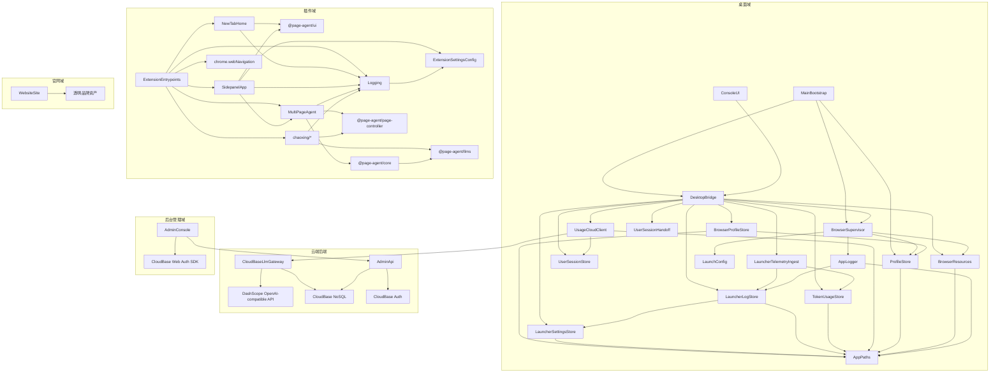

# 问学 WenXue — 架构文档（ARCHITECTURE）

> 模块、依赖、契约、目录布局的**唯一权威**。新增/重命名/移动模块或调整依赖方向，必须先改本文，再改代码（同一个 commit）。
> 上游：`PRD.md`（行为）。本文不重复需求，只回答"怎么拆"。

## 0. 阅读指引

§1 定义名词与系统不变量（I1–I5，排查问题时引用）；§2 用卡片定义每个模块的边界（"不负责"是边界的灵魂）；§3 锁定依赖方向与跨模块签名；§4–§6 回答数据、测试、目录的归属。写代码前先在 §2/§3 里找到改动的归属，找不到就先改本文。基础设施（CfT 供应链、打包、CI、签名）的权威是同目录 `TECH-INFRA.md`，分工见 §9。

## 1. 领域模型（Domain Model）

### 1.1 实体

| 实体                     | 关键字段                                                                                                                                                                                  | 关系                                                                                | 持久化与生命周期                                                                                                                                                   |
| ------------------------ | ----------------------------------------------------------------------------------------------------------------------------------------------------------------------------------------- | ----------------------------------------------------------------------------------- | ------------------------------------------------------------------------------------------------------------------------------------------------------------------ |
| BrowserProfile           | id（目录名）、displayName、type、colorKey、createdAt、lastUsedAt、userDataDir                                                                                                             | 1:1 → 画像目录；1:0/1 → 运行中的浏览器实例（瞬态）                                  | 是：元数据 `<userData>/browsers.json` + 磁盘目录 `<userData>/profiles/<id>`                                                                                        |
| BrowserRuntimeDescriptor | version、platform、binaryPath                                                                                                                                                             | 被 LaunchConfig / 版本查询消费                                                      | 是：打包资源 + `apps/desktop/browser.lock.json`，随 App 发版变更                                                                                                   |
| ModelConfig              | selectedModelId、customModels[]（id、provider、providerName?、baseURL、apiKey、model）、运行时 llmConfig（baseURL、apiKey、model）、language、uiLanguage、logRetentionDays、logMaxEntries | 被 Agent 循环、插件 UI 与 Logging 消费                                              | 是：`chrome.storage.local`；自定义 BYO-Key 模型 Key 仅本机，内置模型只存网关 baseURL / 空 apiKey，运行时注入插件侧用户 access token；不再保留内置本地直连兜底      |
| AgentTask                | id、instruction、status、startedAt、finishedAt                                                                                                                                            | 1:N → AgentActivity                                                                 | 是：插件 IndexedDB，用户可删                                                                                                                                       |
| AgentActivity            | taskId、type、payload、ts                                                                                                                                                                 | 属于 AgentTask                                                                      | 是：插件 IndexedDB，随任务删除                                                                                                                                     |
| QuickLink                | id、title、url、icon?                                                                                                                                                                     | 属于 NewTabHome 仪表盘                                                              | 是：chrome.storage.local（newtabQuickLinks，仅本机，I2）                                                                                                           |
| LogEntry                 | id、ts、level、source、context、browserId、message、data?                                                                                                                                 | 由插件各运行时产生，由 Logging / LauncherLogStore 管理                              | 插件侧 IndexedDB + 启动器侧 `<userData>/launcher-logs.json`；按保留天数与条数上限自动清理，用户可导出/清空                                                         |
| LauncherSettings         | launch、behavior、logs、kernel、本地资料等设置组                                                                                                                                          | 被启动器 UI、BrowserSupervisor、LauncherLogStore 消费                               | 是：`<userData>/settings.json`，即时保存                                                                                                                           |
| TokenUsageRecord         | id、ts、browserId?、uid?、model、inputTokens、outputTokens、totalTokens、estimatedCostCny?、latencyMs?                                                                                    | 由已脱敏日志遥测或 CloudBase LLM Gateway 计量生成                                   | 本地缓存：`<userData>/token-usage.json`；云端权威：`token_usage`；云端 uid 为 CloudBase 用户 id；均不包含提示词正文、API Key、access token、refresh token 或敏感头 |
| UserSession              | userId、accessToken、refreshToken、expiresAt、gatewayBaseUrl                                                                                                                              | 桌面登录后同步给主进程并交接扩展；扩展用 access token 调网关并用 refresh token 刷新 | 桌面主进程仅内存持有当前 session；插件 `chrome.storage.local` 的 `WenXueUserSession`；CloudBase Web SDK 负责桌面登录态持久化                                       |
| CloudTokenUsage          | \_id、ts、uid、model、inputTokens、outputTokens、totalTokens、latencyMs、createdAt                                                                                                        | 由 CloudBase LLM Gateway 从 DashScope usage 生成                                    | 是：CloudBase NoSQL `token_usage`；PRIVATE；不含正文、Key、Authorization/Bearer                                                                                    |
| UserAccount              | \_id/uid、active、firstSeenAt、lastSeenAt、createdAt、updatedAt、note?                                                                                                                    | 由后台管理系统/初始化控制用户是否可调用内置模型                                     | 是：CloudBase NoSQL `user_accounts`；`active=true` 才放行，`active=false` 禁止调用                                                                                 |
| AdminUser                | \_id(uid)、role、status、displayName?、createdAt?、updatedAt?                                                                                                                             | CloudBase Auth 内部账号对应的后台授权记录                                           | 是：CloudBase NoSQL `admin_users`；只有 active 管理员/查看者可访问 AdminApi                                                                                        |
| UserPermissionAudit      | \_id、uid、adminUid、before、after、reason?、createdAt                                                                                                                                    | 由 AdminApi 在用户状态调整时写入                                                    | 是：CloudBase NoSQL `user_permission_audit`；不含 access token、refresh token、提示词正文或厂商 Key                                                                |

### 1.2 派生概念（非持久化）

- **BrowserStatus 状态机**：`idle | launching | running | error`，由 BrowserSupervisor 对子进程事件归约，仅存于主进程内存，经 IPC 事件推送 UI。
- **DOM 快照**：page-controller 每轮 Agent 循环对页面的文本化表示，用完即弃。
- **版本三元组**（app / browser / extension）：由打包资源与 lock 文件即时计算。

### 1.3 不变量（任何模块都必须维护）

- **I1.** 同一画像目录同一时刻至多一个浏览器实例（BrowserSupervisor 状态机为主，CfT ProcessSingleton 兜底）。
- **I2.** 内置模型的用户提示词/对话经自有 CloudBase LLM Gateway 转发至百炼；网关只透传与计量，不持久化提示词/响应正文。厂商 API Key 仅存网关服务端环境变量，永不下发插件、桌面或打包产物；插件日志仍可在本机 IndexedDB 保存已脱敏的对话与 LLM 请求/响应正文。自定义 BYO-Key 模型维持本机直连。CloudBase 用户 access token 是内置网关凭据，仅允许在一次性 handoff 与网关 `Authorization` 头中使用；refresh token 仅允许用于插件刷新 session。API Key、`Authorization` 头、`Bearer` 凭据、access token 与 refresh token 绝不持久化到日志、tokens 记录或打包产物；进入桌面域、AdminApi 或云端计量的数据不得包含 API Key、敏感头、access token、refresh token 或提示词正文。
- **I3.** Demo 阶段桌面域与插件域无运行时控制通信。豁免仅限两类：插件域可通过 Chrome Native Messaging 向桌面域单向发送已脱敏日志 / tokens 遥测；启动器可经一次性 localhost `externally_connectable` 页面向插件域交接用户 session。桌面域禁止通过这些通道向 Agent 发送控制指令。
- **I4.** 插件域只经 OpenAI-compatible HTTP 接口调用 LLM；更换供应商/接入网关只允许改配置（baseURL/key/model），不允许改 Agent 核心代码。
- **I5.** vendor 的 `@page-agent/*` 四包保持上游包名、目录结构与版权头；任何本地改动必须登记 `UPSTREAM.md`（ROADMAP M1 建立）。

## 2. 模块清单

> 每个模块一张卡片。**"不负责"是卡片的灵魂**。按依赖层级从低到高排列（低层不依赖高层）。
> 系统分两个进程域：**桌面域**（Electron 主/渲染进程）与**插件域**（CfT 内的 MV3 扩展）。跨域无依赖边（I3）。

### 2.1 桌面域（apps/desktop）

#### Layer 0 — 基础设施

```
## 模块名：AppPaths
- 职责：集中定义 <userData> 下的目录布局（profiles/、logs/）并确保存在
- 不负责：不读写业务数据；不理解"画像/浏览器"语义
- 输入：Electron app.getPath('userData')
- 输出：所有上层模块
- 关键类型/接口：profilesRoot(): string · logsDir(): string
- 持有状态：无
```

```
## 模块名：AppLogger
- 职责：滚动文件日志（main.log、browser-<profile>.log），接管 CfT stdout/stderr，并把主进程系统事件镜像写入 LauncherLogStore
- 不负责：不上报云端；不解析 LLM 载荷；不记录敏感值（I2）
- 输入：各模块日志调用；BrowserSupervisor 转交的子进程流
- 输出：`<userData>/logs/`；`<userData>/launcher-logs.json` 的 system/background 事件
- 关键类型/接口：log(scope, level, msg) · attachStream(profileId, readable)
- 持有状态：文件句柄
```

#### Layer 1 — 资源定位（纯）

```
## 模块名：BrowserResources
- 职责：定位 CfT 二进制与插件构建产物；读 browser.lock.json 提供版本号
- 不负责：不下载（构建期脚本的事）；不校验完整性（M5 冒烟的事）；不 spawn
- 输入：process.resourcesPath（生产）/ .browsers 与 ../extension/.output（开发）
- 输出：LaunchConfig 调用方、BrowserSupervisor、版本查询
- 关键类型/接口：browserBinary(): string · extensionDir(): string · browserVersion(): string
- 持有状态：无（纯函数）
```

#### Layer 2 — 纯计算

```
## 模块名：LaunchConfig
- 职责：由 { userDataDir, extensionDir, startUrl?, debugPipe? } 组装 CfT argv
  （--load-extension、--no-first-run 等全集见 TECH-INFRA §4.3）
- 不负责：不触文件系统；不 spawn；不持状态
- 输入：调用方传入的路径参数
- 输出：string[]（给 BrowserSupervisor）
- 关键类型/接口：buildArgv(opts: LaunchOptions): string[]
- 持有状态：无。守护 I1/I3 的参数面（默认不开调试通道）
```

#### Layer 3 — 有状态服务

```
## 模块名：ProfileStore
- 职责：画像目录创建/枚举/定位（demo 仅 default，接口按多画像设计）
- 不负责：不管理画像内部内容（cookie/登录态归 CfT）；不删除画像
- 输入：AppPaths
- 输出：BrowserSupervisor、MainBootstrap
- 关键类型/接口：ensureProfile(id = 'default'): Promise<string> · listProfiles(): string[]
- 持有状态：无内存状态（磁盘即状态）
```

```
## 模块名：BrowserProfileStore
- 职责：持久化浏览器画像元数据（名称、颜色、时间、路径）并与 ProfileStore 目录对齐
- 不负责：不读取画像内部 cookie/登录态；不 spawn；不渲染 UI
- 输入：AppPaths、ProfileStore
- 输出：DesktopBridge、BrowserSupervisor 调用方、ConsoleUI
- 关键类型/接口：BrowserProfile · list · create · rename · touch
- 持有状态：`<userData>/browsers.json`
```

```
## 模块名：LauncherSettingsStore
- 职责：持久化启动默认值、启动器行为、日志策略、内核/关于可显示配置与本地资料
- 不负责：不直接应用设置副作用；不渲染表单
- 输入：AppPaths、ConsoleUI 的设置 patch
- 输出：BrowserSupervisor、LauncherLogStore、ConsoleUI
- 关键类型/接口：LauncherSettings · get · update
- 持有状态：`<userData>/settings.json`
```

```
## 模块名：LauncherLogStore
- 职责：启动器侧日志查询、清空、导出前数据读取、保留裁剪；承接单向插件日志遥测
- 不负责：不发起插件控制；不保存 API Key / Authorization / Bearer；不渲染日志 UI
- 输入：AppPaths、LauncherSettingsStore、AppLogger 系统事件、LauncherTelemetryIngest 的已脱敏日志批次
- 输出：DesktopBridge、ConsoleUI 日志页、TokenUsageStore 的用量提取源
- 关键类型/接口：LauncherLogEntry · LauncherLogFilter · query · append · clear · purge
- 持有状态：`<userData>/launcher-logs.json`；JSON 损坏时先改名为 `.corrupt-<timestamp>` 再重建空日志，日志页不得因单个坏文件持续崩溃
```

```
## 模块名：TokenUsageStore
- 职责：启动器侧本地 tokens 用量记录、按日期/画像/模型聚合与成本估算；作为云端用量读取失败时的本地兜底
- 不负责：不保存提示词正文；不执行计费扣费；不发起网络请求
- 输入：AppPaths、LauncherTelemetryIngest 从 LLM usage 提取的记录、单向 tokens 遥测或未来网关计量导入
- 输出：DesktopBridge、ConsoleUI tokens 页
- 关键类型/接口：TokenUsageRecord · TokenUsageSummary · summary · append
- 持有状态：`<userData>/token-usage.json`
```

```
## 模块名：UsageCloudClient
- 职责：用当前用户 access token 读取 CloudBase LLM Gateway 的 `/v1/usage/summary`，校验 `TokenUsageSummary`，按 userId 写入离线缓存
- 不负责：不写 `token_usage`；不保存厂商 API Key、access token、refresh token、uid 或敏感头到 summary 数据；不计算订阅/扣费
- 输入：AppPaths、UserSessionStore、CloudBaseLlmGateway
- 输出：DesktopBridge 的 `tokens:getSummary`
- 关键类型/接口：summary() -> Promise<TokenUsageSummary>
- 持有状态：`<userData>/token-usage-summary-cache.json`（按 userId 绑定的脱敏 summary）
```

```
## 模块名：UserSessionStore
- 职责：主进程内存持有当前 CloudBase 用户 session，校验必需字段，为浏览器启动、UsageCloudClient 与 handoff 提供 access/refresh token
- 不负责：不执行 CloudBase 登录/注册；不刷新远端会话；不保存厂商 API Key；不写日志或 tokens 记录
- 输入：ConsoleUI 经 DesktopBridge 同步的 UserSession
- 输出：DesktopBridge、UserSessionHandoff、UsageCloudClient 可用的 userId / accessToken / refreshToken / expiresAt / gatewayBaseUrl
- 关键类型/接口：setSession(session) · current() · requireSession() · clear()
- 持有状态：仅主进程内存
```

```
## 模块名：UserSessionHandoff
- 职责：创建一次性 localhost handoff 页面，把用户 session 经 `externally_connectable` 交给问学插件 background
- 不负责：不执行登录/刷新；不控制 Agent；不持久化提示词正文、API Key、access token 或 refresh token
- 输入：UserSessionStore 的当前会话、固定扩展 ID、BrowserSupervisor 打开的 URL
- 输出：DesktopBridge 的 handoff 成功/失败结果；插件 `WenXueUserSession`
- 关键类型/接口：run(session, openUrl) -> { ok, error? }
- 持有状态：单次 HTTP server 生命周期内的 nonce 与完成状态
```

```
## 模块名：LauncherTelemetryIngest
- 职责：接收单向遥测批次，校验 browserId，归一化日志字段，写入 LauncherLogStore，并从已脱敏 LLM usage 载荷提取 TokenUsageRecord
- 不负责：不注册 Native Messaging 宿主；不向插件回送控制命令；不保存提示词正文或 API Key
- 输入：Native Messaging 宿主或受控主进程入口传入的 `{ browserId, logs?, tokenUsage? }`
- 输出：LauncherLogStore、TokenUsageStore
- 关键类型/接口：LauncherTelemetryIngest.ingest(payload) -> { logs, tokenUsage }
- 持有状态：无
```

```
## 模块名：BrowserSupervisor
- 职责：按画像 spawn CfT、监听 exit/error、维护每个画像 idle→launching→running 状态机、崩溃通知（I1 执行者）；停止时先 SIGTERM，2s 未退出则 SIGKILL，5s 仍无退出事件标记 error
- 不负责：不组参数（LaunchConfig）；不定位资源（BrowserResources）；不渲染 UI
- 输入：LaunchConfig、BrowserResources、ProfileStore、AppLogger
- 输出：状态事件 → DesktopBridge
- 关键类型/接口：见 §3.2
- 持有状态：profileId → 子进程句柄 + BrowserStatus
```

#### Layer 4 — 桥接

```
## 模块名：DesktopBridge
- 职责：preload contextBridge + IPC 通道注册；渲染层访问主进程的唯一入口
- 不负责：不含业务逻辑（仅转译与入参校验）；不绕过 I2/I3 直接控制插件域
- 输入：BrowserSupervisor、BrowserProfileStore、LauncherLogStore、LauncherSettingsStore、LauncherTelemetryIngest、TokenUsageStore、UsageCloudClient、UserSessionStore、UserSessionHandoff、BrowserResources
- 输出：ConsoleUI（window.wenxue.*）
- 关键类型/接口：见 §3.2 IPC 契约
- 持有状态：无
```

#### Layer 5 — 展示

```
## 模块名：ConsoleUI
- 职责：React 启动器 App shell（侧栏路由、浏览器多开页、日志页、tokens 页、设置页）
- 不负责：不触 Node API；不写业务判断（仅消费状态、发送意图）
- 输入：DesktopBridge
- 输出：用户
- 关键类型/接口：无对外编程接口
- 持有状态：仅 UI 态
```

#### Layer 7 — 组装根

```
## 模块名：MainBootstrap
- 职责：app 生命周期（ready→建窗→注册 IPC→退出询问对话框），装配 L0–L4
- 不负责：不实现任何具体服务逻辑
- 输入：桌面域全部模块
- 输出：进程入口 apps/desktop/src/main/index.ts
- 持有状态：窗口句柄
```

### 2.2 云端后端（apps/llm-gateway + CloudBase）

```
## 模块名：CloudBaseLlmGateway
- 职责：CloudBase Run Function 模式的 OpenAI-compatible 网关；注册入口创建 CloudBase Auth externalUser 后同步创建 `user_accounts.active=true` 授权记录；introspect CloudBase Auth access token 并解析用户 uid；每次请求读取 `user_accounts` 并在请求 DashScope 前执行 active 鉴权；为流式 DashScope 请求注入 stream_options.include_usage；透传 SSE；提取 usage 与延迟并生成 uid 维度计量；提供当前用户 `/v1/usage/summary` 脱敏汇总
- 不负责：不持久化提示词/响应正文；不保存或返回 DashScope Key；不实现订阅/扣费；不提供管理员登录或管理 UI；M4 实时聚合不做 rollup 预计算
- 输入：插件 OpenAIClient 发来的 `/v1/chat/completions` 请求、UsageCloudClient 发来的 `/v1/usage/summary` 请求、桌面注册页发来的 `/v1/auth/register` 请求、CloudBase access token、服务端 DASHSCOPE_API_KEY / CLOUDBASE_USAGE_API_KEY / Tencent Cloud API 凭证环境变量
- 输出：DashScope SSE/JSON 原样回传；创建 CloudBase Auth 用户并写 `user_accounts`；读取 `user_accounts` 与写 `token_usage`；返回不含 uid/Key/敏感头的 `TokenUsageSummary`
- 关键类型/接口：handleLauncherRegistration · createCloudBaseExternalUser · buildDashScopeRequest · authorizeUserRequest · resolveCloudBaseUser · readUserAccount · extractUsageFromSseFrame · buildUsageRecord · handleUsageSummary · readUsageRecords · buildUsageSummary
- 持有状态：无业务授权缓存；部署态环境变量由 CloudBase Run 管理
```

```
## 模块名：AdminApi
- 职责：CloudBase Run Function 模式的后台管理 API；校验 CloudBase Auth 管理员 session；查询 `admin_users` 角色；读取 `token_usage` 聚合 tokens 看板；读取/更新 `user_accounts` 并写 `user_permission_audit`
- 不负责：不接受用户 access token 以外的管理登录；不转发 LLM；不保存提示词/响应正文；不下发 CloudBase API Key；不渲染后台 UI
- 输入：AdminConsole 发来的 CloudBase Auth bearer token、服务端 CloudBase 环境变量与 NoSQL 集合
- 输出：内部兼容 `/admin/v1/me`、`/admin/v1/usage/summary`、`/admin/v1/users`、`/admin/v1/users/status` JSON 响应；公网 HTTP 网关默认域名使用不与 `/admin` 页面前缀冲突的精确路由 `/api/admin/v1/me`、`/api/admin/v1/usage/summary`、`/api/admin/v1/users`、`/api/admin/v1/user-status`
- 关键类型/接口：resolveCloudBaseAdminIdentity · requireAdminUser · buildAdminUsageSummary · handleAdminRequest
- 持有状态：无；持久状态在 CloudBase NoSQL
```

### 2.3 插件域（apps/extension + packages/\*）

vendor 四包为上游快照（粗粒度卡片；内部实现以上游为准，本域约束是：不逆向依赖、不 reach into 内部实现、改动登记 UPSTREAM.md）：

```
## 模块名：@page-agent/ui（L0 视觉基座）
- 职责：共享 UI 基件与样式
- 不负责：业务与 Agent 逻辑
```

```
## 模块名：@page-agent/llms（L2）
- 职责：OpenAI-compatible LLM 客户端（流式、错误归一化）
- 不负责：不持久化配置；不做计费；不组提示词
- 关键类型/接口：OpenAIClient（I4 的唯一 LLM 出口）
```

```
## 模块名：@page-agent/page-controller（L3）
- 职责：DOM 文本化、动作执行（点击/输入/滚动/执行 JS）、执行结果结构化序列化（`serializeResult`）、模拟光标与遮罩、框架补丁（react/antd）
- 不负责：不调 LLM；不编排任务
```

```
## 模块名：@page-agent/core（L4）
- 职责：PageAgentCore Agent 循环（系统提示词、工具执行、`execute_javascript` 的 world/frame 参数、活动流、ExecutionResult、可恢复人工接管状态、完成后同会话续接、agent_history 投影压缩、recall_steps 回退取回）
- 不负责：不直接操作多标签（MultiPageAgent 的事）；不渲染历史 UI；不决定问学产品层卡住阈值
```

fork 应用层（apps/extension）：

```
## 模块名：ExtensionSettingsConfig（L4/纯配置）
- 职责：定义内置模型 ID、厂商预设、自定义厂商与自定义模型结构；归一化 selectedModelId/customModels；将设置页源数据解析为 Agent 可用的 llmConfig；在运行时把内置模型解析为 CloudBase Gateway baseURL + 用户 access token；定义并归一化插件日志保留配置
- 不负责：不读写 chrome.storage；不渲染 UI；不发 LLM 请求
- 输入：设置页表单值、chrome.storage 中的 ModelConfig、插件侧 `WenXueUserSession`
- 输出：ExtConfig / LLMConfig / RuntimeAgentModels
- 关键类型/接口：CustomModelConfig · ModelProviderPreset · resolveSelectedLLMConfig · normalizeCustomModels · buildSettingsConfig · buildRuntimeAgentModels · loadRuntimeAgentModels · logRetentionDays · logMaxEntries
- 持有状态：无（纯函数）
```

```
## 模块名：Logging（L4）
- 职责：定义日志类型与脱敏规则；为所有插件运行时提供统一 logger；由 background 作为 IndexedDB 单写入者完成追加、查询、导出、清空与自动清理；限定并记录 LLM fetch 请求/响应正文
- 不负责：不渲染日志 UI；不写桌面日志；不远程上报；不持久化 API Key、Authorization 或 Bearer；不修改 packages/*（I2/I3/I5）
- 输入：background / sidepanel / hub / newtab / content 的日志事件；ExtensionSettingsConfig 的 logRetentionDays/logMaxEntries；命中 LLM 端点的 fetch 请求与响应
- 输出：已脱敏 LogEntry；LOG_APPEND/LOG_QUERY/LOG_EXPORT/LOG_CLEAR 响应；启动器遥测出口的日志批次
- 关键类型/接口：LogEntry · LogFilter · logger.debug/info/warn/error · appendBatch · query · exportAll · clear · purge · handleLogControlMessage · installLlmFetchLogging（详见 §3.2）
- 持有状态：background 独占的 IndexedDB `page-agent-ext` v2 `logs` 对象库；非 background 上下文的瞬态发送批次
```

```
## 模块名：SidepanelApp（L5）
- 职责：侧边栏对话流、完成/错误后的 followUp 续接路由、近溢出上下文横幅、人工接管/暂停/继续 UI、右上角更多菜单、语言快捷入口、任务历史 UI、options 设置页 UI、自定义模型列表与默认模型选择
- 不负责：不实现 Agent 循环；不直接发 LLM 请求
- 输入：MultiPageAgent、ExtensionSettingsConfig、@page-agent/ui
- 输出：用户
- 持有状态：UI 态；读写 ModelConfig（chrome.storage.local）与按 conversationId upsert 的会话历史（IndexedDB）
```

```
## 模块名：LogViewer（L5 / legacy）
- 职责：历史插件内日志查看器组件；M3.5 后不再挂载到 SettingsForm，查看入口迁移到桌面启动器日志页
- 不负责：不作为当前产品入口；不直接访问 IndexedDB；不执行脱敏或保留策略；不向桌面域或远程发送日志
- 输入：无活跃入口；组件文件暂留供回滚参考
- 输出：无活跃输出
- 关键类型/接口：LogViewer · LogFilter
- 持有状态：筛选条件、分页游标、当前详情与加载/错误 UI 态
```

```
## 模块名：NewTabHome（L5）
- 职责：接管新标签页；首次 onboarding、快捷入口仪表盘（增删改排序）、设置/刷新入口、白底同步滑入动效
- 不负责：不实现 Agent 循环 / 不发 LLM 请求 / 不收集 API Key / 不跨域调用桌面端
- 输入：chrome.storage.local（QuickLink、newtabOnboardingDone）、@page-agent/ui、openExtensionOptionsPage
- 输出：用户；经 chrome.tabs 打开站点
- 持有状态：UI 态；读写 QuickLink 与 onboarding 标志
```

```
## 模块名：MultiPageAgent（L5）
- 职责：多标签编排、当前标签加载等待、向 PageAgentCore 透传压缩配置、问学产品层卡住检测（连续 3 次重复动作触发人工接管，done/ask_user/request_user_takeover/recall_steps 不计入重复）
- 不负责：不渲染 UI
- 输入：@page-agent/core、@page-agent/page-controller
- 输出：SidepanelApp
- 持有状态：运行中任务
```

```
## 模块名：chaoxing/*（L5）
- 职责：学习通作业/考试求解器。solve.ts 智能域编排「读题→并发 LLM 生成结构化答案→回填→翻页→汇总」；
  adapter.content.ts 内容脚本持有学习通 DOM 读取/回填，经与 RemotePageController 同传输的 RPC 与智能域通信；
  工具经 customTools 注入，向 Agent 暴露单一高层工具 chaoxing_solve
- 不负责：不自动提交（交卷由用户完成）；不绕过登录/验证码/人脸识别/字体反爬等任何防护；不改 vendor packages/*（I5）
- 输入：@page-agent/llms（仅 zodToOpenAITool）、RemotePageController、学习通页面 DOM
- 输出：经 customTools 注入 ExtensionEntrypoints 的 Agent 工具集
- 关键类型/接口：createChaoxingTools(deps) → chaoxing_solve · extractQuestions / fillAnswers / gotoNextPage
- 持有状态：单次求解的运行中流水线状态
```

```
## 模块名：ExtensionEntrypoints（L6/组装根）
- 职责：background service worker、content scripts、main-world 注入、sidepanel/hub/options 页面入口的装配与消息路由、按 frameId 路由 PAGE_CONTROL、main-world JS 执行通道、`webNavigation` frame 发现、`list_frames` 工具、newtab 页面装配；接收 localhost `WENXUE_USER_SESSION` 外部消息并保存插件侧用户 session
- 不负责：业务决策
- 持有状态：会话级路由表
```

### 2.4 后台管理域（apps/admin）

后台管理域是公网 Web 前端，只消费 AdminApi 和 CloudBase Web Auth；它不直接访问 CloudBase NoSQL，也不接触用户 access token / refresh token 原文以外的业务凭据。

```
## 模块名：AdminConsole
- 职责：内部后台登录页、受保护路由、tokens 看板、用户列表与状态调整表单
- 不负责：不直接读写 `token_usage` / `user_accounts` / `admin_users`；不持久化管理员密码；不调用 LLM；不接收机器 token 登录
- 输入：CloudBase Web Auth username/password session、AdminApi JSON 响应
- 输出：公网后台静态站点；主入口为 CloudBase HTTP 网关默认域名 `/admin`；当前由 CloudBase Run 静态容器 `wenxue-admin-web` 提供，避免共享静态托管域返回 attachment 头
- 关键类型/接口：signInWithPassword · getSession · adminApiFetch · AdminDashboard
- 持有状态：浏览器 local auth session 与 UI 态
```

### 2.5 官网域（apps/website）

官网域是静态前端站点，与桌面域、插件域均无运行时依赖边；它只消费公开产品叙事、品牌资产与下载链接。

```
## 模块名：WebsiteSite
- 职责：问学对外官网首页与文档页体验；首屏 DotField 品牌背景、VariableProximity 主标题 hover、React Bits 官网 `ln-navbar` 风格固定导航（默认透明任务栏，滚动后收束成悬浮胶囊；左侧透明 slogan 无底图 + Docs，右侧下载 + GitHub，无中英切换入口）、浏览器 hero 演示、下载 CTA 与三栏文档站（hash 子页 / 左侧固定大目录 / 中间 README 式正文 / 右侧固定章节目录）
- 不负责：不启动浏览器；不注入插件；不存储 API Key；不调用 LLM；不读取插件/桌面本地数据
- 输入：透明品牌资产、静态文案、构建期环境变量或静态下载链接（后续 CloudBase 托管时接入）
- 输出：静态 HTML/CSS/JS 站点（CloudBase 静态托管目标）
- 关键类型/接口：无跨运行时接口；React + motion 组件仅持有本页交互状态
- 持有状态：仅浏览器内瞬态 UI 状态（演示步骤、演示任务选项、语言与页面视图）
```

## 3. 依赖图（DAG）



> 桌面域与插件域无运行时控制边（I3）；当前仅允许用户 session 的一次性 handoff 和已脱敏遥测豁免。云端后端通过 OpenAI-compatible HTTPS 契约服务插件内置模型，不依赖插件实现细节；后台管理域只依赖 CloudBase Web Auth 与 AdminApi，不直接读写 NoSQL；官网域也不连接任一运行时域。vendor 包之间的内部边以上游 package.json 为准（图中仅画已确认的 core→llms）；我们自己的代码不得新增指向 vendor 包私有实现的边。`chaoxing/*` 指向 `@page-agent/llms` 的边仅消费其公开导出 `zodToOpenAITool`（不 reach into 私有实现，I5）；指向 `@page-agent/page-controller` 的边表示其内容脚本 RPC 与 `RemotePageController` 同传输（该传输属 page-controller 层）。`chrome.webNavigation` 是浏览器外部 API，仅供 ExtensionEntrypoints 发现 frame 元数据。手工验证：所有箭头自高层指向低层，无环。

### 3.1 依赖方向规则

- 高层依赖低层；**反向依赖一律禁止**，需要时用接口/回调倒置。
- 跨模块只走 §3.2 声明的接口契约，不 reach into 内部实现。

### 3.2 跨模块接口契约（写代码时必须遵守的签名）

```ts
// module: DesktopBridge —— IPC 通道（渲染层唯一入口；通道上禁止出现插件域数据，I2/I3）
//   browser:launch         invoke () => Promise<{ ok: boolean; error?: string }>  // 需已登录；幂等，保证 I1
//   browser:getStatus      invoke () => BrowserStatus                             // 'idle'|'launching'|'running'|'error'
//   browser:getStatuses    invoke () => Record<string, BrowserStatus>
//   browser:listProfiles   invoke () => Promise<BrowserProfile[]>
//   browser:addProfile     invoke () => Promise<{ ok: boolean; profile?: BrowserProfile; error?: string }>
//   browser:renameProfile  invoke (id: string, displayName: string) => Promise<{ ok: boolean; profile?: BrowserProfile; error?: string }>
//   browser:duplicateProfile invoke (id: string) => Promise<{ ok: boolean; profile?: BrowserProfile; error?: string }>
//   browser:removeProfile  invoke (id: string) => Promise<{ ok: boolean; profile?: BrowserProfile; error?: string }>
//   browser:openProfileFolder invoke (id: string) => Promise<{ ok: boolean; error?: string }>
//   browser:launchProfile  invoke (id: string) => Promise<{ ok: boolean; error?: string }>
//                            // 需已登录；启动/聚焦时自动 handoff UserSession 给插件
//   browser:stopProfile    invoke (id: string) => Promise<{ ok: boolean; error?: string }>
//   browser:status-changed event  (status: BrowserStatus)                         // main → renderer
//   browser:profile-status-changed event ({ profileId, status })                   // main → renderer
//   app:getVersions        invoke () => { app: string; browser: string; extension: string }
//   app:getShellInfo       invoke () => { platform: NodeJS.Platform; frameless: boolean; hasSystemTrafficLights: boolean; isMaximized: boolean }
//   app:openLogs           invoke () => Promise<{ ok: boolean; error?: string }>  // 打开本机日志目录，不传插件域数据
//   app:minimizeWindow     invoke () => Promise<{ ok: boolean; error?: string }>
//   app:toggleMaximizeWindow invoke () => Promise<{ ok: boolean; error?: string }>
//   app:requestClose       invoke () => Promise<{ ok: boolean; error?: string }>  // 触发 MainBootstrap 关闭策略
//   logs:query             invoke (filter?: LauncherLogFilter) => Promise<LauncherLogEntry[]>
//   logs:clear             invoke () => Promise<{ ok: boolean; error?: string }>
//   settings:get           invoke () => Promise<LauncherSettings>
//   settings:update        invoke (patch: DeepPartial<LauncherSettings>) => Promise<{ ok: boolean; settings?: LauncherSettings; error?: string }>
//   telemetry:ingest       invoke (payload: unknown) => Promise<{ ok: boolean; result?: { logs: number; tokenUsage: number }; error?: string }>
//                            // 主进程受控入口；preload 不暴露给 renderer；后续 Native Messaging host 复用同一校验逻辑
//   tokens:getSummary      invoke () => Promise<TokenUsageSummary>
//                            // 需已登录；优先读 CloudBaseLlmGateway `/v1/usage/summary`；失败时回退本地 TokenUsageStore
//   auth:setSession        invoke (session: UserSession) => Promise<{ ok: boolean; session?: PublicUserSession; error?: string }>
//   auth:getSession        invoke () => Promise<{ ok: boolean; session?: PublicUserSession; error?: string }>
//   auth:clearSession      invoke () => Promise<{ ok: boolean; error?: string }>
//                            // Main 仅内存持有 session；renderer 通过 CloudBase Web SDK 登录/注册/刷新

// module: BrowserSupervisor
//   launch(profileId = 'default', opts?: { startUrl?: string }): Promise<void>
//   // I1：running 时不二次 spawn，转为聚焦；startUrl 来自 LauncherSettingsStore
//   stop(profileId: string): Promise<void>
//   status(): BrowserStatus                             // 聚合状态：任一 running/launching/error 优先
//   statuses(): Record<string, BrowserStatus>
//   onStatusChange(cb: (s: BrowserStatus) => void): () => void
//   onProfileStatusChange(cb: (profileId: string, s: BrowserStatus) => void): () => void
//   requestShutdown(): Promise<void>                    // 仅响应用户"退出时一并关闭"的选择，关闭全部运行画像

// module: LaunchConfig（纯函数）
//   buildArgv(opts: { userDataDir: string; extensionDir: string;
//                     startUrl?: string; debugPipe?: boolean }): string[]
//   // debugPipe 仅冒烟测试可为 true（TECH-INFRA §4.3）

// module: BrowserResources（纯函数）
//   browserBinary(): string
//   extensionDir(): string
//   browserVersion(): string        // 读 browser.lock.json

// module: ProfileStore
//   ensureProfile(id = 'default'): Promise<string>      // 返回 userDataDir 绝对路径
//   listProfiles(): string[]

// module: Logging —— background 是 page-agent-ext/logs 的唯一写入者
//   type LogLevel = 'debug' | 'info' | 'warn' | 'error'
//   type LogContext = 'background' | 'sidepanel' | 'hub' | 'newtab' | 'content'
//   interface LogEntry {
//     id?: number; ts: number; level: LogLevel; source: string;
//     context: LogContext; message: string; data?: unknown
//   }
//   interface LogFilter {
//     levels?: LogLevel[]; sources?: string[]; sinceTs?: number; untilTs?: number;
//     text?: string; limit?: number; beforeId?: number
//   }
//   logger.debug/info/warn/error(source, message, data?): void
//     // background 上下文 direct → logStore；其余上下文 message → LOG_APPEND
//   appendBatch(entries: LogEntry[]): Promise<void>
//   query(filter: LogFilter): Promise<LogEntry[]>
//   exportAll(filter?: LogFilter): Promise<LogEntry[]>
//   clear(): Promise<void>
//   purge(config: { retentionDays: number; maxEntries: number }): Promise<void>
//   installLlmFetchLogging(): () => void                // 返回卸载函数；仅拦截 LLM 端点
//
//   chrome.runtime 消息契约（仅插件域，禁止桥接桌面域，I3）：
//   LOG_APPEND  request { entries: LogEntry[] }        response { ok: boolean }
//   LOG_QUERY   request { filter: LogFilter }           response { ok: boolean; entries?: LogEntry[]; error?: string }
//   LOG_EXPORT  request { filter?: LogFilter }          response { ok: boolean; entries?: LogEntry[]; error?: string }
//   LOG_CLEAR   request {}                              response { ok: boolean; error?: string }
//   // 四类消息均由 background 的 log.background 分派；只有 LOG_APPEND 可写入 logs。

// module: 插件域对 vendor 的消费面（签名以上游 1.9.x 为准，本地变更先登记 UPSTREAM.md，I5）
//   PageAgentCore.status: 'idle' | 'running' | 'waiting_for_user' | 'paused' | 'completed' | 'error'
//   PageAgentCore.execute(instruction): Promise<ExecutionResult>
//   PageAgentCore.followUp(instruction): Promise<ExecutionResult>
//     // 仅 completed/error；保留 history 并追加 user_message，作为同一会话下一轮继续
//   PageAgentCore.restoreConversation({ task, history, status }): void
//     // 仅 completed/error 历史；供 SidepanelApp 从 IndexedDB 记录恢复后继续 followUp
//   PageAgentCore.requestUserTakeover(input, { signal? }): Promise<'completed' | 'paused'>
//   PageAgentCore.resume(): Promise<ExecutionResult>    // 仅 paused；保留 task/taskId/history/内部状态
//   AgentConfig.compaction?: {
//     enabled: boolean; softTokens: number; hardTokens: number; keepRecentSteps: number
//   }
//     // 默认 enabled=true, softTokens=12000, hardTokens=28000, keepRecentSteps=5
//   HistoricalEvent +=
//     | { type: 'user_message'; content: string }
//     | { type: 'summary'; content: string; coversThroughIndex: number }
//   tool recall_steps({ indices: number[] }): Promise<string>
//     // 根据 stepIndex 从全量 history 取回归档步骤原文，供摘要不足时回退/重做
//   tool execute_javascript({ script, world?, frame_id? }): Promise<string>
//     // world 默认 isolated；frame_id 由 extension 的 list_frames 发现，缺省为 top frame
//   new OpenAIClient({ baseURL, apiKey, model })        // I4：插件域唯一 LLM 出口

// module: CloudBaseLlmGateway —— CloudBase Run Function mode
//   POST /v1/chat/completions
//     headers.Authorization = Bearer <CloudBase accessToken>
//     body = OpenAI-compatible chat completion payload
//     stream=true 时必须向 DashScope 注入 stream_options.include_usage=true
//     请求 DashScope 前必须 introspect CloudBase Auth token，并读取 user_accounts 检查 active=true
//     response = DashScope SSE/JSON passthrough
//     usage record = { uid, model, inputTokens, outputTokens, totalTokens, latencyMs, createdAt }
//     usage record 禁止包含 prompt/content/API Key/Authorization/Bearer/accessToken/refreshToken
//   GET /v1/usage/summary
//     headers.Authorization = Bearer <CloudBase accessToken>
//     response = TokenUsageSummary（browserId 固定 cloud；recent.id 不含 uid）
//     response 禁止包含 uid/prompt/content/API Key/Authorization/Bearer/accessToken/refreshToken
//
// module: AdminApi —— CloudBase Run Function mode
//   公网默认 HTTP 网关精确路由：
//     /api/admin/v1/me
//     /api/admin/v1/usage/summary
//     /api/admin/v1/users
//     /api/admin/v1/user-status
//   内部兼容 /admin/v1/* triggerPath；不得在默认域名下把 AdminApi 放到 /admin/v1/*，
//   因为 /admin 页面路由会按前缀捕获。
//   所有 AdminApi 请求：
//     headers.Authorization = Bearer <CloudBase Auth access_token>
//     服务端先 introspect CloudBase Auth token，再读取 admin_users[_id=uid]
//     仅 status=active 的 admin/viewer 可读取；只有 role=admin 可改用户状态
//   GET /api/admin/v1/me
//     response = { uid, role, displayName? }
//   GET /api/admin/v1/usage/summary
//     response = { totals, byDay, byModel, byUser, recent, userStatus }
//     response 禁止包含 uid 原文以外的敏感头、prompt/content/API Key/Authorization/Bearer/accessToken/refreshToken
//   GET /api/admin/v1/users
//     query.status? = active|disabled · query.q? = uid 片段 · query.limit?
//     response = { users: UserAccountView[] }
//   PATCH /api/admin/v1/user-status
//     body = { uid, status?, note?, reason? }
//     response = { user: UserAccountView }
//     side effect = update user_accounts + insert user_permission_audit
```

## 4. 持久化与边界

| 数据                                          | 位置                                                                                                                                      | 谁写                                                                     | 边界约束                                                                                                                                                                                       |
| --------------------------------------------- | ----------------------------------------------------------------------------------------------------------------------------------------- | ------------------------------------------------------------------------ | ---------------------------------------------------------------------------------------------------------------------------------------------------------------------------------------------- |
| 画像数据（cookie、登录态、浏览记录）          | `<userData>/profiles/<id>/`                                                                                                               | 仅 CfT 进程                                                              | 桌面端只创建目录，永不读内容                                                                                                                                                                   |
| 画像元数据                                    | `<userData>/browsers.json`                                                                                                                | BrowserProfileStore                                                      | 只含名称、颜色、时间、目录路径，不含 cookie/登录态                                                                                                                                             |
| 启动器设置                                    | `<userData>/settings.json`                                                                                                                | LauncherSettingsStore                                                    | 即时保存；不得包含 API Key                                                                                                                                                                     |
| 运行日志                                      | `<userData>/logs/`                                                                                                                        | AppLogger                                                                | 不含 Key/对话内容（I2）；主进程系统事件同时镜像到启动器日志                                                                                                                                    |
| 启动器日志                                    | `<userData>/launcher-logs.json`                                                                                                           | LauncherLogStore / AppLogger / LauncherTelemetryIngest                   | 仅保存已脱敏日志；支持 browserId 归类、保留裁剪、清空与导出；桌面侧二次清洗敏感键但保留 token 计数字段；坏 JSON 自动隔离为 `.corrupt-<timestamp>` 后重建空文件                                 |
| tokens 用量                                   | `<userData>/token-usage.json`                                                                                                             | TokenUsageStore / LauncherTelemetryIngest                                | 仅保存 tokens 数量、模型、画像、时间与估算成本；不含提示词正文或敏感头                                                                                                                         |
| 云端 tokens summary 缓存                      | `<userData>/token-usage-summary-cache.json`                                                                                               | UsageCloudClient                                                         | 按 userId 绑定；只保存已脱敏 `TokenUsageSummary`，不保存 access token、refresh token、uid 到 summary、正文或敏感头                                                                             |
| ModelConfig（含每个自定义模型自己的 API Key） | `chrome.storage.local`                                                                                                                    | SidepanelApp options 设置页与语言快捷入口                                | 自定义 BYO-Key 不出本机；内置模型只保存网关 baseURL 与空 apiKey，不保存百炼 Key；`selectedModelId` + `customModels[]` 为设置页源数据；历史 `WenXueUseLocalBuiltinLlmFallback` 标志被运行时忽略 |
| 用户 session                                  | 主进程内存；插件 `chrome.storage.local` 的 `WenXueUserSession`                                                                            | ConsoleUI / UserSessionStore / UserSessionHandoff / ExtensionEntrypoints | 仅作为调网关凭据；不得在桌面设置页展示/复制 token；不得写入日志、tokens 记录或打包产物；refresh token 仅用于插件刷新 session                                                                   |
| DashScope API Key                             | CloudBase Run 环境变量 `DASHSCOPE_API_KEY`                                                                                                | CloudBaseLlmGateway                                                      | 仅服务端读取；不得返回给客户端、写入日志、写入仓库或本地配置                                                                                                                                   |
| 云端 tokens 计量                              | CloudBase NoSQL `token_usage`                                                                                                             | CloudBaseLlmGateway / usage-summary target                               | 原始计量仅用户 uid、模型、tokens、时间、延迟；summary 返回前移除 uid；不含正文、Key、Authorization/Bearer/accessToken/refreshToken                                                             |
| 用户账号权限                                  | CloudBase NoSQL `user_accounts`                                                                                                           | AdminApi / 内部初始化                                                    | 网关优先读取 active；只有 active=true 可调用内置模型；AdminApi 可改 active/note                                                                                                                |
| 后台管理员授权                                | CloudBase NoSQL `admin_users`                                                                                                             | 手动初始化 / AdminApi 读取                                               | `_id` 等于 CloudBase Auth uid；只有 active admin/viewer 可访问 AdminApi；不保存密码，密码由 CloudBase Auth 管理                                                                                |
| 用户权限审计                                  | CloudBase NoSQL `user_permission_audit`                                                                                                   | AdminApi                                                                 | 每次状态调整写 before/after/adminUid/reason/createdAt；不含提示词正文、access token、refresh token、API Key 或敏感头                                                                           |
| 任务历史                                      | 插件 IndexedDB `page-agent-ext` v3：`sessions`（`id`、`conversationId`、`createdAt`、`updatedAt`，索引 `by-created` / `by-conversation`） | SidepanelApp                                                             | 不出本机；同一会话多轮续接按 `conversationId` upsert 为一条记录；用户可清空                                                                                                                    |
| 插件日志                                      | IndexedDB `page-agent-ext` v3：`logs`（`id` 自增，`by-ts` 索引）；与 `sessions` 同库                                                      | 仅 background Logging 写；启动器日志页接管查看入口                       | 已脱敏的对话/LLM 正文可保存；Key/Authorization/Bearer 禁止入库；默认 3 天、5000 条，按 `logRetentionDays`/`logMaxEntries` 自动清理；可通过单向遥测进入桌面域                                   |
| 快捷入口与 onboarding 标志                    | chrome.storage.local                                                                                                                      | NewTabHome                                                               | 不出本机（I2）；newtabQuickLinks 为非敏感书签数据                                                                                                                                              |
| browser.lock.json                             | 仓库 `apps/desktop/`                                                                                                                      | 开发者（升级 CfT 时）                                                    | 构建期消费，运行期只读                                                                                                                                                                         |
| 官网演示 UI 状态                              | 浏览器内存                                                                                                                                | WebsiteSite                                                              | 仅本页交互演示，不持久化、不出网                                                                                                                                                               |

出网边界：内置模型路径为插件域 → CloudBaseLlmGateway → DashScope；自定义 BYO-Key 路径仍为插件域 → 用户配置的 LLM baseURL（HTTPS）。桌面域仅在用量读取里访问 CloudBaseLlmGateway；后台管理域仅访问 CloudBase Web Auth 与 AdminApi；CfT 自身的浏览流量属用户行为，不在系统边界内。

## 5. 测试边界

- **必有单测（vitest）**：LaunchConfig（argv 组装全分支）、BrowserResources（路径解析，mock resourcesPath）、ProfileStore、BrowserSupervisor 状态机（mock child_process）。
- **vendor 四包**：上游测试套件随包保留，`pnpm -r test` 必绿；对 vendor 的本地补丁必须配套回归测试。`@page-agent/core` 的续接/压缩补丁需覆盖 `user_message`、`followUp`、历史投影、摘要降级、`recall_steps`、硬阈值淘汰与恢复历史后续接。
- **SidepanelApp 会话续接**：`useAgent` 覆盖 execute/followUp/restoreConversation 的状态同步，`db` 覆盖 v1/v2→v3 迁移与 `conversationId` upsert，`ContextBanner` 覆盖近溢出判定与横幅文案。
- **启动器 App 化新增单测**：BrowserProfileStore 持久化与目录对齐；BrowserSupervisor 多画像并行与同画像 I1；DesktopBridge 新 IPC 契约；LauncherTelemetryIngest 日志/tokens 导入与二次清洗；窗口外壳选项纯函数。
- **UserSessionStore / UserSessionHandoff / UsageCloudClient**：覆盖 session 字段校验、未登录拒绝启动/云端 summary、按 userId 读取与缓存云端 summary、云端失败时读同 userId 缓存、一次性 localhost handoff 成功/失败与重复完成保护。
- **插件 Logging**：`logRedaction` 覆盖 API Key/Authorization/Bearer 深度脱敏及超长/base64 截断；`logStore` 覆盖 v1/v2→v3 升级、追加、筛选、导出、清空、按时间与最旧优先裁剪；`logger` 覆盖 background direct 与其他上下文 message 路由及批量刷新；`loggingFetch` 覆盖 LLM URL 匹配、非 LLM 透传、流式响应不受破坏与正文脱敏。
- **CloudBaseLlmGateway**：TDD 覆盖 token 缺失拒绝、CloudBase access token introspection、无 user_accounts/disabled 时请求 DashScope 前拒绝、active 用户放行、流式请求注入 `stream_options.include_usage`、SSE 末块 usage 解析、计量记录无正文/Key/敏感头。
- **AdminApi / AdminConsole**：AdminApi 覆盖未登录/非 admin_users/禁用账号拒绝、viewer 只读、admin 可调整用户状态、tokens 聚合总数等于明细求和、响应不含敏感字段；AdminConsole 至少通过 `tsc --noEmit` 与 `vite build`，登录页/看板/用户状态表单需手动或浏览器 smoke 验证。
- **LogViewer legacy**：不再作为活跃入口；后续删除组件文件时需确保启动器日志页与 telemetry ingest 已覆盖查看/导出/清空链路。
- **集成/真环境**：打包产物的"启动 + 注入"CDP 冒烟（TECH-INFRA §8.3）；双平台干净机器安装验收；真实 LLM 调用（演示前人工走查）。
- **仅手动**：ConsoleUI、SidepanelApp 的视觉与交互（按 `UIUX.md` 与 PRD 验收标准）。

## 6. 目录结构（与 §2 模块清单一一对应）

```
WenXue/
├── apps/
│   ├── desktop/                     # 桌面域
│   │   ├── src/main/                # AppPaths · AppLogger · BrowserResources · LaunchConfig
│   │   │                            #   · ProfileStore · BrowserProfileStore · LauncherSettingsStore
│   │   │                            #   · LauncherLogStore · LauncherTelemetryIngest · TokenUsageStore · UsageCloudClient · UserSessionStore · UserSessionHandoff · BrowserSupervisor · MainBootstrap
│   │   ├── src/preload/             # DesktopBridge（preload 侧）
│   │   ├── src/renderer/            # ConsoleUI（含 strings.ts 文案）
│   │   ├── scripts/                 # fetch-browser.ts / smoke-launch.ts（构建工具，非运行时模块）
│   │   ├── browser.lock.json        # BrowserRuntimeDescriptor 版本来源
│   │   └── electron-builder.yml
│   ├── extension/                   # 插件域 fork：SidepanelApp · MultiPageAgent · Logging · chaoxing/* · ExtensionEntrypoints
│       ├── src/entrypoints/         # background / content / main-world / sidepanel / hub / newtab
│       ├── src/agent/chaoxing/      # chaoxing/*：solve.ts · adapter.content.ts · tools.ts（学习通求解器）
│       ├── src/components/
│       │   ├── LogViewer.tsx        # legacy：入口已下线，桌面启动器日志页接管
│       │   └── ContextBanner.tsx    # 侧边栏近溢出上下文提示横幅
│       └── src/lib/
│           ├── logTypes.ts          # LogEntry / LogFilter / LOG_* 消息类型
│           ├── logRedaction.ts      # Key/Authorization/Bearer 脱敏与正文截断
│           ├── logger.ts            # 统一 logger、批量与 direct/message 路由
│           ├── logStore.ts          # background IndexedDB 读写与 retention
│           ├── log.background.ts    # LOG_APPEND/QUERY/EXPORT/CLEAR 分派
│           ├── loggingFetch.ts      # LLM fetch 请求/响应正文捕获
│           ├── userSession.ts       # 插件侧用户 session 存储与刷新
│           ├── runtimeModelConfig.ts # 内置模型运行时解析：gateway 用户 access token 注入；旧 fallback 标志忽略
│           └── db.ts                # page-agent-ext v3：sessions/by-conversation + logs/by-ts
	│   ├── llm-gateway/                 # 云端后端：CloudBaseLlmGateway（CloudBase Run Function mode）
	│   │   ├── cloudbase-functions.json # /v1/chat/completions 函数型云托管入口
	│   │   ├── src/                     # 网关纯逻辑与 Function mode main
	│   │   └── scripts/                 # M0 真实流式验证脚本
	│   ├── admin-api/                   # 云端后端：AdminApi（CloudBase Run Function mode）
	│   │   ├── cloudbase-functions.json # /admin/v1/* 兼容入口 + /api/admin/v1 精确默认网关入口
	│   │   └── src/                     # 管理 API 纯逻辑、CloudBase store 与 Function mode target
	│   ├── admin/                       # 后台管理域：AdminConsole（CloudBase Web Auth + tokens 看板）
	│   │   ├── Dockerfile               # 静态 dist 的 CloudBase Run 容器入口
	│   │   ├── server.mjs               # 极小静态文件服务器，SPA fallback 到 index.html
	│   │   ├── src/
	│   │   └── public/
	│   └── website/                     # 官网域：WebsiteSite（DotField 首页、浏览器 hero、下载 CTA、三栏文档页）
│       ├── src/
│       │   ├── App.tsx
│       │   ├── DotField.tsx
│       │   ├── SiteNavbar.tsx
│       │   └── styles.css
│       └── public/assets/           # 官网消费的透明品牌资产
├── packages/                        # vendor：@page-agent/{ui, llms, page-controller, core}（I5）
├── third_party/page-agent/LICENSE   # 上游 MIT 协议与版权声明
├── .project.agents/                 # 治理（CLAUDE/AGENTS/约束/指南/log）
│   └── docs/context/                # PRD · ARCHITECTURE · TECH-INFRA · ROADMAP · CONVENTIONS · UIUX · UPSTREAM(M1)
├── pnpm-workspace.yaml
└── package.json
```

## 7. 自检（架构健康度三问）

1. 出 bug 了，能否 30 秒内指出"是哪个模块的责任"？
2. 整体替换模块 X，改动能否控制在 X 内部 + 一个接口适配层？
3. 加新功能，能否立刻说出它属于哪个模块、或要新增哪个模块？

## 8. 待办与已知技术负债

- **常设负债**：vendor 四包与上游 alibaba/page-agent 的漂移。约束：每次同步按 `UPSTREAM.md` 流程挑拣合入并更新快照记录（该文件由 ROADMAP M1 建立）。
- 代码尚未开始，暂无其他登记负债。未登记的负债 = 红线（SELF_CONSTRAINTS §F）。

## 9. 文档变更协议

- 加/删模块或改依赖方向 → 改本文 §2 + §3，同一 commit。
- 改对外签名 → 先改 §3.2，再改代码。
- 与 `PRD.md` 冲突 → 以 `PRD.md` 为准，回改本文。
- 与 `TECH-INFRA.md` 的分工：模块边界与依赖以本文为准；供应链、打包、CI、启动参数全集、签名公证以 `TECH-INFRA.md` 为准。
