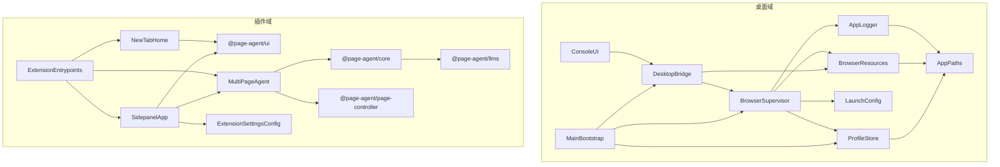

# 问学 WenXue — 架构文档（ARCHITECTURE）

> 模块、依赖、契约、目录布局的**唯一权威**。新增/重命名/移动模块或调整依赖方向，必须先改本文，再改代码（同一个 commit）。
> 上游：`PRD.md`（行为）。本文不重复需求，只回答"怎么拆"。

## 0. 阅读指引

§1 定义名词与系统不变量（I1–I5，排查问题时引用）；§2 用卡片定义每个模块的边界（"不负责"是边界的灵魂）；§3 锁定依赖方向与跨模块签名；§4–§6 回答数据、测试、目录的归属。写代码前先在 §2/§3 里找到改动的归属，找不到就先改本文。基础设施（CfT 供应链、打包、CI、签名）的权威是同目录 `TECH-INFRA.md`，分工见 §9。

## 1. 领域模型（Domain Model）

### 1.1 实体

| 实体                     | 关键字段                                                                                                                                                 | 关系                             | 持久化与生命周期                                                  |
| ------------------------ | -------------------------------------------------------------------------------------------------------------------------------------------------------- | -------------------------------- | ----------------------------------------------------------------- |
| BrowserProfile           | id（目录名，demo 固定 `default`）、dirPath、createdAt                                                                                                    | 1:N → 运行中的浏览器实例（瞬态） | 是：磁盘目录 `<userData>/profiles/<id>`，首次启动创建，删除即重置 |
| BrowserRuntimeDescriptor | version、platform、binaryPath                                                                                                                            | 被 LaunchConfig / 版本查询消费   | 是：打包资源 + `apps/desktop/browser.lock.json`，随 App 发版变更  |
| ModelConfig              | selectedModelId、customModels[]（id、provider、providerName?、baseURL、apiKey、model）、运行时 llmConfig（baseURL、apiKey、model）、language、uiLanguage | 被 Agent 循环与插件 UI 消费      | 是：`chrome.storage.local`（仅本机，I2）                          |
| AgentTask                | id、instruction、status、startedAt、finishedAt                                                                                                           | 1:N → AgentActivity              | 是：插件 IndexedDB，用户可删                                      |
| AgentActivity            | taskId、type、payload、ts                                                                                                                                | 属于 AgentTask                   | 是：插件 IndexedDB，随任务删除                                    |
| QuickLink                | id、title、url、icon?                                                                                                                                    | 属于 NewTabHome 仪表盘           | 是：chrome.storage.local（newtabQuickLinks，仅本机，I2）          |

### 1.2 派生概念（非持久化）

- **BrowserStatus 状态机**：`idle | launching | running | error`，由 BrowserSupervisor 对子进程事件归约，仅存于主进程内存，经 IPC 事件推送 UI。
- **DOM 快照**：page-controller 每轮 Agent 循环对页面的文本化表示，用完即弃。
- **版本三元组**（app / browser / extension）：由打包资源与 lock 文件即时计算。

### 1.3 不变量（任何模块都必须维护）

- **I1.** 同一画像目录同一时刻至多一个浏览器实例（BrowserSupervisor 状态机为主，CfT ProcessSingleton 兜底）。
- **I2.** API Key 与对话内容永不离开本机、永不经过桌面端进程：不得出现在 IPC 通道、主进程日志或除 `chrome.storage.local`/IndexedDB 之外的磁盘位置。
- **I3.** Demo 阶段桌面域与插件域零运行时通信；引入任何通道前必须先修改本文 §2/§3 并经评审。
- **I4.** 插件域只经 OpenAI-compatible HTTP 接口调用 LLM；更换供应商/接入网关只允许改配置（baseURL/key/model），不允许改 Agent 核心代码。
- **I5.** vendor 的 `@page-agent/*` 四包保持上游包名、目录结构与版权头；任何本地改动必须登记 `UPSTREAM.md`（ROADMAP M1 建立）。

## 2. 模块清单

> 每个模块一张卡片。**"不负责"是卡片的灵魂**。按依赖层级从低到高排列（低层不依赖高层）。
> 系统分两个进程域：**桌面域**（Electron 主/渲染进程）与**插件域**（CfT 内的 MV3 扩展）。跨域无依赖边（I3）。

### 2.1 桌面域（apps/desktop）

#### Layer 0 — 基础设施

```
## 模块名：AppPaths
- 职责：集中定义 <userData> 下的目录布局（profiles/、logs/）并确保存在
- 不负责：不读写业务数据；不理解"画像/浏览器"语义
- 输入：Electron app.getPath('userData')
- 输出：所有上层模块
- 关键类型/接口：profilesRoot(): string · logsDir(): string
- 持有状态：无
```

```
## 模块名：AppLogger
- 职责：滚动文件日志（main.log、browser-<profile>.log），接管 CfT stdout/stderr
- 不负责：不上报云端；不解析日志内容；不记录敏感值（I2）
- 输入：各模块日志调用；BrowserSupervisor 转交的子进程流
- 输出：<userData>/logs/
- 关键类型/接口：log(scope, level, msg) · attachStream(profileId, readable)
- 持有状态：文件句柄
```

#### Layer 1 — 资源定位（纯）

```
## 模块名：BrowserResources
- 职责：定位 CfT 二进制与插件构建产物；读 browser.lock.json 提供版本号
- 不负责：不下载（构建期脚本的事）；不校验完整性（M5 冒烟的事）；不 spawn
- 输入：process.resourcesPath（生产）/ .browsers 与 ../extension/.output（开发）
- 输出：LaunchConfig 调用方、BrowserSupervisor、版本查询
- 关键类型/接口：browserBinary(): string · extensionDir(): string · browserVersion(): string
- 持有状态：无（纯函数）
```

#### Layer 2 — 纯计算

```
## 模块名：LaunchConfig
- 职责：由 { userDataDir, extensionDir, startUrl?, debugPipe? } 组装 CfT argv
  （--load-extension、--no-first-run 等全集见 TECH-INFRA §4.3）
- 不负责：不触文件系统；不 spawn；不持状态
- 输入：调用方传入的路径参数
- 输出：string[]（给 BrowserSupervisor）
- 关键类型/接口：buildArgv(opts: LaunchOptions): string[]
- 持有状态：无。守护 I1/I3 的参数面（默认不开调试通道）
```

#### Layer 3 — 有状态服务

```
## 模块名：ProfileStore
- 职责：画像目录创建/枚举/定位（demo 仅 default，接口按多画像设计）
- 不负责：不管理画像内部内容（cookie/登录态归 CfT）；不删除画像
- 输入：AppPaths
- 输出：BrowserSupervisor、MainBootstrap
- 关键类型/接口：ensureProfile(id = 'default'): Promise<string> · listProfiles(): string[]
- 持有状态：无内存状态（磁盘即状态）
```

```
## 模块名：BrowserSupervisor
- 职责：spawn CfT、监听 exit/error、维护 idle→launching→running 状态机、崩溃通知（I1 执行者）
- 不负责：不组参数（LaunchConfig）；不定位资源（BrowserResources）；不渲染 UI
- 输入：LaunchConfig、BrowserResources、ProfileStore、AppLogger
- 输出：状态事件 → DesktopBridge
- 关键类型/接口：见 §3.2
- 持有状态：子进程句柄 + 当前 BrowserStatus
```

#### Layer 4 — 桥接

```
## 模块名：DesktopBridge
- 职责：preload contextBridge + IPC 通道注册；渲染层访问主进程的唯一入口（5 通道）
- 不负责：不含业务逻辑（仅转译与入参校验）；不出现插件域数据（I2/I3）
- 输入：BrowserSupervisor、BrowserResources
- 输出：ConsoleUI（window.wenxue.*）
- 关键类型/接口：见 §3.2 IPC 契约
- 持有状态：无
```

#### Layer 5 — 展示

```
## 模块名：ConsoleUI
- 职责：React 控制台（状态卡、启动按钮、版本 footer）
- 不负责：不触 Node API；不写业务判断（仅消费状态、发送意图）
- 输入：DesktopBridge
- 输出：用户
- 关键类型/接口：无对外编程接口
- 持有状态：仅 UI 态
```

#### Layer 7 — 组装根

```
## 模块名：MainBootstrap
- 职责：app 生命周期（ready→建窗→注册 IPC→退出询问对话框），装配 L0–L4
- 不负责：不实现任何具体服务逻辑
- 输入：桌面域全部模块
- 输出：进程入口 apps/desktop/src/main/index.ts
- 持有状态：窗口句柄
```

### 2.2 插件域（apps/extension + packages/\*）

vendor 四包为上游快照（粗粒度卡片；内部实现以上游为准，本域约束是：不逆向依赖、不 reach into 内部实现、改动登记 UPSTREAM.md）：

```
## 模块名：@page-agent/ui（L0 视觉基座）
- 职责：共享 UI 基件与样式
- 不负责：业务与 Agent 逻辑
```

```
## 模块名：@page-agent/llms（L2）
- 职责：OpenAI-compatible LLM 客户端（流式、错误归一化）
- 不负责：不持久化配置；不做计费；不组提示词
- 关键类型/接口：OpenAIClient（I4 的唯一 LLM 出口）
```

```
## 模块名：@page-agent/page-controller（L3）
- 职责：DOM 文本化、动作执行（点击/输入/滚动）、模拟光标与遮罩、框架补丁（react/antd）
- 不负责：不调 LLM；不编排任务
```

```
## 模块名：@page-agent/core（L4）
- 职责：PageAgentCore Agent 循环（系统提示词、工具执行、活动流、ExecutionResult）
- 不负责：不直接操作多标签（MultiPageAgent 的事）；不渲染历史 UI
```

fork 应用层（apps/extension）：

```
## 模块名：ExtensionSettingsConfig（L4/纯配置）
- 职责：定义内置模型 ID、厂商预设、自定义厂商与自定义模型结构；归一化 selectedModelId/customModels；将设置页源数据解析为 Agent 可用的 llmConfig
- 不负责：不读写 chrome.storage；不渲染 UI；不发 LLM 请求
- 输入：设置页表单值与 chrome.storage 中的 ModelConfig
- 输出：ExtConfig / LLMConfig
- 关键类型/接口：CustomModelConfig · ModelProviderPreset · resolveSelectedLLMConfig · normalizeCustomModels · buildSettingsConfig
- 持有状态：无（纯函数）
```

```
## 模块名：SidepanelApp（L5）
- 职责：侧边栏对话流、右上角更多菜单、语言快捷入口、任务历史 UI、options 设置页 UI、自定义模型列表与默认模型选择
- 不负责：不实现 Agent 循环；不直接发 LLM 请求
- 输入：MultiPageAgent、ExtensionSettingsConfig、@page-agent/ui
- 输出：用户
- 持有状态：UI 态；读写 ModelConfig（chrome.storage.local）与历史（IndexedDB）
```

```
## 模块名：NewTabHome（L5）
- 职责：接管新标签页；首次 onboarding、快捷入口仪表盘（增删改排序）、设置入口、液态玻璃入场动效
- 不负责：不实现 Agent 循环 / 不发 LLM 请求 / 不收集 API Key / 不跨域调用桌面端
- 输入：chrome.storage.local（QuickLink、newtabOnboardingDone）、@page-agent/ui、openExtensionOptionsPage
- 输出：用户；经 chrome.tabs 打开站点
- 持有状态：UI 态；读写 QuickLink 与 onboarding 标志
```

```
## 模块名：MultiPageAgent（L5）
- 职责：跨标签页任务编排（TabsController / RemotePageController 经 background-content 协作）
- 不负责：不渲染 UI
- 输入：@page-agent/core、@page-agent/page-controller
- 输出：SidepanelApp
- 持有状态：运行中任务
```

```
## 模块名：ExtensionEntrypoints（L6/组装根）
- 职责：background service worker、content scripts、main-world 注入、sidepanel/hub/options 页面入口的装配与消息路由、newtab 页面装配
- 不负责：业务决策
- 持有状态：会话级路由表
```

## 3. 依赖图（DAG）



> 跨两个 subgraph **不存在任何边**（I3）。vendor 包之间的内部边以上游 package.json 为准（图中仅画已确认的 core→llms）；我们自己的代码不得新增指向 vendor 包私有实现的边。手工验证：所有箭头自高层指向低层，无环。

### 3.1 依赖方向规则

- 高层依赖低层；**反向依赖一律禁止**，需要时用接口/回调倒置。
- 跨模块只走 §3.2 声明的接口契约，不 reach into 内部实现。

### 3.2 跨模块接口契约（写代码时必须遵守的签名）

```ts
// module: DesktopBridge —— IPC 通道（渲染层唯一入口；通道上禁止出现插件域数据，I2/I3）
//   browser:launch         invoke () => Promise<{ ok: boolean; error?: string }>  // 幂等，保证 I1
//   browser:getStatus      invoke () => BrowserStatus                             // 'idle'|'launching'|'running'|'error'
//   browser:status-changed event  (status: BrowserStatus)                         // main → renderer
//   app:getVersions        invoke () => { app: string; browser: string; extension: string }
//   app:openLogs           invoke () => Promise<{ ok: boolean; error?: string }>  // 打开本机日志目录，不传插件域数据

// module: BrowserSupervisor
//   launch(profileId = 'default'): Promise<void>        // I1：running 时不二次 spawn，转为聚焦
//   status(): BrowserStatus
//   onStatusChange(cb: (s: BrowserStatus) => void): () => void
//   requestShutdown(): Promise<void>                    // 仅响应用户"退出时一并关闭"的选择

// module: LaunchConfig（纯函数）
//   buildArgv(opts: { userDataDir: string; extensionDir: string;
//                     startUrl?: string; debugPipe?: boolean }): string[]
//   // debugPipe 仅冒烟测试可为 true（TECH-INFRA §4.3）

// module: BrowserResources（纯函数）
//   browserBinary(): string
//   extensionDir(): string
//   browserVersion(): string        // 读 browser.lock.json

// module: ProfileStore
//   ensureProfile(id = 'default'): Promise<string>      // 返回 userDataDir 绝对路径
//   listProfiles(): string[]

// module: 插件域对 vendor 的消费面（签名以上游 1.9.x 为准，本地变更先登记 UPSTREAM.md，I5）
//   PageAgentCore.execute(instruction, { onStatusChange?, onActivity? }): Promise<ExecutionResult>
//   new OpenAIClient({ baseURL, apiKey, model })        // I4：插件域唯一 LLM 出口
```

## 4. 持久化与边界

| 数据                                          | 位置                        | 谁写                                      | 边界约束                                                                                                 |
| --------------------------------------------- | --------------------------- | ----------------------------------------- | -------------------------------------------------------------------------------------------------------- |
| 画像数据（cookie、登录态、浏览记录）          | `<userData>/profiles/<id>/` | 仅 CfT 进程                               | 桌面端只创建目录，永不读内容                                                                             |
| 运行日志                                      | `<userData>/logs/`          | AppLogger                                 | 不含 Key/对话内容（I2）                                                                                  |
| ModelConfig（含每个自定义模型自己的 API Key） | `chrome.storage.local`      | SidepanelApp options 设置页与语言快捷入口 | 不出本机（I2）；`selectedModelId` + `customModels[]` 为设置页源数据，`llmConfig` 为 Agent 当前运行时配置 |
| 任务历史                                      | 插件 IndexedDB              | MultiPageAgent / SidepanelApp             | 不出本机；用户可清空                                                                                     |
| 快捷入口与 onboarding 标志                    | chrome.storage.local        | NewTabHome                                | 不出本机（I2）；newtabQuickLinks 为非敏感书签数据                                                        |
| browser.lock.json                             | 仓库 `apps/desktop/`        | 开发者（升级 CfT 时）                     | 构建期消费，运行期只读                                                                                   |

出网边界：插件域 → 用户配置的 LLM baseURL（HTTPS）是**唯一**业务出网；桌面域 demo 阶段零出网；CfT 自身的浏览流量属用户行为，不在系统边界内。

## 5. 测试边界

- **必有单测（vitest）**：LaunchConfig（argv 组装全分支）、BrowserResources（路径解析，mock resourcesPath）、ProfileStore、BrowserSupervisor 状态机（mock child_process）。
- **vendor 四包**：上游测试套件随包保留，`pnpm -r test` 必绿；对 vendor 的本地补丁必须配套回归测试。
- **集成/真环境**：打包产物的"启动 + 注入"CDP 冒烟（TECH-INFRA §8.3）；双平台干净机器安装验收；真实 LLM 调用（演示前人工走查）。
- **仅手动**：ConsoleUI、SidepanelApp 的视觉与交互（按 `UIUX.md` 与 PRD 验收标准）。

## 6. 目录结构（与 §2 模块清单一一对应）

```
WenXue/
├── apps/
│   ├── desktop/                     # 桌面域
│   │   ├── src/main/                # AppPaths · AppLogger · BrowserResources · LaunchConfig
│   │   │                            #   · ProfileStore · BrowserSupervisor · MainBootstrap
│   │   ├── src/preload/             # DesktopBridge（preload 侧）
│   │   ├── src/renderer/            # ConsoleUI（含 strings.ts 文案）
│   │   ├── scripts/                 # fetch-browser.ts / smoke-launch.ts（构建工具，非运行时模块）
│   │   ├── browser.lock.json        # BrowserRuntimeDescriptor 版本来源
│   │   └── electron-builder.yml
│   └── extension/                   # 插件域 fork：SidepanelApp · MultiPageAgent · ExtensionEntrypoints
│       └── src/entrypoints/         # background / content / main-world / sidepanel
├── packages/                        # vendor：@page-agent/{ui, llms, page-controller, core}（I5）
├── third_party/page-agent/LICENSE   # 上游 MIT 协议与版权声明
├── .project.agents/                 # 治理（CLAUDE/AGENTS/约束/指南/log）
│   └── docs/context/                # PRD · ARCHITECTURE · TECH-INFRA · ROADMAP · CONVENTIONS · UIUX · UPSTREAM(M1)
├── pnpm-workspace.yaml
└── package.json
```

## 7. 自检（架构健康度三问）

1. 出 bug 了，能否 30 秒内指出"是哪个模块的责任"？
2. 整体替换模块 X，改动能否控制在 X 内部 + 一个接口适配层？
3. 加新功能，能否立刻说出它属于哪个模块、或要新增哪个模块？

## 8. 待办与已知技术负债

- **常设负债**：vendor 四包与上游 alibaba/page-agent 的漂移。约束：每次同步按 `UPSTREAM.md` 流程挑拣合入并更新快照记录（该文件由 ROADMAP M1 建立）。
- 代码尚未开始，暂无其他登记负债。未登记的负债 = 红线（SELF_CONSTRAINTS §F）。

## 9. 文档变更协议

- 加/删模块或改依赖方向 → 改本文 §2 + §3，同一 commit。
- 改对外签名 → 先改 §3.2，再改代码。
- 与 `PRD.md` 冲突 → 以 `PRD.md` 为准，回改本文。
- 与 `TECH-INFRA.md` 的分工：模块边界与依赖以本文为准；供应链、打包、CI、启动参数全集、签名公证以 `TECH-INFRA.md` 为准。
