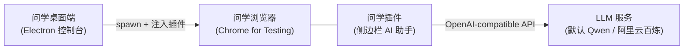
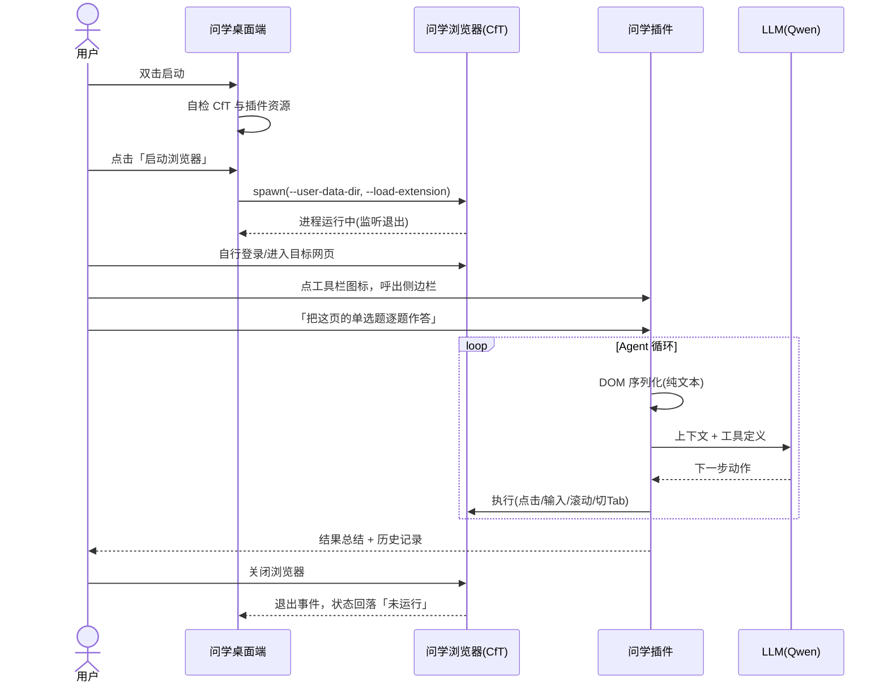

# 问学 WenXue — 产品需求文档（PRD）

> **ask for everything**

| 项       | 内容                                              |
| -------- | ------------------------------------------------- |
| 产品名   | 问学（WenXue）                                    |
| Slogan   | ask for everything                                |
| 文档版本 | v0.1（Demo 阶段）                                 |
| 日期     | 2026-06-11                                        |
| 状态     | 已评审                                            |
| 配套文档 | [TECH-INFRA.md](./TECH-INFRA.md) 技术基础设施文档 |

---

## 1. 一句话定位

问学是一个桌面应用：它启动一个预装了 AI 助手插件的浏览器，用户在任意网页上用自然语言下达任务（网页 research、表单填写、答题等），由 LLM 驱动的 Agent 直接在页面上完成操作——产品体验对标 Claude in Chrome，但无需经过 Chrome 应用商店分发。

## 2. 背景与问题

1. **LLM 网页操作助手有真实需求**：大量重复性的网页工作（资料检索与整理、后台表单录入、在线练习题）可以被"对话式指挥 + Agent 执行"的模式大幅加速。
2. **Chrome 商店分发链路太重**：插件上架审核慢、迭代受限；而从 Chrome 137 起，官方品牌版 Chrome 已移除 `--load-extension` 启动参数，"让用户手动加载未打包插件"的路也变窄了。
3. **结论**：自带 Chromium 内核（Chrome for Testing）的桌面启动器 + 启动时注入插件，是当前唯一既合规又顺滑的"原生预装插件"分发形态。桌面端同时为后续的账户、计费、多实例管理提供承载。

## 3. 目标用户与核心场景

| 用户            | 场景示例                                                   |
| --------------- | ---------------------------------------------------------- |
| 学生 / 研究人员 | 跨多个网页做 research，让 Agent 打开、阅读、对比、汇总信息 |
| 知识工作者      | 在线练习/测评页面上，让 Agent 阅读题目并逐题作答、核对     |
| 运营 / 行政人员 | ERP、CRM、问卷等后台系统中，把"二十次点击"的流程变成一句话 |

共同特征：用户**全程在场**，浏览器是用户自己的工作现场，Agent 是协作者而非无人值守的机器人。

## 4. 产品形态

问学产品由桌面运行时、浏览器插件与对外官网组成。运行时由两个进程组成：

- **问学桌面端**：小而精的控制台窗口。Demo 阶段仅承担"启动/监控浏览器"职责；它是未来账户、订阅计费、多开管理、用量面板的宿主。
- **问学浏览器**：完整的现代浏览器（Chrome for Testing 内核），问学插件以"原生预装"形态存在。
- **问学插件**：浏览器侧边栏中的对话面板与 Agent 执行引擎，承载全部"智能"。基于开源项目 [alibaba/page-agent](https://github.com/alibaba/page-agent)（MIT）fork 改造。
- **问学官网**：对外产品门户，承载认知、演示、下载与文档入口。本期首页采用白色极简官网形态：首屏为全屏 DotField 背景、中间定位文案与「下载问学 / 看演示」两个动作；主标题具备 React Bits VariableProximity 风格的鼠标邻近字重 hover 效果；顶部参考 React Bits 官网 `ln-navbar` 形态实现固定导航，默认态为接近全宽的透明任务栏（无边框、无底色，仅展示放大的透明 slogan、Docs、下载与 GitHub），滚动后收束成悬浮胶囊；左侧使用透明 slogan 无底图并在右侧仅保留 Docs 入口，右侧动作保留下载与 GitHub，舍弃中英切换入口；文档采用参考 page-agent 文档站的两栏 README 阅读布局，每个板块映射到独立 hash 子页（如 `#docs/customer-start`），左侧固定大目录用于切换板块，中间只渲染当前板块的 README 式正文，不设置右侧本页章节目录，内容覆盖客户快速上手、从工具栏进入问学、固定到浏览器工具栏、常见任务教程、开发者接入示例、故障排查、能力边界与待补截图/动画占位；下滑后用大号浏览器 hero 演示真实浏览器中呼出问学插件、固定到顶部并输入任务；页面信息密度保持低，不堆叠功能网格与合规宣传条。

## 5. Demo 范围（P0 功能）

> **2026-06-26 启动器 App 化修订**：桌面启动器从"单实例小控制台"升级为
> 1120×720 左右的无边框白色 App 工作台。P0 现在包含多画像浏览器管理、启动器日志页、
> 设置页与 tokens 消耗统计页；旧文中"多浏览器实例不做"的 Demo 限制被本修订取代。

### F1 浏览器启动器（多画像 App 工作台）

- 用户故事：作为用户，我打开问学 App，可以管理多个隔离浏览器画像，并按需单开或多开。
- 需求点：
  - App 使用无系统标题栏窗口：macOS `hiddenInset` 保留红绿灯但不显示标题文字，
    Windows / Linux 使用 frameless + 自绘右上三键；顶部安全区与拖拽区不遮挡任何页面操作；
  - 启动器固定白色单一主题，常驻窄图标侧栏，主区路由为浏览器 / 日志 / tokens / 设置；
  - 浏览器页展示持久画像列表，支持添加、就地重命名、多选批量打开、聚焦、停止；
  - 每个画像使用独立 `user-data-dir`，登录态 / Cookie 隔离；同一画像同时至多一个实例；
  - 批量打开遵守同时打开上限与错峰间隔设置；
  - 运行状态按画像展示（未运行 / 启动中 / 运行中 / 异常），浏览器退出后状态自动回落；
  - 关闭 App 时询问是否一并关闭浏览器，浏览器默认不被连坐杀死。
- 验收标准：macOS（Apple Silicon）与 Windows（x64）上，从双击 App 到浏览器可用 ≤ 10 秒
  （不含首次系统授权）；同一画像重复启动只聚焦，不开第二个实例；不同画像可并行运行；
  连续启动/退出 10 次无残留进程、无僵尸状态。

### F2 插件注入

- 用户故事：作为用户，我不需要访问 Chrome 商店或打开开发者模式，浏览器一启动插件就在工具栏上。
- 需求点：
  - 启动参数 `--load-extension` 注入未打包插件；
  - 插件 ID 通过 manifest `key` 字段固定（保证存储、侧边栏行为跨版本稳定）；
  - 插件加载失败可被识别（冒烟测试链路，详见 Infra 文档）。
- 验收标准：浏览器启动后，工具栏可见问学图标，点击即弹出侧边栏；浏览器重启后插件配置与历史记录保留。

### F3 侧边栏对话与网页操作 Agent

- 用户故事：作为用户，我在任意网页点开侧边栏，用一句话描述任务，看着 Agent 替我完成点击、输入、翻页。
- 需求点（fork 自 page-agent，验证可用即视为满足）：
  - 自然语言任务输入、流式过程反馈、执行结果总结（结果正文按 Markdown 渲染）；
  - Agent 循环：DOM 文本化 → LLM 决策 → 动作执行（点击/输入/选择/滚动/切换标签页）→ 循环至完成；
  - Agent 可执行任意 JavaScript（isolated/main world，可指定 frame）；该工具默认启用，需收敛时可通过 `experimentalScriptExecutionTool: false` 关闭；
  - 执行过程在页面上有可视化反馈（模拟光标、元素高亮遮罩）；
  - 支持多标签页任务（打开新页、跨页接续），浏览器视图跟随 Agent 当前操作的标签页（开新页、切换页即前台激活）；
  - 侧边栏右上角提供新建对话加号按钮，点击后当前可见对话以收束进历史按钮的动效清空，随后回到品牌空态；
  - 任务完成或出错后，用户在同一可见会话继续输入时默认续接上一轮上下文；点击「新建对话」是唯一显式上下文边界；
  - Agent 历史上下文按体积自动压缩：保留用户原始指令与最近步骤，较早步骤由 LLM 摘要进入提示词投影，原始步骤仍留在本地历史中供回看与回退；
  - 当会话上下文接近模型上限时，侧边栏以非模态横幅建议开启新会话；用户可继续当前会话，系统随后按最旧步骤优先从提示词投影中淘汰，任务不中断；
  - 任务历史记录（本地 IndexedDB），历史列表以卡片展示；同一会话的多轮续接在历史库中累加为一条记录，可回看每一步，可从记录直接回到当时会话上下文继续追问；导出 JSON 文件名使用 `wenxue-history` 前缀；
  - 用户可随时停止任务；遇到登录、验证码、权限确认、不可操作区域或模型连续重复同一动作时，插件展示人工接管提示，用户完成后可继续原任务，也可暂停并保留上下文。
- 验收标准：在示例 research 场景（如"搜索并总结某主题前三个结果"）与示例答题页（标准 HTML 表单类题目）各跑通一次全链路，成功率以演示通过为准。

### F4 模型配置

- 用户故事：作为用户，我可以直接使用内置默认模型；高级用户可以添加多个 OpenAI-compatible 自定义模型，并在需要时切换默认模型。
- 需求点：
  - 默认模型为内置 `qwen3.5-plus`，作为默认模型下拉菜单的首项；
  - options 设置页提供自定义模型列表：点击加号弹出添加对话框，填写厂商、URL、API Key、模型名；每个自定义模型单独保存自己的 API Key；
  - 内置厂商预设先包含 DeepSeek 与千问；选择厂商后自动填入对应 OpenAI-compatible URL，用户仍可手动修改；厂商选择最下方提供「自定义厂商」，用户可自行填写厂商名称与 URL；
  - 厂商选择项与自定义模型列表需展示厂商标识；自定义厂商用用户输入名称生成本地标识；
  - 添加成功后，新模型出现在默认模型下拉菜单中并可被选为当前默认模型；
  - 模型选择、界面语言、回复语言与高级选项均可在插件 options 设置页修改并自动保存；
  - 侧边栏输入框底部提供模型快捷切换下拉（内置默认模型 + 已添加的自定义模型 + 「管理模型」入口），切换即时生效并持久化，任务执行中禁用切换；
  - 侧边栏右上角提供三点菜单，包含设置入口与语言快捷入口；设置入口打开插件 options 设置页；
  - Key 仅存于本机浏览器画像内（`chrome.storage.local`），不经任何问学侧服务器。
- 验收标准：填入有效 Key 后首条任务即可执行；填入无效 Key 时给出可理解的错误提示。

### F5 新标签引导页（增强）

- 新标签引导页（增强）：问学浏览器接管新标签页，白底同步滑入呈现品牌区、默认快捷入口（百度 / 学习通 / 必应中国）、可自定义快捷入口、首次 onboarding 与插件设置/刷新入口。仅插件域，不收集 API Key，不与桌面端通信。
  用户故事：作为问学浏览器用户，我打开新标签即可看到上手引导与常用入口，并一键进入设置。

### F6 学习通求解

- 学习通求解：进入超星学习通作业/考试页时，问学可读取全部题目、用 LLM 生成结构化答案并自动回填；全程不自动提交（最终交卷由用户完成），不绕过登录/验证码/人脸识别/字体反爬等任何防护。
  用户故事：作为问学浏览器用户，我在学习通作业/考试页让 Agent 读题并给出每题答案、自动填回，自己核对后再决定是否交卷。

### F7 启动器日志与可观测性

- 用户故事：作为问学启动器用户，我可以在启动器日志页查看和导出本机日志，以便复盘 Agent 与 LLM 的执行过程、定位失败原因，并按需清理记录。
- 需求点：
  - 插件统一记录 background、sidepanel、hub、newtab 与 content script 的运行日志，覆盖 Agent、标签页/页面操作、学习通求解、配置变更、系统异常与 LLM 调用；
  - 启动器日志页支持实时 tail、跟随最新 / 暂停、按级别 / 来源 / 浏览器画像 / 时间 / 关键词筛选，查看单条详情，按当前筛选导出，以及二次确认后清空；
  - 为支持本地排障，LLM 请求与响应正文可写入插件 IndexedDB；写入前必须脱敏，API Key、`Authorization` 头与 `Bearer` 凭据永不入库；
  - 日志默认保留 3 天、最多 5000 条，两项均可在启动器设置页配置；启动器按过期与最旧优先裁剪超量记录；
  - 插件到启动器仅允许 Chrome Native Messaging 单向日志遥测出口，桌面端不得反向控制 Agent。
- 验收标准：五类插件运行时均可通过统一接口产生日志；用户可完成实时查看、筛选、详情查看、
  导出与清空；脱敏测试证明 API Key、`Authorization` 与 `Bearer` 不会进入桌面持久化日志；
  超期和超量记录可自动清理。

### F8 Tokens 消耗统计

- 用户故事：作为问学用户，我想在启动器看到本机 tokens 消耗趋势、模型分布与画像归因，以便控制成本。
- 需求点：
  - 启动器提供 tokens 统计页，展示总输入 tokens、总输出 tokens、总 tokens、估算人民币成本；
  - 支持按浏览器画像、模型、日期聚合；展示最近调用明细；
  - 统计数据来自已脱敏日志遥测或后续网关计量记录，不包含提示词正文、API Key 或敏感头；
  - 无数据时显示空状态与下一步说明。
- 验收标准：无数据、单日数据、多画像数据均能正确渲染；聚合总数等于明细求和；成本估算规则在 UI 中可解释。

## 6. Demo 端到端链路

## 7. 非目标与能力边界

### 7.1 Demo 明确不做

- 账户体系、订阅与计费、云端后端；
- 自动更新（electron-updater 仅留接口）；
- 插件商店上架、MCP 对外接口、Linux 支持；
- 代码签名与公证（Demo 内部分发，附手动放行说明）。

### 7.2 技术能力边界（如实告知用户）

- DOM 文本化方案不覆盖跨域 iframe 与 Canvas 渲染内容；跨域 iframe 可经 `list_frames` + `execute_javascript`（`frame_id`）在目标 frame 自身上下文内执行读取，但 `<iframe sandbox>`（尤其无 `allow-same-origin`）、浏览器特权页和页面防护仍可能限制执行，Canvas 像素/视觉内容仍不等同于可读 DOM；
- 页面 JS 运行时变量可经 `execute_javascript` 的 `world: 'main'` 读取；严格 CSP、sandbox、同步死循环或页面主动拦截可能导致失败或超时，需提示人工接管；
- 验证码、滑块等人机校验不在 Agent 能力内，遇到即提示人工接管；
- 强前端混淆或高度动态的页面可能降低成功率。

### 7.3 合规与伦理边界（产品红线）

- 问学定位为**用户在场的协作助手**（与 Claude in Chrome 同一伦理位置），不是无人值守的代考/刷题机器人；
- **不开发**验证码绕过、防作弊系统反检测、浏览器指纹伪装类功能；
- 用户须自行确认目标平台服务条款允许辅助工具；正式版在首次使用时以免责声明形式呈现；
- 侧边栏输入区下方常驻「内容由 AI 生成」标识，向用户明示 AI 生成内容属性（AIGC 标识合规）；
- 上游 page-agent 为 MIT 协议，保留其版权声明（详见 Infra 文档 License 合规节）。

## 8. 路线图（Demo 之后）

| 里程碑          | 内容                                                                            |
| --------------- | ------------------------------------------------------------------------------- |
| M0（本期 Demo） | F1–F7 全链路跑通，双端可演示                                                    |
| M1 稳定性与多开 | 多 profile 并行实例、崩溃恢复、插件本地日志体验增强、浏览器版本升级机制         |
| M2 商业化地基   | 账户登录、云端 LLM 网关（密钥托管 + 计量）、订阅计费、插件经会话 token 调用网关 |
| M3 分发成熟     | 代码签名与公证、自动更新、官网下载链路                                          |

## 9. 成功指标（Demo 级）

- 双端（macOS arm64 / Windows x64）安装包均可在干净机器上完成 F1–F4 验收；
- 演示脚本（research 场景 + 答题场景）连续 3 次演练至少 2 次全链路成功；
- 从启动 App 到 Agent 开始执行第一个动作 ≤ 60 秒（含填 Key）。

## 10. 开放问题（假设与待澄清项，复核时请逐条回应）

| #   | 问题                                                                                                                                | 影响                         | 建议时点                                                                             |
| --- | ----------------------------------------------------------------------------------------------------------------------------------- | ---------------------------- | ------------------------------------------------------------------------------------ |
| 1   | 品牌视觉（图标、主色、侧边栏皮肤）                                                                                                  | 插件与 App 的品牌化改造范围  | 开发启动前给出基础版即可                                                             |
| 2   | CfT 跟版策略（固定大版本 or 跟随 Stable）                                                                                           | 安全补丁节奏 vs 回归测试成本 | M1 前决定，Demo 锁单一版本                                                           |
| 3   | 是否需要 Windows arm64 产物                                                                                                         | 构建矩阵 +1                  | M1 前决定                                                                            |
| 4   | 海外模型（OpenAI/Anthropic）是否进默认预置列表                                                                                      | 设置页预设项                 | M1 前决定，Demo 手填可用                                                             |
| 5   | 后端技术栈（网关/计费）                                                                                                             | M2 架构                      | M2 启动时专项设计                                                                    |
| 6   | 仓库根是否放一行式 `CLAUDE.md` 指针指向 `.project.agents/CLAUDE.md`（Claude Code 仅自动读取仓库根，治理文件在子目录不会被自动加载） | 新会话能否自动加载项目规则   | **已决议**（2026-06-11）：放——根 `CLAUDE.md` 仅作指针，规则本体在 `.project.agents/` |
