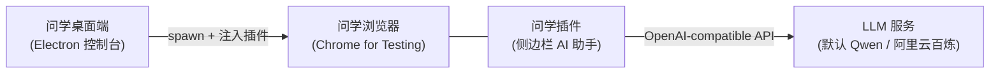
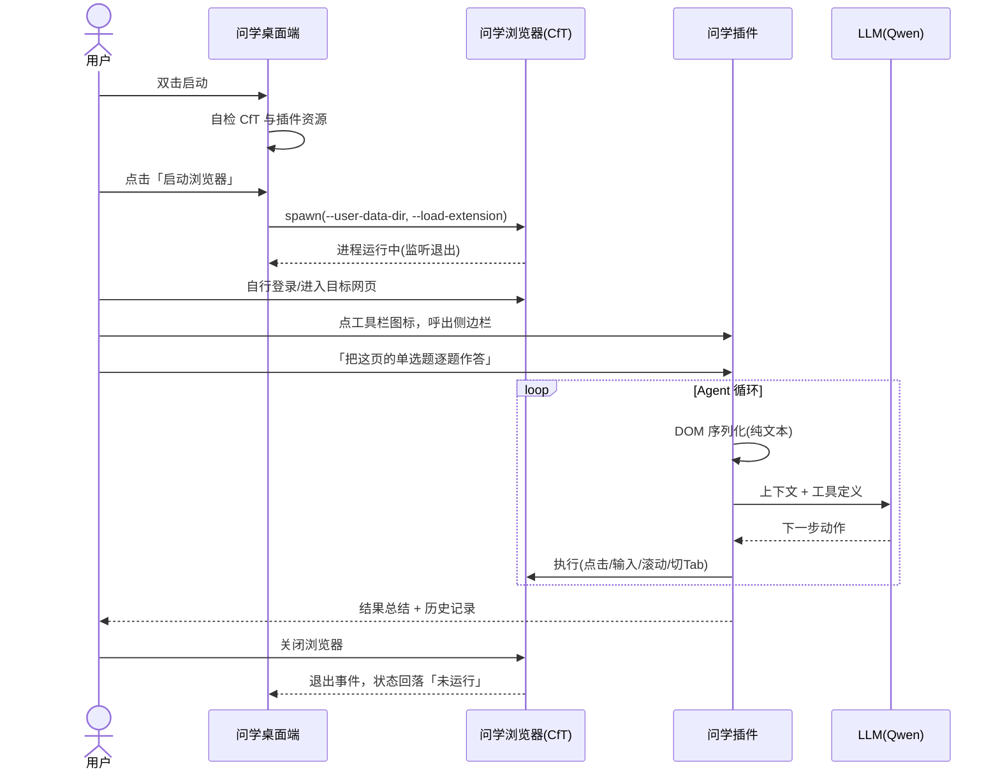

# 问学 WenXue — 产品需求文档（PRD）

> **ask for everything**

| 项 | 内容 |
|---|---|
| 产品名 | 问学（WenXue） |
| Slogan | ask for everything |
| 文档版本 | v0.1（Demo 阶段） |
| 日期 | 2026-06-11 |
| 状态 | 已评审 |
| 配套文档 | [TECH-INFRA.md](./TECH-INFRA.md) 技术基础设施文档 |

---

## 1. 一句话定位

问学是一个桌面应用：它启动一个预装了 AI 助手插件的浏览器，用户在任意网页上用自然语言下达任务（网页 research、表单填写、答题等），由 LLM 驱动的 Agent 直接在页面上完成操作——产品体验对标 Claude in Chrome，但无需经过 Chrome 应用商店分发。

## 2. 背景与问题

1. **LLM 网页操作助手有真实需求**：大量重复性的网页工作（资料检索与整理、后台表单录入、在线练习题）可以被"对话式指挥 + Agent 执行"的模式大幅加速。
2. **Chrome 商店分发链路太重**：插件上架审核慢、迭代受限；而从 Chrome 137 起，官方品牌版 Chrome 已移除 `--load-extension` 启动参数，"让用户手动加载未打包插件"的路也变窄了。
3. **结论**：自带 Chromium 内核（Chrome for Testing）的桌面启动器 + 启动时注入插件，是当前唯一既合规又顺滑的"原生预装插件"分发形态。桌面端同时为后续的账户、计费、多实例管理提供承载。

## 3. 目标用户与核心场景

| 用户 | 场景示例 |
|---|---|
| 学生 / 研究人员 | 跨多个网页做 research，让 Agent 打开、阅读、对比、汇总信息 |
| 知识工作者 | 在线练习/测评页面上，让 Agent 阅读题目并逐题作答、核对 |
| 运营 / 行政人员 | ERP、CRM、问卷等后台系统中，把"二十次点击"的流程变成一句话 |

共同特征：用户**全程在场**，浏览器是用户自己的工作现场，Agent 是协作者而非无人值守的机器人。

## 4. 产品形态

问学由两个进程组成：

- **问学桌面端**：小而精的控制台窗口。Demo 阶段仅承担"启动/监控浏览器"职责；它是未来账户、订阅计费、多开管理、用量面板的宿主。
- **问学浏览器**：完整的现代浏览器（Chrome for Testing 内核），问学插件以"原生预装"形态存在。
- **问学插件**：浏览器侧边栏中的对话面板与 Agent 执行引擎，承载全部"智能"。基于开源项目 [alibaba/page-agent](https://github.com/alibaba/page-agent)（MIT）fork 改造。

## 5. Demo 范围（P0 功能）

### F1 浏览器启动器（单实例）

- 用户故事：作为用户，我打开问学 App，点一个按钮就能得到一个装好 AI 助手的浏览器。
- 需求点：
  - App 启动时自检浏览器二进制与插件资源完整性；
  - 一键启动 Chrome for Testing，使用 App 专属用户画像目录（与用户系统里的 Chrome 完全隔离）；
  - 运行状态展示（未运行 / 运行中），浏览器退出后状态自动回落；
  - 重复点击"启动"不会开出第二个实例（聚焦已有窗口）；
  - 关闭 App 时询问是否一并关闭浏览器，浏览器默认不被连坐杀死。
- 验收标准：macOS（Apple Silicon）与 Windows（x64）上，从双击 App 到浏览器可用 ≤ 10 秒（不含首次系统授权）；连续启动/退出 10 次无残留进程、无僵尸状态。

### F2 插件注入

- 用户故事：作为用户，我不需要访问 Chrome 商店或打开开发者模式，浏览器一启动插件就在工具栏上。
- 需求点：
  - 启动参数 `--load-extension` 注入未打包插件；
  - 插件 ID 通过 manifest `key` 字段固定（保证存储、侧边栏行为跨版本稳定）；
  - 插件加载失败可被识别（冒烟测试链路，详见 Infra 文档）。
- 验收标准：浏览器启动后，工具栏可见问学图标，点击即弹出侧边栏；浏览器重启后插件配置与历史记录保留。

### F3 侧边栏对话与网页操作 Agent

- 用户故事：作为用户，我在任意网页点开侧边栏，用一句话描述任务，看着 Agent 替我完成点击、输入、翻页。
- 需求点（fork 自 page-agent，验证可用即视为满足）：
  - 自然语言任务输入、流式过程反馈、执行结果总结；
  - Agent 循环：DOM 文本化 → LLM 决策 → 动作执行（点击/输入/选择/滚动/切换标签页）→ 循环至完成；
  - 执行过程在页面上有可视化反馈（模拟光标、元素高亮遮罩）；
  - 支持多标签页任务（打开新页、跨页接续）；
  - 任务历史记录（本地 IndexedDB），可回看每一步；
  - 用户可随时停止任务。
- 验收标准：在示例 research 场景（如"搜索并总结某主题前三个结果"）与示例答题页（标准 HTML 表单类题目）各跑通一次全链路，成功率以演示通过为准。

### F4 模型配置

- 用户故事：作为用户，我首次使用时只需填一个 API Key 就能开始；高级用户可以换任意兼容服务。
- 需求点：
  - 默认预置阿里云百炼（DashScope）OpenAI-compatible 接入点与 `qwen3.5-plus` 模型，用户仅需填写 API Key；
  - baseURL / model / API Key 均可在配置面板修改（即兼容 DeepSeek、OpenAI 等任意 OpenAI-compatible 服务）；
  - Key 仅存于本机浏览器画像内（`chrome.storage.local`），不经任何问学侧服务器。
- 验收标准：填入有效 Key 后首条任务即可执行；填入无效 Key 时给出可理解的错误提示。

## 6. Demo 端到端链路

## 7. 非目标与能力边界

### 7.1 Demo 明确不做

- 多浏览器实例（多开）——架构上预留（独立 profile 目录设计），功能不实现；
- 账户体系、订阅与计费、云端后端；
- 自动更新（electron-updater 仅留接口）；
- 插件商店上架、MCP 对外接口、Linux 支持；
- 代码签名与公证（Demo 内部分发，附手动放行说明）。

### 7.2 技术能力边界（如实告知用户）

- 跨域 iframe 内容、Canvas 渲染的页面（如部分在线文档/白板）无法被 DOM 文本化方案操作；
- 验证码、滑块等人机校验不在 Agent 能力内，遇到即提示人工接管；
- 强前端混淆或高度动态的页面可能降低成功率。

### 7.3 合规与伦理边界（产品红线）

- 问学定位为**用户在场的协作助手**（与 Claude in Chrome 同一伦理位置），不是无人值守的代考/刷题机器人；
- **不开发**验证码绕过、防作弊系统反检测、浏览器指纹伪装类功能；
- 用户须自行确认目标平台服务条款允许辅助工具；正式版在首次使用时以免责声明形式呈现；
- 上游 page-agent 为 MIT 协议，保留其版权声明（详见 Infra 文档 License 合规节）。

## 8. 路线图（Demo 之后）

| 里程碑 | 内容 |
|---|---|
| M0（本期 Demo） | F1–F4 全链路跑通，双端可演示 |
| M1 稳定性与多开 | 多 profile 并行实例、崩溃恢复、日志上报、浏览器版本升级机制 |
| M2 商业化地基 | 账户登录、云端 LLM 网关（密钥托管 + 计量）、订阅计费、插件经会话 token 调用网关 |
| M3 分发成熟 | 代码签名与公证、自动更新、官网下载链路 |

## 9. 成功指标（Demo 级）

- 双端（macOS arm64 / Windows x64）安装包均可在干净机器上完成 F1–F4 验收；
- 演示脚本（research 场景 + 答题场景）连续 3 次演练至少 2 次全链路成功；
- 从启动 App 到 Agent 开始执行第一个动作 ≤ 60 秒（含填 Key）。

## 10. 开放问题（假设与待澄清项，复核时请逐条回应）

| # | 问题 | 影响 | 建议时点 |
|---|---|---|---|
| 1 | 品牌视觉（图标、主色、侧边栏皮肤） | 插件与 App 的品牌化改造范围 | 开发启动前给出基础版即可 |
| 2 | CfT 跟版策略（固定大版本 or 跟随 Stable） | 安全补丁节奏 vs 回归测试成本 | M1 前决定，Demo 锁单一版本 |
| 3 | 是否需要 Windows arm64 产物 | 构建矩阵 +1 | M1 前决定 |
| 4 | 海外模型（OpenAI/Anthropic）是否进默认预置列表 | 配置面板预设项 | M1 前决定，Demo 手填可用 |
| 5 | 后端技术栈（网关/计费） | M2 架构 | M2 启动时专项设计 |
| 6 | 仓库根是否放一行式 `CLAUDE.md` 指针指向 `.project.agents/CLAUDE.md`（Claude Code 仅自动读取仓库根，治理文件在子目录不会被自动加载） | 新会话能否自动加载项目规则 | **已决议**（2026-06-11）：放——根 `CLAUDE.md` 仅作指针，规则本体在 `.project.agents/` |
