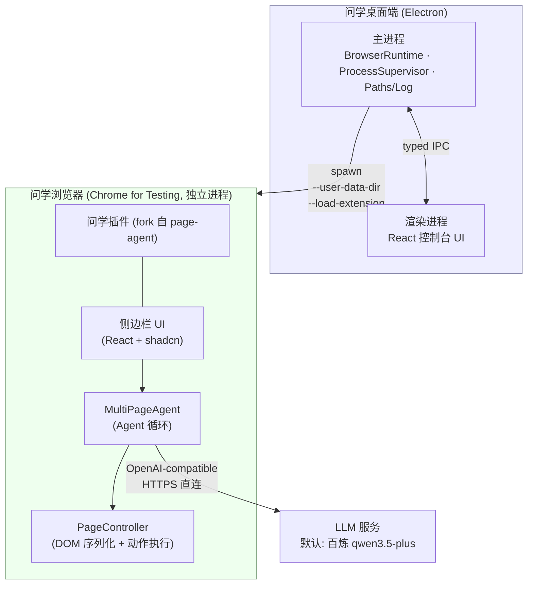

# 问学 WenXue — 技术基础设施文档（Tech Infra）

| 项       | 内容               |
| -------- | ------------------ |
| 文档版本 | v0.1（Demo 阶段）  |
| 日期     | 2026-06-11         |
| 状态     | 已评审             |
| 配套文档 | [PRD.md](./PRD.md) |

---

## 1. 总体架构



要点：

- **Demo 阶段桌面端与插件之间零运行时通信**。桌面端只负责"把一个装好插件的浏览器拉起来并看护进程"；插件独立完成全部智能交互。
- 浏览器是**独立 OS 进程**，不内嵌于 Electron（Electron 的扩展 API 仅支持子集，无法运行依赖 `chrome.sidePanel`/MV3 service worker 的插件，方案评审时已否决内嵌路线）。
- 未来桌面端 ↔ 插件通信的升级路径：插件连接桌面端本地 WebSocket（上游 page-agent 的 MCP hub 已验证该模式），不引入新机制。

## 2. 仓库结构（pnpm monorepo）

```
WenXue/
├── apps/
│   ├── desktop/                 # Electron 桌面端
│   │   ├── src/main/            # 主进程：窗口、IPC、浏览器运行时管理
│   │   ├── src/preload/         # contextBridge 类型化 API
│   │   ├── src/renderer/        # React 控制台 UI
│   │   ├── scripts/             # fetch-browser.ts / smoke-launch.ts
│   │   └── electron-builder.yml
│   └── extension/               # fork 自 page-agent packages/extension（品牌化改造）
├── packages/                    # vendor 自 page-agent 的支撑库（保持包名便于 diff 上游）
│   ├── core/                    # @page-agent/core         → Agent 循环
│   ├── llms/                    # @page-agent/llms         → OpenAI-compatible 客户端
│   ├── page-controller/         # @page-agent/page-controller → DOM 序列化与动作
│   └── ui/                      # @page-agent/ui           → 共享 UI
├── .project.agents/             # 治理与项目文档（ADS）
│   └── docs/context/            # PRD / TECH-INFRA / ARCHITECTURE / ROADMAP / CONVENTIONS / UIUX / UPSTREAM
├── third_party/
│   └── page-agent/LICENSE       # 上游 MIT 协议与版权声明
├── pnpm-workspace.yaml
└── package.json
```

vendor 原则：

- `packages/*` 四个库从上游 commit 快照复制，**包名不改**（`@page-agent/*`），`apps/extension` 内部以 `workspace:*` 引用，便于打补丁（默认模型、品牌文案、遮罩样式）；
- `.project.agents/docs/context/UPSTREAM.md` 记录：上游仓库地址、快照 commit hash、快照日期、本地改动清单、手动同步流程（`git diff` 上游 tag 对应目录后挑拣合入）；
- 上游为 MIT：保留 `third_party/page-agent/LICENSE`，各 vendor 包内保留原始版权头与 NOTICE（含其对 browser-use 的致谢声明）。

## 3. 技术栈与版本策略

| 层       | 选型                                                                                                              | 锁定策略                                                                                                                                      |
| -------- | ----------------------------------------------------------------------------------------------------------------- | --------------------------------------------------------------------------------------------------------------------------------------------- |
| 运行时   | Node 22 LTS / pnpm 9                                                                                              | `.nvmrc` + `packageManager` 字段                                                                                                              |
| 桌面壳   | Electron（当前 Stable 大版本）+ electron-vite + React 19 + TypeScript + Tailwind 4                                | renovate 手动升级，主版本升级走回归                                                                                                           |
| 打包     | electron-builder（macOS dmg / Windows nsis）                                                                      | 配置入库                                                                                                                                      |
| 浏览器   | Chrome for Testing，**单一版本全平台统一**，版本号记录于 `apps/desktop/browser.lock.json`                         | Demo 锁定一个 Stable 版本；升级 = 改 lock + 跑冒烟                                                                                            |
| 插件     | WXT 0.20 + React 19 + Tailwind 4 + shadcn（沿用上游）                                                             | 跟随 vendor 快照                                                                                                                              |
| LLM 接入 | OpenAI-compatible REST（上游 `@page-agent/llms`）                                                                 | 内置模型 M3 起经 CloudBase 网关并使用 CloudBase 用户 session 鉴权，默认文本 `qwen3.7-max`、默认视觉 `qwen3.7-plus`；自定义 BYO-Key 模型仍直连 |
| 云端网关 | CloudBase Run 容器 + Functions Framework 多 target + CloudBase Auth HTTP / Tencent Cloud TCB API                  | 注册通过 TCB `CreateUser`；激活与所有受保护请求读取 `/auth/v1/user/me`，不以 NoSQL 记录作为账号授权条件                                       |
| 后台管理 | `apps/admin` Vite + React + CloudBase Web Auth；`apps/admin-api` CloudBase Run Function mode + CloudBase HTTP API | 管理员只走内部 username/password；管理 API PUBLIC 但服务端强制 CloudBase Auth + `admin_users` 角色                                            |
| 测试     | vitest（沿用上游各包测试）+ 桌面端 CDP 冒烟脚本                                                                   | CI 必跑                                                                                                                                       |

## 4. 桌面端（Electron）设计

### 4.1 主进程模块（模块卡片与契约的权威是 ARCHITECTURE §2/§3，此处为速览）

| 模块                     | 职责                                                                                                                                                                       |
| ------------------------ | -------------------------------------------------------------------------------------------------------------------------------------------------------------------------- |
| `BrowserResources`       | 定位资源路径（CfT 二进制、插件产物）、读 `browser.lock.json` 提供版本（纯函数）                                                                                            |
| `LaunchConfig`           | 由路径参数组装 CfT argv（纯函数，参数全集见 §4.3）                                                                                                                         |
| `BrowserSupervisor`      | 持有子进程句柄；监听 `exit`/`error`；状态机：`idle → launching → running → idle`；停止时 SIGTERM 后 2s 未退出则 SIGKILL；崩溃（非 0 退出码）或停止超时通知 UI              |
| `ProfileStore`           | 画像目录创建与定位；启动前安全开启专用画像的 unpacked-extension Developer Mode（POSIX SingletonLock / Windows lockfile 防并发占用，Preferences 临时文件 fsync 后原子替换） |
| `AppPaths` / `AppLogger` | `app.getPath('userData')` 目录布局 / electron-log，主进程与 CfT stdout/stderr 各一份滚动日志                                                                               |

### 4.2 数据目录布局（多开预留）

```
<userData>/                      # macOS: ~/Library/Application Support/WenXue
├── profiles/
│   └── default/                 # CfT --user-data-dir（未来每实例一个目录）
└── logs/
    ├── main.log
    └── browser-default.log
```

### 4.3 CfT 启动参数表

| 参数                          | 值                            | 目的                                                                                        |
| ----------------------------- | ----------------------------- | ------------------------------------------------------------------------------------------- |
| `--user-data-dir`             | `<userData>/profiles/default` | 与系统浏览器完全隔离；CfT 自带 ProcessSingleton：同画像二次启动自动聚焦已有窗口，天然防多开 |
| `--disable-extensions-except` | `<resources>/extension`       | 专用 CfT 画像只启用问学扩展，避免其他扩展干扰消息与截图链路                                 |
| `--load-extension`            | `<resources>/extension`       | 插件注入（CfT 永久保留该参数）                                                              |
| `--no-first-run`              | —                             | 跳过首次运行向导                                                                            |
| `--no-default-browser-check`  | —                             | 不弹"设为默认浏览器"                                                                        |
| `--hide-crash-restore-bubble` | —                             | 上次崩溃后不弹恢复气泡                                                                      |
| `--remote-debugging-pipe`     | 仅冒烟测试注入                | CDP 校验插件加载；**日常启动不开启**（避免暴露调试面）                                      |
| 位置参数                      | 欢迎页 URL（可选）            | 首屏引导（指向插件使用说明静态页）                                                          |

### 4.4 IPC 接口（preload 经 contextBridge 暴露）

| 通道                                                                   | 方向                    | 语义                                       |
| ---------------------------------------------------------------------- | ----------------------- | ------------------------------------------ |
| `browser:launch`                                                       | renderer → main         | 启动浏览器，幂等（running 时聚焦已有实例） |
| `browser:getStatus`                                                    | renderer → main         | 查询状态机当前态                           |
| `browser:status-changed`                                               | main → renderer（事件） | 状态变更推送                               |
| `app:getVersions`                                                      | renderer → main         | App / CfT / 插件三方版本号                 |
| `app:getShellInfo`                                                     | renderer → main         | 查询平台、frameless、安全区与最大化状态    |
| `app:minimizeWindow` / `app:toggleMaximizeWindow` / `app:requestClose` | renderer → main         | 自绘窗口按钮调用主进程窗口能力             |
| `app:openLogs`                                                         | renderer → main         | 打开本机日志目录                           |

安全基线：`contextIsolation: true`、`nodeIntegration: false`、`sandbox: true`；渲染层不接触 Node API。

### 4.5 进程生命周期决策

- 浏览器**不随 App 退出被强杀**：App 退出时若浏览器在运行，弹对话框让用户选择（一并关闭 / 仅关 App）。理由：浏览器内可能有用户未保存的工作。
- CfT 异常退出（非 0 退出码 / 信号）：系统通知 + UI 提供一键重启。

## 5. 浏览器运行时（Chrome for Testing）供应链

### 5.1 获取与锁版本

- 构建期由 `apps/desktop/scripts/fetch-browser.ts` 调用 **`@puppeteer/browsers`** 下载 `browser.lock.json` 指定版本，落盘 `.browsers/`（gitignore）；
- 国内构建环境设置镜像：`PUPPETEER_DOWNLOAD_BASE_URL=https://registry.npmmirror.com/-/binary/chrome-for-testing`；
- 产物矩阵：`mac-arm64`、`mac-x64`、`win64` 三份。

### 5.2 打包内置（已评审决策：内置而非首启下载）

electron-builder `extraResources` 将对应平台的 CfT 与插件构建产物放入安装包：

```yaml
extraResources:
  - from: '.browsers/chrome/${cftPlatformDir}' # 构建脚本按 target 解析
    to: 'browser'
  - from: '../extension/.output/chrome-mv3'
    to: 'extension'
```

- 运行时定位：`process.resourcesPath/browser/...`（macOS 为 `WenXue.app/Contents/Resources/browser/Google Chrome for Testing.app`，Windows 为 `resources\browser\chrome.exe`）；
- 代价（已接受）：安装包增大约 200MB；CfT 升级必须随 App 发版；
- **签名与公证（上线前必须解决，Demo 不做）**：macOS 公证会校验 .app 内全部 Mach-O 二进制，内置的 CfT.app 需在签名流程中以 App 自身证书重签（`codesign --deep` 不可靠，需脚本逐层签）并通过 notarytool 公证。这是内置路线最大的工程坑，M3 里程碑专项处理。Demo 阶段产物不签名，macOS 接收方需 `xattr -dr com.apple.quarantine` 放行。

## 6. 插件（fork 自 page-agent）改造清单

| #   | 改造项                                | 说明                                                                                                                                            |
| --- | ------------------------------------- | ----------------------------------------------------------------------------------------------------------------------------------------------- |
| 1   | 品牌化                                | 名称/图标/`_locales`（zh_CN、en）/侧边栏标题 → 问学 WenXue · ask for everything                                                                 |
| 2   | 固定插件 ID                           | manifest 增加 `key` 字段（自生成 RSA 公钥），保证未打包加载时 ID 稳定，存储与权限跨版本不漂移                                                   |
| 3   | 默认模型预置                          | 配置面板默认值：内置文本 `qwen3.7-max` + 内置视觉 `qwen3.7-plus`，经 CloudBase Gateway 使用用户 session；自定义模型仍由用户填写 baseURL/API Key |
| 4   | 权限审计                              | 收敛 `host_permissions` 与可选权限到 Demo 必需集合；逐项记录保留理由                                                                            |
| 5   | 页面级 API（`window.PAGE_AGENT_EXT`） | 上游的 token 鉴权对外 API，Demo 不需要 → 默认关闭（编译开关保留，正式版再评估）                                                                 |
| 6   | 遥测确认                              | 审计上游是否有任何外发统计/Demo LLM 端点残留，全部移除或指向空实现                                                                              |
| 7   | 历史与存储                            | 沿用 IndexedDB 历史、`chrome.storage.local` 存配置（含 API Key，不出本机）                                                                      |
| 8   | 视觉观察工具                          | `visual_observe` 由 Agent 自主调用，截取当前可见视口并经视觉模型返回结构化 JSON；图片本体不落盘、不入历史、不入日志                             |

- 权限审计补充：保留 `webNavigation` 权限，用于 `list_frames` 获取 frame 元数据，并支撑按 `frame_id` 执行 JavaScript；这是跨 frame JS 能力对权限最小化原则的显式权衡。
- 权限审计补充：`visual_observe` 使用 `chrome.tabs.captureVisibleTab` 截取 Agent 当前管理 tab 的可见视口。v2 capture 消息必须携带逻辑 targetTabId，background 在截图后复核 active tab id 与 URL，目标不存在时 fail closed，不回退截图任意活动 tab；该必填约束相对旧 wire contract 不兼容，所以显式升为 v2。Chrome Tabs API 文档说明匹配 host permissions 可支持该能力；本项目已有 `<all_urls>` host permission，首版不新增 manifest 权限。特权页、浏览器 UI、不可截图页面等失败时返回结构化错误并建议改用 DOM 检查或人工处理。
- 页面级 API 补充：本期 main-world executor 是独立 eval 通道，仅服务 `execute_javascript` 的 `world: 'main'`，不启用上游 `window.PAGE_AGENT_EXT`。

构建：`pnpm -F extension build` → WXT 产出 `.output/chrome-mv3/`，被 desktop 打包步骤消费。仓库根 `pnpm dev` 先构建 extension 再启动 desktop，避免持久画像注册旧 MV3 service worker；修改 background 后必须重启该开发链。专用画像启动前由 ProfileStore 开启 Developer Mode，使 unpacked extension 的 service worker 能从当前目录重新注册；sidepanel/hub 再以 v2 握手探测，并用 Web Locks 在 extension origin 内互斥、最多调用一次 `chrome.runtime.reload()`，失败时仅视觉工具降级，不阻断 DOM Agent。

## 7. 业务边界矩阵（插件 / 桌面端 / 未来后端）

> 原则：**插件管"智能"，桌面端管"运行时与用户 session handoff"，后端管"密钥托管、用户鉴权与计量"。**

| 能力                                    | 插件                                                                     | 桌面端                                                                                                                  | 云端后端（M2）                                                                                                                        |
| --------------------------------------- | ------------------------------------------------------------------------ | ----------------------------------------------------------------------------------------------------------------------- | ------------------------------------------------------------------------------------------------------------------------------------- |
| 对话 UI、Agent 循环、DOM 操作、任务历史 | ✅ 唯一归属                                                              | —                                                                                                                       | —                                                                                                                                     |
| LLM 调用                                | ✅ Demo 直连厂商 API；M2 起调自家网关                                    | 永不经手对话内容                                                                                                        | ✅ OpenAI-compatible 透传网关                                                                                                         |
| CfT 版本/进程/画像管理、插件注入        | —                                                                        | ✅ 唯一归属                                                                                                             | —                                                                                                                                     |
| 用户 session、订阅、计费、用量展示      | 仅消费启动器交接的用户 session；refresh token 只用于刷新内置模型网关会话 | ✅ 通过注册网关创建用户，再以 CloudBase Web Auth SDK 完成用户 id + 密码登录与会话；tokens UI 优先读当前用户云端 summary | ✅ CloudBase Auth 用户创建；激活与逐请求读取 user profile 并严格要求 `ACTIVE`；计量、当前用户 summary、后台 tokens 看板；订阅账单后置 |
| 密钥                                    | Demo：用户 Key 存 `chrome.storage.local`；内置模型 M3 起仅存用户 session | M2：登录并向插件交接用户 session；不保存厂商 Key                                                                        | M2：厂商 Key 仅存服务端                                                                                                               |
| 升级通道                                | 随 App 发版                                                              | electron-updater（M3 启用）                                                                                             | 独立部署                                                                                                                              |

**M2 网关切换设计（2026-07-02 改为用户 session）**：插件的 LLM 客户端只认 `baseURL + 鉴权头`。切换到计费网关时，仅需把默认 baseURL 指向 CloudBase LLM Gateway、把 API Key 字段换成当前 CloudBase access token——Agent 核心零改动。这是"直连优先"决策的可演进性依据。M0 先做端到端薄切片：扩展/脚本 → CloudBase Run 容器型 `wenxue-llm-gateway`（Functions Framework 多 target）→ DashScope SSE，必须验证流式末块 usage 非 0 与延迟基线。M3 默认内置文本模型按产品要求为 `qwen3.7-max`，视觉模型为 `qwen3.7-plus`；插件启动不因 session 缺失阻断，首次发送进入聊天后由网关返回「登录已过期/无权限」错误。网关每个受保护请求都调用 `/auth/v1/user/me`，只有 CloudBase Auth `status=ACTIVE` 才继续请求 DashScope 或读取 usage；`BLOCKED` 在上游调用前返回 403。

### 7.1 CloudBase LLM Gateway（M0–M5）

- 运行形态：CloudBase Run 容器型服务（Dockerfile + Functions Framework 多 target），服务名 `wenxue-llm-gateway`，环境 `wenxue-d8gz76tacc3659f05`（ap-shanghai）。
- 入口：`POST /v1/auth/register` 创建 `ACTIVE` CloudBase Auth 身份；`POST /v1/auth/activate` 保留为登录后的兼容 readiness check，只验证当前 Auth 用户状态而不写数据库；OpenAI-compatible `POST /v1/chat/completions`；M4 起同服务暴露 `GET /v1/usage/summary` 供启动器 tokens 页读取当前用户计量；`GET /healthz` 仅返回无敏感信息的服务就绪状态。
- 鉴权：请求 `Authorization: Bearer <CloudBase accessToken>`；网关携带同一 bearer 调官方 `/auth/v1/user/me?client_id=...`，从 profile 取得真实 uid，并严格要求 `status === 'ACTIVE'`。缺少/无效 token 返回 401，`BLOCKED` 或其他非 ACTIVE 状态返回 403；`/v1/auth/activate`、chat 与 usage summary 均走同一检查，且不依赖 `user_accounts` 或 token introspection 中不存在的状态字段。
- 注册：桌面端先校验凭据，再调用 `/v1/auth/register`；网关重复校验后通过 Tencent Cloud TCB `CreateUser(UserStatus=ACTIVE)` 创建 externalUser，且不依赖该接口返回 uid。随后桌面端调用 CloudBase Web Auth SDK `signInWithPassword` 验证密码并取得真实 session，再以 access token 调用 `/v1/auth/activate`；该 target 在 10 秒上限内读取 `/auth/v1/user/me`，确认真实 uid 与 `ACTIVE` 后返回，不写 NoSQL。若 CreateUser 已成功但客户端未收到响应，重试可得到 409，桌面仍以本次密码尝试登录：只有正确密码才能通过 Auth profile 校验。密码只在注册 TLS 请求、TCB 创建调用及 SDK 登录中传递，激活请求体不含密码，密码不写日志、数据库或响应。
- 上游：`https://dashscope.aliyuncs.com/compatible-mode/v1/chat/completions`；DashScope Key 只来自 CloudBase Run 环境变量 `DASHSCOPE_API_KEY`。
- 流式计量：当请求 `stream=true` 时，网关必须注入 `stream_options: { include_usage: true }`，否则 DashScope 流式响应不返回 usage。
- 计量：M0 捕获 usage 与端到端延迟；M1 后写 `token_usage`，记录只含 CloudBase 用户 uid、model、tokens、latency、createdAt；M4 的 `usage-summary` target 实时读取当前用户 uid 记录并返回脱敏 `TokenUsageSummary`（recent id 不含 uid）。
- 访问（2026-07-17 降耗上线后）：当前配置发布版本 024 复用已经过灰度验证的 023 镜像并承接 100% 流量，保持 `OpenAccessTypes:["OA","PUBLIC","MINIAPP"]`，规格为 `Cpu:0.25`、`Mem:0.5`、`MinNum:1`、`MaxNum:2`；注册 target 按来源 IP、用户名和单实例总量限流，返回 429 与 `Retry-After`；扩大实例规模或正式公开获客前还必须在共享网关层补全局限流与审计告警。
- 组合运行时上线（2026-07-17）：AdminApi 四个公开 targets 与 AdminConsole `/admin` 静态 target 已合并到 Gateway；AdminConsole 以 `/admin/` base 构建，产物经约 1.1MB 的白名单 staging 进入镜像，Functions Framework 固定 `1.18.2`。七条后台 HTTP 路由均已切换到 Gateway；独立 `wenxue-admin-api` 与 `wenxue-admin-web` 仅保留为 `MinNum:0` 的回滚单元。
- 发布记录（2026-07-17）：初次发布时环境停服，导致无流量中间版本 022 无法切流或回滚；环境恢复后先回滚 022，再将完整组合版本 023 按 5% → 25% → 50% → 100% 灰度验证并全量，随后以复用 023 镜像的配置发布版本 024 完成降配，当前 024 为 100%。未购买额外资源点，也未开启超限。
- 公网默认入口：`https://wenxue-llm-gateway-wenxue-d8gz76tacc3659f05-1427406869.ap-shanghai.run.wxcloudrun.com`；2026-07-15 验证旧 `run.tcloudbase.com` 入口持续超时，桌面、主进程与插件默认地址不得再指向旧入口。
- NoSQL 容量边界：2026-07-15 环境资源点配额 40000 已耗尽，数据库 REST 与 server SDK 写均返回 `EXCEED_REQUEST_LIMIT`。注册、登录、激活与网关用户授权因此改为只依赖 CloudBase Auth 原生 `ACTIVE/BLOCKED` 状态，不消耗 NoSQL 资源点；`token_usage` 写入与 usage/admin NoSQL 查询仍可能受该配额影响，写入失败按既有 best-effort 处理，展示层保留本地缓存兜底，资源点恢复前不得把云端计量/后台状态页表述为可用验收。
- 用户 session：M2 使用 CloudBase Web Auth username/password；用户名 5–24 位、匹配 `^[A-Za-z][A-Za-z0-9]*$`；密码 9–32 位、首字符为字母或数字，仅允许 ASCII 字母数字与 `()!@#$%^&*|?><_-`，并至少包含小写字母、大写字母、数字、允许的特殊字符中的三类。桌面端在任何认证请求前校验，网关在注册边界重复校验；桌面端的注册、SDK 登录与激活等待均以 12 秒结束 UI busy 状态，网关注册阶段与激活阶段各自共享 10 秒总 deadline。桌面端不生成、展示、复制或持久化 `wxm_` 机器 token；桌面端/后台/扩展内置当前环境的 CloudBase publishable key，`VITE_CLOUDBASE_ACCESS_KEY` 仅作为环境覆盖入口。
- 会话交接：M2 使用一次性 localhost 页面 + `externally_connectable` 把 `userId`、`accessToken`、`refreshToken`、`expiresAt` 与网关地址交给插件 background；不经远端服务，不向 Agent 发送控制指令。
- 切换纪律：M3 已把内置模型运行时配置切到网关，`apiKey` 字段只注入插件侧当前 access token；M5 已删除本地百炼 Key 与本地直连兜底开关，旧 DashScope 直连 baseURL 仅用于自动迁移到网关默认配置。
- 用量展示：M4 新增桌面 `UsageCloudClient`，通过主进程当前用户 session 调 `GET /v1/usage/summary`；成功后按 userId 写 `<userData>/token-usage-summary-cache.json`，失败时 `tokens:getSummary` 回退本地 `TokenUsageStore`。

### 7.2 后台管理（M4.6）

- 前端：`apps/admin` 静态站点，使用 CloudBase Web SDK 的 username/password 登录；路由守卫必须使用 `auth.getSession()`，不得使用已废弃且可能误判的 `getLoginState()`。仓库目标运行形态由 `wenxue-llm-gateway` 的 `/admin` target 提供构建产物；构建固定 `VITE_BASE_PATH=/admin/`、同源 AdminApi、当前 env/region，避免 shell 残留 `VITE_*` 污染 bundle。独立 CloudRun 静态容器保留作回滚。
- 后端：`apps/admin-api` 是唯一业务实现；PUBLIC 请求均先校验 CloudBase Auth bearer，再查 `admin_users` 角色，前端不直接读写 NoSQL。相同公开 targets 由 Gateway 复用；独立 Function mode 服务保留作回滚。
- 数据：网关用户授权权威是 CloudBase Auth `ACTIVE/BLOCKED`；运营临时封禁/解封应使用 CloudBase 用户管理或 TCB `ModifyUser(UserStatus=BLOCKED|ACTIVE)`。现有 AdminApi 仍读写 legacy `user_accounts` 与 `user_permission_audit`，尚未迁移到 `ModifyUser`，其状态页当前不影响网关放行；`admin_users` 继续作为后台管理员角色表。
- 当前公网部署（2026-07-17，降耗切换已完成）：
  - AdminConsole 主入口：`https://wenxue-d8gz76tacc3659f05-1427406869.ap-shanghai.app.tcloudbase.com/admin`，使用 CloudBase HTTP 网关默认域名；`/admin`、`/admin/`、`/admin/assets/*` 三条路由均指向 `wenxue-llm-gateway` 配置发布版本 024，构建期注入 `VITE_BASE_PATH=/admin/` 与同源 AdminApi base URL。
  - AdminApi 主入口：同域精确路由 `/api/admin/v1/me`、`/api/admin/v1/usage/summary`、`/api/admin/v1/users`、`/api/admin/v1/user-status` 四条路由均指向 `wenxue-llm-gateway`；不在默认域名下使用 `/admin/v1/*`，因为 `/admin` 页面路由会按前缀捕获。至此七条 HTTP 路由全部由 Gateway 承接。
  - 独立 CloudRun 服务继续作为回滚单元和底层排障入口：`wenxue-admin-web` 在线版本 006、`wenxue-admin-api` 在线版本 009，均为 `MinNum:0`；正常功能路径不再经过这两个可冷启动服务。
  - 授权内部账号：`administrator`、`outas`、`spike2801` 的 CloudBase uid 已写入 `admin_users`，`role=admin`、`status=active`。
  - 数据权限：`admin_users`、`user_accounts`、`user_permission_audit` 为 `ADMINONLY`；后台前端只能经 AdminApi 访问。
  - 2026-07-09 验证：`/admin` 返回 200 HTML 且引用 `/admin/assets/index-DAabuiMV.js`；JS/CSS 静态资源返回 200；四条 AdminApi 精确路由未带 bearer token 均返回 401，并带 CloudBase Run upstream 状态。
  - 2026-07-17 上线验证：Gateway 健康检查、AdminConsole HTML/JS/CSS、路径穿越拒绝、CORS 预检及四条未带 bearer token 的 AdminApi 精确路由均符合预期；真实浏览器可正常渲染后台登录页且无控制台错误。本轮未使用真实管理员凭据登录，因此不把登录后的管理操作列为本次验收结论。
  - 2026-07-17 切换前基线：`wenxue-admin-web` 为 0.25C/0.5GB、`MinNum=1`；`wenxue-admin-api` 为 0.5C/1GB、`MinNum=1`；加上 Gateway 0.5C/1GB、`MinNum=1`，固定计算约 107100 点/月。当时的目标配置估算为单一常驻 Gateway 0.25C/0.5GB 约 21420 点/月、理论下降约 80%，在该基线时点尚未生效。
  - 2026-07-17 降耗结果：唯一常驻 Gateway 为 0.25C/0.5GB、`MinNum=1`、`MaxNum=2`，按配置估算固定计算约 21420 点/月，较 107100 点/月基线约下降 80%。该数值是配置侧估算，不是账单实测；本次未购买资源点、未开启超限。
  - 2026-07-17 清理与切换：隔离静态托管探针路由与本轮上传的 `admin/`、`__admin_probe/` 文件已删除；正式七条后台路由随后全部切换到 Gateway。

## 8. 构建、CI 与分发

### 8.1 本地构建流水线

```
pnpm install
pnpm -r test                         # vitest：core / llms / page-controller
pnpm -F extension build              # WXT → .output/chrome-mv3
pnpm -F desktop fetch-browser        # 按 browser.lock.json 拉取 CfT（带镜像）
pnpm -F desktop build                # electron-vite 构建
pnpm -F desktop dist:mac / dist:win  # electron-builder 出 dmg / nsis
```

### 8.2 CI（GitHub Actions，Demo 期最小集）

- PR 门禁：lint + typecheck + `pnpm -r test`；
- 打包流水线：macOS runner 出 dmg（arm64、x64），Windows runner 出 nsis（x64）；CfT 下载带缓存；
- 产物上传 Actions artifacts（Demo 内部分发，不接更新服务器）。

### 8.3 冒烟测试（发布门禁）

`scripts/smoke-launch.ts`：以 `--remote-debugging-pipe` 启动打包产物中的 CfT → CDP `Target.getTargets` 断言问学插件 service worker 存在 → `VISUAL_OBSERVE/get_protocol_version` 返回当前版本 → 测试页截图返回 JPEG data URL 且 requested/captured tab id 一致 → 正常退出无残留进程。双平台 CI 各跑一次。

## 9. 错误处理与可观测性

| 故障                                      | 检测                                            | 处置                                                                    |
| ----------------------------------------- | ----------------------------------------------- | ----------------------------------------------------------------------- |
| CfT 启动失败（二进制缺失/被杀毒拦截）     | spawn `error` 事件                              | UI 明确报错 + 指引（日志路径、重装提示）                                |
| CfT 运行中崩溃                            | 非 0 退出码                                     | 系统通知 + 一键重启；日志留档                                           |
| 插件未加载                                | 冒烟测试期 CDP 校验；运行期用户反馈             | 属发布门禁问题，不做运行时自动修复                                      |
| 插件页面与旧 service worker 协议不一致    | sidepanel `VISUAL_OBSERVE` 版本握手             | 单飞 reload 一次；仍失败则视觉工具结构化降级，DOM Agent 保持可用        |
| 注册网关 / CloudBase Auth 网络或服务失败  | fetch 超时/网络错误或 Web Auth SDK 返回网络错误 | 登录/注册页停止处理中并提示检查网络后重试；不显示原始 `Failed to fetch` |
| LLM 401/限流/超时                         | 插件内（上游已有处理）/ CloudBase LLM Gateway   | 侧边栏内联错误与重试引导；网关记录无敏感信息的状态码与延迟              |
| 页面不可操作（sandbox/CSP/canvas/验证码） | Agent 自报告；`execute_javascript` 超时或错误   | 提示人工接管，任务可完成后继续或暂停并保留上下文                        |
| 日志                                      | `<userData>/logs/` 滚动文件                     | Demo 不上报云端；M1 评估接入上报                                        |

## 10. 安全与隐私基线

- 内置模型提示词/对话经 CloudBase LLM Gateway 转发百炼；网关不持久化正文，只记录 CloudBase 用户 uid 维度 token usage；自定义 BYO-Key 模型仍直连用户配置的 baseURL；
- 百炼 API Key 仅存 CloudBase Run 环境变量，永不下发到插件/桌面/打包产物/本地配置；
- Electron 渲染层全沙箱（contextIsolation + sandbox），IPC 面最小化且必须登记于 `ARCHITECTURE.md §3.2`；
- CfT 日常启动不开远程调试端口/管道；
- 插件权限最小化（改造清单 #4），页面级 API 默认关闭（#5）；
- `visual_observe` 的截图 data URL 仅在插件内存中用于单次视觉模型请求；内置视觉网关缺少用户 session token 时在截图前失败，自定义无鉴权端点仍可用；不向供应商额外发送 tab URL/title；成功输出有字段/数组/总长度上限并拒绝 data URI/长 base64，错误诊断按当前 API key 精确去密；LLM fetch 日志对视觉请求体和响应体分别只记录 omitted 概要，不记录图片本体或模型回显；
- `execute_javascript` 默认启用以满足真实网页排障/动态 DOM/iframe 场景；高风险部署可通过 `experimentalScriptExecutionTool: false` 关闭。`world: 'main'` 与 `frame_id` 仍受 sandbox、CSP、特权页、跨源隔离和执行超时约束，不承诺绕过页面安全边界；
- 画像目录权限沿用 OS 用户级隔离；不写入任何系统级配置（无需管理员权限安装）。

## 11. 测试策略

| 层         | 手段                                         | 范围                                                      |
| ---------- | -------------------------------------------- | --------------------------------------------------------- |
| vendor 库  | 上游 vitest 套件原样保留                     | core 的 Agent 循环、llms 客户端、page-controller DOM 处理 |
| 插件 UI    | Demo 期手动验收（PRD F2–F4 验收标准）        | 侧边栏、配置面板、历史                                    |
| 桌面端     | 单测（状态机、参数组装、路径解析）+ CDP 冒烟 | F1 验收标准自动化覆盖核心段                               |
| 端到端演示 | 演示脚本（research + 答题样例页）人工演练    | PRD 第 9 节成功指标                                       |

## 12. 关键决策记录（ADR 摘要）

| #   | 决策                                                                                                                                                   | 备选与否决理由                                                                                                                    |
| --- | ------------------------------------------------------------------------------------------------------------------------------------------------------ | --------------------------------------------------------------------------------------------------------------------------------- |
| 1   | 浏览器内核 = Chrome for Testing，打包内置                                                                                                              | 品牌版 Chrome：137+ 已移除 `--load-extension`；首启下载：被否（要求离线可用、首启零等待）；Playwright Chromium：无增益多一层依赖  |
| 2   | 插件 = fork page-agent extension 整包                                                                                                                  | npm 依赖自建插件壳：多 1–2 周；完全自研：Demo 周期不可接受                                                                        |
| 3   | Demo 初期 LLM = 插件直连；2026-06-28 起提前执行 CloudBase LLM Gateway，M3 默认文本 `qwen3.7-max`、视觉 `qwen3.7-plus`，M5 删除内置本地 Key 与 fallback | 本地代理：不满足服务端密钥托管与计量；直接删除本地 Key：切换风险过高，所以先 M3 切流验证，再 M5 删除                              |
| 7   | CloudBase LLM Gateway = CloudBase Run 容器型（Dockerfile + Functions Framework 多 target）+ DashScope OpenAI-compatible 透传                           | 普通云函数：SSE 长连接与服务形态不合适；纯 Function mode：当前服务实际由 Dockerfile 构建并以 container 类型部署，不能作为部署事实 |
| 4   | 单 pnpm monorepo，vendor 上游                                                                                                                          | 双仓库 fork 跟踪：小团队跨仓成本高于上游同步收益                                                                                  |
| 5   | 浏览器进程不内嵌 Electron                                                                                                                              | Electron 扩展 API 子集跑不动 MV3 sidePanel 插件                                                                                   |
| 6   | App 退出不强杀浏览器                                                                                                                                   | 保护用户未保存的页面工作                                                                                                          |

## 13. 里程碑对应的 Infra 演进

| 里程碑  | Infra 新增                                                                                                                                                   |
| ------- | ------------------------------------------------------------------------------------------------------------------------------------------------------------ |
| M0 Demo | 本文档全部内容                                                                                                                                               |
| M1      | 多 profile 实例管理、CfT 升级机制、崩溃恢复、日志上报                                                                                                        |
| M2      | LLM 网关（OpenAI-compatible 透传 + 用户 session 鉴权计量）、插件 session 化、一次性 localhost 用户 session 交接；后续如需 Agent 控制再接 App↔插件本地 WS hub |
| M3      | macOS 重签 + 公证流水线、Windows 签名、electron-updater 接入、官网分发                                                                                       |
