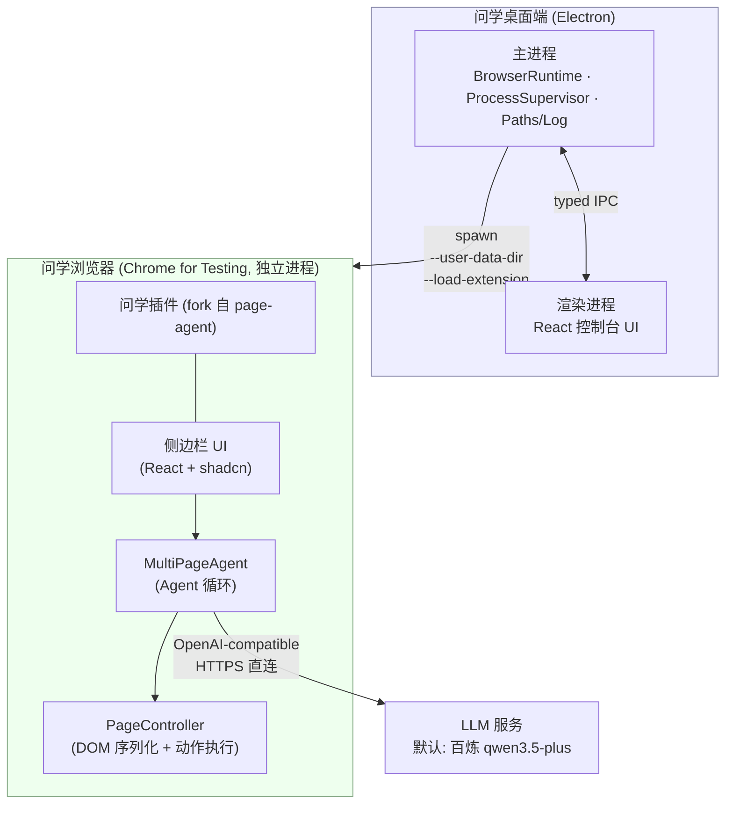

# 问学 WenXue — 技术基础设施文档（Tech Infra）

| 项       | 内容               |
| -------- | ------------------ |
| 文档版本 | v0.1（Demo 阶段）  |
| 日期     | 2026-06-11         |
| 状态     | 已评审             |
| 配套文档 | [PRD.md](./PRD.md) |

---

## 1. 总体架构



要点：

- **Demo 阶段桌面端与插件之间零运行时通信**。桌面端只负责"把一个装好插件的浏览器拉起来并看护进程"；插件独立完成全部智能交互。
- 浏览器是**独立 OS 进程**，不内嵌于 Electron（Electron 的扩展 API 仅支持子集，无法运行依赖 `chrome.sidePanel`/MV3 service worker 的插件，方案评审时已否决内嵌路线）。
- 未来桌面端 ↔ 插件通信的升级路径：插件连接桌面端本地 WebSocket（上游 page-agent 的 MCP hub 已验证该模式），不引入新机制。

## 2. 仓库结构（pnpm monorepo）

```
WenXue/
├── apps/
│   ├── desktop/                 # Electron 桌面端
│   │   ├── src/main/            # 主进程：窗口、IPC、浏览器运行时管理
│   │   ├── src/preload/         # contextBridge 类型化 API
│   │   ├── src/renderer/        # React 控制台 UI
│   │   ├── scripts/             # fetch-browser.ts / smoke-launch.ts
│   │   └── electron-builder.yml
│   └── extension/               # fork 自 page-agent packages/extension（品牌化改造）
├── packages/                    # vendor 自 page-agent 的支撑库（保持包名便于 diff 上游）
│   ├── core/                    # @page-agent/core         → Agent 循环
│   ├── llms/                    # @page-agent/llms         → OpenAI-compatible 客户端
│   ├── page-controller/         # @page-agent/page-controller → DOM 序列化与动作
│   └── ui/                      # @page-agent/ui           → 共享 UI
├── .project.agents/             # 治理与项目文档（ADS）
│   └── docs/context/            # PRD / TECH-INFRA / ARCHITECTURE / ROADMAP / CONVENTIONS / UIUX / UPSTREAM
├── third_party/
│   └── page-agent/LICENSE       # 上游 MIT 协议与版权声明
├── pnpm-workspace.yaml
└── package.json
```

vendor 原则：

- `packages/*` 四个库从上游 commit 快照复制，**包名不改**（`@page-agent/*`），`apps/extension` 内部以 `workspace:*` 引用，便于打补丁（默认模型、品牌文案、遮罩样式）；
- `.project.agents/docs/context/UPSTREAM.md` 记录：上游仓库地址、快照 commit hash、快照日期、本地改动清单、手动同步流程（`git diff` 上游 tag 对应目录后挑拣合入）；
- 上游为 MIT：保留 `third_party/page-agent/LICENSE`，各 vendor 包内保留原始版权头与 NOTICE（含其对 browser-use 的致谢声明）。

## 3. 技术栈与版本策略

| 层       | 选型                                                                                                              | 锁定策略                                                                                                                                      |
| -------- | ----------------------------------------------------------------------------------------------------------------- | --------------------------------------------------------------------------------------------------------------------------------------------- |
| 运行时   | Node 22 LTS / pnpm 9                                                                                              | `.nvmrc` + `packageManager` 字段                                                                                                              |
| 桌面壳   | Electron（当前 Stable 大版本）+ electron-vite + React 19 + TypeScript + Tailwind 4                                | renovate 手动升级，主版本升级走回归                                                                                                           |
| 打包     | electron-builder（macOS dmg / Windows nsis）                                                                      | 配置入库                                                                                                                                      |
| 浏览器   | Chrome for Testing，**单一版本全平台统一**，版本号记录于 `apps/desktop/browser.lock.json`                         | Demo 锁定一个 Stable 版本；升级 = 改 lock + 跑冒烟                                                                                            |
| 插件     | WXT 0.20 + React 19 + Tailwind 4 + shadcn（沿用上游）                                                             | 跟随 vendor 快照                                                                                                                              |
| LLM 接入 | OpenAI-compatible REST（上游 `@page-agent/llms`）                                                                 | 内置模型 M3 起经 CloudBase 网关并使用 CloudBase 用户 session 鉴权，默认文本 `qwen3.7-max`、默认视觉 `qwen3.7-plus`；自定义 BYO-Key 模型仍直连 |
| 后台管理 | `apps/admin` Vite + React + CloudBase Web Auth；`apps/admin-api` CloudBase Run Function mode + CloudBase Node SDK | 管理员只走内部 username/password；管理 API PUBLIC 但服务端强制 CloudBase Auth + `admin_users` 角色                                            |
| 测试     | vitest（沿用上游各包测试）+ 桌面端 CDP 冒烟脚本                                                                   | CI 必跑                                                                                                                                       |

## 4. 桌面端（Electron）设计

### 4.1 主进程模块（模块卡片与契约的权威是 ARCHITECTURE §2/§3，此处为速览）

| 模块                     | 职责                                                                                                                                                          |
| ------------------------ | ------------------------------------------------------------------------------------------------------------------------------------------------------------- |
| `BrowserResources`       | 定位资源路径（CfT 二进制、插件产物）、读 `browser.lock.json` 提供版本（纯函数）                                                                               |
| `LaunchConfig`           | 由路径参数组装 CfT argv（纯函数，参数全集见 §4.3）                                                                                                            |
| `BrowserSupervisor`      | 持有子进程句柄；监听 `exit`/`error`；状态机：`idle → launching → running → idle`；停止时 SIGTERM 后 2s 未退出则 SIGKILL；崩溃（非 0 退出码）或停止超时通知 UI |
| `ProfileStore`           | 画像目录创建与定位。Demo 仅 `default` 一个画像，目录结构按多画像设计                                                                                          |
| `AppPaths` / `AppLogger` | `app.getPath('userData')` 目录布局 / electron-log，主进程与 CfT stdout/stderr 各一份滚动日志                                                                  |

### 4.2 数据目录布局（多开预留）

```
<userData>/                      # macOS: ~/Library/Application Support/WenXue
├── profiles/
│   └── default/                 # CfT --user-data-dir（未来每实例一个目录）
└── logs/
    ├── main.log
    └── browser-default.log
```

### 4.3 CfT 启动参数表

| 参数                          | 值                            | 目的                                                                                        |
| ----------------------------- | ----------------------------- | ------------------------------------------------------------------------------------------- |
| `--user-data-dir`             | `<userData>/profiles/default` | 与系统浏览器完全隔离；CfT 自带 ProcessSingleton：同画像二次启动自动聚焦已有窗口，天然防多开 |
| `--load-extension`            | `<resources>/extension`       | 插件注入（CfT 永久保留该参数）                                                              |
| `--no-first-run`              | —                             | 跳过首次运行向导                                                                            |
| `--no-default-browser-check`  | —                             | 不弹"设为默认浏览器"                                                                        |
| `--hide-crash-restore-bubble` | —                             | 上次崩溃后不弹恢复气泡                                                                      |
| `--remote-debugging-pipe`     | 仅冒烟测试注入                | CDP 校验插件加载；**日常启动不开启**（避免暴露调试面）                                      |
| 位置参数                      | 欢迎页 URL（可选）            | 首屏引导（指向插件使用说明静态页）                                                          |

### 4.4 IPC 接口（preload 经 contextBridge 暴露）

| 通道                                                                   | 方向                    | 语义                                       |
| ---------------------------------------------------------------------- | ----------------------- | ------------------------------------------ |
| `browser:launch`                                                       | renderer → main         | 启动浏览器，幂等（running 时聚焦已有实例） |
| `browser:getStatus`                                                    | renderer → main         | 查询状态机当前态                           |
| `browser:status-changed`                                               | main → renderer（事件） | 状态变更推送                               |
| `app:getVersions`                                                      | renderer → main         | App / CfT / 插件三方版本号                 |
| `app:getShellInfo`                                                     | renderer → main         | 查询平台、frameless、安全区与最大化状态    |
| `app:minimizeWindow` / `app:toggleMaximizeWindow` / `app:requestClose` | renderer → main         | 自绘窗口按钮调用主进程窗口能力             |
| `app:openLogs`                                                         | renderer → main         | 打开本机日志目录                           |

安全基线：`contextIsolation: true`、`nodeIntegration: false`、`sandbox: true`；渲染层不接触 Node API。

### 4.5 进程生命周期决策

- 浏览器**不随 App 退出被强杀**：App 退出时若浏览器在运行，弹对话框让用户选择（一并关闭 / 仅关 App）。理由：浏览器内可能有用户未保存的工作。
- CfT 异常退出（非 0 退出码 / 信号）：系统通知 + UI 提供一键重启。

## 5. 浏览器运行时（Chrome for Testing）供应链

### 5.1 获取与锁版本

- 构建期由 `apps/desktop/scripts/fetch-browser.ts` 调用 **`@puppeteer/browsers`** 下载 `browser.lock.json` 指定版本，落盘 `.browsers/`（gitignore）；
- 国内构建环境设置镜像：`PUPPETEER_DOWNLOAD_BASE_URL=https://registry.npmmirror.com/-/binary/chrome-for-testing`；
- 产物矩阵：`mac-arm64`、`mac-x64`、`win64` 三份。

### 5.2 打包内置（已评审决策：内置而非首启下载）

electron-builder `extraResources` 将对应平台的 CfT 与插件构建产物放入安装包：

```yaml
extraResources:
  - from: '.browsers/chrome/${cftPlatformDir}' # 构建脚本按 target 解析
    to: 'browser'
  - from: '../extension/.output/chrome-mv3'
    to: 'extension'
```

- 运行时定位：`process.resourcesPath/browser/...`（macOS 为 `WenXue.app/Contents/Resources/browser/Google Chrome for Testing.app`，Windows 为 `resources\browser\chrome.exe`）；
- 代价（已接受）：安装包增大约 200MB；CfT 升级必须随 App 发版；
- **签名与公证（上线前必须解决，Demo 不做）**：macOS 公证会校验 .app 内全部 Mach-O 二进制，内置的 CfT.app 需在签名流程中以 App 自身证书重签（`codesign --deep` 不可靠，需脚本逐层签）并通过 notarytool 公证。这是内置路线最大的工程坑，M3 里程碑专项处理。Demo 阶段产物不签名，macOS 接收方需 `xattr -dr com.apple.quarantine` 放行。

## 6. 插件（fork 自 page-agent）改造清单

| #   | 改造项                                | 说明                                                                                                                                            |
| --- | ------------------------------------- | ----------------------------------------------------------------------------------------------------------------------------------------------- |
| 1   | 品牌化                                | 名称/图标/`_locales`（zh_CN、en）/侧边栏标题 → 问学 WenXue · ask for everything                                                                 |
| 2   | 固定插件 ID                           | manifest 增加 `key` 字段（自生成 RSA 公钥），保证未打包加载时 ID 稳定，存储与权限跨版本不漂移                                                   |
| 3   | 默认模型预置                          | 配置面板默认值：内置文本 `qwen3.7-max` + 内置视觉 `qwen3.7-plus`，经 CloudBase Gateway 使用用户 session；自定义模型仍由用户填写 baseURL/API Key |
| 4   | 权限审计                              | 收敛 `host_permissions` 与可选权限到 Demo 必需集合；逐项记录保留理由                                                                            |
| 5   | 页面级 API（`window.PAGE_AGENT_EXT`） | 上游的 token 鉴权对外 API，Demo 不需要 → 默认关闭（编译开关保留，正式版再评估）                                                                 |
| 6   | 遥测确认                              | 审计上游是否有任何外发统计/Demo LLM 端点残留，全部移除或指向空实现                                                                              |
| 7   | 历史与存储                            | 沿用 IndexedDB 历史、`chrome.storage.local` 存配置（含 API Key，不出本机）                                                                      |

- 权限审计补充：保留 `webNavigation` 权限，用于 `list_frames` 获取 frame 元数据，并支撑按 `frame_id` 执行 JavaScript；这是跨 frame JS 能力对权限最小化原则的显式权衡。
- 页面级 API 补充：本期 main-world executor 是独立 eval 通道，仅服务 `execute_javascript` 的 `world: 'main'`，不启用上游 `window.PAGE_AGENT_EXT`。

构建：`pnpm -F extension build` → WXT 产出 `.output/chrome-mv3/`，被 desktop 打包步骤消费。

## 7. 业务边界矩阵（插件 / 桌面端 / 未来后端）

> 原则：**插件管"智能"，桌面端管"运行时与用户 session handoff"，后端管"密钥托管、用户鉴权与计量"。**

| 能力                                    | 插件                                                                     | 桌面端                                                                     | 云端后端（M2）                                                                                                                  |
| --------------------------------------- | ------------------------------------------------------------------------ | -------------------------------------------------------------------------- | ------------------------------------------------------------------------------------------------------------------------------- |
| 对话 UI、Agent 循环、DOM 操作、任务历史 | ✅ 唯一归属                                                              | —                                                                          | —                                                                                                                               |
| LLM 调用                                | ✅ Demo 直连厂商 API；M2 起调自家网关                                    | 永不经手对话内容                                                           | ✅ OpenAI-compatible 透传网关                                                                                                   |
| CfT 版本/进程/画像管理、插件注入        | —                                                                        | ✅ 唯一归属                                                                | —                                                                                                                               |
| 用户 session、订阅、计费、用量展示      | 仅消费启动器交接的用户 session；refresh token 只用于刷新内置模型网关会话 | ✅ CloudBase 用户 id + 密码登录/注册；tokens UI 优先读当前用户云端 summary | ✅ CloudBase access token introspection、`user_accounts` 鉴权、计量、当前用户 summary、后台 tokens 看板与用户状态；订阅账单后置 |
| 密钥                                    | Demo：用户 Key 存 `chrome.storage.local`；内置模型 M3 起仅存用户 session | M2：登录并向插件交接用户 session；不保存厂商 Key                           | M2：厂商 Key 仅存服务端                                                                                                         |
| 升级通道                                | 随 App 发版                                                              | electron-updater（M3 启用）                                                | 独立部署                                                                                                                        |

**M2 网关切换设计（2026-07-02 改为用户 session）**：插件的 LLM 客户端只认 `baseURL + 鉴权头`。切换到计费网关时，仅需把默认 baseURL 指向 CloudBase LLM Gateway、把 API Key 字段换成当前 CloudBase access token——Agent 核心零改动。这是"直连优先"决策的可演进性依据。M0 先做端到端薄切片：扩展/脚本 → CloudBase Run Function mode `wenxue-llm-gateway` → DashScope SSE，必须验证流式末块 usage 非 0 与延迟基线。M3 默认内置文本模型按产品要求为 `qwen3.7-max`，视觉模型为 `qwen3.7-plus`；插件启动不因 session 缺失阻断，首次发送进入聊天后由网关返回「登录已过期/无权限」错误。网关每次请求 introspect CloudBase access token 并读取 `user_accounts`，后台禁用用户后下一次请求即拒绝，tokens usage 仍逐次写入。

### 7.1 CloudBase LLM Gateway（M0–M5）

- 运行形态：CloudBase Run Function 模式，服务名 `wenxue-llm-gateway`，环境 `wenxue-d8gz76tacc3659f05`（ap-shanghai）。
- 入口：OpenAI-compatible `POST /v1/chat/completions`；M4 起同服务暴露 `GET /v1/usage/summary` 供启动器 tokens 页读取当前用户计量。
- 鉴权：请求 `Authorization: Bearer <CloudBase accessToken>`；网关 introspect CloudBase Auth access token 后取得用户 uid，再读取 `user_accounts[_id=uid]`，仅 `status=active` 放行。
- 注册：`/v1/auth/register` 先通过 Tencent Cloud TCB `CreateUser` 创建 CloudBase Auth externalUser，再用同 uid 写入 `user_accounts.status=active`，保证新用户注册登录后可直接调用内置模型；后台仍可通过 AdminApi 禁用。
- 上游：`https://dashscope.aliyuncs.com/compatible-mode/v1/chat/completions`；DashScope Key 只来自 CloudBase Run 环境变量 `DASHSCOPE_API_KEY`。
- 流式计量：当请求 `stream=true` 时，网关必须注入 `stream_options: { include_usage: true }`，否则 DashScope 流式响应不返回 usage。
- 计量：M0 捕获 usage 与端到端延迟；M1 后写 `token_usage`，记录只含 CloudBase 用户 uid、model、tokens、latency、createdAt；M4 的 `usage-summary` target 实时读取当前用户 uid 记录并返回脱敏 `TokenUsageSummary`（recent id 不含 uid）。
- 访问：M0/M1 部署 `OpenAccessTypes:["PUBLIC"]`、`MinNum:1`、`Cpu:0.5`、`Mem:1`；公开多用户前必须补限流。
- 用户 session：M2 使用 CloudBase Web Auth username/password；桌面端不生成、展示、复制或持久化 `wxm_` 机器 token；桌面端/后台/扩展内置当前环境的 CloudBase publishable key，`VITE_CLOUDBASE_ACCESS_KEY` 仅作为环境覆盖入口。
- 会话交接：M2 使用一次性 localhost 页面 + `externally_connectable` 把 `userId`、`accessToken`、`refreshToken`、`expiresAt` 与网关地址交给插件 background；不经远端服务，不向 Agent 发送控制指令。
- 切换纪律：M3 已把内置模型运行时配置切到网关，`apiKey` 字段只注入插件侧当前 access token；M5 已删除本地百炼 Key 与本地直连兜底开关，旧 DashScope 直连 baseURL 仅用于自动迁移到网关默认配置。
- 用量展示：M4 新增桌面 `UsageCloudClient`，通过主进程当前用户 session 调 `GET /v1/usage/summary`；成功后按 userId 写 `<userData>/token-usage-summary-cache.json`，失败时 `tokens:getSummary` 回退本地 `TokenUsageStore`。

### 7.2 后台管理（M4.6）

- 前端：`apps/admin` 静态站点，使用 CloudBase Web SDK 的 username/password 登录；路由守卫必须使用 `auth.getSession()`，不得使用已废弃且可能误判的 `getLoginState()`；当前通过 CloudBase Run 静态容器发布，避免 CloudBase 共享静态托管域返回 attachment 头；默认使用内置 publishable key，部署可用 `VITE_CLOUDBASE_ACCESS_KEY` 覆盖。
- 后端：`apps/admin-api` CloudBase Run Function mode，PUBLIC 访问但所有业务接口先校验 CloudBase Auth bearer，再查 `admin_users` 角色；前端不直接读写 NoSQL。
- 数据：`user_accounts` 由后台管理/初始化控制 active 或 disabled；`admin_users` 由内部初始化；`user_permission_audit` 由 AdminApi 写入。
- 当前公网部署（2026-07-01）：
  - AdminConsole：`https://wenxue-admin-web-4037646-1427406869.ap-shanghai.run.tcloudbase.com/`，CloudBase Run 容器服务 `wenxue-admin-web`，`OpenAccessTypes:["PUBLIC"]`、`MinNum:1`、`Cpu:0.25`、`Mem:0.5`；构建期注入真实 Publishable Key 与 AdminApi base URL。
  - AdminApi：`https://wenxue-admin-api-4037646-1427406869.ap-shanghai.run.tcloudbase.com`，CloudBase Run 容器服务 `wenxue-admin-api`，`OpenAccessTypes:["PUBLIC"]`、`MinNum:1`、`Cpu:0.5`、`Mem:1`。
  - 授权内部账号：`administrator`、`outas`、`spike2801` 的 CloudBase uid 已写入 `admin_users`，`role=admin`、`status=active`。
  - 数据权限：`admin_users`、`user_accounts`、`user_permission_audit` 为 `ADMINONLY`；后台前端只能经 AdminApi 访问。
  - 待重新验证：公网 AdminApi 未带 bearer token 返回 401；公网 AdminConsole HTML/JS/CSS 资源返回 200 且无 attachment 头；公网 LLM Gateway `GET /v1/usage/summary` 接受 CloudBase access token 并只返回当前用户脱敏 summary。

## 8. 构建、CI 与分发

### 8.1 本地构建流水线

```
pnpm install
pnpm -r test                         # vitest：core / llms / page-controller
pnpm -F extension build              # WXT → .output/chrome-mv3
pnpm -F desktop fetch-browser        # 按 browser.lock.json 拉取 CfT（带镜像）
pnpm -F desktop build                # electron-vite 构建
pnpm -F desktop dist:mac / dist:win  # electron-builder 出 dmg / nsis
```

### 8.2 CI（GitHub Actions，Demo 期最小集）

- PR 门禁：lint + typecheck + `pnpm -r test`；
- 打包流水线：macOS runner 出 dmg（arm64、x64），Windows runner 出 nsis（x64）；CfT 下载带缓存；
- 产物上传 Actions artifacts（Demo 内部分发，不接更新服务器）。

### 8.3 冒烟测试（发布门禁）

`scripts/smoke-launch.ts`：以 `--remote-debugging-pipe` 启动打包产物中的 CfT → CDP `Target.getTargets` 断言问学插件 service worker 存在 → 正常退出无残留进程。双平台 CI 各跑一次。

## 9. 错误处理与可观测性

| 故障                                      | 检测                                          | 处置                                                       |
| ----------------------------------------- | --------------------------------------------- | ---------------------------------------------------------- |
| CfT 启动失败（二进制缺失/被杀毒拦截）     | spawn `error` 事件                            | UI 明确报错 + 指引（日志路径、重装提示）                   |
| CfT 运行中崩溃                            | 非 0 退出码                                   | 系统通知 + 一键重启；日志留档                              |
| 插件未加载                                | 冒烟测试期 CDP 校验；运行期用户反馈           | 属发布门禁问题，不做运行时自动修复                         |
| LLM 401/限流/超时                         | 插件内（上游已有处理）/ CloudBase LLM Gateway | 侧边栏内联错误与重试引导；网关记录无敏感信息的状态码与延迟 |
| 页面不可操作（sandbox/CSP/canvas/验证码） | Agent 自报告；`execute_javascript` 超时或错误 | 提示人工接管，任务可完成后继续或暂停并保留上下文           |
| 日志                                      | `<userData>/logs/` 滚动文件                   | Demo 不上报云端；M1 评估接入上报                           |

## 10. 安全与隐私基线

- 内置模型提示词/对话经 CloudBase LLM Gateway 转发百炼；网关不持久化正文，只记录 CloudBase 用户 uid 维度 token usage；自定义 BYO-Key 模型仍直连用户配置的 baseURL；
- 百炼 API Key 仅存 CloudBase Run 环境变量，永不下发到插件/桌面/打包产物/本地配置；
- Electron 渲染层全沙箱（contextIsolation + sandbox），IPC 面最小化且必须登记于 `ARCHITECTURE.md §3.2`；
- CfT 日常启动不开远程调试端口/管道；
- 插件权限最小化（改造清单 #4），页面级 API 默认关闭（#5）；
- `execute_javascript` 默认启用以满足真实网页排障/动态 DOM/iframe 场景；高风险部署可通过 `experimentalScriptExecutionTool: false` 关闭。`world: 'main'` 与 `frame_id` 仍受 sandbox、CSP、特权页、跨源隔离和执行超时约束，不承诺绕过页面安全边界；
- 画像目录权限沿用 OS 用户级隔离；不写入任何系统级配置（无需管理员权限安装）。

## 11. 测试策略

| 层         | 手段                                         | 范围                                                      |
| ---------- | -------------------------------------------- | --------------------------------------------------------- |
| vendor 库  | 上游 vitest 套件原样保留                     | core 的 Agent 循环、llms 客户端、page-controller DOM 处理 |
| 插件 UI    | Demo 期手动验收（PRD F2–F4 验收标准）        | 侧边栏、配置面板、历史                                    |
| 桌面端     | 单测（状态机、参数组装、路径解析）+ CDP 冒烟 | F1 验收标准自动化覆盖核心段                               |
| 端到端演示 | 演示脚本（research + 答题样例页）人工演练    | PRD 第 9 节成功指标                                       |

## 12. 关键决策记录（ADR 摘要）

| #   | 决策                                                                                                                                                   | 备选与否决理由                                                                                                                   |
| --- | ------------------------------------------------------------------------------------------------------------------------------------------------------ | -------------------------------------------------------------------------------------------------------------------------------- |
| 1   | 浏览器内核 = Chrome for Testing，打包内置                                                                                                              | 品牌版 Chrome：137+ 已移除 `--load-extension`；首启下载：被否（要求离线可用、首启零等待）；Playwright Chromium：无增益多一层依赖 |
| 2   | 插件 = fork page-agent extension 整包                                                                                                                  | npm 依赖自建插件壳：多 1–2 周；完全自研：Demo 周期不可接受                                                                       |
| 3   | Demo 初期 LLM = 插件直连；2026-06-28 起提前执行 CloudBase LLM Gateway，M3 默认文本 `qwen3.7-max`、视觉 `qwen3.7-plus`，M5 删除内置本地 Key 与 fallback | 本地代理：不满足服务端密钥托管与计量；直接删除本地 Key：切换风险过高，所以先 M3 切流验证，再 M5 删除                             |
| 7   | CloudBase LLM Gateway = CloudBase Run Function mode + DashScope OpenAI-compatible 透传                                                                 | 云函数：SSE 长连接与服务形态不如 Function mode 云托管；容器模式：M0 过重                                                         |
| 4   | 单 pnpm monorepo，vendor 上游                                                                                                                          | 双仓库 fork 跟踪：小团队跨仓成本高于上游同步收益                                                                                 |
| 5   | 浏览器进程不内嵌 Electron                                                                                                                              | Electron 扩展 API 子集跑不动 MV3 sidePanel 插件                                                                                  |
| 6   | App 退出不强杀浏览器                                                                                                                                   | 保护用户未保存的页面工作                                                                                                         |

## 13. 里程碑对应的 Infra 演进

| 里程碑  | Infra 新增                                                                                                                                                   |
| ------- | ------------------------------------------------------------------------------------------------------------------------------------------------------------ |
| M0 Demo | 本文档全部内容                                                                                                                                               |
| M1      | 多 profile 实例管理、CfT 升级机制、崩溃恢复、日志上报                                                                                                        |
| M2      | LLM 网关（OpenAI-compatible 透传 + 用户 session 鉴权计量）、插件 session 化、一次性 localhost 用户 session 交接；后续如需 Agent 控制再接 App↔插件本地 WS hub |
| M3      | macOS 重签 + 公证流水线、Windows 签名、electron-updater 接入、官网分发                                                                                       |
