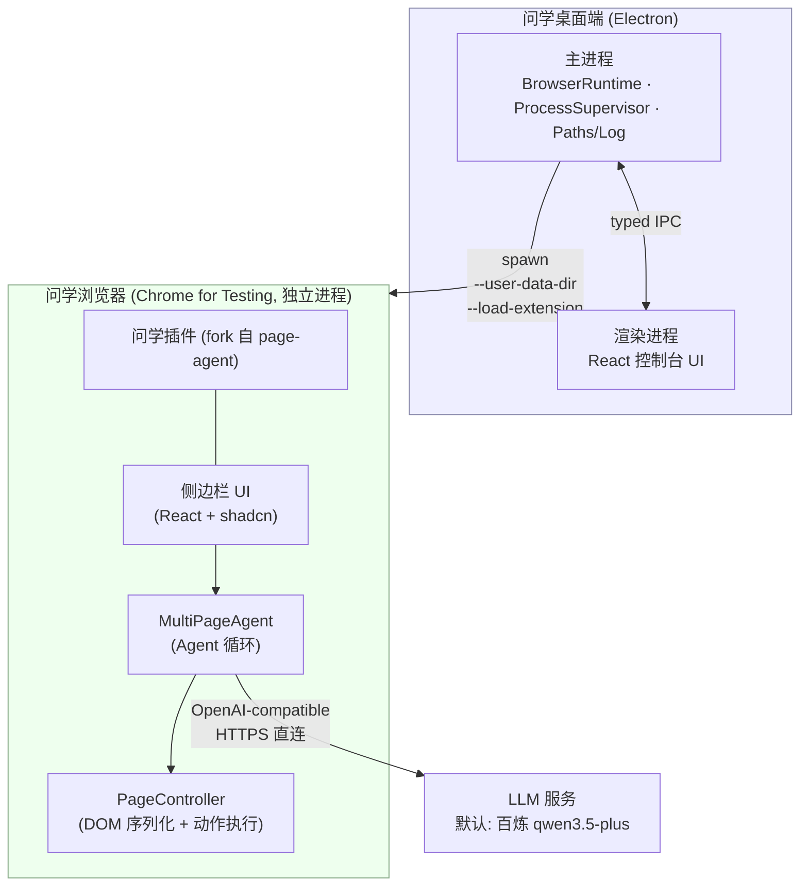

# 问学 WenXue — 技术基础设施文档（Tech Infra）

> 2026-09-27：当前产品继续使用 Electron + CfT，Chromium 重构方案已废弃。P2 的 AdminApi schema 2、CI seal v3 与本机发布脚本已实现；桌面候选 `0.1.1-beta.1` 已由 GitHub Actions run `36260499160` 构建并成功登记为 verified candidate，尚未创建 rollout 或完成安装/升级验收。P5 两端实机验收仍待完成。

> P1 历史核验见[发布就绪报告](../../log/2026-09-25-p1-release-readiness.md)。组合服务 039 已上线；后台定向公告创建成功，Mac 测试 A 已由用户目视看到弹窗并点击确认。服务端回执独立核验、公告在线时延和跨设备去重仍待验收。`0.1.1-beta.1` 候选已登记并在后台显示 Ed25519 verified；尚无 rollout。正式域名不能直接替代客户端的完整网关 origin。以下带日期的历史快照不作为当前就绪证明。

> 2026-09-26：本轮构建与验收范围收敛为 Windows x64 / macOS arm64，Intel Mac 暂缓；P2 本地验证与构建/部署状态见[本次执行日志](../../log/2026-09-26-release-key-and-protocol.md)。2026-09-27 新候选 CI、公开托管回读和候选登记结果见[候选登记日志](../../log/2026-09-27-beta-candidate-registration.md)。

| 项       | 内容               |
| -------- | ------------------ |
| 文档版本 | v0.2（当前运行时） |
| 日期     | 2026-07-17         |
| 状态     | 已评审             |
| 配套文档 | [PRD.md](./PRD.md) |

---

## 1. 总体架构



要点：

- **Demo 阶段桌面端与插件之间零运行时通信**。桌面端只负责"把一个装好插件的浏览器拉起来并看护进程"；插件独立完成全部智能交互。
- 浏览器是**独立 OS 进程**，不内嵌于 Electron（Electron 的扩展 API 仅支持子集，无法运行依赖 `chrome.sidePanel`/MV3 service worker 的插件，方案评审时已否决内嵌路线）。
- 未来桌面端 ↔ 插件通信的升级路径：插件连接桌面端本地 WebSocket（上游 page-agent 的 MCP hub 已验证该模式），不引入新机制。

## 2. 仓库结构（pnpm monorepo）

```
WenXue/
├── apps/
│   ├── desktop/                 # Electron 桌面端
│   │   ├── src/main/            # 主进程：窗口、IPC、浏览器运行时管理
│   │   ├── src/preload/         # contextBridge 类型化 API
│   │   ├── src/renderer/        # React 控制台 UI
│   │   ├── scripts/             # fetch-browser.ts / smoke-launch.ts
│   │   └── electron-builder.yml
│   └── extension/               # fork 自 page-agent packages/extension（品牌化改造）
├── packages/
│   ├── client-operations/       # 一方 @wenxue/client-operations：分发契约与固定弹窗
│   ├── core/                    # @page-agent/core         → Agent 循环（以下四包为 vendor）
│   ├── llms/                    # @page-agent/llms         → OpenAI-compatible 客户端
│   ├── page-controller/         # @page-agent/page-controller → DOM 序列化与动作
│   └── ui/                      # @page-agent/ui           → 共享 UI
├── .project.agents/             # 治理与项目文档（ADS）
│   └── docs/context/            # PRD / TECH-INFRA / ARCHITECTURE / ROADMAP / CONVENTIONS / UIUX / UPSTREAM
├── third_party/
│   └── page-agent/LICENSE       # 上游 MIT 协议与版权声明
├── pnpm-workspace.yaml
└── package.json
```

包边界：

- `packages/client-operations` 是问学一方包，只包含无 IO 类型/校验/匹配纯函数与固定 React 展示组件，
  不受 vendor I5 约束；

- `packages/*` 四个库从上游 commit 快照复制，**包名不改**（`@page-agent/*`），`apps/extension` 内部以 `workspace:*` 引用，便于打补丁（默认模型、品牌文案、遮罩样式）；
- `.project.agents/docs/context/UPSTREAM.md` 记录：上游仓库地址、快照 commit hash、快照日期、本地改动清单、手动同步流程（`git diff` 上游 tag 对应目录后挑拣合入）；
- 上游为 MIT：保留 `third_party/page-agent/LICENSE`，各 vendor 包内保留原始版权头与 NOTICE（含其对 browser-use 的致谢声明）。

## 3. 技术栈与版本策略

| 层       | 选型                                                                                                              | 锁定策略                                                                                                                                      |
| -------- | ----------------------------------------------------------------------------------------------------------------- | --------------------------------------------------------------------------------------------------------------------------------------------- |
| 运行时   | Node 22 LTS / pnpm 9                                                                                              | `.nvmrc` + `packageManager` 字段                                                                                                              |
| 桌面壳   | Electron（当前 Stable 大版本）+ electron-vite + React 19 + TypeScript + Tailwind 4                                | renovate 手动升级，主版本升级走回归                                                                                                           |
| 打包     | electron-builder（macOS dmg / Windows nsis）                                                                      | 配置入库                                                                                                                                      |
| 应用更新 | 主进程 HTTPS 下载 + SHA-512/size 校验 + 系统 shell open                                                           | `manual-unsigned`；候选清单 Ed25519 验签，用户两次明确点击，安装由操作系统安装器接管                                                          |
| 浏览器   | Chrome for Testing，**单一版本全平台统一**，版本号记录于 `apps/desktop/browser.lock.json`                         | Demo 锁定一个 Stable 版本；升级 = 改 lock + 跑冒烟                                                                                            |
| 插件     | WXT 0.20 + React 19 + Tailwind 4 + shadcn（沿用上游）                                                             | 跟随 vendor 快照                                                                                                                              |
| LLM 接入 | OpenAI-compatible REST（上游 `@page-agent/llms`）                                                                 | 内置模型 M3 起经 CloudBase 网关并使用 CloudBase 用户 session 鉴权，默认文本 `qwen3.7-max`、默认视觉 `qwen3.7-plus`；自定义 BYO-Key 模型仍直连 |
| 云端网关 | CloudBase Run 容器 + Functions Framework 多 target + CloudBase Auth HTTP / Tencent Cloud TCB API                  | 注册在桌面通过 CloudBase 邮箱验证后 `signUp`；激活与所有受保护请求读取 `/auth/v1/user/me`，不以 NoSQL 记录作为账号授权条件                    |
| 后台管理 | `apps/admin` Vite + React + CloudBase Web Auth；`apps/admin-api` CloudBase Run Function mode + CloudBase HTTP API | 管理员用邮箱密码或内置管理员账号密码；管理 API PUBLIC 但服务端强制 CloudBase Auth + `admin_users` 角色                                        |
| 实时信号 | CloudBase NoSQL `watch()` revision 文档                                                                           | 消息 signal 仅登录只读，更新 signal 公开只读；正文/目标/候选不进入 signal                                                                     |
| 更新存储 | CloudBase 静态托管的独立版本路径                                                                                  | 无查询参数的 HTTPS 匿名读；本机签名后由受权操作者通过 managed upload 上传，公开回读逐字节核验后注册；现有私有业务存储桶不改 ACL               |
| 测试     | vitest（沿用上游各包测试）+ 桌面端 CDP 冒烟脚本                                                                   | CI 必跑                                                                                                                                       |

## 4. 桌面端（Electron）设计

### 4.1 主进程模块（模块卡片与契约的权威是 ARCHITECTURE §2/§3，此处为速览）

| 模块                     | 职责                                                                                                                                                                       |
| ------------------------ | -------------------------------------------------------------------------------------------------------------------------------------------------------------------------- |
| `BrowserResources`       | 定位资源路径（CfT 二进制、插件产物）、读 `browser.lock.json` 提供版本（纯函数）                                                                                            |
| `LaunchConfig`           | 由路径参数组装 CfT argv（纯函数，参数全集见 §4.3）                                                                                                                         |
| `BrowserSupervisor`      | 持有子进程句柄；监听 `exit`/`error`；状态机：`idle → launching → running → idle`；停止时 SIGTERM 后 2s 未退出则 SIGKILL；崩溃（非 0 退出码）或停止超时通知 UI              |
| `ProfileStore`           | 画像目录创建与定位；启动前安全开启专用画像的 unpacked-extension Developer Mode（POSIX SingletonLock / Windows lockfile 防并发占用，Preferences 临时文件 fsync 后原子替换） |
| `AppPaths` / `AppLogger` | `app.getPath('userData')` 目录布局 / electron-log，主进程与 CfT stdout/stderr 各一份滚动日志                                                                               |
| `DesktopUpdateService`   | 主进程更新状态机、策略/清单/灰度校验、用户触发下载、SHA-512 校验、打开前策略复核与系统安装器交接                                                                           |

renderer 的 `DesktopAnnouncementService` 负责用户消息 watch/fetch/ack/重连与队列，不放入 React 展示组件；
renderer 的 `DesktopReleaseSignalService` 负责公开 release signal watch/退避/轮询且只发 check intent；
main 的 DesktopUpdateService 不加载 CloudBase Web SDK。模块卡片和依赖权威见 `ARCHITECTURE.md §2/§3`。

### 4.2 数据目录布局（多开预留）

```
<userData>/                      # macOS: ~/Library/Application Support/WenXue
├── profiles/
│   └── default/                 # CfT --user-data-dir（未来每实例一个目录）
├── logs/
│   ├── main.log
│   └── browser-default.log
├── update-install-id             # 随机 UUID，只用于稳定灰度分桶
└── update-downloads/             # 已校验的 manual-unsigned DMG/NSIS；候选失效后清理
```

### 4.3 CfT 启动参数表

| 参数                          | 值                            | 目的                                                                                        |
| ----------------------------- | ----------------------------- | ------------------------------------------------------------------------------------------- |
| `--user-data-dir`             | `<userData>/profiles/default` | 与系统浏览器完全隔离；CfT 自带 ProcessSingleton：同画像二次启动自动聚焦已有窗口，天然防多开 |
| `--disable-extensions-except` | `<resources>/extension`       | 专用 CfT 画像只启用问学扩展，避免其他扩展干扰消息与截图链路                                 |
| `--load-extension`            | `<resources>/extension`       | 插件注入（CfT 永久保留该参数）                                                              |
| `--no-first-run`              | —                             | 跳过首次运行向导                                                                            |
| `--no-default-browser-check`  | —                             | 不弹"设为默认浏览器"                                                                        |
| `--hide-crash-restore-bubble` | —                             | 上次崩溃后不弹恢复气泡                                                                      |
| `--disable-infobars`          | —                             | 隐藏不可手动关闭的 Chrome for Testing 顶部说明栏                                            |
| `--remote-debugging-pipe`     | 仅冒烟测试注入                | CDP 校验插件加载；**日常启动不开启**（避免暴露调试面）                                      |
| 位置参数                      | 有序启动 URL（可选）          | 首项为前台标签、其余为后台标签；会话交接使用“新标签页、一次性 localhost 页”的顺序           |

### 4.4 IPC 接口（preload 经 contextBridge 暴露）

| 通道                                                                   | 方向                    | 语义                                       |
| ---------------------------------------------------------------------- | ----------------------- | ------------------------------------------ |
| `browser:launch`                                                       | renderer → main         | 启动浏览器，幂等（running 时聚焦已有实例） |
| `browser:getStatus`                                                    | renderer → main         | 查询状态机当前态                           |
| `browser:status-changed`                                               | main → renderer（事件） | 状态变更推送                               |
| `app:getVersions`                                                      | renderer → main         | App / CfT / 插件三方版本号                 |
| `app:getShellInfo`                                                     | renderer → main         | 查询平台、frameless、安全区与最大化状态    |
| `app:minimizeWindow` / `app:toggleMaximizeWindow` / `app:requestClose` | renderer → main         | 自绘窗口按钮调用主进程窗口能力             |
| `app:openLogs`                                                         | renderer → main         | 打开本机日志目录                           |
| `app:openExternal`                                                     | renderer → main         | 仅在系统浏览器打开校验后的 HTTPS URL       |
| `updates:getState` / `updates:check`                                   | renderer → main         | 查询/手动刷新更新策略                      |
| `updates:download` / `updates:openInstaller`                           | renderer → main         | 用户分别明确触发下载/打开系统安装包        |
| `updates:state-changed`                                                | main → renderer（事件） | 更新状态与进度                             |

安全基线：`contextIsolation: true`、`nodeIntegration: false`、`sandbox: true`；渲染层不接触 Node API。

### 4.5 进程生命周期决策

- 浏览器**不随 App 退出被强杀**：App 退出时若浏览器在运行，弹对话框让用户选择（一并关闭 / 仅关 App）。理由：浏览器内可能有用户未保存的工作。
- CfT 异常退出（非 0 退出码 / 信号）：系统通知 + UI 提供一键重启。

## 5. 浏览器运行时（Chrome for Testing）供应链

### 5.1 获取与锁版本

- 构建期由 `apps/desktop/scripts/fetch-browser.ts` 调用 **`@puppeteer/browsers`** 下载 `browser.lock.json` 指定版本，落盘 `.browsers/`（gitignore）；
- 国内构建环境设置镜像：`PUPPETEER_DOWNLOAD_BASE_URL=https://registry.npmmirror.com/-/binary/chrome-for-testing`；
- 当前正式产物矩阵：`mac-arm64`、`win64` 两份（2026-09-26 用户确认）。Intel Mac 暂不适配；历史下载器中的 `mac-x64` 能力不作为本轮构建或验收要求。

### 5.2 打包内置（已评审决策：内置而非首启下载）

electron-builder `extraResources` 将对应平台的 CfT 与插件构建产物放入安装包：

```yaml
extraResources:
  - from: '../../.browsers' # 原样拷贝；CI 构建前按 target 只拉一份平台 CfT，本地多平台并存时需自行裁剪
    to: 'browser'
  - from: '../extension/.output/chrome-mv3'
    to: 'extension'
```

- 运行时定位：`process.resourcesPath/browser/` 下保留与 `.browsers` 相同的 Puppeteer 缓存布局；`BrowserResources.browserBinary()` 以该缓存相对路径拼接（macOS arm64 为 `WenXue.app/Contents/Resources/browser/chrome/mac_arm-<version>/chrome-mac-arm64/Google Chrome for Testing.app`，Windows 为 `resources\browser\chrome\win64-<version>\chrome-win64\chrome.exe`）；
- 代价（已接受）：安装包增大约 200MB；CfT 升级必须随 App 发版；
- **当前分发限制**：Electron + 内置 CfT 的 DMG/NSIS 以 `manual-unsigned` 方式交付；系统可能显示
  未签名来源警告。发布说明、后台候选详情和更新弹窗必须如实提示，用户自行决定是否在系统界面继续，
  应用不执行绕过系统安全机制的命令。

## 6. 插件（fork 自 page-agent）改造清单

| #   | 改造项                                | 说明                                                                                                                                                                                                                     |
| --- | ------------------------------------- | ------------------------------------------------------------------------------------------------------------------------------------------------------------------------------------------------------------------------ |
| 1   | 品牌化                                | 名称/图标/`_locales`（zh_CN、en）/侧边栏标题 → 问学 WenXue · ask for everything                                                                                                                                          |
| 2   | 固定插件 ID                           | manifest 增加 `key` 字段（自生成 RSA 公钥），保证未打包加载时 ID 稳定，存储与权限跨版本不漂移                                                                                                                            |
| 3   | 默认模型预置                          | 配置面板默认值：内置文本 `qwen3.7-max` + 内置视觉 `qwen3.7-plus`，经 CloudBase Gateway 使用用户 session；自定义模型仍由用户填写 baseURL/API Key                                                                          |
| 4   | 权限审计                              | 收敛 `host_permissions` 与可选权限到 Demo 必需集合；逐项记录保留理由                                                                                                                                                     |
| 5   | 页面级 API（`window.PAGE_AGENT_EXT`） | 上游的 token 鉴权对外 API，Demo 不需要 → 默认关闭（编译开关保留，正式版再评估）                                                                                                                                          |
| 6   | 遥测确认                              | 审计上游是否有任何外发统计/Demo LLM 端点残留，全部移除或指向空实现                                                                                                                                                       |
| 7   | 历史与存储                            | 沿用 IndexedDB 历史、`chrome.storage.local` 存配置（含 API Key，不出本机）                                                                                                                                               |
| 8   | 通用视觉能力入口                      | `visual_observe` legacy/Observe 保持结构化观察；capability mode 经内部 registry 显式分派；图片本体不落盘、不入历史、不入日志                                                                                             |
| 9   | 统一答题 capability                   | `question_solver` 通过 `QUESTION_SOLVER_CONTROL` v1 task/run/request/cancel envelope 精确路由 managed tab/frame/document；DOM/runtime 优先、bound screenshot、结构化模型、写前快照、精确填写/验证/恢复；最终提交永远人工 |

- 权限审计补充：保留 `webNavigation` 权限，用于 `list_frames` 获取 frame 元数据，并支撑按 `frame_id` 执行 JavaScript；这是跨 frame JS 能力对权限最小化原则的显式权衡。
- 权限审计补充：`visual_observe` 使用 `chrome.tabs.captureVisibleTab`，但只在 target managed tab 同时是 last-focused window 的 active 可见 tab 时捕获；否则 `waiting_for_foreground`，禁止 `tabs.update/windows.update` 抢焦点。源格式 PNG，crop 以 bitmap/top-viewport 实测比例计算并编码 JPEG 0.85；截图前后复核 task lease、URL/page/frame binding。特权页、浏览器 UI 或不可截图页面 fail closed。
- QuestionSolver 不新增 host 权限（沿用 `<all_urls>`），但为固定 MAIN-world operation 新增 manifest `scripting` permission。content script 使用 `allFrames:true + matchOriginAsFallback:true`；background 以 task lease + run/request + frame/document token 路由。content host 只能经 parent-bound `QUESTION_SOLVER_MAIN_WORLD` 子 RPC 请求源码内 exhaustive allowlist，再由 background 调用 `chrome.scripting.executeScript({world:'MAIN'})`；不接受脚本字符串。
- frame bootstrap 使用 background nonce challenge + content host 主动 registration，以真实 MessageSender 建立 FrameRef；effectful content/MAIN operation 只按 Chrome documentId 定向。run 最小 lease/lifecycle/effect ledger（含 snapshot digest）写 `chrome.storage.session` 供 MV3 worker rehydrate，题目、答案、图片和凭据不进入该存储；完整 control snapshot 只在 caller 内存与 content PendingControlJournal 暂存，background-only recovery capability 只能驱动 restore/verify cleanup。
- 同一 tab 的 fill/navigation 由 run-scoped mutation owner 独占，capture/scroll/write/restore 经过 tab effect lock；cleanup 用户侧超时但 effect 未 settle 时 owner 转为 document quarantine，直到 settle+恢复或 document 权威失效。全扩展 `captureVisibleTab` 起始间隔至少 550ms。图片请求只接受 locator/anchor/binding；fetch 失败的 bound crop 由 background 在同一 authenticated request 内 one-shot capture + finally restore，字节再通过 hard-omitted internal envelope 进入 caller EphemeralImageStore（2 MiB/asset、16 MiB/run），普通 RPC/ResultStore/history 仅见 asset ref 或图片标签。
- 当前题 screenshot 通过 child→parent `postMessage/event.source` anchor 逐层换算 cross-origin iframe rect，保存/恢复各层 scroll，只接受 translate/scale；无法完整绑定时 review，不发送整屏兜底，也不发送 tab URL/title。
- 页面级 API 补充：现有 main-world eval executor 仍只服务显式 `execute_javascript` 的 `world:'main'`；QuestionSolver 不调用该通道，也不启用上游 `window.PAGE_AGENT_EXT`。

构建：`pnpm -F extension build` → WXT 产出 `.output/chrome-mv3/`，被 desktop 打包步骤消费。候选发布流水线以同一个 `WENXUE_GATEWAY_BASE_URL` 同时构建插件与桌面，并验证两份 bundle 的内嵌值一致；该值必须是无凭据、path、query、fragment 的 HTTPS origin（本地开发仅额外允许 loopback HTTP）。仓库根 `pnpm dev` 先构建 extension 再启动 desktop，避免持久画像注册旧 MV3 service worker；修改 background 后必须重启该开发链。专用画像启动前由 ProfileStore 开启 Developer Mode，使 unpacked extension 的 service worker 能从当前目录重新注册；sidepanel/hub 再以 v2 握手探测，并用 Web Locks 在 extension origin 内互斥、最多调用一次 `chrome.runtime.reload()`，失败时仅视觉工具降级，不阻断 DOM Agent。

## 7. 业务边界矩阵（插件 / 桌面端 / 未来后端）

> 原则：**插件管"智能"，桌面端管"运行时与用户 session handoff"，后端管"密钥托管、用户鉴权与计量"。**

| 能力                                    | 插件                                                                     | 桌面端                                                                                                                     | 云端后端（M2）                                                                                                                        |
| --------------------------------------- | ------------------------------------------------------------------------ | -------------------------------------------------------------------------------------------------------------------------- | ------------------------------------------------------------------------------------------------------------------------------------- |
| 对话 UI、Agent 循环、DOM 操作、任务历史 | ✅ 唯一归属                                                              | —                                                                                                                          | —                                                                                                                                     |
| LLM 调用                                | ✅ Demo 直连厂商 API；M2 起调自家网关                                    | 永不经手对话内容                                                                                                           | ✅ OpenAI-compatible 透传网关                                                                                                         |
| CfT 版本/进程/画像管理、插件注入        | —                                                                        | ✅ 唯一归属                                                                                                                | —                                                                                                                                     |
| 用户 session、订阅、计费、用量展示      | 仅消费启动器交接的用户 session；refresh token 只用于刷新内置模型网关会话 | ✅ 通过 CloudBase Web Auth SDK 完成邮箱验证码/密码登录、最终资料提交才注册及密码重置；tokens UI 优先读当前用户云端 summary | ✅ CloudBase Auth 用户创建；激活与逐请求读取 user profile 并严格要求 `ACTIVE`；计量、当前用户 summary、后台 tokens 看板；订阅账单后置 |
| 密钥                                    | Demo：用户 Key 存 `chrome.storage.local`；内置模型 M3 起仅存用户 session | M2：登录并向插件交接用户 session；不保存厂商 Key                                                                           | M2：厂商 Key 仅存服务端                                                                                                               |
| 升级通道                                | 随 App 发版                                                              | `manual-unsigned` 候选：HTTPS 下载、SHA-512 校验、系统打开 DMG/NSIS                                                        | 独立部署                                                                                                                              |

**M2 网关切换设计（2026-07-02 改为用户 session）**：插件的 LLM 客户端只认 `baseURL + 鉴权头`。切换到计费网关时，仅需把默认 baseURL 指向 CloudBase LLM Gateway、把 API Key 字段换成当前 CloudBase access token——Agent 核心零改动。这是"直连优先"决策的可演进性依据。M0 先做端到端薄切片：扩展/脚本 → CloudBase Run 容器型 `wenxue-llm-gateway`（Functions Framework 多 target）→ DashScope SSE，必须验证流式末块 usage 非 0 与延迟基线。M3 默认内置文本模型按产品要求为 `qwen3.7-max`，视觉模型为 `qwen3.7-plus`；插件启动不因 session 缺失阻断，首次发送进入聊天后由网关返回「登录已过期/无权限」错误。网关每个受保护请求都调用 `/auth/v1/user/me`，只有 CloudBase Auth `status=ACTIVE` 才继续请求 DashScope 或读取 usage；`BLOCKED` 在上游调用前返回 403。

### 7.1 CloudBase LLM Gateway（M0–M5）

- 运行形态：CloudBase Run 容器型服务（Dockerfile + Functions Framework 多 target），服务名 `wenxue-llm-gateway`，环境 `wenxue-d8gz76tacc3659f05`（ap-shanghai）。
- 入口：旧 `POST /v1/auth/register` 固定返回 410，账号仅在桌面邮箱验证及完整资料最终提交后经 CloudBase Auth `signUp` 创建；`POST /v1/auth/activate` 保留为登录后的兼容 readiness check，只验证当前 Auth 用户状态而不写数据库；OpenAI-compatible `POST /v1/chat/completions`；M4 起同服务暴露 `GET /v1/usage/summary` 供启动器 tokens 页读取当前用户计量；`GET /healthz` 仅返回无敏感信息的服务就绪状态。
- 鉴权：请求 `Authorization: Bearer <CloudBase accessToken>`；网关携带同一 bearer 调官方 `/auth/v1/user/me?client_id=...` 取得真实 uid。显式状态必须为 `ACTIVE`；真实响应可能完全省略 `status`，此时经组合根注入的 `getAuthUser(uid, timeoutMs)`，使用服务端 CAM 凭据调用 `DescribeUserList({UidList:[uid]})` 精确确认该账号 ACTIVE，不扫描全表或默认放行。缺少/无效 token 返回 401，显式非 ACTIVE、管理查询 BLOCKED 或不存在返回 403，缺凭据/查询失败/UID 错配返回 503。激活、chat、usage 与消息 pending/ack 均覆盖此契约；管理查询使用现有鉴权剩余预算，激活总预算保持 10 秒。不依赖 `user_accounts` 或 token introspection 中不存在的状态字段。
- 注册（2026-09-22 变更）：桌面先 `getVerification({email,target:'ANY'})` 与默认 `verify` 得到临时证明，不创建用户。已注册邮箱用证明登录；新邮箱只有在昵称、密码和确认校验通过并最终提交后才 `signUp({email,verification_token,password,name})`。不提供 username 注册。关闭/返回丢弃仅在内存的挑战与资料；头像最终提交后通过认证用户存储上传，Auth 保存永久 fileID，显示时解析临时 URL。旧 `/v1/auth/register` 固定 410，不调用 CreateUser；新会话仍经 `/v1/auth/activate` 进行 UID 与 ACTIVE 校验。
- 上游：`https://dashscope.aliyuncs.com/compatible-mode/v1/chat/completions`；DashScope Key 只来自 CloudBase Run 环境变量 `DASHSCOPE_API_KEY`。
- 流式计量：当请求 `stream=true` 时，网关必须注入 `stream_options: { include_usage: true }`，否则 DashScope 流式响应不返回 usage。
- 计量：M0 捕获 usage 与端到端延迟；M1 后写 `token_usage`，记录只含 CloudBase 用户 uid、可选 browserId、model、tokens、latency、createdAt；M4 的 `usage-summary` target 实时读取当前用户 uid 记录并返回脱敏 `TokenUsageSummary`（recent id 不含 uid）。browserId 来自 `X-WenXue-Browser-Id`，限 1–128 位 ASCII 字母、数字、下划线和短横线，仅用于当前鉴权 uid 下的分组，不参与授权、不转发上游。旧记录保留 cloud 分组。
- 访问（2026-09-26 公告修复上线后）：当前版本 037 状态 normal，承接 100% 流量（`IsReleasing:false`）；部署前后 CPU、内存、实例数、端口、环境变量与扩缩容策略一致，访问类型集合仍为 `OA/PUBLIC/MINIAPP`（仅返回顺序变化）。资源仍为 `Cpu:0.25`、`Mem:0.5`、`MinNum:1`、`MaxNum:2`。旧注册 target 仅返回 410，不再运行用户名注册或其限流逻辑；邮箱发码与验证使用 CloudBase Auth。扩大实例规模或正式公开获客前仍需评估共享网关层限流与审计告警。
- 组合运行时上线（2026-07-18）：AdminApi 管理、消息、版本、客户端与 CI targets 及 AdminConsole `/admin` 静态 target 已合并到 Gateway；AdminConsole 以 `/admin/` base 构建，产物、AdminApi 的 `cloudbaseAuth.mjs` 与 `packages/client-operations` 服务端契约入口经白名单 staging 进入镜像，Functions Framework 固定 `1.18.2`。统一域名共 18 条公开路由；独立 `wenxue-admin-api` 与 `wenxue-admin-web` 保留为回滚/排障单元。
- 发布记录：2026-07-17 完成 023 灰度与 024 降配；2026-07-18 完成消息/手动更新控制面并发布 030。中间 028 曾错误使用 `/` base，生产只读冒烟发现 `/assets/*` 404 后改用固定 staging 脚本重建，029 恢复；030 携带最终幂等、健康统计、配额与发布公钥绑定修复。未购买额外资源点，也未开启超限。
- 2026-09-18 发布：从在线 032 更新为 033，构建 ID `2605704907`，保留既有运行配置、VPC 与全部环境变量。通过固定白名单脚本构建组合运行时，验证两个客户端入口的新画像 ID 校验、健康与鉴权边界、注册 CORS、AdminConsole HTML/JS/CSS；未调用真实收费模型或改写历史用量。详见 [部署记录](../../log/2026-09-18-deploy-and-commit-workspace.md)。
- 2026-09-22 发布与清理：033 → 034，RunId `1x8iuNFA5uvBGo`、BuildId `2607109111`；两个公网入口均实测 health 200、旧注册 410、实际 CORS 预检 204、无凭据激活/管理用户/用量 API 401，AdminConsole 页面 200 且静态资源字节吻合。短信关闭、邮箱/密码开启、匿名关闭；存储保持 PRIVATE，实际开发安全域 `localhost:5173` 为 ENABLE。删除测试 externalUser 1 个，以及 `token_usage` 82、`machine_accounts` 3、`user_permission_audit` 6、`user_accounts` 5、悬空 `admin_users` 2 条；测试账号与上述测试业务数据复核为 0，仅保留内置 internalUser 及其角色记录 1 条。详见 [邮箱切换执行日志](../../log/2026-09-22-email-auth.md)。
- 2026-09-22 状态缺省修复：真实密码登录 signin 200、user/me 200，但后者省略 `status`；Auth 管理查询同 UID 为 ACTIVE，旧 guard 因而误报 activate 403。已修复并发布 035，DeployTime `2026-09-22 03:24:20`、BuildId `2607117927`、RunId `1x8jcidyBo3zT8`；health 200、旧 register 410、activate 无 token 401。Gateway 87 项、AdminApi 101 项测试及类型检查通过，定向 ESLint、AdminConsole build 与 staging 字节核对通过。
- 2026-09-23 成本估算发布：确认此前线上 035 的 `toTokenUsageRecord` 固定返回 `estimatedCostCny: 0`，而已合并的内置模型计价实现尚未部署。以 035 白名单发布包为基线，仅替换 `apps/llm-gateway/src/gateway.mjs` 后发布 036；DeployTime `2026-09-23 02:56:30`、BuildId `2607262307`、RunId `1x95fKT8Fb8sZO`，状态 normal、流量 100%，CPU/内存/实例数/端口/访问类型及环境变量原样保留。网关 124 项测试与 typecheck 通过；客户端实际使用的 `run.wxcloudrun.com` 入口 health 200、无凭据 usage 401，旧注册 410、后台页面 200。真实桌面 Tokens 页刷新后显示 152,720 tokens、参考成本 ¥1.9262；历史缺少金额的内置模型记录由 036 的 summary 补算，不改写历史记录。详见 [部署日志](../../log/2026-09-23-fix-token-estimated-cost.md)。
- 邮箱验收进展：`is_user` 是官方可选字段，省略按未注册处理，适配已修复；用户完成邮箱验证及资料提交后已创建真实 ACTIVE 账号。原自定义邮箱 `askforeverythingai@askwenxue.com` 已由用户重新填写授权码，恢复 `smtp.qq.com:465` / SSL 并经管理接口复核。035 上线后认证通过，正常 Quit 并重启 dev 后工作台可见，账号菜单正确，原 UID 会话恢复成功；此前旧开发实例白屏未归因为 GPU，未修改布局。桌面全量 273 项 + 脚本 14 项通过，其后补充 UI 定向 11 项（含新增 1 项）、认证服务 58 项及最新 typecheck/build 通过。忘记密码验证进行中；头像及验证码校验后、最终提交前的无账号远程快照仍待补齐，不宣称全部端到端通过。
- 2026-09-26 公告适配发布：以冻结提交 `12ad186` 构建 AdminConsole 并准备 16 文件白名单包，部署 037（BuildId `2607399952`、RunId `1xADV8Eoy4KhrL`）。本次包括公告 direct event 正文适配修复和此前已验收的 schema v1 双目标候选兼容；保留既有计价逻辑。健康检查正常，后台仅对测试 A 的公告创建和 signal revision 更新均有实证，Mac 可访问性树已观察到该弹窗；近实时送达和确认尚未通过。详见[发布修复日志](../../log/2026-09-26-announcement-body-adapter.md)。

- 公网默认入口：统一功能入口使用 `https://wenxue-d8gz76tacc3659f05-1427406869.ap-shanghai.app.tcloudbase.com`；底层排障入口为 `https://wenxue-llm-gateway-4037646-1427406869.ap-shanghai.run.tcloudbase.com`，2026-09-18 `/healthz` 已验证 200；客户端原 `run.wxcloudrun.com` 入口也已验证同一新逻辑。
- NoSQL 容量边界：2026-07-15 环境资源点配额 40000 已耗尽，数据库 REST 与 server SDK 写均返回 `EXCEED_REQUEST_LIMIT`。注册、登录、激活与网关用户授权因此改为只依赖 CloudBase Auth 原生 `ACTIVE/BLOCKED` 状态，不消耗 NoSQL 资源点；`token_usage` 写入与 usage/admin NoSQL 查询仍可能受该配额影响，写入失败按既有 best-effort 处理，展示层保留本地缓存兜底，资源点恢复前不得把云端计量/后台状态页表述为可用验收。
- 用户 session：邮箱密码登录、邮箱验证码登录与密码重置使用 CloudBase Web Auth SDK；`usernamePassword` 平台开关必须保留以支持邮箱密码，email 开启、phone 关闭、anonymous 关闭。注册昵称可重复且仅展示；密码 8–32 位、首字符英文字母，仅允许 ASCII 字母数字与 `()!@#$%^&*|?><_-`，至少含四类字符中的三类。登录仅要求密码非空。验证码有效期遵从平台返回值；网络等待以 12 秒为界，人机挑战等待用户输入时暂停计时。不可中止的 SDK 请求保持互斥直到实际完成，取消/超时后的晚到登录清理会话。忘记密码使用 `target:'USER'` 邮箱验证与 `resetPassword`，成功返回密码登录，不改变 UID。桌面端不生成或展示 `wxm_` token；内置环境 publishable key 不是管理密钥。
- 会话交接：M2 使用一次性 localhost 页面 + `externally_connectable` 把 `userId`、`accessToken`、`refreshToken`、`expiresAt`、网关地址及本次启动的 browserId 交给插件 background；不经远端服务，不向 Agent 发送控制指令。启动参数把问学新标签页置于前台、交接页置于后台；交接页不渲染状态 UI，结果回传后扩展只关闭该发送方标签。开始/成功/拒绝/超时只写桌面端脱敏日志，不写 session、token 或 nonce URL。扩展刷新凭据时保留归属，内置模型通过 customFetch 携带画像请求头；自定义模型不添加该头。
- 切换纪律：M3 已把内置模型运行时配置切到网关，`apiKey` 字段只注入插件侧当前 access token；M5 已删除本地百炼 Key 与本地直连兜底开关，旧 DashScope 直连 baseURL 仅用于自动迁移到网关默认配置。
- 用量展示：M4 新增桌面 `UsageCloudClient`，通过主进程当前用户 session 调 `GET /v1/usage/summary`；成功后按 userId 写 `<userData>/token-usage-summary-cache.json`，失败时 `tokens:getSummary` 回退本地 `TokenUsageStore`。浏览器分组展示与导出使用本机当前画像名称，cloud 显示“未关联浏览器”；新归属需要更新客户端并重新启动画像，历史缺失 ID 的记录不能可靠回填。

### 7.2 后台管理（M4.6）

- 前端：`apps/admin` 静态站点，使用 CloudBase Web SDK 的邮箱密码或内置管理员账号密码登录；路由守卫必须使用 `auth.getSession()`，不得使用已废弃且可能误判的 `getLoginState()`。仓库目标运行形态由 `wenxue-llm-gateway` 的 `/admin` target 提供构建产物；构建固定 `VITE_BASE_PATH=/admin/`、同源 AdminApi、当前 env/region，避免 shell 残留 `VITE_*` 污染 bundle。独立 CloudRun 静态容器保留作回滚。
- 后端：`apps/admin-api` 是唯一业务实现；PUBLIC 请求均先校验 CloudBase Auth bearer，再查 `admin_users` 角色，前端不直接读写 NoSQL。相同公开 targets 由 Gateway 复用；独立 Function mode 服务保留作回滚。
- 数据：CloudBase Auth `ACTIVE/BLOCKED` 是账号状态权威。AdminApi 的 `cloudbaseAuth.mjs` 用服务端 CAM 凭据调用 `DescribeUserList`/`ModifyUser`，后台真实用户列表按 UID 关联用量和 `user_accounts` 备注及历史时间；状态变更先写 requested 审计、ModifyUser 后回读确认，再写 applied，未确认写 unconfirmed；不使用历史 active 字段授权。`admin_users` 继续管 admin/viewer 角色，普通注册不会获管理角色；内置管理员用户名入口只在管理后台兼容。管理凭据/权限缺失时明确报服务不可用，不退回旧表。
- 公网部署快照（2026-07-18，当前 Gateway 版本见 §7.1）：
  - AdminConsole 主入口：`https://wenxue-d8gz76tacc3659f05-1427406869.ap-shanghai.app.tcloudbase.com/admin`，使用 CloudBase HTTP 网关默认域名；`/admin`、`/admin/`、`/admin/assets/*` 三条路由均指向 `wenxue-llm-gateway` 030，构建期注入 `VITE_BASE_PATH=/admin/` 与同源 AdminApi base URL。
  - AdminApi 主入口：同域的管理、消息、版本、客户端与 CI 精确路由均指向 Gateway；不在默认域名下使用 `/admin/v1/*`，因为 `/admin` 页面路由会按前缀捕获。统一域名当前共 18 条公开路由。
  - 独立 CloudRun 服务继续作为回滚单元和底层排障入口：`wenxue-admin-web` 在线版本 007、`wenxue-admin-api` 在线版本 012；正常功能路径由 Gateway 030 承接。
  - 当时的授权内部账号：`administrator`、`outas`、`spike2801` 的 CloudBase uid 写入 `admin_users`。2026-09-22 已清理其中 2 条悬空记录，当前仅保留内置 internalUser 管理员对应的 1 条管理角色，普通注册不自动获得后台权限。
  - 数据权限：`admin_users`、`user_accounts`、`user_permission_audit` 为 `ADMINONLY`；后台前端只能经 AdminApi 访问。
  - 2026-07-09 验证：`/admin` 返回 200 HTML 且引用 `/admin/assets/index-DAabuiMV.js`；JS/CSS 静态资源返回 200；四条 AdminApi 精确路由未带 bearer token 均返回 401，并带 CloudBase Run upstream 状态。
  - 2026-07-17 上线验证：Gateway 健康检查、AdminConsole HTML/JS/CSS、路径穿越拒绝、CORS 预检及四条未带 bearer token 的 AdminApi 精确路由均符合预期；真实浏览器可正常渲染后台登录页且无控制台错误。本轮未使用真实管理员凭据登录，因此不把登录后的管理操作列为本次验收结论。
  - 2026-07-17 切换前基线：`wenxue-admin-web` 为 0.25C/0.5GB、`MinNum=1`；`wenxue-admin-api` 为 0.5C/1GB、`MinNum=1`；加上 Gateway 0.5C/1GB、`MinNum=1`，固定计算约 107100 点/月。当时的目标配置估算为单一常驻 Gateway 0.25C/0.5GB 约 21420 点/月、理论下降约 80%，在该基线时点尚未生效。
  - 2026-07-17 降耗结果：唯一常驻 Gateway 为 0.25C/0.5GB、`MinNum=1`、`MaxNum=2`，按配置估算固定计算约 21420 点/月，较 107100 点/月基线约下降 80%。该数值是配置侧估算，不是账单实测；本次未购买资源点、未开启超限。
  - 2026-07-17 清理与切换：隔离静态托管探针路由与本轮上传的 `admin/`、`__admin_probe/` 文件已删除；正式七条后台路由随后全部切换到 Gateway。
  - 2026-07-18 验收：Gateway 030 与 AdminApi 012 均为 `NORMAL` 且承接 100% 流量；健康与 update policy 返回 200，三类未授权边界返回 401，CORS 预检为 204/`*`，`/admin` 及其实际 JS/CSS 均返回 200。
  - 2026-09-18 验收：Gateway 032 正常承接 100% 流量；源码发布 031 的镜像构建和推送成功但平台状态失败，经 TCR 摘要核验后以同一镜像发布 032。健康、默认域名页面、HTML/JS/CSS 构建哈希、未登录管理接口 401 均通过；使用原服务配置只读查询生产目录，返回 8 个 Auth 账号（7 启用、1 禁用，其中 5 个无用量）及 82 条计量记录。真实账号状态写操作未在线执行，启用/禁用链路由本地集成与浏览器测试覆盖。

#### 自定义域名（2026-09-18）

- 官网入口：`https://askwenxue.com/`；后台入口：`https://askwenxue.com/admin/`。
- 阿里云 DNS：根域名 `@` 使用 CNAME 指向
  `askwenxue.com.tcbaccess.tencentcloudbase.com`，以 CloudBase HTTP 网关当前返回的
  `Cname` 为准，不使用默认测试域名或固定 IP。此次 DNS 记录由用户自行配置。
- CloudBase 环境保持 `wenxue-d8gz76tacc3659f05`，域名接入为 `DIRECT`，复用已绑定的
  SSL 证书，协议为 `HTTP_TO_HTTPS`；HTTP 请求返回 307 并保留请求路径。
- 自定义域名下共 14 条路由：`/` 指向 `STATIC_STORE/staticstore`，关闭路径透传；
  `/admin`、`/admin/`、`/admin/assets` 及默认域名已有的 10 条 `/api/admin/v1/`
  管理路由指向 `CBR/wenxue-llm-gateway`，开启完整路径透传。网关按最长前缀匹配，
  `/admin/assets` 覆盖其下的 JS/CSS 文件，新路由不使用 `*` 路径通配符。
- 安全域名中的 `askwenxue.com` 为 `ENABLE`。管理 API 继续由现有服务验证 bearer
  和管理员角色；不改变账户、数据库权限或默认域名路由。
- 验证：公网官网、`/admin`、`/admin/` 和两站实际引用的 JS/CSS 返回 200；真实浏览器
  正常显示官网及后台登录页；无 bearer 的 `/api/admin/v1/me` 与 `/api/admin/v1/users`
  返回 401。未使用管理员凭据验证登录后的业务操作。具体证据及回滚范围见
  `../../log/2026-09-18-restore-askwenxue-domain.md`。
- 2026-09-25 官网发布：已合入主线的文档与隐私页（`2a5e691`）构建后发布到同一环境的
  静态托管，先上传新哈希 JS/CSS，再更新 `index.html`。公网入口与新资源逐字节匹配，
  浏览器验证首页、文档、隐私页和备案链接可见，控制台无错误；`/admin/` 仍返回 200。
  隐私页保留“发布前草案”说明，下载入口仍为占位。详见
  `../../log/2026-09-25-publish-website-docs-privacy.md`。
- 同日页脚更新：以现有 `wenxue-slogan.png` 图片替换页脚品牌文字，重新发布哈希 JS/CSS
  与 `index.html`。公网文件与构建产物逐字节一致，页脚图片加载正常；详见
  `../../log/2026-09-25-replace-website-footer-slogan.md`。

### 7.3 应用内消息与版本分发（M4.7 / M5.1）

- **一方协议**：`@wenxue/client-operations` 是 desktop、admin、admin-api、llm-gateway 共用的 wire
  types、纯校验/匹配和固定展示组件；不得在该包执行 fetch、watch、IPC 或持久化。
- **消息信号**：renderer 同时 watch `desktop_announcement_signal/global` 与当前账号
  `user:<sha256(uid)>` 的 revision；global 仅因发布/撤回递增，账号文档仅因该账号确认递增并保存 uid
  供逐文档读规则校验。账号 watch 查询同时限定 `_id` 与 `uid: '{openid}'`，匹配线上读规则；
  global watch 只按 `_id` 查询。消息正文、目标 UID 与回执均经带 CloudBase 用户 bearer 的
  `/v1/client/announcements/*` API。两个 watch 独立退避，15 分钟轮询兜底；切换账号后旧 generation
  回调无效。
- **版本信号**：未登录 renderer 可只读 `desktop_release_signal/<runtime>:<channel>` revision；
  DesktopReleaseSignalService 变化后经 typed IPC 发送 `updates:check(reason='signal')`，再由 main 经 HTTPS
  获取 update policy。signal 不含候选 URL、签名或发布说明，main 不加载 CloudBase Web SDK。
- **候选密钥绑定**：当前 build seal v3 要求 macOS arm64 与 Windows x64 的最终 `app.asar` 都内嵌
  与发布配置相同的 Ed25519 公钥；两份 SPKI SHA-256 指纹必须一致，并继续绑定到 candidate manifest。
  这项清单完整性校验不依赖 Apple Developer ID/notarization 或 Windows Authenticode 平台证书。
- **管理路由**：新增 `/api/admin/v1/announcements`、`/api/admin/v1/announcement-withdraw`、
  `/api/admin/v1/release-candidates`、`/api/admin/v1/releases`、`/api/admin/v1/release-publish`、
  `/api/admin/v1/release-state`；Gateway 和独立 AdminApi 回滚运行时复用同一业务实现。
- **客户端/CI 路由**：新增 `/v1/client/announcements/pending`、
  `/v1/client/announcement-ack`、`/v1/client/update-policy`、`/v1/client/update-events` 和
  `/api/internal/v1/release-candidates/register`。消息接口要求用户 bearer；update policy 用匿名
  `installIdHash` 换取绑定 release/runtime/platform/arch/fromVersion/过期时间的短期 event token，
  events 必须验证该 token；候选注册只接受专用 bearer（保留 CI token 配置名，由本机工具使用）。event token 只防未取得 policy 的随意写入，
  不证明真实下载/安装，也不替代 Gateway/WAF QPS。
- **NoSQL**：`client_announcements`、`client_announcement_receipts`、
  `desktop_release_candidates`、`desktop_release_rollouts`、`desktop_release_events`、
  `admin_dispatch_audit` 为 ADMINONLY；announcement signal 为登录只读；release signal 为公开只读；
  客户端均不可直接写。`client_announcement_receipts.expiresAt` 是公告到期后 24 小时的 BSON Date，
  `desktop_release_events.expiresAt` 是创建后 30 天的 BSON Date；两者均由 `expireAfterSeconds=0` TTL
  索引主清理。回执 pending/ack 路径另以 5 分钟节流、每次最多 20 条的 best-effort 删除兜底，不让清理
  失败阻断消息交付。更新事件以事务维护全局 UTC 日共享计数，默认上限 100,000，并拆成最多 32 个
  确定性 shard；事务冲突用带抖动的指数退避重放。duplicate 与 failure→success 不重复计数；后台只为
  最多 6 个活动/暂停 rollout 读取健康度，每个最多 2,000 条，未覆盖项返回明确原因。匿名健康结果是
  advisory，不是可信遥测或自动扩大 rollout 的单一依据。

#### 7.3.1 生产资源快照（2026-07-18）

- CloudBase 环境查询为 `NORMAL`，当前个人版有效期至 2027-02-01；账单侧同时显示
  `EnvActivated=no`、`EnableOverrun=false`。
  两组信号不等价，不得用 `NORMAL` 推断资源超额或后续发布已获账单授权。
- 已创建全部 8 个 collection、本功能所需索引和读写规则；已 seed
  `desktop_announcement_signal/global` 与 `desktop_release_signal/electron:{dev,beta,stable}` 共 4 个
  revision 文档；`desktop_release_events.expiresAt` 与 `client_announcement_receipts.expiresAt` 两个 TTL
  索引均已实际创建，并新增 `release_created_cursor` 和 `runtime_channel_published` 索引。
  `desktop_announcement_signal` 规则已实际限制为登录用户只能读取 `global` 或 uid 与本人一致的账号文档。
- `desktop_release_rollouts` 同时保存用户可见 rollout 记录和 `_id=release-slot:<runtime>:<channel>`、
  `recordType=release-slot` 的内部通道保留文档；slot 不进入列表，事务内维护 active/current/highestVersion。
  `admin_dispatch_audit` 只保存追加审计，不兼任 slot 或版本互斥状态。
- `wenxue-llm-gateway` 030、`wenxue-admin-api` 012、`wenxue-admin-web` 007 均为 `NORMAL`，当前版本
  各承接 100% 流量。统一公开域名
  `https://wenxue-d8gz76tacc3659f05-1427406869.ap-shanghai.app.tcloudbase.com` 现有 18 条 routes，包含
  本功能新增的 11 条消息、版本、客户端与 CI 精确路由；误建到内部 origin 的 routes 已清理。
- candidate manifest Ed25519 验签公钥、release CI token 与 event HMAC secret 已配置到 CloudRun；配置
  材料保存在本机 Keychain，不在本文记录任何值，Ed25519 私钥不下发到 CloudRun。
- 已创建 `ap-shanghai` 独立 COS 桶 `wenxue-desktop-releases-1427406869`：private ACL，bucket policy
  只允许匿名 `GetObject`，不允许匿名 list/write；版本控制从未启用。公网 404 probe 已证明匿名对象读取
  权限生效且未暴露列表。
- GitHub repository/Environment variables 与 secrets 仍需 GitHub 登录授权后配置；当前云身份缺少
  `cam:ListUsers` 与创建 CAM 用户权限，无法创建专用最小权限 CI 子账号。不得复用高权限 Gateway 密钥
  代替该 CI 身份。
- 当前 Electron 继续分发 `manual-unsigned` DMG/NSIS，不配置或使用平台签名证书。平台签名不是当前
  Electron 阻塞；GitHub/CAM 配置与三平台当前版本到更高 SemVer 版本的手动安装交接 E2E 仍未完成。

## 8. 构建、CI 与分发

最近登记的桌面候选版本为合法 SemVer `0.1.1-beta.4`，通道为 `beta`；CI、本机最终 DMG 严格签名验证、五对象公网回读与候选登记均通过。真实托管的部分上传恢复和全部对象复用验证通过。用户确认后，root 于 2026-09-28 21:20 CST 提交 beta/optional/100% rollout，覆盖所有符合资格的 beta 用户，当前发布中。Mac beta.4 自动发现、后台下载、DMG 手动覆盖及目标版本启动路径已实测；应用与插件 About 均显示 beta.4。升级前 beta.3 的 CfT 账号交接曾有一次 15 秒超时，随后 warm 和两次 cold 成功，原因未复现；beta.4 此次交接 2.052 秒成功。Profile 前后均有两项、原 Profile 和已开标签仍在，但未逐项核对历史、书签和站点登录。Windows 用户从 beta.1 或 beta.2 下载时曾报告约 50 KB/s，随后恢复；用户已确认正常退出、再次打开后为 beta.4，浏览器和资料正常。精确起始版本与 Windows build 未提供，不将此算为两个起始版本均验收。桌面包、插件包与官网包需分别读取各自 package metadata，不能由桌面版本推断三者统一。Chrome 插件清单的 `version` 为数值 `0.1.1`，`version_name` 使用其品牌版本字符串；
CfT 与 vendor 库保留各自独立版本。桌面构建未显式提供 `WENXUE_UPDATE_CHANNEL` 时，从包版本的
`-beta` 标识选择 beta 更新通道；CI 显式通道优先。

### 8.1 本地构建流水线

```
pnpm install
pnpm -r test                         # vitest：core / llms / page-controller
pnpm -F extension build              # WXT → .output/chrome-mv3
pnpm -F desktop fetch-browser        # 按 browser.lock.json 拉取 CfT（带镜像）
pnpm -F desktop build                # electron-vite 构建
pnpm -F desktop dist:mac / dist:win  # electron-builder 出 dmg / nsis
```

### 8.2 CI（GitHub Actions，Demo 期最小集）

- 发布构建门禁：lint + typecheck + `pnpm -r test`；当前仅配置手动发布构建，不把它表述为已启用的 PR 门禁。
- `desktop-release-candidate.yml` 是免费私有仓库的无发布凭据构建段：仅允许 main 上的手动首轮运行，
  操作者输入的完整 `expected_commit` 必须等于实际构建 SHA，再运行质量门禁；当前构建配置生成
  macOS arm64 未签名 DMG、Windows x64 未签名 NSIS 与对应 update YAML；`release-build.json` 当前使用
  seal v3，并与三项产物一同作为 Actions artifacts 保留 1 天。2026-09-27 run `36260499160` 在 commit `6fb2731a9e303e2ead81567b78d06c69b42e9a0c`、version `0.1.1-beta.1`、channel `beta` 上以 attempt 1 成功；quality、macOS arm64、Windows x64、seal-artifacts 四个 job 全通过。仅手动触发，不开启每次 push 的多平台打包；运行前确认 Actions 额度与阻止超额消费的预算设置。
- P2 协议实现状态：AdminApi schema 2/兼容逻辑、CI seal v3 与本机发布脚本已在本地实现并验证
  （Admin API 141/141；发布脚本 31/31）。新配置已通过上述 CI；schema 1 候选及其原始
  清单字节/Ed25519 签名保持不变；AdminApi 登记、读取兼容 schema 1 双目标和旧完整三目标，不裁剪或重签。
  schema 2 只允许 Electron 候选，产物集合必须且只能为 `darwin/arm64:dmg`、
  `win32/x64:nsis`、`win32/x64:nsis-yaml`，分发模式为 `platform-unsigned`。Windows NSIS 成功产出后，
  受控发布脚本生成合法 YAML（可用 JSON 序列化，因其是合法 YAML），含 `version`、恰好一个 EXE 的
  `files` 项（含 `url`、`sha512`、`size`）、顶层 `sha512`（须与 EXE 一致）及安装器 `path`；元数据不超过
  64 KiB。按通道生成 `dev.yml`、`beta.yml` 或 `latest.yml`，与 EXE 同目录。候选中的 URL 必须是无 userinfo、
  query、fragment 的 HTTPS URL；元数据文件字节和安装器字节均由候选签名绑定。版本、文件名 URL、size、
  文件内与候选中的 SHA-512 均须一致。CI seal v3 固定封存上述三项。seal v2 仅作为历史版本供验签，
  新构建与本机发布流程只生成并接受 seal v3。
- 客户端请求带 `protocolVersion=2` 时可接收 schema 1 或 schema 2 候选；参数缺省时只协商 schema 1，
  未知协议版本返回 HTTP 400。只有 schema 2 候选响应显式携带 `policy.schemaVersion: 2`，schema 1
  响应字段保持原样。旧客户端由用户从官网或测试分发手动覆盖安装过渡包；P2 禁止向旧协议客户端下发
  schema 2，也不允许 v2 策略设为 mandatory。P2 协议与脚本已通过本地验证；P5 安装协调和实机验收仍在
  进行；新 CI 构建及网关 039 部署已完成，设备安装/升级仍待验收。
- 历史 seal v2 锁定 repository、commit、version、channel、`buildRunUrl`、`artifactSetSha512`、逐产物哈希/尺寸
  与 Ed25519 SPKI SHA-256 公钥指纹；两个最终 `app.asar` 的指纹证明必须一致且等于发布时配置。
  tests 必须且只能是 `quality`、`manual-installer-integrity`、`manifest-tamper-rejection` 三项 passed 记录，
  三者 URL 均等于该成功首轮 `buildRunUrl`。
- 新候选的构建封存、清单生成与公开字节验证必须严格包含 `darwin/arm64:dmg` 和
  `win32/x64:nsis` 各一份；缺失、重复、额外平台或错误类型均拒绝。schema v1 的服务端登记/读取
  同时接受旧的完整三目标清单（额外 `darwin/x64:dmg`），保留原清单字节与签名，不裁剪旧候选；
  不因此恢复 Intel Mac 构建。该兼容只服务已有 v1 协议，新 CI 不再产生 Intel 包。三个测试证据名称不变。
  上线时先部署接受双目标的 AdminApi/组合网关，再登记新 CI 候选；旧服务端仍要求三份安装包，会拒绝新双目标清单。
- 原 `desktop-release-publish.yml` 退役。`publish-local-candidate.mjs prepare` 在可信本机运行，要求干净
  checkout 的 HEAD 等于操作者显式输入的完整 commit、origin 对应预期 GitHub 仓库，并验证源 run
  的仓库、main 分支、工作流路径、workflow_dispatch、success、`run_attempt=1`、SHA 与规范 run URL。
  只下载该 run 的 `desktop-darwin-arm64`、`desktop-win32-x64`、`desktop-release-seal` 三个未过期且唯一
  artifact，写入全新的候选目录，复核 seal、双目标公钥和原字节哈希，生成不含凭据的 review JSON。
- `publish-local-candidate.mjs publish` 使用同一显式 run/commit/version/channel 与已准备目录，另外要求
  操作者传入 review 中的 `artifactSetSha512`。每次重新核对 checkout、源 run、seal、产物哈希与公钥，
  不把可修改的 review 文件当授权。构建证据仍绑定同一 run；本机工具不会执行下载目录中的代码。
- 验证全部通过后，本机 publish 才生成确定性 Ed25519 候选清单，验证 COS versioning 为
  `Closed`，通过 `--forbid-overwrite` 上传，再从公开 COS origin 逐字节复核并注册。
- 本轮选用 `prepare-upload` / `register-upload` 分段：前者在同样的源码、run、seal v3、公钥和操作者
  `artifactSetSha512` 门禁后签名，生成恰好五项 `hosting-upload.json`（DMG、EXE、channel YAML、manifest、
  signature）的本地路径、`desktop-releases/electron/<channel>/<version>/...` 托管路径、
  `https://askwenxue.com/` 公网 URL、SHA-512 和尺寸；不调用 COSCLI 或注册。打包内的 generic
  默认根仅用于形成更新器配置和缓存目录，没有可自主发现版本的全局 `latest.yml`；运行时必须由
  经签名校验的候选策略设置到该版本自己的元数据目录。受权操作者通过现有
  CloudBase managed upload 逐项上传，既有同路径对象只有原字节一致才可复用，不同则停止，部分上传可按
  同一清单恢复。`register-upload` 重新执行本机门禁，验证五个公网对象均与本机原字节一致，并运行
  签名清单与三项产物的公开验证；仅全部通过才使用注册 token 登记候选，不需要私钥或 COS 写入凭据。
  这是工具和操作层的不可覆盖约束，不是存储桶 WORM 保证。现有 `publish` 自动 COS 路径保留兼容，
  本轮不选用。
- 本机工具只注册 candidate，不自动发布 rollout；发布比例和 optional/mandatory 只能在后台“版本更新”发起。候选 `electron:beta:0.1.1-beta.1` 已登记为 verified；后台核对显示强制更新 disabled，发布记录尚未发起版本发布。
- GitHub 只配置公开的网关 origin 与 Ed25519 公钥变量，不配置签名私钥、COS 写入或候选注册 secrets。
  私钥留在可信本机，仅 `prepare-upload` 签名时使用；注册 token 仅在 `register-upload` 进程中使用。
  managed upload 使用当前已授权 CloudBase 工具，不提取 MCP 会话凭据、不创建 CAM 上传子账号；
  注册请求仅允许 HTTPS 且禁止重定向，不回显凭据或原始错误响应。私有仓库的免费额度不等于无限构建；
  不自动购买额度、升级套餐或改为公开仓库。候选已上传并登记；本机按具体 commit 审阅并签名，
  不冒称 GitHub 分支保护已生效。
- 2026-09-26 发布密钥自检：可信本机 Keychain 中的 Ed25519 签名材料已通过进程内挑战签名验证；派生
  SPKI SHA-256 指纹 `bbacf14f6a6de5f743cf499bd85ccad61434d83f8f110ae4119b2b02eb01c336` 与 Keychain
  公钥、GitHub 公钥变量及已安装客户端内嵌公钥一致。私钥值未导出到文件或写入仓库。本项只证明密钥可用
  及公钥匹配，不代表 schema 2 实现、Windows 更新验收或发布门禁通过。
- 2026-09-26 构建配置核验：两个公开 repository variables 已配置并逐值回读一致；公钥取自当前
  Gateway 036 配置，Ed25519 SPKI SHA-256 为 `bbacf14f6a6de5f743cf499bd85ccad61434d83f8f110ae4119b2b02eb01c336`。
  用同一公开配置进行本地 desktop build 与内嵌公钥验证通过。用户登录后，账单页已核实 GitHub Free、
  首轮构建前 Actions 0/2,000 分钟与 0/0.5 GB，账号 Actions 预算为 $0 且 Stop usage=Yes；2026-09-27 本轮构建前账单页显示 35.7/2,000 分钟、存储显示 0 GB/0.5 GB（页面取整）、当前应付 $0 且 Actions 预算 $0 / Stop usage=Yes。详见
  [CI 预检记录](../../log/2026-09-26-ci-preflight.md)及[本轮候选登记日志](../../log/2026-09-27-beta-candidate-registration.md)。随后首轮 run `36188670852` 的 quality、macos、
  windows、seal-artifacts 全部成功；此首轮版本 `0.0.1-beta` 仅为构建试跑，详见
  [首次 CI 验收记录](../../log/2026-09-26-first-ci-build.md)。随后 run `36260499160` 四个 job 全部成功，本机 `prepare` 与 `prepare-upload` 通过；manageHosting 先上传 DMG，再批量上传 `beta.yml`、EXE 和 signature，最后上传 manifest，共五对象。`register-upload` 从公开 URL 验证签名和每个对象原字节、大小及 SHA-512 后返回 `candidateId=electron:beta:0.1.1-beta.1`、`status=verified`。该 verified candidate 尚未创建 rollout，未完成实际安装或升级验收；旧 run 三个 artifact 已删除，新 run artifacts 保留。详见[本轮候选登记日志](../../log/2026-09-27-beta-candidate-registration.md)。
- 2026-09-28 后续 beta.2 run `36271403682`（commit `1534b7c18a16ba7b92735a10cdd346c8ee3f8677`）的 quality、macOS、Windows、seal-artifacts 四个 job 全成功；本机 `prepare`、`prepare-upload`、五对象 hosting 上传与 `register-upload` 公网全量回读成功，候选登记为 verified。事后用户报告 beta.1 App 拖入 Applications 后打开提示“已损坏”。beta.1/beta.2 DMG 的 SHA-512/尺寸都与发布记录一致，`hdiutil verify` 均为 VALID；只读挂载后两版 DMG 内 App 的 `codesign --verify --deep --strict` 均失败，beta.1 `spctl` 也失败。beta.1 为 `Identifier=Electron`、adhoc/linker-signed，Info.plist 未绑定且无 sealed resources。由此确认阻塞在 App bundle 签名结构，不是候选清单或 DMG 字节完整性；verified 不证明 macOS 安装可用。beta.1/beta.2 保持未发布，不再用于安装/升级验收。独立旧 App 副本经 builder 26.15.3 的 `MacPackager.sign` identity `'-'` 流程重签后，根 Agent 的 `codesign --verify --deep --strict --verbose=2` exit 0，显示 ad-hoc 签名、Info.plist entries 31、Sealed Resources v2 files 391；`spctl assess` exit 3/rejected，因未提供 Developer ID/公证信任，属预期。该实证未启动 GUI，也不代表最终 DMG 或首次启动验收通过。修复配置已落地；最终 DMG 的版本、应用标识和严格 codesign 门禁已接入 CI，macOS job 同时运行该门禁的正反例回归。根 Agent 独立通过相关 7 项测试及 release lint；当时 beta.3 完整 CI 尚待验证，结果见下条。见[macOS 包签名故障日志](../../log/2026-09-28-macos-bundle-signature.md)。
- 2026-09-28 beta.3 run `36383077750`（source `4708213cf5afac26e22f3ba48731e86f4f893e2d`）的 `quality`、`windows`、`macos`、`seal-artifacts` 四个 job 全成功；macOS 最终 DMG 回归、ad-hoc sealed DMG 打包、最终 DMG 版本/应用标识/严格签名门禁通过。本机 `verifyMacDmg` exit 0；prepare、prepare-upload、MCP 五对象上传和 register-upload 完整公网回读/签名校验成功，`electron:beta:0.1.1-beta.3` 登记为 `verified`，manifest URL 为 `https://askwenxue.com/desktop-releases/electron/beta/0.1.1-beta.3/candidate-manifest.json`。2026-09-28 20:43 CST，在本机备份哈希复核且确认候选 verified 后，根 Agent 按用户持续授权删除该 run 三项 GitHub artifacts，API 回查 `remainingCount=0`，释放 498346326 bytes；本机备份及 CloudBase 五对象保留，删除证据位于 `/Users/outas/Downloads/WenXue-CI-36383077750/github-artifact-cleanup.json`。没有 rollout；用户首次打开反馈尚未收到，不代表实机安装/升级验收完成。发布证据位于 `/Users/outas/Downloads/WenXue-CI-36383077750/`。
- 用户随后确认 beta.3 在 Mac 上“正常打开了”；此反馈仅证明首次打开成功，CfT 启动、资料/Profile 保留和自动升级均未由此验证。接续准备 beta.3→beta.4 N+1 演练，起始工作树提交 `3b04bce`。beta.4 仅三包版本同步及必要测试，root 候选测试 2/2、Sol extension 11/11 与 website 6/6 及 frozen-lock/format/lint 通过；尚未触发 CI或产出候选。Windows 当前版本反馈为 beta.1 或 beta.2，具体版本未精确，但可作为验收起点，无需先手动装 beta.3。GitHub 当前无 artifact、无运行中任务；构建前账单：Free Product Actions 139/2000 分钟，storage UI 0/0.5 GB（页面取整），gross `$0.84`、discount `$0.84`、billable `$0`；Actions budget `$0`、spent `$0`、Stop usage=Yes，设置未改。具体发布范围、beta.4 CI/注册及实机升级仍待完成。详见[beta.4 升级演练日志](../../log/2026-09-28-beta4-upgrade-rehearsal.md)。
- 2026-09-28 21:20 CST root 已按用户确认提交 beta/optional/100% rollout，覆盖所有符合资格的 beta 用户，当前发布中。公开策略探测：Win x64 beta.1/beta.2 与 Mac arm64 beta.3 均返回 schema 2 optional、100%、beta.4；same-version、stable、Intel Mac 返回 null；显式 protocol 1 返回 HTTP 400 `Unsupported update protocol version`，省略协议的旧版请求返回 null。
- Mac 实测：未手动触发检查，客户端自动弹出更新并后台下载，随后下载完成；本机缓存 DMG SHA-512/size 与 candidate 一致。客户端打开 DMG 后 attempt handoff 为 accepted、旧版主进程正常退出；Finder 自动控制不可用，用户完成手动覆盖后，本机 Info.plist 及 About 显示应用和插件均为 beta.4。原 Profile 数量前后均为 2、原 Profile 可启动、原已打开标签仍在，新标签与侧边栏可见；account handoff 21:28:36.400→38.452，约 2.052 秒。未发出 LLM 请求，未全面检查历史/书签/站点登录，故不宣称完整资料保留。最终后台检查 2/0、下载 2/0、交接 1/0、目标启动聚合计数 2；聚合计数不提供设备归因。
- Windows 用户报告从 beta.1 或 beta.2 下载约 50 KB/s 后恢复，随后明确确认正常退出再打开已到 beta.4，浏览器和资料正常（U4）。针对相同 EXE 的 4 MiB 本机 HTTP probe 耗时 0.654 秒、约 6260 KiB/s，HTTP 200 且 Range 未返回 206；该 probe 不定位用户实际网络原因。Sol 只读检查未发现代码限速；下载速度是 updater 从首块起的平均值，未改代码或配置。Windows 的正常退出升级路径已由用户确认；立即重启、浏览器占用和其他异常路径仍待实测。
- 证据：`/Users/outas/Downloads/WenXue-CI-36424859967/rollout-policy-verification.json`、`rollout-runtime-evidence.json`、`windows-download-probe.json`；rollout验收日志见[beta.4 rollout 验收日志](../../log/2026-09-28-beta4-rollout-verification.md)。本次未触发新 CI、后端部署或购买额度。

#### 8.2.1 免费私有仓库的操作顺序

1. 在 GitHub 账单页面核实 Actions 的剩余额度与超额停止设置；未验证时不启动远端构建。
   2026-09-26 已按用户决定删除超大演示视频并清理 main 历史、完成首次推送；恢复与 SHA 映射见
   [移除记录](../../log/2026-09-26-remove-work-video.md)。构建不使用大型付费 runner。
2. 将已验收的代码放到远端 main，核对完整 commit。先配置公开 repository variables
   `WENXUE_GATEWAY_BASE_URL`、`WENXUE_RELEASE_ED25519_PUBLIC_KEY`，再手动运行
   `desktop-release-candidate.yml`，输入相同的完整 `expected_commit`、package 版本和 channel。
3. 在同一 commit 的干净本机 checkout 中使用 Node 22、pnpm 9 和已登录的 `gh`。设置同一公开
   `WENXUE_RELEASE_ED25519_PUBLIC_KEY`；产物目录放在仓库外且事先不存在。成功运行后 1 天内准备：

   ```sh
   node apps/desktop/scripts/publish-local-candidate.mjs prepare \
     --repository SmartSunruiyang/WenXue \
     --run-id "$RELEASE_RUN_ID" --commit "$REVIEWED_COMMIT" \
     --version "$RELEASE_VERSION" --channel beta \
     --release-dir "$CANDIDATE_DIR"
   ```

4. 审阅 `release-review.json` 的源码 commit、构建链接、版本、两个安装包及其 hash、公钥指纹，
   保存确认过的 `artifactSetSha512`。prepare 不需要发布私钥、COS 写入配置或注册 token。
5. 确认双目标服务端契约已部署。通过可信本机进程环境提供
   `WENXUE_RELEASE_ED25519_PRIVATE_KEY`；`CONFIRMED_ARTIFACT_SET_SHA512` 是上一步已审阅确认的 hash，
   不自动从 review 读取代签。下列命令只签名并列出五个待上传文件，不上传或注册：

   ```sh
   node apps/desktop/scripts/publish-local-candidate.mjs prepare-upload \
     --repository SmartSunruiyang/WenXue \
     --run-id "$RELEASE_RUN_ID" --commit "$REVIEWED_COMMIT" \
     --version "$RELEASE_VERSION" --channel beta \
     --release-dir "$CANDIDATE_DIR" \
     --artifact-set-sha512 "$CONFIRMED_ARTIFACT_SET_SHA512"
   ```

6. 审阅 `hosting-upload.json` 的五项 `localPath/cloudPath/publicUrl/sha512/size/disposition`，仅对
   `disposition=upload` 的项目由受权操作者通过 CloudBase managed upload 将原字节写到清单指定路径；
   `disposition=reuse` 表示公网现有对象与本机原字节一致，无需再上传。上传前工具对公开对象执行只读完整性
   检查：不存在可继续；已存在且原字节一致可复用；已存在但不同则停止，不覆盖。任何部分上传都保留
   同一候选目录及清单，重新执行 `prepare-upload` 后继续。业务 CloudBase 私有存储桶 ACL 不变。
7. 五项上传后，移除签名私钥的进程环境，仅提供 `WENXUE_RELEASE_REGISTER_URL` 与
   `WENXUE_RELEASE_CI_TOKEN`，执行只读公开回验并注册：

   ```sh
   node apps/desktop/scripts/publish-local-candidate.mjs register-upload \
     --repository SmartSunruiyang/WenXue \
     --run-id "$RELEASE_RUN_ID" --commit "$REVIEWED_COMMIT" \
     --version "$RELEASE_VERSION" --channel beta \
     --release-dir "$CANDIDATE_DIR" \
     --artifact-set-sha512 "$CONFIRMED_ARTIFACT_SET_SHA512"
   ```

   注册成功应返回同一 `releaseId`、清单 URL 和 `status=verified`。最后进入后台“版本更新”确认候选，
   再按验收计划开启灰度；上述命令不会触发客户端更新。产物过期且未下载时重新发起新的首轮构建，
   不使用 rerun 绕过来源校验。

### 8.3 冒烟测试（发布门禁）

`scripts/smoke-launch.ts`：以 `--remote-debugging-pipe` 启动打包产物中的 CfT → CDP `Target.getTargets` 断言问学插件 service worker 存在 → `VISUAL_OBSERVE/get_protocol_version` 返回当前版本 → 测试页截图返回 JPEG data URL 且 requested/captured tab id 一致 → 正常退出无残留进程。双平台 CI 各跑一次。

### 8.4 更新源、完整性与 rollout

- 本轮目标为 CloudBase 静态托管 `desktop-releases/electron/<channel>/<version>/` 独立路径，
  `https://askwenxue.com/` 提供无查询参数的长期匿名 HTTPS 读；业务 CloudBase 私有存储桶不改 ACL。
  受权操作者通过 managed upload 按五项签名候选清单逐项写入。工具在上传前后均从公网完整读取，
  同路径只有原字节一致才可幂等复用，不同则停止；这属于应用层和操作层不可覆盖纪律，不宣称
  CloudBase 静态托管提供 WORM。现有独立 COS bucket 和自动 COSCLI 发布路径保留，但本轮不使用。
- 2026-09-26 托管探针以 managed upload 上传 300 MiB 测试对象，匿名 HTTPS 全量读取的
  Content-Length、实际字节数和 SHA-256 一致；探针对象已核验后删除。两个测试域名对 Range 请求
  均返回 200 全文，本轮 `disableDifferentialDownload=true` 走全量下载，不宣称断点续传已验收。
- 候选 manifest 固定包含 schema、releaseId/version/channel/runtime、源码 commit、CfT/扩展版本、
  artifact URL/SHA-512/size、schema 2 的 `distribution.mode=platform-unsigned`、`releasePublicKeyFingerprint` 和测试证据；Ed25519
  公钥固定在 App，私钥仅保存在可信本机发布环境。Ed25519 证明清单与产物字节来源，不改变安装包在操作系统中的
  未签名状态。
- 打包运行时的 DesktopUpdateService 在启动 30 秒、每 4 小时、release revision 和“关于问学”手动
  intent 时检查；开发运行时保持 idle，不启动自动更新，用户手动检查时只在“关于问学”显示不可用说明。
  缺少内置更新公钥的打包版保留更新不可用状态；顶部提示可关闭，错误详情仍可在“关于问学”查看。
  用户点击后才下载，SHA-512/size 校验通过后再次点击“打开安装包”，随后由系统打开 DMG/NSIS。
- rollout 比例为 1/5/25/50/100；`sha256(releaseId + randomInstallId)` 稳定分桶；mandatory 仅允许
  100%。打开安装包前必须成功完成一次实时策略请求，pause/withdraw/断网都禁止新下载或打开；缓存
  mandatory 只可继续 24 小时内的离线门禁/下载，不能授权打开。已安装故障版本只发更高版本 hotfix，
  不降级。
- mandatory 只在最近验证策略不超过 24 小时时阻断工作区；超过 24 小时且服务不可达时降级为持续
  警告与重试，用户始终可以退出 App。
- P5 安装协调目标（实现与实机验收进行中）：DesktopUpdateService 增加 `restartInstall()`、
  `installOnQuit()` 与 `withInstallGuard(intent, operation(canInstall))`，其中 intent 为 `open-dmg`、
  `restart` 或 `quit`；在每种安装器交接前通过 guard 实时确认 `canInstall`。Windows 由现有
  BrowserSupervisor 在本模块内按受管子进程 PID 与 binary 精确定位并发送 `WM_CLOSE`，等待 child exit
  且全部 profile 空闲，禁止 kill；`withInstallLaunchLock` 在安装事务期间阻止任何新 launch。macOS 若仍有
  受管 CfT 占用，需用户手动关闭后重试。该设计待代码与实机验收，当前不能描述为已上线或可完成自动安装。

## 9. 错误处理与可观测性

| 故障                                      | 检测                                               | 处置                                                                    |
| ----------------------------------------- | -------------------------------------------------- | ----------------------------------------------------------------------- |
| CfT 启动失败（二进制缺失/被杀毒拦截）     | spawn `error` 事件                                 | UI 明确报错 + 指引（日志路径、重装提示）                                |
| CfT 运行中崩溃                            | 非 0 退出码                                        | 系统通知 + 一键重启；日志留档                                           |
| 插件未加载                                | 冒烟测试期 CDP 校验；运行期用户反馈                | 属发布门禁问题，不做运行时自动修复                                      |
| 插件页面与旧 service worker 协议不一致    | sidepanel `VISUAL_OBSERVE` 版本握手                | 单飞 reload 一次；仍失败则视觉工具结构化降级，DOM Agent 保持可用        |
| QuestionSolver adapter / 页面版本漂移     | probe signature、adapter version、page fingerprint | 不写页面；返回 unsupported variant / needsReview，并保留非敏感诊断      |
| Solver task/frame 串扰或迟到结果          | taskEpoch/runId/requestId/lease/documentToken 门禁 | cancel/丢弃 stale 结果；不进入模型、状态机或页面写入                    |
| 截图 tab 非前台或 cross-frame anchor 失败 | 前台所有权、parent-chain rect、截图前后 binding    | waiting_for_foreground 或 needsReview；不激活 tab、不发整屏             |
| Embedded answer 旧缓存 / 乱序 / 跨题      | attempt、question、题干与 option 映射门禁          | 丢弃候选并回退 LLM；仍冲突则人工复核                                    |
| CloudBase Auth 网络或服务失败             | fetch 超时/网络错误或 Web Auth SDK 返回网络错误    | 登录/注册页停止处理中并提示检查网络后重试；不显示原始 `Failed to fetch` |
| LLM 401/限流/超时                         | 插件内（上游已有处理）/ CloudBase LLM Gateway      | 侧边栏内联错误与重试引导；网关记录无敏感信息的状态码与延迟              |
| 页面不可操作（sandbox/CSP/canvas/验证码） | Agent 自报告；`execute_javascript` 超时或错误      | 提示人工接管，任务可完成后继续或暂停并保留上下文                        |
| signal watch 断开                         | CloudBase SDK error/close                          | 指数退避重连；消息 15 分钟轮询，更新按 4 小时检查兜底                   |
| update policy 不可达                      | HTTPS 超时/非 2xx/无效 schema                      | 可选更新保留当前版本；强制策略超过 24 小时后降级警告，不锁死工作区      |
| 候选清单/产物校验失败                     | Ed25519、SHA-512/size、版本、平台或架构失败        | fail closed，不下载/不打开；匿名上报阶段结果并提示稍后重试              |
| 更新下载/打开失败                         | HTTPS 下载、文件校验或系统 shell open 失败         | 保留可启动当前版本与用户画像；允许重试；不自动降级                      |
| 日志                                      | `<userData>/logs/` 滚动文件                        | Demo 不上报云端；M1 评估接入上报                                        |

## 10. 安全与隐私基线

- 内置模型提示词/对话经 CloudBase LLM Gateway 转发百炼；网关不持久化正文，只记录 CloudBase 用户 uid 维度 token usage；自定义 BYO-Key 模型仍直连用户配置的 baseURL；
- 百炼 API Key 仅存 CloudBase Run 环境变量，永不下发到插件/桌面/打包产物/本地配置；
- Electron 渲染层全沙箱（contextIsolation + sandbox），IPC 面最小化且必须登记于 `ARCHITECTURE.md §3.2`；
- CfT 日常启动不开远程调试端口/管道；
- 插件权限最小化（改造清单 #4），页面级 API 默认关闭（#5）；
- `visual_observe` 的截图 data URL 仅在插件内存中用于单次视觉模型请求；内置视觉网关缺少用户 session token 时在截图前失败，自定义无鉴权端点仍可用；不向供应商额外发送 tab URL/title；成功输出有字段/数组/总长度上限并拒绝 data URI/长 base64，错误诊断按当前 API key 精确去密；LLM fetch 日志对视觉请求体和响应体分别只记录 omitted 概要，不记录图片本体或模型回显；
- `question_solver` 的题目截图 / 内联图片沿用相同边界；passive hook 只在 active run 由 manifest endpoint/projection allowlist 临时 arm，最多 64 candidates/256 KiB/10 分钟，结束/cancel/navigation 即恢复 wrapper 并清空。OCSJS 23 个 production variant 当前没有已核实的正确答案字段 allowlist；zhs gxk response 只投影 `questionDtos[].name` 作为题干 identity。原始响应、Cookie、Authorization、session、签名 URL、无关题目与用户数据用完即弃；
- `execute_javascript` 默认启用以满足真实网页排障/动态 DOM/iframe 场景；高风险部署可通过 `experimentalScriptExecutionTool: false` 关闭。`world: 'main'` 与 `frame_id` 仍受 sandbox、CSP、特权页、跨源隔离和执行超时约束，不承诺绕过页面安全边界；
- 画像目录权限沿用 OS 用户级隔离；不写入任何系统级配置（无需管理员权限安装）。
- 消息正文、目标 UID 与回执集合均为 ADMINONLY；客户端 watch 只读取 revision，pending/ack 必须重新验证
  CloudBase 用户 bearer，退出登录立即释放订阅与队列；
- release signal 仅公开 revision；版本候选和 rollout 为 ADMINONLY。后台不能上传安装包或修改候选
  URL/hash；CI token 与 Ed25519 私钥只存在隔离 CI；当前 Electron 安装包明确为 `manual-unsigned`；
- `desktop_release_events` 不写 uid、session、页面正文、Cookie 或硬件指纹，匿名 installId hash 与阶段
  结果通过 `expiresAt` TTL 保留 30 天；事件 token 仅降低随意写入，分片事务级全局 UTC 日配额防止多实例
  绕过进程限流造成无界存储。后台必须把健康统计标注为 advisory，不得宣称为可信安装遥测；日志统一移除
  Authorization、CI token、签名材料与消息目标清单。

## 11. 测试策略

| 层         | 手段                                              | 范围                                                                    |
| ---------- | ------------------------------------------------- | ----------------------------------------------------------------------- |
| vendor 库  | 上游 vitest 套件原样保留                          | core 的 Agent 循环、llms 客户端、page-controller DOM 处理               |
| 插件 UI    | Demo 期手动验收（PRD F2–F4 验收标准）             | 侧边栏、配置面板、历史                                                  |
| 桌面端     | 单测（状态机、参数组装、路径解析）+ CDP 冒烟      | F1 验收标准自动化覆盖核心段                                             |
| 分发协议   | vitest + 组件测试                                 | 消息校验/匹配/回执、候选签名、灰度分桶、固定弹窗可访问性                |
| 分发服务   | AdminApi/Gateway 集成 + watch 故障注入            | 发布/撤回/signal/pending/ack、rollout/policy/event token/TTL            |
| 更新 E2E   | macOS arm64 / Windows x64 安装包（Intel 暂缓）    | 当前版到更高 SemVer 版、篡改拒绝、系统警告、画像无损、暂停与前向 hotfix |
| 端到端演示 | 演示脚本（research + 多平台答题 fixture）人工演练 | PRD 第 9 节成功指标；adapter 在真实 smoke 前仅 `fixture_verified`       |

## 12. 关键决策记录（ADR 摘要）

| #   | 决策                                                                                                                                                   | 备选与否决理由                                                                                                                    |
| --- | ------------------------------------------------------------------------------------------------------------------------------------------------------ | --------------------------------------------------------------------------------------------------------------------------------- |
| 1   | 浏览器内核 = Chrome for Testing，打包内置                                                                                                              | 品牌版 Chrome：137+ 已移除 `--load-extension`；首启下载：被否（要求离线可用、首启零等待）；Playwright Chromium：无增益多一层依赖  |
| 2   | 插件 = fork page-agent extension 整包                                                                                                                  | npm 依赖自建插件壳：多 1–2 周；完全自研：Demo 周期不可接受                                                                        |
| 3   | Demo 初期 LLM = 插件直连；2026-06-28 起提前执行 CloudBase LLM Gateway，M3 默认文本 `qwen3.7-max`、视觉 `qwen3.7-plus`，M5 删除内置本地 Key 与 fallback | 本地代理：不满足服务端密钥托管与计量；直接删除本地 Key：切换风险过高，所以先 M3 切流验证，再 M5 删除                              |
| 7   | CloudBase LLM Gateway = CloudBase Run 容器型（Dockerfile + Functions Framework 多 target）+ DashScope OpenAI-compatible 透传                           | 普通云函数：SSE 长连接与服务形态不合适；纯 Function mode：当前服务实际由 Dockerfile 构建并以 container 类型部署，不能作为部署事实 |
| 4   | 单 pnpm monorepo，vendor 上游                                                                                                                          | 双仓库 fork 跟踪：小团队跨仓成本高于上游同步收益                                                                                  |
| 5   | 浏览器进程不内嵌 Electron                                                                                                                              | Electron 扩展 API 子集跑不动 MV3 sidePanel 插件                                                                                   |
| 6   | App 退出不强杀浏览器                                                                                                                                   | 保护用户未保存的页面工作                                                                                                          |
| 8   | 更新发布 = 无发布凭据 CI 构建、可信本机验证签名并注册不可变候选，后台“版本更新”控制通道/灰度/模式                                                      | 免费私有仓库不依赖付费保护功能；后台上传二进制会扩大密钥与误操作面，自动全量发布无法安全暂停和运营灰度                            |
| 9   | 实时推送 = CloudBase watch 仅监听 revision，再由鉴权 HTTPS 拉取正文/策略                                                                               | watch 全量消息集合：会暴露其他账号正文和 UID；自建 WebSocket：当前规模增加不必要的常驻基础设施                                    |

## 13. 里程碑对应的 Infra 演进

| 里程碑  | Infra 新增                                                                                                                                                   |
| ------- | ------------------------------------------------------------------------------------------------------------------------------------------------------------ |
| M0 Demo | 本文档全部内容                                                                                                                                               |
| M1      | 多 profile 实例管理、CfT 升级机制、崩溃恢复、日志上报                                                                                                        |
| M2      | LLM 网关（OpenAI-compatible 透传 + 用户 session 鉴权计量）、插件 session 化、一次性 localhost 用户 session 交接；后续如需 Agent 控制再接 App↔插件本地 WS hub |
| M3      | macOS/Windows `manual-unsigned` 打包、下载页与系统安装说明                                                                                                   |
| M4.7    | 消息/版本集合、AdminApi 客户端与管理协议、后台两个入口、DesktopAnnouncementService 与 release signal                                                         |
| M5.1    | 专用 COS、Ed25519 清单/候选注册 CI、DesktopUpdateService、三平台手动安装交接、beta 灰度与前向 hotfix 演练                                                    |
