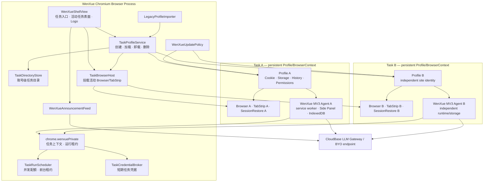
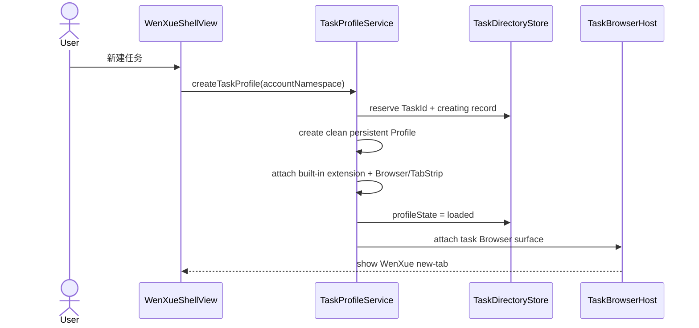

# 问学 Chromium AI 工作浏览器目标架构

| 项       | 内容                                                                                                   |
| -------- | ------------------------------------------------------------------------------------------------------ |
| 状态     | G0 已批准；已同步 v0.4 消息发布与通用视觉答题兼容修订                                                  |
| 日期     | 2026-07-19                                                                                             |
| 上游需求 | [AI 浏览器重构 PRD v0.4](../01-product/PRD.md)                                                         |
| 配套计划 | [迁移实施计划](../03-delivery/PLAN.md)                                                                 |
| 冻结基线 | extension 1.9.1 @ `8a29557797e9ffbbc7fbe1d88de463529c6f0820`；CfT `149.0.7827.55` / revision `1625079` |

> 文档入口：[AI 浏览器重构文档体系](../README.md)。本文定义目标架构与迁移边界，不定义 UI
> 视觉、尺寸、颜色和动效。G0 已通过；现有 `.project.agents/docs/context/` 继续描述正在运行的
> Electron/CfT legacy runtime，本目录描述 target runtime。完成 [开工就绪度](../03-delivery/READINESS.md)
> 中的硬门禁前，不允许修改目标运行时代码。

## 1. 决策摘要

### D1. 正式运行时采用最小化 Chromium 分支

问学 P0 正式运行时采用 Chromium `//chrome` 产品层分支，保留 Chromium 的多进程模型、
`Profile`、`Browser`、`TabStripModel`、Session Restore、Omnibox、下载、权限、PDF、媒体、
扩展系统与 GPU 管线，只在产品层增加隔离任务 Profile、任务浏览器宿主、并行 Agent 调度和品牌外壳。

- 正式运行时不再由 Electron 拉起外部 Chrome for Testing。
- CEF 不作为正式运行时，也不作为扩展兼容兜底。
- Chrome for Testing 继续作为冻结旧版基线和同版本性能对照，不作为最终用户浏览器。
- 本路线已作为 G0 目标基线接受；G1/G2 Spike 负责验证工程可行性。若验证失败，必须新增 ADR
  变更路线，而不是在实现中静默降级。

选择依据：

- Chrome for Testing 官方定位是自动化与测试专用，并明确不用于常规浏览；它适合作为对照基线，
  不适合作为问学长期产品运行时。[Chrome for Testing 官方说明](https://developer.chrome.com/blog/chrome-for-testing/)
- Electron 官方只承诺 Chrome Extensions API 的子集，并明确“完美兼容 Chrome 扩展”不是其目标，
  无法支撑 CAP-01～CAP-13 的等价承诺。
  [Electron 扩展支持说明](https://www.electronjs.org/docs/latest/api/extensions/)
- CEF 的优势是嵌入式浏览控件和稳定宿主 API，但问学需要的是浏览器产品层、完整标签体系与现有
  MV3 行为；采用 CEF 会把这些浏览器职责重新交给问学实现。
  [CEF 项目定位](https://github.com/chromiumembedded/cef)
- Chromium 原生提供 WebUI、组件扩展、私有扩展 API 和现有 Side Panel 基础，允许在保留浏览器
  能力的同时做产品级定制。
  [WebUI](https://chromium.googlesource.com/chromium/src/+/main/docs/webui/webui_explainer.md)、
  [组件扩展](https://chromium.googlesource.com/chromium/src/+/main/extensions/docs/component_extensions.md)、
  [扩展 API 规范](https://chromium.googlesource.com/chromium/src/+/main/chrome/common/extensions/api/schemas.md)

### D2. 每个任务 Profile 加载独立的内置 MV3 Agent 实例

现有问学插件不整体重写为 C++。首版将其构建为固定 ID 的内置组件扩展，每个任务的持久化
Chromium Profile 独立加载一个扩展实例，并由该任务的问学 Logo 打开对应侧边栏。Agent 循环、
LLM 客户端、页面控制、视觉观察、学习通、对话 UI 和任务内存储继续使用 TypeScript/React 代码。

组件扩展若在 Spike 中无法同时满足 MV3 service worker、Side Panel 与所需 API，则允许在同一
Chromium 分支内改为“随浏览器预装且按 ID allowlist 的内置扩展”；该替代不允许退回 Electron/CEF，
也必须通过相同 CAP 门禁。

### D3. 一个任务对应一个持久化 Chromium Profile/BrowserContext

P0 把任务实现为独立持久化 Chromium `Profile/BrowserContext`，并为其创建独立 `Browser`、
`TabStripModel`、Session Restore 与扩展实例。Cookie、HTTP cache、LocalStorage、IndexedDB、
Service/Shared Worker、网站权限、浏览历史、密码、扩展存储和页面会话均不得跨任务共享。

不采用“单 Profile + TaskId 标签投影”作为最终隔离边界。Chromium 官方把 Profile 定义为包含
Cookie、密码、历史、扩展等用户数据和设置的核心原语，正好对应问学任务浏览器的隔离语义。
[Chromium `//chrome/browser` 设计原则](https://chromium.googlesource.com/chromium/src/+/main/docs/chrome_browser_design_principles.md)

`StoragePartition` 只作为 Profile 内部的网络与站点存储分区机制，不单独承担 P0 任务隔离；它由
partition domain/name 标识，但不能天然覆盖全部 Profile-keyed 历史、权限、密码、扩展状态和浏览器
设置。[StoragePartitionConfig](https://chromium.googlesource.com/chromium/src/+/main/content/public/browser/storage_partition_config.h)

因此，新任务扩展实例可以继续使用标准 `chrome.tabs`、`webNavigation`、`scripting` 和 tab
messaging：Chromium Profile 本身就是可见标签和扩展事件的边界。`chrome.wenxuePrivate` 只负责
不可由标准扩展 API 提供的 TaskId/Profile 绑定、运行租约、前台请求、账号控制配置和短期网关凭据，
不得枚举或打开其他任务 Profile。

每个任务拥有独立 Agent 状态机。全局 `TaskRunScheduler` 只限制资源和协调前台，不实施“全局只许
一个 Agent”；P0 至少允许两个任务 Agent 同时运行。用户切换任务不暂停后台 Agent，后台任务也不得
抢占当前窗口焦点或可见标签。

### D4. 采用双仓协作但单一发布清单

- 当前 WenXue 仓库继续承载 Agent、React 页面、CloudBase 服务、能力矩阵、迁移工具和产品文档。
- 新建 `wenxue-chromium` 仓库跟踪 Chromium `src` 上游，承载 `//wenxue` 原生模块、品牌配置和
  少量集成补丁；不把完整 Chromium checkout 提交到当前 pnpm 仓库。
- 每个发布由一个不可变发布清单同时锁定 Chromium 上游 revision、`wenxue-chromium` commit、
  WenXue commit、内置扩展 hash、工具链和平台产物 hash。

### D5. 迁移期间双运行时并存，完成门禁后再移除启动器

当前 CfT 启动链在迁移期作为回归基线和用户回退通道保留。新增 Agent 平台适配层后，同一套
Agent 测试可以分别跑在旧 `LegacyTaskRuntimeGateway` 与新 `WenXueTaskRuntimeGateway` 上。只有完整
发布门禁通过并经历至少一个稳定回退窗口，才删除 Electron/CfT 正式入口。

迁移证据同时维护两类对照：**语义基线**固定“冻结扩展 commit +
`apps/desktop/browser.lock.json` 中的 CfT
版本”，用于证明用户功能没有退化；**同 revision 引擎对照**把冻结扩展运行在与目标 Chromium
revision 一致的 CfT 上，用于归因内核、构建与性能差异。两者不得混为一个 baseline。

## 2. 范围与非目标

### 2.1 本设计范围

- 浏览器内核路线、仓库边界、模块边界和依赖方向。
- 隔离任务 Profile、任务浏览器宿主、任务切换和并行 Agent 调度的原生模型。
- 现有插件的复用、适配和等价验证策略。
- 账号隔离、数据持久化、旧画像迁移和失败回滚。
- Chromium 构建、更新、签名、性能、安全和发布门禁。
- 从当前启动器到问学浏览器的阶段性迁移顺序。

### 2.2 非目标

- 不定义左侧任务区、地址栏、标签、侧边栏或新标签页的视觉方案。
- 不在本设计中实现任何代码或创建 Chromium 仓库。
- 不开放 Chrome Web Store、第三方扩展、Chrome Sync 或 Google 账号登录。
- 不支持任务间网站身份共享、任务间 OS 进程/虚拟机级隔离、云端无人值守任务或定时任务；用户主动
  启动的本机并行任务属于 P0。
- 不承诺 Google 专有服务；Safe Browsing、地理位置、编解码器等能力必须分别完成 API、许可和
  可用性评审。自定义 Chromium 构建的 Google API 能力受官方密钥与配额约束。
  [Chromium API Keys 文档](https://chromium.googlesource.com/chromium/src/+/main/docs/api_keys.md)

## 3. 架构需求与验收标准

以下需求从 PRD 派生，使用 EARS 风格描述。实现任务必须引用对应 AR 编号。

### AR-01 Chromium 产品层基线

- 当构建问学正式运行时时，系统应从锁定的 Chromium Stable revision 构建 `//chrome` 目标，
  不通过 Electron 或 CEF 托管网页内容。
- 当对比问学与 CfT 时，系统应使用相同 Chromium revision、OS、硬件、干净画像与发布优化参数。
- 当未修改的问学 Chromium 基线不能满足 PRD F14 性能阈值时，团队应停止产品功能开发并先修复
  构建优化、PGO/ThinLTO 或测试条件。

### AR-02 现有插件能力等价

- 当内置 Agent 扩展加载时，系统应继续支持 CAP-01～CAP-13 所需的 MV3 service worker、
  content/main-world 注入、Side Panel、tabs、frame、截图、存储和 IndexedDB 行为。
- 当任一 CAP 能力缺少旧版基线、预期结果、新版结果或证据时，迁移应保持未完成状态。
- 当替换浏览器适配层时，`@page-agent/*` 的 Agent 核心、LLM 和页面控制公共语义应保持不变。

### AR-03 任务与标签所有权

- 当用户创建任务时，浏览器应创建唯一 `TaskId` 和独立持久化 Profile/BrowserContext；不得从其他
  任务复制 Cookie、站点存储、权限、历史、密码或 Session。
- 当任意用户页或系统页标签被创建时，它应属于创建它的任务 Profile，且标准扩展 API、浏览器命令
  和 Session Restore 不得把它暴露给其他 Profile。
- 当用户切换任务时，任务浏览器宿主应展示目标任务自己的 Browser/TabStrip，并恢复其活动标签；
  其他任务可以继续在后台运行但不得抢占可见表面。
- 当创建用户可见任务时，系统只响应用户显式新建或恢复既有任务；搜索、Agent 子步骤、新建 AI
  会话和网页打开标签均不得自动创建或拆分用户任务。
- 当网页、用户或 Agent 在当前任务打开新标签时，新标签应自动归属该任务。
- 当浏览器恢复会话时，系统应只在对应任务 Profile 内恢复标签，再允许该任务 Agent 运行。
- 当删除任务时，系统应在关闭并卸载对应 Profile 后删除其 Profile 目录，不得触碰其他任务或问学
  账号控制域。

### AR-04 Agent 隔离与运行状态

- 当 Agent 开始运行时，调用扩展所属 Profile 应被原生层映射到唯一 TaskId，并获得只绑定该
  TaskId/Profile 实例的运行租约；客户端不得指定其他 TaskId。
- 当两个任务 Agent 同时运行时，每个扩展实例应只接收自己 Profile 的标签、消息、存储和运行事件；
  其中一个停止、失败、重载或等待用户不得撤销另一个任务的运行租约。
- 当用户切换离开运行中的任务时，该任务 Agent 应默认继续运行；浏览器只切换前台宿主，不切换其
  Profile、标签或 Agent 状态。
- 当后台任务尝试抢占窗口焦点、激活其他任务表面或请求不可用的视觉表面时，系统应拒绝抢占，并
  仅把该任务置为 `waiting_for_foreground`。
- 当任务遇到登录、验证码、权限或人工接管时，系统应暂停该任务并通知用户，其他任务继续运行。
- 当资源达到并发上限时，调度器应把额外运行置为排队状态，而不是复用、合并或终止其他任务状态。

### AR-05 浏览器基础能力

- 当 AI 未运行时，地址与搜索、导航、下载、上传、权限、PDF、音视频、历史、页面查找、缩放和
  崩溃恢复应直接复用 Chromium 产品层能力。
- 当问学修改浏览器外壳时，系统不得绕过 Chromium 的 Site Isolation、sandbox、网络服务、GPU
  进程或标准权限决策链。
- 当浏览历史、下载记录、网站权限、密码或 Session Restore 被访问时，系统应使用当前任务 Profile
  的对应服务，不得回退到共享默认 Profile。
- 当 Agent 空闲时，系统不得持续扫描 DOM、截图或轮询标签。

### AR-06 账号与数据边界

- 当用户登录时，系统应把任务目录、模型配置、BYO Key、快捷入口、日志设置与用量缓存映射到该
  账号的 `AccountNamespace`，但把 AI 历史和网站数据保存在各自 Task Profile。
- 当用户退出或切换账号时，系统应保存并卸载该账号的所有 Task Profile，撤销其任务运行租约，并
  只挂载目标账号的任务目录；不得把一个账号的 Task Profile 交给另一个账号。
- 当用户退出并由另一账号登录时，系统不得向新账号展示前一账号的问学数据、任务 Profile 或 live
  标签；原账号再次登录时只恢复原账号任务。
- 当两个任务属于同一问学账号时，它们仍不得共享网站 Cookie、登录态、站点存储、权限、历史、
  密码或扩展任务数据。
- 当保存 BYO Key 或用户 session 时，系统应使用 OS 级密钥服务封装，且不得进入日志、tokens、
  崩溃注释或发布清单。

### AR-07 数据迁移与回滚

- 当首次启动检测到旧启动器画像时，系统应枚举全部来源并要求用户选择一个主来源。
- 当来源是含 `accountNamespace` 的 Electron 画像时，系统只应向当前已验证账号展示归属匹配的记录；
  其他账号记录不得显示、重归属或迁移。无归属 legacy 记录不得自动绑定账号，只能进入单独风险确认的
  显式选择流程。这里“已验证账号”必须来自受信服务以 bearer token 解析的真实 uid，不得采用 renderer
  自报的 userId。
- 当执行迁移时，系统应在 staging 目录完成复制、版本升级和校验，成功后再原子切换正式目录。
- 当迁移失败或进程崩溃时，系统应保留旧画像与 staging journal，并允许重试或回到旧启动器。
- 当存在未选画像时，系统应只写保留清单，不修改其内容。
- 当选中旧画像完成迁移时，系统应把它激活为一个“导入任务”Profile；随后创建的其他任务必须使用
  干净 Profile，不得继承导入任务的网站身份。
- 当 macOS/Windows 加密 Cookie 或凭据无法可靠迁移时，系统应明确列为未迁移项，不得声称登录态
  已保留。

### AR-08 更新与供应链

- 当上游 Chromium Stable 发布安全更新时，问学公开版目标应在 7 天内完成同步、构建、回归和
  分阶段发布；未满足时应记录阻塞和风险。
- 当任一发布构建时，发布清单应锁定并校验所有源码与内置扩展输入。
- 当更新安装失败时，更新器应保留可启动的上一版本并禁止破坏用户画像。
- 当 Chromium revision 变化时，CAP 等价、迁移、性能和安全测试应自动重新进入发布门禁。
- 当 CI 注册 Ed25519 清单保护、且产物通过 Chromium G5 平台签名门禁的不可变候选后，管理员应只通过
  既有后台选择候选并发布动态 rollout；后台不得上传二进制。客户端沿用 Electron 已建立的
  runtime/channel/platform/version/稳定分桶协议，但不复用其 `manual-unsigned` 安装包下载器。
- 当强制策略超过 24 小时且服务不可达时，浏览器不得无限锁死工作区；更新安装前必须成功完成实时策略复核，
  缓存 mandatory 策略只能维持 24 小时内的离线警告/门禁，不得授权安装。

### AR-09 平台与性能

- 当在 macOS Apple Silicon 与 Windows x64 运行 release 产物时，系统应满足 PRD F14 的启动、
  Web 基准、内存、空闲 CPU、加载、切换与进程回收阈值。
- 当测量多任务开销时，系统应使用相同数量的隔离 CfT Profile 作为对照；不得把两个任务 Profile
  与单一 CfT Profile 比较后宣称回归。
- 当至少两个任务 Agent 并行运行时，任一任务停止、失败或等待用户不得导致浏览器崩溃、串状态或
  遗留不可回收 Profile/renderer 进程。
- 当构建 release 产物时，应启用适用于目标平台的 official optimization、ThinLTO，并在可获得且
  许可允许时使用匹配 revision 的 PGO 数据。
- 当不具备 H.264/AAC 等常见编解码能力的合法分发条件时，团队应在发布前完成法律/许可决策，
  不得仅通过构建开关绕过。

### AR-10 可回退切换

- 当新浏览器尚未通过全部 P0 门禁时，旧启动器与旧插件基线应保持可构建、可测试和可启动。
- 当正式切换后发现阻断性回归时，用户应能在不降级或覆盖新画像的情况下启动上一稳定入口。
- 当回退窗口完成且迁移成功率、崩溃率和 CAP 通过率满足发布要求时，团队才可删除 Electron/CfT
  运行时代码。

### AR-11 配套系统兼容

- 后台用户目录及启用/禁用使用 CloudBase Auth 同一 uid 与 `ACTIVE/BLOCKED` 权威状态。无业务元数据或模型用量的新用户也必须可见；用户备注只按 uid 补充，不决定权限。权限更新需审计意图、权威写入与回读验证，兼容当前 AdminApi 契约。

- 当账号控制端申请内置模型任务凭据时，现有 CloudBase Gateway 应先用用户 session 鉴权并校验用户
  启用状态；厂商 Key 只存在服务端，任务凭据签发不得联系模型厂商。
- 当任务扩展调用内置模型时，它应使用绑定 `uid + TaskId + purpose + expiry` 的短期任务凭据；
  Gateway 应再次验证签名、绑定、有效期和用户启用状态，不要求 Task Profile 持有长期用户
  access/refresh token，流式正文不得持久化。
- 当模型调用完成时，Gateway 应按 uid 记录不含正文和敏感凭据的 tokens，并只向当前账号返回脱敏
  汇总；浏览器来源字段和版本字段不得改变既有计量语义。
- 当管理员操作用户状态时，现有后台应继续要求内部管理员登录并写审计记录，且不得展示 prompt、
  response、API Key 或用户 session。
- 当管理员推送消息时，Gateway 应按 uid、平台和版本过滤并只向匹配账号返回正文；Chromium 客户端
  复用既有 announcement/ack/signal 协议和固定展示语义。
- 当 G5 stable 产物发布时，官网应指向匹配发布清单的双平台签名产物和版本说明；官网 UI 重设计
  不属于本迁移。

### AR-12 通用视觉答题能力

- 当 Agent 使用视觉能力时，新旧运行时都应只公开正式入口 `visual_observe`；legacy Observe 输入 / 输出
  保持兼容，`question_solver` 通过内部 capability registry 显式分派。
- 当用户只要求读题、答案或明确填写时，系统应分别执行 `inspect | answer | fill`，前两者不得写入
  页面；最终提交在所有动作下均由用户完成。
- 当当前页面已经按正常业务流程收到 embedded answer 时，adapter 可在 attempt/question/option 映射
  通过后优先使用；不得主动构造答案请求、伪造评分 / 提交状态或跨任务读取页面数据。
- 当 production variant 没有已核实的正确答案字段契约时，其 embedded-answer allowlist 必须为空；
  OCSJS 当前 23 个 variant 不得把未知 `answer` 字段猜成标准答案，zhs gxk 正常响应仅可投影题干 identity。
- 当目标运行时迁移统一 solver 时，应保留标准 tabs、frame、scripting、webNavigation、
  captureVisibleTab 与每 Profile 扩展隔离语义，不建立跨 Profile 私有答题 broker。
- 当 solver 运行时，tab/frame RPC 应携带 taskEpoch/runId/requestId/cancel 和 document token；迟到结果
  必须丢弃，navigation profile 由 route probe 冻结，翻页后必须重新发现 frame/profile；同 frame
  adapter 冲突与多 frame 聚合分别判定，全 frame 防护扫描任一命中即取消整次 run。
- 当 MV3 service worker 被回收时，最小 lease/run/effect ledger 应从 session storage 恢复；frame identity
  必须重新 challenge，未结算写操作先按 canonical snapshot digest 从 caller/content journal
  verify/restore；background-only recovery capability 不得包含业务写 operation，无法恢复就保持 document
  quarantine。effectful content/MAIN operation 只可定向确切 documentId，MAIN request 必须绑定 active
  parent request/control transaction；同 tab mutation owner、effect lock 与 screenshot 全局限速必须跨 task 生效。
- 当题目含图时，image service 只接受 locator/anchor/binding，图片 bytes 只进入 task 内存 ephemeral asset
  store；bound crop 由 background 在同一 image request 内 capture + finally restore，ResultStore/history
  只保留标签；大结果通过 continuation/resume 无丢失分块，ResumeCursorStore
  必须独立于 chunk store 并绑定原 tab/managed lease，续取不得重新访问页面或重放 fill。
- 当后台任务需要 screenshot 而没有自己的当前可见 surface 时，应进入 `waiting_for_foreground`，不得
  激活标签；cross-origin frame 只允许通过 parent-chain anchor 绑定最小 crop，无法定位时不得发送整屏。
- 当真实平台环境缺失时，六个平台族及全部声明 variant 必须达到 `fixture_verified`，但不得标记
  `live_verified`；两种成熟度都进入 CAP evidence。

## 4. 路线对比

| 维度                     | Chromium `//chrome` 分支                      | CEF 自定义壳                                | Electron 内嵌                        |
| ------------------------ | --------------------------------------------- | ------------------------------------------- | ------------------------------------ |
| 现有 MV3/Chrome API 等价 | 最高，直接保留 Chrome 产品层扩展系统          | 需逐 API 验证并补宿主行为                   | 官方只支持子集                       |
| 浏览器基础功能           | 直接复用 Omnibox、标签、Session、下载、权限等 | 多数产品层需自行组装                        | 多数产品层需自行组装                 |
| 任务网站身份隔离         | 每任务 Profile/BrowserContext 原生覆盖        | 需自行管理 RequestContext 与浏览器数据服务  | 可用 session 分区但扩展与产品层需补  |
| UI 自定义                | Native Views + WebUI，改动成本高但上限最高    | 宿主 UI 自由度高                            | React UI 自由度高                    |
| 性能上限                 | 最接近 CfT，同 Blink/V8/多进程产品层          | Blink/V8 接近，宿主与浏览器层差异需测       | Blink/V8 接近，额外壳与 API 差异需测 |
| 上游维护成本             | 最高，需要持续 rebase 和安全发版              | 中等，需要跟 CEF 分支                       | 较低，但能力不满足 P0                |
| P0 重构面                | 原生壳与任务模型重写，Agent 大量复用          | 浏览器壳、标签、扩展宿主与 Agent 边界均重写 | 扩展 API 与浏览器壳均重写            |
| 结论                     | **推荐；先 Spike 后冻结**                     | 不选，除非 PRD 放弃插件等价                 | 排除                                 |

## 5. 当前代码复用评估

当前 `apps/extension/src` 约 14.9k 行生产 TS/TSX，其中约 31 个文件、6.5k 行直接触达
`chrome.*`；vendor 四包生产代码约 6.2k 行；Electron desktop 生产代码约 5.8k 行。以下为设计期
区间估算，最终以 G2 适配 Spike 和能力矩阵为准。

| 当前范围                                | 预计直接/轻改复用 | 迁移策略                                                                  |
| --------------------------------------- | ----------------: | ------------------------------------------------------------------------- |
| `@page-agent/core`                      |           85%–95% | 保留 Agent 循环、上下文压缩、人工接管与工具语义；只接受浏览器网关依赖注入 |
| `@page-agent/llms`                      |          90%–100% | 保留 OpenAI-compatible 客户端、流式与兼容策略                             |
| `@page-agent/page-controller`           |           80%–95% | 保留 DOM 序列化与动作；替换目标 Tab/Frame 的宿主路由                      |
| `@page-agent/ui`                        |           70%–90% | 继续服务侧边栏；视觉变更留给 UIUX                                         |
| content/main-world/frame 脚本           |           80%–95% | 继续作为扩展内容脚本，仅收紧消息授权                                      |
| `MultiPageAgent` / `useAgent`           |           75%–90% | 每个 Task Profile 有独立扩展实例；移除进程外全局单例并接入运行租约        |
| `TabsController` 与 background tab 路由 |           65%–85% | 继续使用标准 Chrome API；Profile 天然限制为当前任务标签                   |
| Sidepanel 对话、历史、设置组件          |           65%–85% | 保留 React 组件和状态语义，替换宿主入口与账号命名空间                     |
| NewTabHome                              |           60%–80% | 快捷入口和搜索逻辑复用，改为内置新标签页资源与原生搜索设置                |
| 插件 session / 存储 / 日志              |           55%–80% | Task Profile 天然隔离；补账号控制配置、凭据租约和迁移版本                 |
| Electron renderer                       |           25%–50% | 登录、日志、tokens 的 React 逻辑可转 WebUI/扩展页；窗口壳不复用           |
| Electron main                           |            0%–20% | 生命周期与测试经验复用；Supervisor、CfT argv、handoff 最终退役            |
| CloudBase Gateway / Admin / Website     |          90%–100% | API 契约基本不变，仅客户端来源和版本字段变化                              |

结论：需要重写的是“多 Profile 任务目录 + 任务浏览器宿主 + 账号凭据桥接”，不是 Agent 智能核心，
也不再需要重写一套任务级 tabs/page-control 私有 API。相比单 Profile 投影方案，现有插件复用率更高，
但任务创建、Profile 生命周期、单窗口宿主和多 Profile 性能成为新的高风险 Spike。

## 6. 目标系统架构



### 6.1 运行时进程边界

| 进程/上下文                                      | 主要职责                                                 | 问学业务模块的数据禁区                                                         |
| ------------------------------------------------ | -------------------------------------------------------- | ------------------------------------------------------------------------------ |
| Chromium browser process                         | 任务目录、Profile 生命周期、窗口宿主、并发配额与更新     | prompt、response、截图、BYO Key 明文或长期 access/refresh token 的持久化与日志 |
| 账号控制 WebUI/扩展                              | 问学登录、账号配置、短期网关凭据申领/发布与 BYO Key 封装 | 任意任务的网站 Cookie、DOM、浏览历史和 AI 正文                                 |
| Task Profile extension service worker / renderer | 该任务 Agent、模型调用、AI 历史、任务日志                | 其他任务 Profile、其他任务扩展存储、长期账号 refresh token                     |
| Task Profile web renderer                        | 该任务页面执行、DOM 序列化与动作反馈                     | 其他任务网站身份、任务目录、用户模型配置                                       |
| CloudBase Gateway                                | session/任务凭据鉴权、厂商转发、tokens 计量              | prompt/响应持久化、厂商 Key 下发                                               |

## 7. 原生模块边界

### 7.1 `TaskDirectoryStore`

- 职责：在问学账号控制域中版本化持久化 TaskId、Profile 相对路径、名称、状态、最近活动时间、
  Profile schema 和迁移 journal。
- 不负责：不保存标签 URL、Cookie、History、对话正文、DOM、截图、API Key 或用户 token。
- 依赖：Chromium `sql::Database`、User Data 路径服务。
- 输出：`TaskProfileService`、`LegacyProfileImporter`、`WenXueShellView`。

### 7.2 `TaskProfileService`

- 职责：按 `AccountNamespace + TaskId` 创建、加载、卸载、关闭、恢复和删除持久化 Chromium Profile；
  为每个 Profile 装配独立 Browser/TabStrip、Session Restore 和内置扩展实例。
- 不负责：不渲染 UI，不执行 Agent 工具，不复制网站身份到其他任务。
- 依赖：`TaskDirectoryStore`、Chromium `ProfileManager`、Profile deletion/keep-alive API。
- 关键约束：Profile 生命周期变化串行化到 browser UI sequence；删除前必须关闭 Browser、停止该任务
  Agent、释放 Profile keep-alive 并等待卸载。

### 7.3 `TaskBrowserHost`

- 职责：把当前任务的 Browser/TabStrip/Side Panel 表面绑定到问学主窗口；在不改变后台任务 Profile
  状态的情况下切换活动表面，并为后续“任务独立窗口”保留同一宿主接口。
- 不负责：不保存网站数据，不决定 Agent 并发，不跨 Profile 移动 `WebContents`。
- 关键风险：标准 Chromium BrowserView 与 Profile/Browser 窗口绑定较深；G2 必须比较“主壳切换
  Browser 表面”和“每任务原生窗口协调”两种实现，未证明前不锁定具体 UI 宿主机制。
- 产品约束：无论内部采用可切换表面还是受控 backing window，P0 默认仍只向用户展示一个工作台和
  一个活动任务，不得把任务隔离退化为要求用户管理多个独立应用窗口。

### 7.4 `TaskRunScheduler`

- 职责：登记各 Task Profile 的运行租约，实施并发数量、CPU/内存预算和前台租约；P0 配额至少允许
  两个任务同时运行。
- 不负责：不保存 Agent history，不解释 prompt，不执行网页动作，也不因为任务切换停止运行。
- 依赖：单向 `TaskRunEventSink`；每个任务扩展实例只接收自己的排队、撤销和前台事件。

### 7.5 `TaskCredentialBroker`

- 职责：把账号控制域签发的短生命周期、绑定 `AccountNamespace + TaskId` 的网关凭据，以及按 run
  一次性领取的 BYO Key，路由到对应任务扩展实例。明文只允许在待领取内存中短暂存在；持久状态只
  保存 hash、过期时间和审计元数据，领取或取消后立即清除明文缓冲区。
- 不负责：不持久化长期 access/refresh token，不代理 prompt/response，不把凭据暴露给网页内容。
- 协议：账号控制端使用长期 session 调用 Gateway 的任务凭据签发端点；Gateway 返回只能访问指定
  账号与任务模型资源的短期凭据，控制端再通过只对固定控制扩展开放的发布接口交给 Broker。
- BYO 限制：若模型厂商只提供长期 API Key，系统不得把它描述为服务端可过期的短期令牌；P0 只
  保证它按 `TaskId + runId + modelId` 一次性解封、仅进入受信任务扩展内存且不写入 Task Profile。
- 目的：用户只登录一次问学，同时不把账号控制 Profile 或网站身份共享给 Task Profile。

### 7.6 `WenXuePrivateApi`

- 职责：只向固定问学扩展 ID 暴露由调用方 BrowserContext 推导的 TaskId、运行租约、前台状态、
  短期网关凭据领取和按 run 的 BYO Key 单次领取；在 browser process 校验扩展 ID 与 Profile 映射。
- 不负责：不代理标准 tabs/frame/script/page-control，不枚举其他 Profile，不暴露任意系统文件或远程
  模型调用。
- 实现依据：Chromium 私有扩展 API 可通过 schema、feature allowlist 和 C++ ExtensionFunction 实现，
  且仍需独立安全与隐私审查。
  [Writing a New Extension API](https://chromium.googlesource.com/chromium/src/+/main/extensions/docs/writing_a_new_api.md)

### 7.7 `LegacyProfileImporter`

- 职责：只读发现旧画像、生成迁移清单，把选中来源 staging 复制到一个导入任务 Profile，完成版本
  迁移、完整性校验、原子激活和回滚。
- 不负责：不静默选择画像，不在旧浏览器运行时修改画像，不删除未选来源。

### 7.8 `WenXueShellView`

- 职责：消费服务状态并发送用户意图；承载账号控制入口、任务目录、当前 `TaskBrowserHost`、问学
  Logo 和任务状态通知。
- 不负责：不写任务业务规则，不直接访问数据库或扩展存储。
- 技术：浏览器 chrome 使用 Native Views；新标签、登录、设置、历史等内容页使用 WebUI 或内置
  扩展 React 页面，以复用现有前端代码。

### 7.9 `WenXueUpdatePolicy`

- 职责：品牌化 Chromium Updater 注册；消费服务端 `UpdatePolicy`、通道、Ed25519 候选清单、稳定灰度、
  暂停/撤回、24 小时强制策略 freshness、安装前实时复核、版本回退保护和更新后健康检查。
- 不负责：不决定 Agent 功能，不修改用户画像 schema。
- 遥测边界：事件 token 只能减少未先取得 policy 的随意写入，不证明安装真实性；更新健康率是 advisory，
  不能作为无人监督的自动 rollout 依据。
- 基础：优先复用 Chromium Updater 与平台 installer，而不是另起一套进程更新器。
  [Chromium Updater 规范](https://chromium.googlesource.com/chromium/src/+/main/docs/updater/functional_spec.md)

### 7.10 `WenXueAnnouncementFeed`

- 职责：在账号控制域监听无正文 announcement revision，经用户 bearer 拉取 pending、维护固定优先级
  队列并幂等 ack；不把消息注入任一 Task Profile。
- 不负责：不读取其他账号目标清单，不允许远端配置视觉/CTA，不控制 Agent 或网站权限。
- 兼容：wire schema、匹配/确认规则和固定 UI 语义以当前 Electron 的
  `@wenxue/client-operations` fixtures 为准；Chromium 实现不依赖该 TypeScript 包运行时。

## 8. 扩展侧适配边界

新增轻量 `TaskRuntimeGateway`。标签、Frame、截图和页面控制继续走现有标准 Chrome API；gateway
只承载任务 Profile 上下文、并发租约和前台协调：

```ts
interface TaskRuntimeGateway {
	currentContext(): Promise<TaskContext>
	acquireRunLease(): Promise<TaskRunLease>
	heartbeatRunLease(lease: TaskRunLease): Promise<void>
	releaseRunLease(lease: TaskRunLease, outcome: RunOutcome): Promise<void>
	requestForeground(lease: TaskRunLease, reason: ForegroundReason): Promise<ForegroundDecision>
	claimGatewayCredential(lease: TaskRunLease): Promise<TaskGatewayCredential>
	claimModelCredential(lease: TaskRunLease, modelId: string): Promise<ModelCredential>
	onRunLeaseChanged(listener: (state: TaskRunLeaseState) => void): () => void
	onForegroundChanged(listener: (isForeground: boolean) => void): () => void
	onContextChanged(listener: (context: TaskContext) => void): () => void
}
```

实现：

- `LegacyTaskRuntimeGateway`：旧 CfT 运行时提供合成 TaskId、单运行租约和始终前台语义，不改变现有
  `chrome.tabs` 页面控制。
- `WenXueTaskRuntimeGateway`：问学 Chromium 中调用 `chrome.wenxuePrivate`，由调用扩展自己的
  BrowserContext 推导 TaskId/Profile；同样不接管标准 tabs/page-control API。

`TabsController`、`RemotePageController`、`VisualCapabilities`、`QuestionSolver`、adapter registry
和 tab/frame RPC 保留现有标准 Chrome API 语义。G2 browser tests 必须证明一个 Task Profile 的扩展
实例无法通过 tabs、messaging、scripting、webNavigation、captureVisibleTab、storage、embedded
answer hook 或 runtime events 观察另一 Task Profile；若该前提不成立，才回到私有 page-control
broker 方案，而不是预先重写全部页面控制。

## 9. 私有 API 最小契约

下列为语义契约，不锁定最终 IDL 字段拼写：

```ts
// 只有固定 component extension id 可访问。
wenxuePrivate.getTaskContext(): Promise<{
	accountNamespace: string
	taskId: string
	profileInstanceId: string
	isForeground: boolean
	runState: 'idle' | 'queued' | 'running' | 'waiting_for_user' | 'waiting_for_foreground' | 'paused' | 'completed' | 'error'
}>

wenxuePrivate.acquireRunLease(): Promise<{ lease: string; runId: string; taskId: string }>
wenxuePrivate.heartbeatRunLease({ lease }): Promise<void>
wenxuePrivate.releaseRunLease({ lease, outcome }): Promise<void>
wenxuePrivate.requestForeground({ lease, reason }): Promise<'granted' | 'queued' | 'user_required'>
wenxuePrivate.claimGatewayCredential({ lease }): Promise<{ credential: string; expiresAt: number }>
wenxuePrivate.claimModelCredential({ lease, modelId }): Promise<{ credential: string; expiresAt?: number }>

wenxuePrivate.onRunLeaseChanged
wenxuePrivate.onForegroundChanged
wenxuePrivate.onTaskContextChanged
```

账号控制域使用另一组只对固定控制扩展开放、Task Profile 不可见的写入契约：

```ts
wenxueControlPrivate.publishTaskCredential({
	taskId,
	credential,
	expiresAt?,
	purpose: 'gateway' | `model:${string}`,
}): Promise<void>
```

浏览器只接受当前账号控制扩展发布的凭据。`gateway` purpose 必须具有可验证的服务端签名和有效期；
`model:*` purpose 必须来自当前账号已封装的模型配置并绑定当前 run。发布成功后不持久化明文。

安全规则：

1. `getTaskContext` 和 `acquireRunLease` 不接受客户端提供的 TaskId/Profile path；只根据调用
   `BrowserContext` 查询 `TaskDirectoryStore` 映射。
2. 运行租约使用 CSPRNG，browser process 只保存 hash，并绑定扩展 ID、Profile 实例、runId、taskId
   与过期时间；一个任务实例同一时刻最多一个有效租约，但多个任务可以各有租约。
3. 切换前台任务不撤销后台租约；停止任务、删除/卸载 Profile、扩展重载、账号退出或租约超时只
   撤销对应 TaskId 的租约。
4. `requestForeground` 不得直接激活其他任务窗口；只有 `TaskBrowserHost` 在用户意图或明确策略下
   授予。未授予时该任务进入 `waiting_for_foreground`。
5. `claimGatewayCredential` 只返回绑定当前账号、TaskId、租约且短期有效的服务端凭据；
   `claimModelCredential` 只允许按当前 run 一次领取对应 modelId 的 BYO Key。browser process 不
   持久化明文，领取或撤销后清除待领取缓冲区，网页 renderer 永远不能调用。
6. `publishTaskCredential` 只接受固定账号控制扩展，且目标 TaskId 必须属于当前
   `AccountNamespace`；Task Profile 扩展不可调用，也不能发布给其他任务。
7. private API 不提供 Profile 枚举、跨 Profile tabs、任意文件或 raw BrowserContext 访问。
8. browser tests 必须覆盖错误扩展 ID、伪造/过期租约、跨 Profile API/event/storage 泄漏、凭据串
   任务、Profile 卸载竞态和前台抢占。

安全威胁模型把固定签名的内置扩展包、browser-process 私有 API 与其内容脚本视为可信计算基；隔离
承诺覆盖不可信网页、模型输出、过期/伪造消息和正常产品代码路径的越界，不承诺在签名扩展本身被
恶意替换后仍保密。因此发布签名、扩展 artifact hash 和 updater 完整性属于同一个 P0 安全门禁，
Profile 映射校验和签名供应链仍作为纵深防御保留。

## 10. 数据模型与持久化

### 10.1 原生任务数据库

位置：Chromium User Data 下的账号控制域 `WenXue/Accounts/<accountHash>/tasks.sqlite`，由
`TaskDirectoryStore` 独占写入。任务 Profile 位于同一账号目录的 `Tasks/<taskId>/Profile/`；数据库
只保存经过校验的相对路径，不接受扩展或网页提供任意路径。

```ts
interface TaskRecord {
	id: string
	accountNamespace: string
	name: string
	profileRelativePath: string
	profileSchemaVersion: number
	state: 'open' | 'closed' | 'deleting' | 'deleted'
	activeConversationId: string | null
	profileState: 'creating' | 'loaded' | 'unloaded' | 'error'
	agentState:
		| 'idle'
		| 'queued'
		| 'running'
		| 'waiting_for_user'
		| 'waiting_for_foreground'
		| 'paused'
		| 'completed'
		| 'error'
	createdAt: number
	updatedAt: number
	lastActiveAt: number
}

interface TaskRunSummary {
	runId: string
	taskId: string
	state:
		| 'queued'
		| 'running'
		| 'waiting_for_user'
		| 'waiting_for_foreground'
		| 'paused'
		| 'completed'
		| 'error'
	checkpointVersion: number
	startedAt: number
	updatedAt: number
}

interface MigrationJournal {
	migrationId: string
	sourceProfilePathHash: string
	targetTaskId: string
	stage: 'inventory' | 'copied' | 'upgraded' | 'verified' | 'activated' | 'rolled_back'
	sourceVersion: string
	targetVersion: string
	startedAt: number
	updatedAt: number
}
```

数据库不保存 prompt、模型响应、网页正文、截图、凭据、URL、页面标题或标签映射。每个任务自己的
Chromium Profile 负责 Cookie、History、Session Restore、权限和网站数据；任务目录不重复维护
Tab GUID/TaskId 映射。

### 10.2 Agent 数据库

每个任务 Profile 的固定 ID 扩展拥有独立 `chrome.storage` 与 IndexedDB，因此任务数据可使用局部键：

- `sessions`: `[conversationId]`，物理隔离由 Task Profile 保证。
- `logs`: `[ts, id]`，导出和云端计量时附加原生 TaskId。
- 页面缓存、Agent checkpoint 和临时状态只存在该 Task Profile。
- `model-config`、BYO Key、quick-links、日志设置和 onboarding 标志属于问学账号控制域；任务扩展只
  领取当前配置快照、短期网关凭据或按 run 一次性 BYO Key，不把它们写入 Task Profile，也不复制
  长期账号 session。

### 10.3 Task Profile 隔离边界

每个任务 Profile 独占 Chromium 的 Cookie、network/cache context、DOM storage、IndexedDB、
Service/Shared Worker、History、HostContentSettings、密码、下载记录、扩展 storage 和 Session
Restore。新任务从干净 Profile 创建，不克隆其他任务目录。

| 边界                 | P0 数据                                                                               |
| -------------------- | ------------------------------------------------------------------------------------- |
| 单任务独占           | 标签、Session、Cookie、cache、站点存储、Worker、权限、History、密码、扩展 DB、AI 历史 |
| 同一问学账号可共享   | 任务目录、问学 session、模型配置、封装后的 BYO Key、快捷入口、用量缓存和应用设置      |
| 同一安装基础设施共享 | 浏览器程序、BrowserProcess、GPU/网络服务、更新器、本机文件系统和系统资源              |

任务仍共享同一个问学浏览器程序、BrowserProcess、GPU/网络服务进程、更新器、本机文件系统以及
当前问学账号的控制配置。这是浏览器数据隔离，不是虚拟机或独立 OS 进程安全边界。文件只有在用户
选择、下载或明确授权后进入任务；默认下载记录按 Profile 隔离。

### 10.4 删除事务

任务删除采用可恢复的两阶段流程：

1. `TaskDirectoryStore` 将任务标记为 `deleting`，`TaskRunScheduler` 撤销该任务租约。
2. `TaskProfileService` 关闭该任务 Browser、等待扩展 checkpoint、释放 keep-alive 并卸载 Profile。
3. 使用 Chromium Profile deletion 路径删除任务 Profile 目录，成功后写 `deleted` tombstone。
4. 任一步崩溃后，启动恢复器从 `deleting` 继续；不得访问或删除其他任务 Profile 与账号控制域。

### 10.5 跨运行时分发数据

CloudBase 的 `client_announcements` / receipts、release candidates / rollouts / events、announcement /
release signals 与 dispatch audit 继续作为服务端权威；Chromium 不复制集合。信号只含 revision，消息
正文经用户鉴权 API，候选清单按 runtime 隔离且由 CI Ed25519 签名。匿名事件以 `expiresAt` TTL 保留 30 天；
其 event token 不构成可信安装证明。`desktop_release_rollouts` 内的 `recordType=release-slot` 保留文档继续维护
每个 runtime/channel 的 active/current/highestVersion，不进入列表；`admin_dispatch_audit` 仍为纯追加审计，
不参与 release 互斥。字段与 API 兼容基线见
[`desktop-update-announcements design`](../../../superpowers/specs/2026-07-17-desktop-update-announcements-design.md)。

## 11. 关键状态流程

### 11.1 新建任务



任一步失败都删除未激活 staging Profile 或保留可重试 journal，不得留下可被任务列表误认为成功的
半创建 Profile。

### 11.2 隔离任务并行运行

```mermaid
sequenceDiagram
    actor U as User
    participant EA as Agent Extension A
    participant R as TaskRunScheduler
    participant H as TaskBrowserHost
    participant EB as Agent Extension B

    EA->>R: acquireRunLease(Profile A)
    R-->>EA: lease A granted
    U->>H: switch foreground A -> B
    H->>H: attach Browser B; keep Profile A alive
    EB->>R: acquireRunLease(Profile B)
    R-->>EB: lease B granted
    par Task A background
        EA->>EA: continue page/LLM loop in Profile A
    and Task B foreground
        EB->>EB: run in Profile B
    end
```

两个扩展实例、tabs API、storage 和运行租约均由 Profile/TaskId 分开。切换前台不发送 pause；任一
任务停止、失败、重载或等待用户只更新自己的状态。

### 11.3 后台任务请求前台或人工接管

后台任务需要验证码、权限、用户确认或平台无法提供的可见合成表面时，扩展调用
`requestForeground`。调度器只发送任务通知并把该 run 标记为 `waiting_for_foreground`；未经用户
切换或明确授权不得激活窗口。用户进入该任务后，仅该 run 恢复，其他任务保持原状态。

## 12. 旧版画像迁移设计

### 12.1 迁移对象

| 数据                                          | P0 策略                                                    |
| --------------------------------------------- | ---------------------------------------------------------- |
| 选中 CfT 画像的 Cookie/登录态/History/Session | 复制到单一“导入任务” staging Profile；OSCrypt 需平台 Spike |
| 固定扩展 ID 的 IndexedDB / storage            | 在导入任务 Profile 内由新扩展执行版本化 schema migration   |
| 模型配置与 BYO Key                            | 映射到当前登录账号；Key 重新 seal 后才写新存储             |
| AI 历史与日志                                 | 映射到当前账号和导入任务；保留旧来源标记                   |
| 快捷入口与日志配置                            | 映射到当前账号 namespace；保留 schema 版本与来源           |
| 启动器画像元数据                              | 只用于发现、来源清单和创建一个导入任务                     |
| 未选画像                                      | 不改动，只记录路径 hash、版本、大小和保留状态              |

旧运行时没有用户任务维度，因此选中画像中可恢复的标签、AI 历史和配置统一进入一个明确标记来源的
“导入任务 Profile”；迁移器不得根据窗口、域名或历史记录猜测并拆分出多个用户任务。迁移后创建的
其他任务必须从干净 Profile 开始，不继承导入任务网站身份。

### 12.2 原子迁移流程

1. 只读解析旧 `<userData>/browsers.json`、画像目录与版本，检查 ProcessSingleton/lock。
2. 用户选择主来源并确认当前问学账号映射。
3. 为导入任务预留 TaskId，在其随机 staging Profile 目录完整复制源画像；源目录全程只读。
4. 使用与源画像兼容的 Chromium revision 启动一次性迁移模式，执行原生 schema 与扩展 schema 升级。
5. 校验数据库完整性、扩展记录计数、TaskId/Profile 映射、Session 可恢复、Cookie 可解密性和关键
   浏览器页，并创建第二个干净任务证明网站状态不泄漏。
6. 写迁移报告；成功后原子激活 TaskDirectory 记录和正式 Profile 路径，失败则保留 journal 与源目录。
7. 首次正常启动完成健康检查后才标记 `activated`；在此之前允许一键回滚。

禁止直接解析或改写扩展 LevelDB 内部键作为正式迁移方案。若同 ID、同 revision 的原位 schema
迁移不可行，应由冻结旧扩展提供显式版本化导出协议，而不是依赖私有文件格式。

## 13. 构建、更新与发布供应链

### 13.1 仓库与 revision

`wenxue-chromium` 采用以下分支模型：

- `upstream/<milestone>`：只跟踪 Chromium Stable branch-head。
- `wenxue/<milestone>`：在对应上游之上的问学提交。
- `integration/<milestone>`：升级期间临时冲突处理，验证后 fast-forward/merge 到 `wenxue/*`。

问学原生代码尽量放在 `//wenxue`；修改 `//chrome` 的提交只允许用于装配点、品牌、Profile/Browser
宿主、Side Panel/Toolbar 接入和 updater。P0 目标是在 `//wenxue` 外不超过 25 个直接修改文件；超过时必须
重新评审可维护性，而不是继续扩大补丁面。

### 13.2 发布清单

```ts
interface BrowserReleaseManifest {
	version: string
	channel: 'dev' | 'beta' | 'stable'
	chromiumVersion: string
	chromiumRevision: string
	wenxueChromiumCommit: string
	wenxueProductCommit: string
	extensionArtifactSha256: string
	toolchainRevision: string
	platformArtifacts: Record<string, string>
}
```

### 13.3 构建配置

- 开发构建：component build、有限 symbols、快速增量链接。
- 发布构建：`is_official_build=true`、非 component、ThinLTO、匹配平台 release 配置；PGO 作为 G1
  性能验证项。
- macOS Apple Silicon 与 Windows x64 分别在原生 runner 构建，不把交叉编译产物作为发布证据。
- Windows 复用 Chromium `mini_installer` 品牌能力；macOS 产出签名、公证的 `.app` 与 DMG/更新包。
  [Windows mini_installer](https://chromium.googlesource.com/chromium/src/+/main/chrome/installer/mini_installer/README.md)

### 13.4 更新通道

- dev：每次可用构建，保留更多诊断。
- beta：通过 CAP、迁移和性能自动门禁后小范围发布。
- stable：签名清单、分阶段百分比、健康检查、可回滚上一版本。
- candidate 由 CI 上传专用 COS 并注册，后台“版本更新”只发布动态 rollout；dev/beta/stable 均沿用
  runtime/channel/platform/arch/version wire schema，防止 Electron 与 Chromium 候选交叉消费。
- 专用 COS 桶必须从未启用过版本控制；已暂停版本控制的桶不可用。版本路径和候选标记写入后不可变。
- optional 只在用户点击后下载并显式安装；mandatory 只允许 100%，且安装前必须成功完成实时策略复核。
- updater 只替换程序文件，不对 Profile 数据执行不可回滚降级；schema migration 必须前向兼容上一
  稳定版本的程序回退窗口。

## 14. 性能设计

1. G1 先测“未加问学功能”的自构建 Chromium。若它相对同 revision CfT 已低于 95%，优先定位
   official build、ThinLTO、PGO、编解码、沙箱或测试噪声。
2. 单任务基线使用一个干净 Profile；双任务基线使用两个隔离 CfT Profile。比较必须保持 Profile 和
   标签数量相同，隔离成本不能藏进不对称基线。
3. 没有运行 Agent 的非活动 Task Profile 可以在保存 Session 后卸载；正在运行或等待用户的 Profile
   保持加载，但不得用定时轮询维持活跃。
4. 每个任务 extension service worker 空闲时可休眠；Side Panel 收起不停止该任务运行，其他任务
   service worker 不应因此被唤醒。
5. 后台视觉观察优先使用该任务自己的可合成表面；平台无法可靠截图时仅暂停该任务等待前台，不
   允许偷偷激活窗口。
6. 每个里程碑都记录单 Profile 和多 Profile 相对 G1 的增量，不等到发布前发现隔离开销。

固定测量：Speedometer、JetStream、MotionMark、单任务 10 标签稳定内存、双任务各 5 标签内存、
相同 Profile 数量下空闲 5 分钟 CPU、页面加载、任务内标签切换、任务表面切换、Profile 加载/卸载、
双 Agent 并行、冷/暖启动与 10 次进程回收；版本与硬件写入证据。

## 15. 测试与能力等价

### 15.1 测试层级

| 层级                   | 必测内容                                                                                                                             |
| ---------------------- | ------------------------------------------------------------------------------------------------------------------------------------ |
| C++ unit tests         | TaskDirectoryStore、TaskProfileService、TaskBrowserHost、TaskRunScheduler、CredentialBroker、Importer                                |
| Chromium browser tests | 两 Profile 的 Cookie/storage/History/permission/extension/tabs 隔离、Profile 恢复删除、并行租约                                      |
| Extension vitest       | TaskRuntimeGateway、每任务运行状态、标准页面路由、VisualCapabilities/QuestionSolver 全部 adapter fixture、账号配置快照、现有全部回归 |
| CAP 自动化             | CAP-01～CAP-13 的旧版基线、v0.4 CAP-07/CAP-13 扩展与单任务/双任务 Profile 证据                                                       |
| 迁移 fixtures          | 单画像、多画像、损坏数据、旧 schema、Cookie 加密、导入任务、干净第二任务、回滚                                                       |
| 真机 E2E               | macOS arm64、Windows x64 的双任务登录隔离、并行 research/答题、截图前台等待、下载/上传/权限/更新                                     |
| 性能                   | PRD F14 单 Profile 与同数量多 Profile 固定条件                                                                                       |

### 15.2 能力矩阵记录

每条记录至少包含：

```ts
interface CapabilityEvidence {
	capabilityId: `CAP-${string}`
	caseId: string
	baselineKind: 'semantic' | 'same_revision_engine'
	baselineCommit: string
	baselineBrowserVersion: string
	baselineArtifactHash: string
	targetBrowserVersion: string
	modelConfigId: string
	fixture: string
	expected: string
	baselineResult: 'pass' | 'fail'
	targetResult: 'pass' | 'fail' | 'needs-review'
	evidencePaths: string[]
}
```

G2 先验证最容易决定路线成败的 CAP-04/05/06/07/10/13；最终发布仍要求 CAP-01～CAP-13 全部
100% 通过。

## 16. 分阶段门禁

| Gate             | 必须证明                                                            | 失败处置                                  |
| ---------------- | ------------------------------------------------------------------- | ----------------------------------------- |
| G0 架构批准      | 用户确认 D1～D5、每任务 Profile、账号控制域与并行语义               | 修改设计，不写实现                        |
| G1 Chromium 基线 | 双平台 release 构建、基础浏览、单/双 Profile 性能、可签名方案       | 停止功能迁移，修供应链或重新评审路线      |
| G2 Profile 宿主  | 两个持久 Profile、独立扩展实例、任务表面切换、后台执行/截图 Spike   | 停止大规模重构，重新评审 Profile 宿主机制 |
| G3 隔离与并行    | 跨 Profile 网站/扩展数据泄漏为 0，至少两个 Agent 并行且状态互不影响 | 不进入用户数据迁移                        |
| G4 数据迁移      | 旧画像进入单一导入任务，干净新任务、OSCrypt、失败回滚               | 保留旧启动器，不开放升级                  |
| G5 发布          | CAP 全绿、浏览器基础、性能、安全、更新、真机场景全部通过            | 不标记 P0 完成                            |

## 17. 风险与缓解

| 风险                                | 影响                         | 缓解与退出条件                                                   |
| ----------------------------------- | ---------------------------- | ---------------------------------------------------------------- |
| Chromium 上游 rebase 成本           | 安全更新延迟                 | 双仓、`//wenxue` 集中、外部补丁文件数预算、每版自动 rebase smoke |
| 组件扩展多 Profile 行为差异         | 插件实例串状态或能力降级     | G2 两 Profile 真浏览器测试；必要时改 allowlisted 预装扩展        |
| 单窗口切换多个 Profile/Browser 表面 | 焦点、命令或窗口生命周期错乱 | G2 比较主壳挂载与协调原生窗口；不在 Spike 前锁死实现             |
| 多 Profile 常驻开销                 | 内存、启动和后台 CPU 上升    | 非运行 Profile 可卸载；与相同数量 CfT Profile 对照；并发配额     |
| 短期任务凭据桥接                    | 账号 token 泄漏或串任务      | 服务器签发短期绑定凭据、只存 hash、Profile/lease 校验、日志脱敏  |
| Cookie/OSCrypt 迁移失败             | 导入任务网站重新登录         | G4 平台 Spike；失败时逐项报告、保留源画像，不伪造成功            |
| 自构建性能低于 CfT                  | 无法达到 PRD F14             | G1 在功能代码前验证 official build/ThinLTO/PGO 与单/双 Profile   |
| Google 服务/媒体专有能力缺失        | 网站兼容性下降               | 单独 API/许可清单；不依赖 Chrome Sync；编解码器发布前法律评审    |
| updater/签名链不成熟                | 安全版本无法及时交付         | 先完成 dev/beta 自动更新和回滚演练，再开放 stable                |
| 双运行时长期并存                    | 维护成本增加                 | 设 G5 与稳定回退窗口，满足后按计划退役旧入口                     |

## 18. 项目治理与文档边界

G0 已通过，AI 浏览器目标运行时使用独立文档域，不把目标架构混写进 legacy context：

1. [README](../README.md) 定义唯一入口、权威链、阶段门禁和跨文档传播规则。
2. 本文只登记 target runtime 的模块、DAG、实体、接口和不变量；现有
   `.project.agents/docs/context/ARCHITECTURE.md` 继续描述 Electron/CfT runtime。
3. [INFRASTRUCTURE](INFRASTRUCTURE.md) 登记双仓、Chromium revision、构建、签名、updater、PGO、
   codec/API 许可与安全跟版机制。
4. [PLAN](../03-delivery/PLAN.md) 与 [READINESS](../03-delivery/READINESS.md) 管理 G1～G6 的执行和
   开工门禁；[TESTING](../03-delivery/TESTING.md) 与 [MIGRATION](../03-delivery/MIGRATION.md)
   管理证据、迁移和回滚。
5. [UIUX](../04-ui/UIUX.md) 当前只冻结功能性交互不变量，视觉设计在独立阶段评审。
6. 项目级 AGENTS、CLAUDE、SELF_CONSTRAINTS 与 VIBECODING_GUIDE 必须指向本目录；旧 spec/plan
   路径只保留兼容入口。
7. 只有兼容层、数据迁移或切换策略发生变化时，才同步更新 legacy 与 target 两个文档域。

## 19. 已批准的架构基线

用户已确认“任务网站身份不共享、任务 Agent 可并行”，并在 G0 批准以下四项技术选择：

1. 正式路线冻结为最小化 Chromium `//chrome` 分支 + 固定 ID 内置 MV3 Agent + 私有任务 API，排除
   Electron/CEF 作为最终运行时。
2. 每个任务采用独立持久化 Profile/BrowserContext + Browser/TabStrip/扩展实例；不以
   StoragePartition 或单 TabStrip 标签投影充当最终隔离边界。
3. 问学账号、模型配置和应用设置位于账号控制域；Task Profile 只领取短期绑定凭据，不复制长期
   refresh token，也不共享网站状态。
4. 采用 WenXue 产品仓库 + `wenxue-chromium` 上游跟踪仓的双仓模式，并在 G5 与稳定回退窗口完成前
   保留旧 CfT 双运行时。

当前进入配套计划阶段 0.3 与开工就绪度收口；完成前不得创建 Chromium 产品代码或改目标运行时。
