# 问学 Chromium AI 工作浏览器迁移实施计划

> 文档入口：[AI 浏览器重构文档体系](../README.md)
>
> **状态：G0 已批准，等待开工就绪度门禁。** 本计划依据
> [目标架构](../02-design/ARCHITECTURE.md)；已同步 PRD v0.4 通用视觉答题能力；阶段 0.3 与 READINESS
> 硬门禁未完成前不得进入目标 Chromium 代码实施。

**目标：** 将当前“Electron 启动器 + Chrome for Testing + MV3 插件”迁移为问学自有 Chromium
AI 工作浏览器。在不拆分用户任务的前提下，每个任务使用独立持久化浏览器 Profile，完整隔离网站
登录态与浏览数据，至少支持两个任务 Agent 并行运行，并保持 CAP-01～CAP-13 100% 等价。

**架构：** 正式浏览器采用最小化 Chromium `//chrome` 分支。一个任务对应一个持久化
`Profile/BrowserContext + Browser/TabStrip + Session Restore + 固定 ID MV3 Agent`。扩展继续使用
Profile 内标准 Chrome tabs/frame/scripting API；原生层只提供任务目录、Profile 生命周期、活动浏览器
表面、并发/前台租约和短期任务凭据。问学账号控制域保存登录与共享应用配置，但不承载或共享任一
任务的网站身份。旧 CfT 运行时在完成发布门禁前保留为功能基线和回退入口。

**主要技术栈：** Chromium C++/Views/WebUI/GN/Ninja、WXT MV3、React 19、TypeScript、Vitest、
Chromium gtest/browser_tests、CloudBase Gateway、Chromium Updater。

## 1. 执行纪律

1. 每个 Gate 未通过前，不开始其后的高成本阶段；失败时回到 Spec 评审，不用更多代码掩盖路线问题。
2. 每个实现任务先写失败测试，再写最小实现，再跑聚焦测试和对应回归。
3. 本迁移必须始终在独立分支/工作树中实施，不得夹带高级设置、模型兼容或生成产物改动。
4. 目标模块、依赖、接口或不变量变化先更新 [ARCHITECTURE](../02-design/ARCHITECTURE.md)；
   供应链变化先更新 [INFRASTRUCTURE](../02-design/INFRASTRUCTURE.md)；阶段变化同步本计划与
   [READINESS](./READINESS.md)。涉及新旧兼容或迁移时，再同步 legacy context。
5. 现有 `packages/*` 本地补丁继续按当前运行时规则登记；Chromium 上游补丁在
   `wenxue-chromium` 以独立提交维护，不生成难以审查的单个巨型 patch。
6. 每完成一个可独立验收的任务或里程碑，写 `.project.agents/log/` 执行日志并记录两仓 commit。
7. 本计划复选框只有在代码、文档和验证证据全部完成时才能勾选。

## 2. 关键路径

```mermaid
flowchart LR
    G0["G0 架构批准"] --> B["冻结旧版能力、单/双 Profile 性能基线"]
    B --> C["未修改 Chromium 双平台构建"]
    C --> G1["G1 Chromium 基线"]
    G1 --> S["双 Task Profile · 内置扩展 · 宿主 · 凭据 Spike"]
    S --> G2["G2 Profile 宿主可行"]
    G2 --> A["Agent 双运行时适配"]
    G2 --> N["原生任务 Profile 核心"]
    A --> I["隔离与并行集成"]
    N --> I
    I --> G3["G3 隔离与并行"]
    G3 --> M["账号数据与旧画像迁移"]
    M --> G4["G4 迁移可回滚"]
    G4 --> P["CAP 全量、浏览器基础、更新、性能、安全"]
    P --> G5["G5 P0 发布"]
    G5 --> D["稳定回退窗口后退役 Electron/CfT"]
    D --> G6["G6 旧运行时退场"]
```

G2 通过后可以并行推进 Agent 适配与原生任务 Profile 核心；二者必须在 G3 前合流。任何一条路径
不得先假设单窗口多 Profile 宿主一定可行，G2 Spike 会在“主壳切换 Browser 表面”和“协调任务原生
backing window”之间冻结内部实现，但两者都必须保持用户默认只看到一个工作台。

## 3. 目标代码与仓库地图

以下路径是实施目标，G0/G1 前不存在是正常状态。文件名可在同步 `ARCHITECTURE.md` 时微调，但模块
职责和依赖方向不得绕过 G0 评审。

### 3.1 当前 WenXue 仓库

- `apps/extension/src/platform/TaskRuntimeGateway.ts`：任务上下文、运行租约、前台和短期凭据抽象。
- `apps/extension/src/platform/LegacyTaskRuntimeGateway.ts`：旧 CfT 合成任务实现。
- `apps/extension/src/platform/WenXueTaskRuntimeGateway.ts`：新 Chromium 私有 API 实现。
- `apps/extension/src/lib/accountControl/`：账号配置快照与短期凭据领取适配，不保存网站身份。
- `apps/llm-gateway/src/gateway.mjs`：增加服务端签名的短期任务凭据签发和校验。
- `apps/llm-gateway/src/gateway.test.ts`：任务凭据、禁用用户、过期和串任务拒绝测试。
- `tests/capability-matrix/`：CAP-01～CAP-13 fixtures、runner、evidence schema。
- `tests/browser-benchmarks/`：单/双 Profile 固定基准、采集与对比脚本。
- `browser-release.lock.json`：跨仓发布清单输入锁。
- `apps/desktop/`：迁移期保留；G5 稳定窗口后归档或删除正式运行时代码。

### 3.2 `wenxue-chromium` 仓库

- `//wenxue/browser/task_directory_store.*`
- `//wenxue/browser/task_profile_service.*`
- `//wenxue/browser/task_browser_host.*`
- `//wenxue/browser/task_run_scheduler.*`
- `//wenxue/browser/task_credential_broker.*`
- `//wenxue/browser/legacy_profile_importer.*`
- `//wenxue/browser/wenxue_update_policy.*`
- `//wenxue/browser/ui/wenxue_shell_view.*`
- `//wenxue/browser/ui/wenxue_new_tab_ui.*`
- `//chrome/common/extensions/api/wenxue_private.idl`
- `//chrome/common/extensions/api/wenxue_control_private.idl`
- `//chrome/browser/extensions/api/wenxue_private/*`
- `//wenxue/test/*_unittest.cc` 与 `*_browsertest.cc`

## 4. 任务清单

### 阶段 0 — 冻结设计与上游文档

- [x] 0.1 用户批准架构决策 D1～D5
  - 明确确认 Chromium `//chrome` + 固定 ID 内置 MV3/private API、每任务持久化 Profile、账号控制域
    与短期任务凭据、至少双 Agent 并行，以及双仓/迁移期双运行时。
  - 明确 P0 隔离是浏览器数据隔离，不是每任务独立 OS 进程或虚拟机。
  - 视觉依据统一 UIUX，本计划不建立独立视觉规范。
  - 2026-07-14 已把目标架构状态冻结为“G0 已批准”。
  - _Spec: D1-D5, §19, G0_

- [x] 0.2 建立目标运行时独立文档与治理入口
  - 在 `.project.agents/docs/refactor/ai-browser/` 建立 PRD、ARCHITECTURE、DECISIONS、
    INFRASTRUCTURE、PLAN、READINESS、TESTING、MIGRATION 与 UIUX。
  - 项目 AGENTS、CLAUDE、SELF_CONSTRAINTS 与 VIBECODING_GUIDE 已区分 legacy/target 文档域。
  - 旧 PRD/spec/plan 路径只保留兼容指针，不维护重复正文。
  - 已复核“网站身份隔离 + 并行 Agent”语义，不回退为共享登录态或全局单 Agent。
  - _Requirements: AR-01, AR-03, AR-04, AR-08, AR-09, AR-10；PRD §13_

- [ ] 0.3 完成 G1 开工就绪度
  - 确认 `wenxue-chromium` 远端、权限、责任人、目标 revision 与安全跟版策略。
  - 建立 macOS arm64 与 Windows x64 干净 runner，锁定工具链和容量方案。
  - 冻结 CAP/隔离/性能基线输入与脱敏迁移 fixtures。
  - 关闭 [READINESS](./READINESS.md) 的 RDY-001～RDY-010，召开 G1 开工评审。
  - _Requirements: AR-01, AR-02, AR-08, AR-09, AR-10_

**阶段出口：G0 文档已完成；0.3 与 READINESS 硬门禁完成后才可创建浏览器产品代码。**

### 阶段 1 — 冻结旧版能力、隔离与性能基线

- [ ] 1.1 建立 CAP 等价矩阵仓库结构
  - 为 CAP-01～CAP-13 分配稳定 `caseId`、fixture、模型配置、期望和证据路径。
  - 固定 extension 1.9.1 / commit `8a295577...` 与 `apps/desktop/browser.lock.json` 的 CfT
    `149.0.7827.55` / revision `1625079`，保存可重建扩展 artifact hash；该组合是功能语义基线。
  - 先覆盖 CAP-04/05/06/07/10/13 的高风险用例。
  - CAP-07/13 另纳入 v0.4 `visual_observe` capability、全部 question adapter variant、
    `fixture_verified/live_verified` 和 embedded answer/no-submit 证据字段。
  - _Requirements: AR-02, AR-12；PRD F6-F9_

- [ ] 1.2 固定同 revision CfT 单/双 Profile 性能基线
  - 另建与目标 Chromium 相同 Stable revision 的 CfT 引擎对照，不覆盖 1.1 的语义基线。
  - 分别采集一个干净 Profile/10 标签和两个独立 CfT Profile/各 5 标签；Profile 数量、标签数量、
    OS、硬件和启动参数必须与目标场景对称。
  - 固定 Speedometer、JetStream、MotionMark 版本；实现 5 次预热后中位数、空闲 CPU、页面加载、
    标签切换、Profile 启停与 10 次进程回收采集。
  - 输出不可修改的 baseline manifest，不以人工截图代替。
  - _Requirements: AR-01, AR-09；PRD F14_

- [ ] 1.3 建立任务隔离与并行验收 fixtures
  - 准备同域不同账号、Cookie、LocalStorage、IndexedDB、Service Worker、权限、History、密码、
    extension storage 和 Session Restore 的跨 Profile 泄漏用例。
  - 准备两个 Agent 同时 research/答题、其中一个等待用户/停止/崩溃/重载的确定性用例。
  - 断言两个任务的 screenshot、frame、adapter、被动 embedded answer 候选和 solver 结果不串扰。
  - fixtures 不包含真实账号、凭据或用户数据。
  - _Requirements: AR-03, AR-04；PRD F3, F7, F13_

- [ ] 1.4 建立旧版迁移 fixtures
  - 生成单画像、多画像、旧 IndexedDB schema、损坏 JSON/LevelDB，以及逐记录
    `accountNamespace` present/absent/畸形的样本；同一 `browsers.json` 混合 A/B/unowned，并覆盖元数据
    缺失但目录存在、伪造或越界 `userDataDir`、renderer userId 与受信 token uid 不一致。
  - macOS 与 Windows 分别准备 Cookie/OSCrypt 测试画像，不提交真实凭据。
  - _Requirements: AR-07；PRD F11_

**阶段出口：** CAP、隔离、并行和单/双 Profile 性能基线均可由 CI/专用 runner 重复产生同一结论。

### 阶段 2 — Chromium 构建与供应链 Spike

- [ ] 2.1 创建 `wenxue-chromium` 上游跟踪仓
  - 从目标 Chromium Stable branch-head 建立 `upstream/*` 与 `wenxue/*` 分支。
  - 记录 checkout、depot_tools、GN、Ninja/Siso、Xcode/Windows SDK 与磁盘/runner 前置条件。
  - 当前 WenXue 仓新增 revision lock，但不提交完整 Chromium checkout。
  - _Requirements: AR-01, AR-08_

- [ ] 2.2 构建未修改的双平台 release Chromium
  - macOS Apple Silicon 与 Windows x64 原生构建 `//chrome`。
  - 配置 official optimization、ThinLTO，并验证 PGO 数据取得和可重复性。
  - 运行基础浏览、PDF、下载、上传、权限、音视频、GPU、单/双 Profile 和 Session Restore smoke。
  - _Requirements: AR-01, AR-05, AR-09_

- [ ] 2.3 对比未修改 Chromium 与 CfT
  - 在相同 revision 下运行阶段 1 固定性能套件；分别比较一对一单 Profile 和二对二多 Profile。
  - 记录二进制大小、冷/暖构建时间、增量构建时间和 CI 资源成本。
  - 任一 PRD F14 阈值失败时停止，不进入产品功能代码。
  - _Requirements: AR-01, AR-09；PRD F14_

- [ ] 2.4 验证签名、安装与 Updater 最小链路
  - Windows 构建品牌化 `mini_installer`；macOS 完成测试证书签名与本地验证。
  - 用测试更新源完成上一版本 → 下一版本 → 失败回滚，不迁移用户 schema。
  - 输出 stable 签名、公证、更新服务的缺口清单。
  - _Requirements: AR-08, AR-10_

**阶段出口：G1。** 双平台未修改基线满足性能和基础浏览，安装/更新路线存在可执行证明。

### 阶段 3 — 双 Task Profile、内置扩展与宿主 Spike

- [ ] 3.1 在两个持久 Profile 加载独立固定 ID 扩展实例
  - 首选 Chromium component extension；验证每个 Profile 独立的 MV3 service worker、Side Panel、
    storage、IndexedDB、content/main-world 注入和生命周期。
  - 验证相同固定 ID 不导致两个实例共享内存单例、extension storage 或 runtime event。
  - 若 component extension 受限，只评估同 fork 内 allowlisted 预装扩展，并记录差异。
  - _Requirements: AR-02, AR-03；PRD F5-F6_

- [ ] 3.2 验证 Task Profile/Browser 宿主路线
  - 创建两个持久 `Profile/BrowserContext`，各自创建 Browser/TabStrip/Session Restore 和新标签页。
  - 用最小功能壳分别验证“主壳切换 Browser 表面”和“协调任务原生 backing window”，后者只是内部
    宿主候选，不得要求用户默认管理多个应用窗口；覆盖焦点、Omnibox、命令路由、Side Panel、popup、
    拖动、关闭、重开、崩溃与重启恢复。
  - 选择补丁面更小且能保持 Chromium 不变量的方案，并记录 ADR；若两者都失败，停止阶段 4。
  - _Requirements: AR-03, AR-05；PRD F1-F3_

- [ ] 3.3 证明 Profile 是网站和扩展数据边界
  - 运行阶段 1.3 fixtures，证明 Cookie/cache/Storage/Worker/权限/History/密码/Session/扩展数据跨
    Profile 泄漏为 0。
  - 证明 Profile A 的固定扩展通过标准 `chrome.tabs`、webNavigation、scripting、messaging 和
    capture API 不能枚举或操作 Profile B；不增加私有 tabs 代理。
  - 覆盖关闭/重载 Profile、扩展重载、导航和 Session Restore 竞态。
  - _Requirements: AR-03, AR-04_

- [ ] 3.4 验证最小任务私有 API 与并行运行
  - 只实现 `getTaskContext`、`acquireRunLease`、`requestForeground` 和事件垂直切片；TaskId 必须由
    调用方 BrowserContext 推导，客户端不得传入其他 TaskId。
  - 两个 Profile 同时持有运行租约；切换前台不撤销后台租约，一个停止/等待/重载不影响另一个。
  - 验证后台任务不抢焦点；无法安全获得视觉表面时仅该任务进入 `waiting_for_foreground`。
  - _Requirements: AR-04；PRD F7, F13_

- [ ] 3.5 验证短期任务凭据闭环
  - Gateway 增加实验性任务凭据签发/校验；凭据绑定账号、TaskId、用途和短有效期。
  - 账号控制端发布凭据，`TaskCredentialBroker` 只保存 hash/expiry，目标 Profile 一次性领取；Profile
    不获得长期 access/refresh token。
  - 覆盖过期、重放、串任务、错误账号、禁用用户、Profile 卸载和日志泄漏。
  - _Requirements: AR-06, AR-11；PRD F10, F13, F15_

- [ ] 3.6 跑高风险 CAP Spike
  - 验证 CAP-04 JS worlds/frame、CAP-05 tabs、CAP-06 webNavigation frames、CAP-07
    VisualCapabilities/target screenshot、CAP-10 暂停/接管和 CAP-13 QuestionSolver tab/frame 内容脚本链。
  - 每个 case 同时保存冻结 CfT 与新 Chromium 单/双 Profile 证据。
  - 任一能力失败时先判断 component → allowlisted 预装扩展能否解决；不能解决则回到架构评审。
  - _Requirements: AR-02, AR-04, AR-12；PRD F6-F9_

**阶段出口：G2。** 两个持久 Task Profile、独立扩展、宿主切换、标准 API 隔离、并行租约、后台行为
和短期凭据均由代码与 browser tests 证明，不靠推测。

### 阶段 4 — Agent 双运行时适配

- [ ] 4.1 定义并测试 `TaskRuntimeGateway`
  - 只为 current context、run lease、foreground request、gateway/model credential 和状态事件定义接口。
  - 标签、Frame、截图、PAGE_CONTROL、isolated/main-world script 继续使用标准 Chrome API，不纳入
    gateway。
  - 契约明确一次扩展实例只对应一个 Task Profile，调用方不能选择其他 TaskId。
  - _Requirements: AR-02, AR-04_

- [ ] 4.2 实现 `LegacyTaskRuntimeGateway`
  - 旧 CfT 当前窗口形成合成 TaskId；运行租约始终可用，前台请求始终授予。
  - 旧版全部测试和 CAP 基线保持通过，证明抽象没有先制造回归。
  - _Requirements: AR-02, AR-10_

- [ ] 4.3 实现 `WenXueTaskRuntimeGateway`
  - 调用 `chrome.wenxuePrivate`，领取由 BrowserContext 绑定的任务上下文、租约和凭据。
  - 同一 gateway contract suite 在旧/新实现上运行，覆盖扩展 service worker 重启与 lease 恢复失败。
  - _Requirements: AR-03, AR-04, AR-06_

- [ ] 4.4 消除扩展进程外全局运行状态
  - `MultiPageAgent`、`useAgent`、background router、视觉观察和人工接管按当前扩展实例/运行租约持有
    状态，不假定整个应用只有一个 Agent。
  - Profile A 的 pause/stop/reset/AbortSignal 只取消 A 的 pending question、接管与页面动作。
  - 两个新 Chromium Profile 运行同一扩展 artifact 的契约测试。
  - _Requirements: AR-04；PRD F7, F13_

- [ ] 4.5 收紧 Profile 内消息路由
  - PAGE_CONTROL、frame、截图和 main-world 消息继续校验 runtime sender、tab/frame 与 run lifetime。
  - 不新增跨 Profile broker，不允许客户端传 Profile path/TaskId；标准 API 的 Profile 边界由 browser
    tests 持续保证。
  - _Requirements: AR-03, AR-04；PRD F7_

**阶段出口：** 同一 Agent 核心可在旧 CfT 与两个新 Task Profile 中运行，高风险 CAP 无回归。

### 阶段 5 — 原生任务 Profile、浏览器宿主与恢复核心

- [ ] 5.1 实现 `TaskDirectoryStore`
  - 先写 schema、迁移、事务、损坏恢复和 `AccountNamespace` 单测。
  - 只保存 TaskId、Profile 相对路径、状态、最近活动和迁移元数据；不保存 URL、Cookie、正文、截图
    或凭据。
  - _Requirements: AR-03, AR-06_

- [ ] 5.2 实现 `TaskProfileService`
  - 按账号与 TaskId 创建干净持久 Profile，加载固定扩展，创建/恢复 Browser 和 Session。
  - Profile 生命周期串行化到 Chromium UI sequence；覆盖 keep-alive、卸载、崩溃恢复和半创建清理。
  - 新任务不得复制模板 Profile 的网站数据或扩展 storage。
  - _Requirements: AR-03, AR-05；PRD F2-F3, F11_

- [ ] 5.3 实现 G2 选定的 `TaskBrowserHost`
  - 提供 attach/switch/detach 语义，路由 Omnibox、命令、下载、权限、Side Panel 和当前活动标签。
  - 切换只改变可见 Browser 表面，不暂停或合并后台 Task Profile，不跨 Profile 移动 `WebContents`。
  - browser tests 覆盖快速切换、popup、新窗口、renderer/browser crash 和 Session Restore。
  - _Requirements: AR-03, AR-05；PRD F1-F3_

- [ ] 5.4 实现任务生命周期
  - 创建、切换、重命名、关闭、恢复和删除任务；创建完成前不在列表中暴露成功状态。
  - 关闭可以卸载空闲 Profile 但保留 Session；运行中或等待用户的任务保持所需 keep-alive。
  - 删除采用 `deleting → unload/delete Profile → tombstone` 两阶段事务，失败可从 journal 恢复。
  - _Requirements: AR-03, AR-06；PRD F2, F11_

**阶段出口：** 不接 Agent 时，任务 Browser/Profile 与标签可在关闭、重启和崩溃后正确恢复，且网站
状态仍互相隔离。

### 阶段 6 — 并行调度、前台协调与私有 API

- [ ] 6.1 实现 `TaskRunScheduler`
  - 每个任务最多一个有效 run lease，但不同任务可同时持有；P0 默认配额至少为 2。
  - 状态覆盖 queued、running、waiting_for_user、waiting_for_foreground、paused、completed、error。
  - 停止、失败、超时、扩展重载或 Profile 卸载只撤销对应任务租约。
  - _Requirements: AR-04；PRD F7, F13_

- [ ] 6.2 实现前台租约与后台规则
  - 后台 Agent 的标准标签动作只作用于自己的 Profile；不得调用宿主切换或窗口激活绕过策略。
  - `requestForeground` 只排队通知；由用户意图或明确策略授予后才切换表面。
  - 视觉表面不可用、登录、验证码或权限步骤只暂停相应任务，其他任务继续。
  - _Requirements: AR-04；PRD F7, §8.4_

- [ ] 6.3 完成 `chrome.wenxuePrivate`
  - 实现 context、run lease、heartbeat/release、foreground、credential claim 与事件。
  - 所有 TaskId/Profile 映射由调用 BrowserContext 和固定扩展 ID 决定；API 不提供 Profile 枚举、跨
    Profile tabs、任意文件或 raw BrowserContext。
  - 覆盖错误扩展 ID、伪造/过期/重放租约、Profile 删除竞态和账号退出。
  - _Requirements: AR-03, AR-04, AR-06_

- [ ] 6.4 完成 `TaskCredentialBroker` 与控制端私有 API
  - `wenxueControlPrivate.publishTaskCredential` 只向固定账号控制扩展开放；目标任务必须属于当前账号。
  - Gateway token 绑定账号/TaskId/run 并短期过期；BYO Key 绑定 modelId/TaskId/run 且只能一次领取，
    不伪称厂商长期 Key 本身已经变成短期令牌。
  - Broker 只在待领取内存中短暂持有明文，领取/撤销后清除且不写入 Task Profile；网页 renderer
    永远不能调用。
  - _Requirements: AR-06, AR-11；PRD F10, F13_

- [ ] 6.5 证明跨任务访问和状态串扰为零
  - 覆盖标准 Chrome API、private API、runtime events、extension storage、Cookie、History、权限、
    Service Worker、Session Restore 和 credential 的全部隔离 fixtures。
  - 两个 Agent 并行时依次触发停止、失败、等待用户、service worker reload、Profile unload 和任务删除。
  - 安全测试结果进入发布证据，不只作为单测输出。
  - _Requirements: AR-03, AR-04, AR-06；PRD 多任务隔离/并行门禁_

**阶段出口：G3。** 跨任务网站/扩展/凭据泄漏为 0，至少两个 Agent 并行且切换、暂停、失败和接管
互不影响。

### 阶段 7 — 功能性浏览器外壳（应用统一 UI 规范）

- [ ] 7.1 接入 `WenXueShellView`
  - 功能上提供账号状态、任务入口、活动 `TaskBrowserHost`、原生 Omnibox/导航和问学 Logo。
  - UI 只消费状态和发送意图；尺寸、颜色、动效遵循 [统一 UIUX](../../../context/UIUX.md)，具体浏览器控件融合在本阶段验证。
  - _Requirements: AR-05；PRD F1-F3_

- [ ] 7.2 接入每任务问学 Side Panel
  - 当前任务 Logo 打开/收起该 Profile 固定扩展的 Side Panel；收起不停止 Agent。
  - 任务切换显示目标 Profile 的 AI 会话；新 AI 会话不创建任务或关闭标签。
  - 后台任务只通过任务列表状态通知，不把 Side Panel 注入当前任务。

- [ ] 7.4 接入固定应用消息/更新中断面
  - `WenXueAnnouncementFeed` 复用既有 pending/ack/signal wire fixtures，消息不进入 Task Profile。
  - 弹窗语义与全局视觉沿用统一 UIUX；本阶段验证目标浏览器的具体承载与跨平台适配。
  - _Requirements: AR-02, AR-04；PRD F5, F8_

- [ ] 7.3 接入问学新标签页
  - 复用 QuickLinks/search/onboarding 逻辑并接入浏览器搜索引擎设置。
  - 新任务和当前任务新标签默认打开该页；快捷入口来自账号控制配置，不携带网站状态。
  - _Requirements: AR-03, AR-05, AR-06；PRD F4_

- [ ] 7.4 完成浏览器基础功能清单
  - Omnibox、导航、任务内 History、下载、上传、查找、缩放、全屏、PDF、音视频、权限、证书/网络/
    崩溃页。
  - 每项使用当前 Task Profile 的 Chromium 服务，不复制共享默认 Profile 或 Web 宿主实现。
  - _Requirements: AR-05；PRD F3_

**阶段出口：** 用户不打开 AI 也能在隔离任务中完成正常浏览；视觉符合统一 UIUX，原生适配通过对应页面验证。

### 阶段 8 — 账号控制域、配置与敏感信息

- [ ] 8.1 把问学登录迁入账号控制域
  - 复用 CloudBase username/password 流程；长期 access/refresh token 只存在账号控制 WebUI/扩展并
    使用 OS 密钥服务封装，Task Profile 不保存。
  - 原生层只接收经过验证的 AccountNamespace、认证状态和短期任务凭据，不记录长期 token。
  - 登录前阻止挂载任务目录；刷新失败撤销该账号任务租约并回到登录。
  - _Requirements: AR-06；PRD F1, F10_

- [ ] 8.2 完成 Gateway 任务凭据正式协议
  - 账号控制端用用户 session 请求短期、服务端签名且绑定 uid/TaskId/purpose/expiry 的凭据。
  - Gateway 在模型调用前验证签名、用户启用状态、TaskId、用途和有效期，再按 uid/TaskId 计量。
  - 覆盖撤销、过期、重放、跨账号、跨任务、禁用用户与版本兼容；不持久化 prompt/response。
  - _Requirements: AR-06, AR-11；PRD F10, F15_

- [ ] 8.3 拆分账号控制数据与 Task Profile 数据
  - 账号域保存任务目录、model-config、BYO Key、quick-links、日志设置、onboarding 和用量缓存。
  - 每个 Task Profile 独立保存 AI sessions/history/logs/checkpoint 和扩展临时数据，不使用跨任务复合
    物理库模拟隔离。
  - 配置快照携带版本；任务扩展只领取所需快照和短期凭据。
  - _Requirements: AR-06；PRD F4, F8, F10-F12_

- [ ] 8.4 完成 BYO Key 密钥领取
  - 账号控制域使用 Keychain/DPAPI 封装长期 BYO Key；任务运行时按 modelId/TaskId/run 一次性解封，
    只进入受信扩展内存，用后清除且不写入 Task Profile、日志或 crash metadata。
  - 覆盖错误账号 ciphertext、复制 ciphertext、Keychain/DPAPI 不可用、数据损坏和日志脱敏。
  - _Requirements: AR-06；PRD F10, F12-F13_

- [ ] 8.5 完成账号退出与切换事务
  - 退出时撤销该账号全部运行租约、关闭或 checkpoint 相应 Agent、卸载全部 Task Profile，再卸载
    任务目录；不得把 Profile 交给下一个账号。
  - 切换回来只恢复原账号目录和 Profile；网站状态仍只存在原任务 Profile 内。
  - _Requirements: AR-06；PRD F10-F11_

**阶段出口：** 用户只登录一次问学即可使用各隔离任务；长期账号/模型凭据不进入 Task Profile，连续
登录两个问学账号时账号级数据和所有 Task Profile 互不可见。

### 阶段 9 — 旧画像迁移与回滚

- [ ] 9.1 实现只读画像发现与选择清单
  - 枚举旧启动器画像、版本、占用状态、数据类型和大小；不静默选择 default。
  - 识别 `electron-account-scoped-v1` 与 `electron-legacy-unowned-v0`；有归属记录只向匹配的已验证
    账号展示，无归属记录不得自动认领，元数据中的目录必须规范化到旧 profiles 根目录内。
  - 未选画像只写保留清单，不修改内容。
  - _Requirements: AR-07；PRD F11_

- [ ] 9.2 实现导入任务 staging 与迁移 journal
  - 旧浏览器必须停止；为唯一导入任务预留 TaskId，把选中画像复制到随机 staging Profile；源目录
    全程只读。
  - 原生与扩展 schema migration 可重复执行且具有版本号。
  - 旧画像没有任务维度时不按窗口、域名或历史推断多个任务。
  - _Requirements: AR-07_

- [ ] 9.3 验证 Cookie/OSCrypt、Session 与固定扩展 ID 数据
  - macOS/Windows 分别验证 Cookie 解密、网站登录、History、Session Restore、IndexedDB、storage
    和 BYO Key 重新 seal。
  - 创建第二个干净任务，证明它没有导入任务的 Cookie、站点存储、历史、权限和扩展数据。
  - 不能迁移的项目逐项报告，不把“文件复制成功”当“登录态迁移成功”。
  - _Requirements: AR-07；PRD F11_

- [ ] 9.4 实现原子激活、失败重试和旧入口回退
  - 健康检查前不标记 activated；崩溃后从 journal 恢复。
  - 回退不得让旧程序打开已升级的新 Profile；使用独立目录和只读迁移源。
  - _Requirements: AR-07, AR-10_

**阶段出口：G4。** 选中画像只进入一个导入任务、其他任务干净隔离，未选画像不变，失败可回滚，
并具有双平台真机证据。

### 阶段 10 — 全量插件能力等价

- [ ] 10.1 CAP-01～CAP-04 对话、Agent、页面动作与 JS
  - 旧/新双运行时运行相同 fixtures 和模型配置。
  - 新运行时同时覆盖前台 Task Profile 与另一个后台运行 Profile。
  - _Requirements: AR-02；PRD F6 CAP-01..04_

- [ ] 10.2 CAP-05～CAP-07 多标签、Frame 与视觉观察
  - 验证任务内标签创建/切换/加载、frame discovery、legacy Observe 兼容、scene suggestion、capability
    registry、目标截图 TOCTOU 和图片不落盘。
  - 验证后台任务不会抢占当前任务；无法截图时只进入 `waiting_for_foreground`。
  - _Requirements: AR-02, AR-04, AR-12；PRD F6 CAP-05..07, F7_

- [ ] 10.3 CAP-08～CAP-12 上下文、历史、接管、模型与日志用量
  - 验证续接、压缩、recall、恢复、暂停、模型切换限制、任务凭据、日志脱敏与 tokens 对账。
  - 两个任务同时运行时，任一 stop/reset/ask_user/takeover 不改变另一任务。
  - _Requirements: AR-02, AR-04, AR-06；PRD F8, F10, F12-F13_

- [ ] 10.4 CAP-13 统一 QuestionSolver
  - 覆盖 `inspect/answer/fill`、六个平台族全部声明 adapter variant、generic visible fallback、题型矩阵、
    当前/全部页、图片/混合题、snapshot/exact fill/verify/restore、翻页上限、全 frame 人工中断和绝不提交。
  - 覆盖 taskEpoch/runId/requestId/cancel/document token、迟到结果丢弃、导航后 frame 重发现、前台截图
    所有权、cross-origin 最小 crop 与滚动恢复。
  - 覆盖 nonce frame bootstrap（含 inherited-origin frames）、documentId-only effect、parent-bound MAIN 子 RPC、
    request lane、cancel cleanup + late-effect quarantine、caller/content snapshot rehydrate、logical/binding
    fingerprints、route navigation profile、多 frame 聚合、tab mutation owner/effect lock、capture 550ms
    limiter、anchor-bound ephemeral image assets，以及彼此独立的 ResultStore continuation / 同 tab lease resume。
  - 用 synthetic contract adapter 覆盖 embedded answer 正确映射、乱序、旧 attempt、跨题、冲突和跳过
    LLM；23 个 production variant 的 answer allowlist 必须为空，zhs gxk 只投影题干 identity；覆盖越权
    请求禁止和原始 response 不入日志。
  - 所有无真实环境 variant 达到 `fixture_verified`；只有真实账号 / 浏览器 smoke 后才标记
    `live_verified`。
  - 并行运行普通 research 任务，证明 solver 不访问或暂停另一任务。
  - _Requirements: AR-02, AR-04, AR-12；PRD F9_

- [ ] 10.5 完成能力证据审计
  - 任一 case 缺 baseline/expected/target/evidence 均视为失败。
  - 生成可审查汇总，CAP-01～CAP-13 通过率必须 100%。
  - _Requirements: AR-02；PRD 插件功能等价门禁_

**阶段出口：** 完整插件迁移，不存在“以后补齐”的 P0 能力。

### 阶段 11 — 日志、Tokens、安全与隐私

- [ ] 11.1 统一账号/任务归因日志
  - 浏览器原生日志只记录元数据；任务扩展日志物理保存在对应 Profile 并按 TaskId 导出。
  - 默认 3 天/5000 条、筛选、导出、清空和最旧优先裁剪保持一致。
  - _Requirements: AR-06；PRD F12_

- [ ] 11.2 统一 tokens 数据来源与对账
  - Gateway 云端为权威，账号控制域缓存和任务本地记录为注明来源的兜底。
  - 聚合等于明细；记录和 summary 不含 prompt、response、API Key、Authorization 或长期/短期凭据。
  - _Requirements: AR-06, AR-11；PRD F12, F15_

- [ ] 11.3 回归 Gateway 与后台管理
  - 验证 session/任务凭据鉴权、用户启用状态在厂商调用前生效、流式透传、tokens uid/TaskId 归属和
    正文不落库。
  - 验证内部管理员登录、用户列表、启停、审计记录和敏感字段不展示。
  - _Requirements: AR-11；PRD F15-F16_

- [ ] 11.4 完成安全审查与模糊测试
  - 覆盖 private/control API、IPC/extension message、Profile path、migration parser、update manifest、
    日志 redaction 和 secret storage。
  - 证明网站/扩展/凭据跨任务泄漏为 0、截图持久化为 0、长期 token 进入 Task Profile 为 0。
  - _Requirements: AR-03, AR-04, AR-06, AR-08；PRD F13_

**阶段出口：** PRD 日志、用量、安全、隐私和任务隔离门禁全部通过。

### 阶段 12 — 安全跟版、签名与发布自动化

- [ ] 12.1 自动同步 Chromium Stable
  - 定期发现 Stable/security revision，创建升级分支，应用问学提交并输出冲突与外部修改文件计数。
  - 目标从上游 Stable 到问学 stable 不超过 7 天。
  - _Requirements: AR-08_

- [ ] 12.2 完成可复现发布构建
  - 发布清单锁两仓 commit、扩展 hash、工具链、PGO 和平台产物。
  - 签名、公证、SBOM、许可证与第三方 notices 随产物生成。
  - 拆分 signing build 与 production publish：build 封存至少 30 天的原字节/seal，publish 只允许
    同 commit 成功首轮 source run，并重验 `artifactSetSha512` / `buildRunUrl`。
  - _Requirements: AR-08, AR-09_

- [ ] 12.3 完成 Chromium Updater dev/beta/stable 通道
  - 复用当前控制面的 Ed25519 candidate manifest + dynamic rollout 协议，候选 runtime 固定
    `chromium`；后台只选候选并控制比例/模式/暂停/撤回，Chromium 侧由 `WenXueUpdatePolicy` 适配
    Updater。当前 Electron 的 `manual-unsigned` 下载/打开安装包适配器不进入 Chromium 正式产物。
  - 签名 update manifest、分阶段 rollout、24 小时策略 freshness、安装前实时策略复核、失败回滚和上一稳定版本保留；
    缓存 mandatory 不得授权安装。
  - 发布桶必须从未启用版本控制且使用不可变路径；event token 只防随意伪造，健康率只作
    advisory 人工交叉验证信号，不能单独授权自动扩大 rollout。
  - 接入前为 Chromium updater/平台安装 tests 明确受评审的 evidence schema 版本；不得静默改变 Electron
    v1 固定的 `quality`、`manual-installer-integrity`、`manifest-tamper-rejection` 三项同 run 约束，也不
    接收外部 evidence 公钥/URL/签名。COSCLI 必须证明 versioning `Closed` 并使用 `--forbid-overwrite`；
    Chromium 平台签名身份与 production 仍分属受保护边界。
  - 更新后自动运行最小双 Profile 隔离、并行租约、CAP 与迁移 smoke，再允许扩大比例。
  - _Requirements: AR-08, AR-10_

- [ ] 12.4 完成 Google API/codec 法律与兼容清单
  - 明确哪些能力可分发、哪些禁用、哪些由自有服务替代；真实媒体站点验证不能被测试页代替。
  - _Requirements: AR-05, AR-09；PRD F3_

**阶段出口：** 双平台签名安装包和自动更新可在测试通道安全升级与回滚。

### 阶段 13 — 性能、稳定性与真机场景

- [ ] 13.1 跑完整 PRD F14 对称性能门禁
  - 相同 revision、硬件、OS 和 Profile/标签数量，预热后至少 5 次取中位数。
  - Web ≥95%；一个任务/10 标签内存 ≤ 一个 CfT Profile 的 115%；两个任务/各 5 标签内存 ≤ 两个
    隔离 CfT Profile 的 115%；空闲 CPU ≤ +1pp；加载/任务内标签切换 ≤110%。
  - 记录 Task Profile 创建、加载、卸载、任务表面切换和双 Agent 并行的增量开销。
  - _Requirements: AR-01, AR-09；PRD F14_

- [ ] 13.2 跑启动、退出、崩溃与恢复
  - 启动 ≤10s；连续 10 次无残留进程；browser/renderer/extension/Profile crash 后任务可恢复。
  - 双 Agent 运行中切换、更新中断、Profile 删除中断和迁移中断分别演练。
  - _Requirements: AR-03, AR-04, AR-08, AR-09；PRD F1, F14_

- [ ] 13.3 跑双平台真实 E2E
  - macOS arm64 与 Windows x64 干净机器。
  - 任务 A 登录同一测试站点后，任务 B 保持未登录；重启后仍成立。
  - research 与答题两个 Agent 同时运行，各连续 3 次、至少 2 次全链路成功；覆盖上传、下载、权限、
    PDF/媒体、停止和人工接管互不影响。
  - _Requirements: AR-02, AR-03, AR-04, AR-05；PRD §8-§9_

**阶段出口：G5 候选。** 所有自动化、真机和人工证据齐全。

### 阶段 14 — 分阶段切换与旧运行时退役

- [ ] 14.1 dev/beta 小流量发布
  - 监控启动失败、崩溃、Profile 创建/迁移成功率、隔离失败、回退率、CAP 失败和性能分位数；不上传
    正文、网站数据或凭据。
  - 阻断性问题自动停止 rollout。
  - _Requirements: AR-08, AR-10_

- [ ] 14.2 stable P0 发布
  - G1～G5 全部通过，发布清单签名，官网提供对应平台版本与说明。
  - 旧启动器保留至少一个稳定回退窗口，且只打开旧画像。
  - _Requirements: AR-10, AR-11；PRD F14, F17, §9_

- [ ] 14.3 退役 Electron/CfT 正式入口
  - 回退窗口指标达标后，先移除发布入口，再删除 Supervisor/LaunchConfig/Profile handoff 等代码。
  - 保留 baseline runner 所需 CfT 测试依赖和历史迁移读取能力。
  - 同步本重构域的 PRD、ARCHITECTURE、INFRASTRUCTURE、PLAN、MIGRATION、官网与执行日志；
    legacy context 只更新实际发生的退役与兼容状态。
  - _Requirements: AR-10_

**阶段出口：G6。** 问学 Chromium 浏览器成为唯一正式产品运行时；旧 CfT 只作为测试基线。

## 5. Gate 验收汇总

| Gate | 对应任务              | 必须通过                                                                |
| ---- | --------------------- | ----------------------------------------------------------------------- |
| G0   | 0.1–0.2               | D1～D5、每任务 Profile、账号控制域、并行语义和权威文档获批              |
| G1   | 0.3、1.1–1.3、2.1–2.4 | 仓库/工具链就绪，双平台构建、能力/隔离/性能基线、安装和更新可行         |
| G2   | 3.1–3.6               | 双 Profile 独立扩展、宿主、标准 API 隔离、并行后台和短期凭据 Spike 通过 |
| G3   | 4.1–6.5               | 任务恢复、网站/扩展/凭据泄漏为 0，至少两个 Agent 并行且状态互不影响     |
| G4   | 1.4、9.1–9.4          | 旧画像进入一个导入任务、干净新任务、OSCrypt、原子激活和回滚             |
| G5   | 7.1–14.2              | 浏览器基础、CAP 全绿、账号隔离、安全、对称性能、更新和双平台真机 E2E    |
| G6   | 14.3                  | 稳定回退窗口结束，旧正式入口退场，历史迁移读取与 CfT 测试基线保留       |

## 6. P0 完成定义

只有同时满足以下条件，迁移才可标记完成：

- PRD F1～F17 中属于 P0/配套系统的验收标准均有证据。
- CAP-01～CAP-13 通过率 100%，旧/新两侧证据完整。
- CAP-13 六个平台族与全部声明 variant 的 `fixture_verified` 覆盖率 100%，`live_verified` 状态如实记录。
- 任务 A 的标签、Cookie、登录态、站点存储、权限、History、密码、Session、扩展数据和凭据不会出现在
  任务 B，跨任务泄漏次数为 0。
- 至少两个任务 Agent 可同时运行；任一任务切换、停止、失败、重载、排队或人工接管不改变另一任务。
- Task Profile 不保存问学长期 access/refresh token；任务凭据均绑定账号、TaskId、用途和有效期。
- 同一安装先后登录两个问学账号时，账号控制数据和该账号全部 Task Profile 互不可见。
- 选中旧画像只进入一个导入任务；新任务干净、未选画像不变、迁移失败不覆盖源数据且可回滚。
- PRD F14 的 Web、单/双 Profile 内存、空闲 CPU、页面加载、标签切换、启动和稳定性阈值同时通过。
- 双平台签名安装、自动更新、回滚和 7 天安全跟版流程已演练。
- research 与答题双任务真实场景达到 PRD 成功率，敏感动作仍由用户接管且绝不自动提交。
- 本重构域的 PRD、ARCHITECTURE、DECISIONS、INFRASTRUCTURE、PLAN、TESTING、MIGRATION、UIUX、
  执行日志和发布清单与代码一致。

## 7. 当前下一步

G0 和阶段 0.2 已完成。当前只执行阶段 0.3 与 [开工就绪度](./READINESS.md) 收口：确认
`wenxue-chromium` 仓库与目标 revision、准备双平台工具链，并冻结 CAP/隔离/性能基线输入。
全部硬门禁通过后，才开始阶段 1；本计划本身不授权提前修改 Chromium 产品代码。
