# 问学 Chromium AI 工作浏览器迁移实施计划

> **状态：待用户批准。** 本计划依据
> [迁移技术设计](../specs/2026-07-14-ai-browser-migration-design.md)；G0 未通过前不得进入代码实施。

**目标：** 将当前“Electron 启动器 + Chrome for Testing + MV3 插件”迁移为问学自有 Chromium
AI 工作浏览器，在不拆分用户任务的前提下实现任务工作空间、任务内多标签 Agent、完整浏览器基础
能力和 CAP-01～CAP-13 100% 等价。

**架构：** 以最小化 Chromium `//chrome` 分支作为正式浏览器；浏览器原生层拥有任务、标签归属、
单 Agent 运行与迁移，现有问学 Agent 作为固定 ID 内置 MV3 组件扩展运行，通过 allowlisted
`chrome.wenxuePrivate` 和能力令牌访问当前任务标签。旧 CfT 运行时在完成发布门禁前保留为基线和
回退入口。

**主要技术栈：** Chromium C++/Views/WebUI/GN/Ninja、WXT MV3、React 19、TypeScript、Vitest、
Chromium gtest/browser_tests、CloudBase Gateway、Chromium Updater。

## 1. 执行纪律

1. 每个 Gate 未通过前，不开始其后的高成本阶段；失败时回到 Spec 评审，不用更多代码掩盖路线问题。
2. 每个实现任务先写失败测试，再写最小实现，再跑聚焦测试和对应回归。
3. 当前工作区存在其他未提交改动。真正实施前必须先把本迁移放到独立分支/工作树，并确保不夹带
   高级设置、模型兼容或生成产物改动。
4. 模块、依赖、接口或不变量变化先更新 `ARCHITECTURE.md`；供应链变化先更新
   `TECH-INFRA.md`；里程碑变化同步 `ROADMAP.md`。
5. `packages/*` 本地补丁继续登记 `UPSTREAM.md`；Chromium 上游补丁在 `wenxue-chromium` 以独立
   提交维护，不生成难以审查的单个巨型 patch。
6. 每完成一个可独立验收的任务或里程碑，写 `.project.agents/log/` 执行日志并记录两仓 commit。
7. 本计划复选框只有在代码、文档和验证证据全部完成时才能勾选。

## 2. 关键路径

```mermaid
flowchart LR
    G0["G0 架构批准"] --> B["冻结旧版能力与性能基线"]
    B --> C["未修改 Chromium 双平台构建"]
    C --> G1["G1 Chromium 基线"]
    G1 --> E["内置扩展 + 私有 API Spike"]
    E --> G2["G2 Agent 宿主与任务投影"]
    G2 --> A1["Agent 双 Gateway 适配"]
    G2 --> N1["原生任务/标签核心"]
    A1 --> I["原生与 Agent 集成"]
    N1 --> I
    I --> G3["G3 任务隔离"]
    G3 --> M["账号数据与旧画像迁移"]
    M --> G4["G4 迁移可回滚"]
    G4 --> P["CAP 全量、浏览器基础、更新、性能、安全"]
    P --> G5["G5 P0 发布"]
    G5 --> D["稳定回退窗口后退役 Electron/CfT"]
```

G2 通过后可并行执行 Agent 适配与原生任务核心；其余关键路径按图顺序推进。

## 3. 目标代码与仓库地图

以下路径是实施目标，G0/G1 前不存在是正常状态。

### 3.1 当前 WenXue 仓库

- `apps/extension/src/platform/BrowserTaskGateway.ts`：Agent 浏览器宿主抽象。
- `apps/extension/src/platform/ChromeTabsTaskGateway.ts`：旧 CfT 兼容实现。
- `apps/extension/src/platform/WenXuePrivateTaskGateway.ts`：新 Chromium 私有 API 实现。
- `apps/extension/src/lib/accountNamespace.ts`：账号命名空间与迁移。
- `apps/extension/src/lib/secretStorage.ts`：调用原生 seal/unseal 的凭据存储。
- `tests/capability-matrix/`：CAP-01～CAP-13 fixtures、runner、evidence schema。
- `tests/browser-benchmarks/`：固定基准版本、采集与对比脚本。
- `browser-release.lock.json`：跨仓发布清单输入锁。
- `apps/desktop/`：迁移期保留；G5 稳定窗口后归档/删除运行时代码。

### 3.2 `wenxue-chromium` 仓库

- `//wenxue/browser/task_store.*`
- `//wenxue/browser/task_workspace_service.*`
- `//wenxue/browser/task_tab_registry.*`
- `//wenxue/browser/task_tab_projection.*`
- `//wenxue/browser/agent_run_coordinator.*`
- `//wenxue/browser/legacy_profile_importer.*`
- `//wenxue/browser/wenxue_update_policy.*`
- `//wenxue/browser/ui/wenxue_shell_view.*`
- `//wenxue/browser/ui/wenxue_new_tab_ui.*`
- `//chrome/common/extensions/api/wenxue_private.idl`
- `//chrome/browser/extensions/api/wenxue_private/*`
- `//wenxue/test/*_unittest.cc` 与 `*_browsertest.cc`

具体文件名可在同步 `ARCHITECTURE.md` 时微调，但模块职责、依赖方向和语义不得绕过 G0 评审。

## 4. 任务清单

### 阶段 0 — 冻结设计与上游文档

- [ ] 0.1 用户批准架构决策 D1～D5
  - 明确确认 Chromium `//chrome` + 内置 MV3/private API、单 TabStrip 任务投影，以及双仓/迁移期
    双运行时模式。
  - 明确本计划不包含 UI 视觉设计。
  - 把 Spec 状态从“架构提案”改为“已批准”。
  - _Spec: D1-D5, G0_

- [ ] 0.2 同步项目权威文档
  - `ARCHITECTURE.md` 同时登记 legacy 与 target runtime、模块卡片、DAG、接口和不变量。
  - `TECH-INFRA.md` 登记 Chromium fork、构建、PGO、签名、Updater、codec/API 许可和 7 天跟版。
  - `ROADMAP.md` 冻结旧 Demo 路线并增加 G1～G5。
  - `CONVENTIONS.md` 增加 C++/GN、Chromium 提交、双仓和 browser_tests 规范。
  - 复核并保留 PRD“功能需求已确认，进入技术设计”状态，避免回退为草案。
  - _Requirements: AR-01, AR-08, AR-09, AR-10；PRD §13_

**阶段出口：G0。** 文档互相一致，用户批准后才可创建浏览器仓库。

### 阶段 1 — 冻结旧版能力与性能基线

- [ ] 1.1 建立 CAP 等价矩阵仓库结构
  - 为 CAP-01～CAP-13 分配稳定 `caseId`、fixture、模型配置、期望和证据路径。
  - 固定 extension 1.9.1 / commit `8a295577...` 与 `apps/desktop/browser.lock.json` 的 CfT
    `149.0.7827.55` / revision `1625079`，保存可重建的扩展产物 hash；该组合是功能语义基线。
  - 先覆盖 CAP-04/05/06/07/10/13 的高风险用例。
  - _Requirements: AR-02；PRD F6-F9_

- [ ] 1.2 固定 CfT 性能基线
  - 另建与目标 Chromium 相同 Stable revision 的 CfT 引擎/性能对照，并锁定
    Speedometer/JetStream/MotionMark 版本和测试硬件；不得覆盖 1.1 的语义基线。
  - 实现 5 次预热后中位数采集、10 标签内存、5 分钟空闲 CPU、加载、标签切换与进程回收脚本。
  - 输出不可修改的 baseline manifest，而不是只保存人工截图。
  - _Requirements: AR-01, AR-09；PRD F14_

- [ ] 1.3 建立旧版迁移 fixtures
  - 生成单画像、多画像、旧 IndexedDB schema、损坏 JSON/LevelDB、含账号数据和无账号数据样本。
  - macOS 与 Windows 分别准备 Cookie/OSCrypt 测试画像，不提交真实凭据。
  - _Requirements: AR-07；PRD F11_

**阶段出口：** CAP 基线和性能基线可由 CI/专用 runner 重复产生相同结论。

### 阶段 2 — Chromium 构建与供应链 Spike

- [ ] 2.1 创建 `wenxue-chromium` 上游跟踪仓
  - 从目标 Chromium Stable branch-head 建立 `upstream/*` 与 `wenxue/*` 分支。
  - 记录 checkout、depot_tools、GN、Ninja/Siso、Xcode/Windows SDK 与磁盘/runner 前置条件。
  - 当前 WenXue 仓新增 revision lock，但不提交完整 Chromium checkout。
  - _Requirements: AR-01, AR-08_

- [ ] 2.2 构建未修改的双平台 release Chromium
  - macOS Apple Silicon 与 Windows x64 原生构建 `//chrome`。
  - 配置 official optimization、ThinLTO，并验证 PGO 数据取得和可重复性。
  - 运行基础浏览、PDF、下载、上传、权限、音视频、GPU、Session Restore smoke。
  - _Requirements: AR-01, AR-05, AR-09_

- [ ] 2.3 对比未修改 Chromium 与 CfT
  - 运行阶段 1 固定性能套件。
  - 记录二进制大小、冷/暖构建时间、增量构建时间和 CI 资源成本。
  - 任一 PRD F14 阈值失败时停止，不进入产品功能代码。
  - _Requirements: AR-01, AR-09；PRD F14_

- [ ] 2.4 验证签名、安装与 Updater 最小链路
  - Windows 构建品牌化 `mini_installer`；macOS 完成测试证书签名/本地验证。
  - 用测试更新源完成上一版本 → 下一版本 → 失败回滚，不迁移用户 schema。
  - 输出稳定版签名、公证、更新服务的缺口清单。
  - _Requirements: AR-08, AR-10_

**阶段出口：G1。** 双平台未修改基线满足性能与基础浏览，安装/更新路线存在可执行证明。

### 阶段 3 — 内置扩展与私有 API Spike

- [ ] 3.1 把冻结插件构建为固定 ID 内置扩展
  - 首选 Chromium component extension；验证 MV3 service worker 生命周期、storage、IndexedDB 和
    content/main-world 注入。
  - 原生测试按钮调用 Chromium Side Panel service 打开现有 `sidepanel.html`。
  - 若 component extension 受限，只评估同 fork 内 allowlisted 预装扩展，并记录差异。
  - _Requirements: AR-02；PRD F5-F6_

- [ ] 3.2 实现最小 `chrome.wenxuePrivate` 证明
  - 只实现 `getContext`、`beginRun`、`listTaskTabs` 三个垂直切片。
  - 使用 feature allowlist 限定固定扩展 ID；browser process 校验随机能力令牌。
  - 新运行时裁剪或拦截固定扩展所有接受 raw tab/window id 的标准枚举、消息、脚本、截图与变更
    API；写 browser tests 证明普通扩展、错误 ID、伪造令牌、过期令牌和标准 API 绕过均被拒绝。
  - _Requirements: AR-03, AR-04_

- [ ] 3.3 跑高风险 CAP Spike
  - 验证 CAP-04 JS worlds/frame、CAP-05 tabs/tabGroups、CAP-06 webNavigation frames、CAP-07 截图、
    CAP-10 暂停/接管、CAP-13 学习通内容脚本链。
  - 对每个 case 同时保存 CfT 与新 Chromium 证据。
  - 任一能力失败时先判断 component → allowlisted 预装扩展能否解决；不能解决则回到架构评审。
  - _Requirements: AR-02, AR-04；PRD F6-F9_

- [ ] 3.4 验证单物理 TabStrip 任务投影
  - 用最小原生 Spike 创建两个任务和多标签，只实现功能性投影，不做视觉；验证切换、循环、关闭、
    重开、拖动、新窗口请求、崩溃与 Session Restore 均不泄露另一任务标签。
  - 统计 `//wenxue` 外直接修改文件数和上游冲突面；若无法保持 Chromium 命令/恢复不变量或补丁面
    明显超预算，停止阶段 4，重新评审 TabStrip 架构。
  - _Requirements: AR-03, AR-05；PRD F1-F3_

**阶段出口：G2。** 内置 Agent 宿主、私有 API 与单 TabStrip 投影路线均已被代码和 browser tests
证明，不靠推测。

### 阶段 4 — Agent 双运行时适配

- [ ] 4.1 定义并测试 `BrowserTaskGateway`
  - 先为 current context、run capability、list/open/activate/close/capture、frame、page command、
    isolated/main-world script 与 pause 定义纯接口和契约测试。
  - `MultiPageAgent`、`TabsController`、`visualObserve`、frame tools 和 chaoxing 不再直接决定窗口级标签范围。
  - _Requirements: AR-02, AR-04_

- [ ] 4.2 实现 `ChromeTabsTaskGateway`
  - 封装当前 `TAB_CONTROL` 与 `chrome.tabs` 行为，以当前窗口形成合成单任务。
  - 旧 CfT 全部测试和 CAP 基线必须保持通过，证明抽象没有先制造回归。
  - _Requirements: AR-02, AR-10_

- [ ] 4.3 实现 `WenXuePrivateTaskGateway`
  - 调用私有 API，使用 opaque tab handle，不暴露任意 `chrome.tabs.query` 结果。
  - 实现上下文变更、能力撤销和暂停确认事件。
  - 同一 gateway contract suite 在两种实现上运行。
  - _Requirements: AR-03, AR-04_

- [ ] 4.4 收紧扩展消息路由
  - PAGE_CONTROL、frame、截图和 main-world 路由在发送前验证 gateway 成员关系。
  - 删除新运行时对“当前窗口全部标签”的隐式依赖；旧 gateway 保留兼容行为。
  - 使用运行时专属 manifest/API feature 配置：新运行时不能直接调用 tabs/tabGroups/webNavigation/
    scripting/capture/tab messaging 绕过任务边界，旧 CfT 仅为 `ChromeTabsTaskGateway` 保留权限；
    两条路径均有 browser/contract tests。
  - _Requirements: AR-04；PRD F7_

**阶段出口：** 同一 Agent 核心可在旧 CfT 与新 Chromium Spike 上运行，高风险 CAP 无回归。

### 阶段 5 — 原生任务、标签与恢复核心

- [ ] 5.1 实现 `TaskStore`
  - 先写 schema、迁移、事务、损坏恢复和账号 namespace 单测。
  - 不保存 URL、prompt、response、截图或凭据。
  - _Requirements: AR-03, AR-06_

- [ ] 5.2 实现 `TaskTabRegistry`
  - 观察用户、网页、Agent 与 Session Restore 创建/关闭/替换 WebContents。
  - 稳定 Tab GUID 写入 WebContents user data，并通过 SessionService 扩展数据持久化，不依赖临时
    tab id。
  - 可信 opener、用户动作或 capability 继承已知任务；来源不明的标签进入 Agent 不可见的内部隔离
    恢复域，直到用户明确归属或关闭，绝不静默归入当前任务。
  - 覆盖新窗口请求、popup、重开标签、崩溃标签和系统页。
  - _Requirements: AR-03；PRD F2-F3, F7_

- [ ] 5.3 实现 `TaskTabProjection`
  - 顶部仅投影活动任务标签；Ctrl/Cmd+Tab、关闭、重开、拖动、前后切换均限定当前任务。
  - 当前账号的非活动任务标签继续在物理 TabStrip/Session 中存在且可被 discard/restore；其他账号
    任务不挂载 live WebContents，最近关闭标签也必须按账号和任务过滤。
  - browser tests 覆盖任务切换、标签顺序与崩溃恢复。
  - _Requirements: AR-03, AR-05；PRD F1-F3_

- [ ] 5.4 实现 `TaskWorkspaceService`
  - 创建、切换、重命名、关闭、恢复、删除任务和初始问学新标签。
  - 删除走 `deleting` 两阶段事务；关闭不删除。
  - _Requirements: AR-03, AR-06；PRD F2, F11_

**阶段出口：** 不接 Agent 时，通用任务与任务标签集合已可在重启/崩溃后正确恢复。

### 阶段 6 — Agent 运行协调与硬隔离

- [ ] 6.1 完成 `AgentRunCoordinator` 状态机
  - 覆盖 begin、waiting、pause request、pause ack、timeout revoke、resume、stop、complete、error。
  - 任意时刻最多一个有效 capability；旧令牌永不复用。
  - _Requirements: AR-04；PRD F2, F7, F10, F13_

- [ ] 6.2 完成私有 API 标签动作面
  - 实现 list/open/activate/close/get info/capture，以及原生代理的 frame discovery、PAGE_CONTROL
    messaging 和 isolated/main-world script；TypeScript 层永不获得内部 tab id。
  - 所有 API 先验证 capability → run → task → tab；写跨任务、标准 API 绕过与 TOCTOU browser tests。
  - _Requirements: AR-03, AR-04；PRD F7, F13_

- [ ] 6.3 集成运行中任务切换
  - 用户切换请求到达时先把 capability 标为 `pausing`，立即阻断全部标签动作，再用一次性
    `pauseNonce` 请求扩展 checkpoint。
  - 确认或超时后撤销令牌再切投影，记录正常/异常暂停；切回后仅允许显式恢复并签发新令牌，延迟
    pause ack 不得恢复旧能力。
  - _Requirements: AR-04；PRD §8.4_

- [ ] 6.4 证明跨任务访问为零
  - 覆盖伪造 taskId/tab handle、延迟消息、service worker reload、导航后截图、任务删除和账号切换。
  - 安全测试结果进入发布证据，不只作为单测输出。
  - _Requirements: AR-04；PRD P0 多任务隔离门禁_

**阶段出口：G3。** 单 Agent、自动暂停与跨任务硬隔离全部通过。

### 阶段 7 — 功能性浏览器外壳（不做视觉设计）

- [ ] 7.1 接入 `WenXueShellView`
  - 功能上提供任务入口、原生 Omnibox/导航、当前任务标签投影和问学 Logo。
  - UI 只消费状态和发送意图；尺寸、颜色、动效使用临时可访问默认值。
  - _Requirements: AR-05；PRD F1-F3_

- [ ] 7.2 接入问学 Side Panel
  - 原生 Logo 打开/收起固定扩展 Side Panel；关闭不停止 Agent。
  - 任务切换同步扩展上下文；新 AI 会话不创建任务或关闭标签。
  - _Requirements: AR-02, AR-04；PRD F5, F8_

- [ ] 7.3 接入问学新标签页
  - 复用 QuickLinks/search/onboarding 逻辑并接入浏览器搜索引擎设置。
  - 新任务与当前任务新标签默认打开该页；默认快捷入口满足 PRD。
  - _Requirements: AR-03, AR-05；PRD F4_

- [ ] 7.4 完成浏览器基础功能清单
  - Omnibox、导航、历史、下载、上传、查找、缩放、全屏、PDF、音视频、权限、证书/网络/崩溃页。
  - 每项优先启用 Chromium 原生服务，不复制一套 Web 宿主实现。
  - _Requirements: AR-05；PRD F3_

**阶段出口：** 用户不打开 AI 也能在问学中完成正常浏览；UI 视觉仍未冻结。

### 阶段 8 — 账号、Agent 数据与敏感信息

- [ ] 8.1 把登录入口迁入内置页面
  - 复用 CloudBase username/password 流程；扩展拥有 access/refresh token，原生层只接收公开账号
    namespace 和认证状态。
  - `setAccountState` 校验 namespace 格式并串行触发账号卸载/激活；未认证或事务未完成时拒绝
    `beginRun`，原生层永不接收 access/refresh token。
  - 登录前阻止进入任务工作台；刷新失败回到登录。
  - _Requirements: AR-06；PRD F1, F10_

- [ ] 8.2 升级账号/任务复合存储
  - sessions/logs/model-config/quick-links/log-settings 迁移到 account namespace；任务内容继续使用
    `accountNamespace + taskId` 复合键。
  - 退出/切换账号时先冻结并撤销 Agent，checkpoint/序列化当前账号任务，从活动 TabStrip 分离并关闭
    其 live WebContents，再挂载目标账号任务；只有活动账号标签可见，但不清网站 Cookie。
  - _Requirements: AR-06；PRD F8, F10-F12_

- [ ] 8.3 实现凭据 seal/unseal
  - browser process 使用 OS 密钥服务封装 BYO Key/session；日志、崩溃注释和 tokens 永不记录明文。
  - 客户端 API 不接受 namespace 参数，原生层自动绑定当前认证账号；覆盖错误账号 ciphertext、复制
    ciphertext、Keychain/DPAPI 不可用和数据损坏。
  - _Requirements: AR-06；PRD F10, F12-F13_

- [ ] 8.4 完成两阶段任务删除
  - 原生 `deleting`、扩展按任务清理、关闭标签、tombstone 与启动恢复全链路。
  - _Requirements: AR-06；PRD F2, F11_

**阶段出口：** 同一 Browser Profile 连续登录两个问学账号，问学数据互不可见，网站登录态按 PRD 共享。

### 阶段 9 — 旧画像迁移与回滚

- [ ] 9.1 实现只读画像发现与选择清单
  - 枚举旧启动器画像、版本、占用状态、数据类型和大小；不静默选择 default。
  - 未选画像仅写保留清单。
  - _Requirements: AR-07；PRD F11_

- [ ] 9.2 实现 staging 复制与迁移 journal
  - 旧浏览器必须停止；复制到随机 staging；原目录只读。
  - 原生与扩展 schema migration 可重复执行且具有版本号。
  - 旧画像没有任务维度时，只创建一个带来源标记的导入任务承载其标签、历史与配置，不按窗口、
    域名或历史推断多个任务。
  - _Requirements: AR-07_

- [ ] 9.3 验证 Cookie/OSCrypt 与固定扩展 ID 数据
  - macOS/Windows 分别验证 Cookie 解密、网站登录、Session Restore、IndexedDB、storage 和 BYO Key
    重新 seal。
  - 不能迁移的项目进入逐项报告，不把“文件复制成功”当“登录态迁移成功”。
  - _Requirements: AR-07；PRD F11_

- [ ] 9.4 实现原子激活、失败重试和旧入口回退
  - 健康检查前不标记 activated；崩溃后从 journal 恢复。
  - 回退不得让旧程序打开已升级的新画像；使用独立目录和只读迁移源。
  - _Requirements: AR-07, AR-10_

**阶段出口：G4。** 多画像选择、选中画像迁移、未选保留、失败回滚均有双平台真机证据。

### 阶段 10 — 全量插件能力等价

- [ ] 10.1 CAP-01～CAP-04 对话、Agent、页面动作与 JS
  - 旧/新双运行时运行相同 fixtures 与模型配置。
  - 验证 isolated/main world、frame、超时和高级设置关闭。
  - _Requirements: AR-02；PRD F6 CAP-01..04_

- [ ] 10.2 CAP-05～CAP-07 多标签、Frame 与视觉观察
  - 验证任务内标签创建/切换/加载、frame discovery、目标截图 TOCTOU 和图片不落盘。
  - _Requirements: AR-02, AR-04；PRD F6 CAP-05..07, F7_

- [ ] 10.3 CAP-08～CAP-12 上下文、历史、接管、模型与日志用量
  - 验证续接、压缩、recall、恢复、暂停、模型切换限制、日志脱敏与 tokens 对账。
  - _Requirements: AR-02, AR-06；PRD F8, F10, F12-F13_

- [ ] 10.4 CAP-13 学习通
  - 覆盖 PRD 题型矩阵、当前/全部页、视觉题、needsReview、翻页上限、人工中断和绝不提交。
  - _Requirements: AR-02；PRD F9_

- [ ] 10.5 完成能力证据审计
  - 任一 case 缺 baseline/expected/target/evidence 均视为失败。
  - 生成可审查汇总，CAP-01～CAP-13 通过率必须 100%。
  - _Requirements: AR-02；PRD P0 插件功能等价门禁_

**阶段出口：** 完整插件迁移，不存在“以后补齐”的 P0 能力。

### 阶段 11 — 日志、Tokens、安全与隐私

- [ ] 11.1 统一任务归因日志
  - 浏览器原生日志只记录元数据；扩展本地日志按账号/任务存已脱敏正文。
  - 默认 3 天/5000 条、筛选、导出、清空和最旧优先裁剪保持一致。
  - _Requirements: AR-06；PRD F12_

- [ ] 11.2 统一 tokens 数据来源与对账
  - 网关云端为权威，当前账号缓存/本地记录为说明来源的兜底。
  - 聚合等于明细；记录和 summary 不含 prompt、response、API Key、Authorization、access/refresh
    token。服务端原始计量可按 uid 归属，客户端只返回当前账号自己的聚合与明细。
  - _Requirements: AR-06, AR-11；PRD F12, F15_

- [ ] 11.3 回归 Gateway 与后台管理
  - 验证 session 鉴权、用户启用状态在厂商调用前生效、流式透传、服务端 Key、tokens 归属和正文
    不落库；客户端版本/来源字段保持后端兼容。
  - 验证内部管理员登录、用户列表、启停、审计记录和敏感字段不展示；浏览器端对禁用用户给出明确
    错误且不退回 BYO Key 以外的隐式路径。
  - _Requirements: AR-11；PRD F15-F16_

- [ ] 11.4 完成安全审查与模糊测试
  - private API、IPC/extension message、migration parser、update manifest、日志 redaction 和 secret storage。
  - 证明截图不持久化、跨任务访问为零、凭据泄漏为零。
  - _Requirements: AR-04, AR-06, AR-08；PRD F13_

**阶段出口：** PRD 日志、用量、安全与隐私门禁全绿。

### 阶段 12 — 安全跟版、签名与发布自动化

- [ ] 12.1 自动同步 Chromium Stable
  - 定期发现 Stable/security revision，创建升级分支，应用问学提交并输出冲突与外部补丁文件计数。
  - 目标从上游 Stable 到问学 stable 不超过 7 天。
  - _Requirements: AR-08_

- [ ] 12.2 完成可复现发布构建
  - 发布清单锁两仓 commit、扩展 hash、工具链、PGO 和平台产物。
  - 签名、公证、SBOM、许可证与第三方 notices 随产物生成。
  - _Requirements: AR-08, AR-09_

- [ ] 12.3 完成 Chromium Updater dev/beta/stable 通道
  - 签名 update manifest、分阶段 rollout、健康检查、失败回滚和上一稳定版本保留。
  - 更新后自动运行最小 CAP/迁移 smoke，再允许扩大比例。
  - _Requirements: AR-08, AR-10_

- [ ] 12.4 完成 Google API/codec 法律与兼容清单
  - 明确哪些能力可分发、哪些禁用、哪些由自有服务替代；真实媒体站点验证不能被测试页替代。
  - _Requirements: AR-05, AR-09；PRD F3_

**阶段出口：** 双平台签名安装包和自动更新可在测试通道安全升级与回滚。

### 阶段 13 — 性能、稳定性与真机场景

- [ ] 13.1 跑完整 PRD F14 性能门禁
  - 相同 revision/CfT/硬件/画像，预热后至少 5 次取中位数。
  - Web ≥95%，10 标签内存 ≤115%，空闲 CPU ≤+1pp，加载/标签切换 ≤110%。
  - _Requirements: AR-01, AR-09；PRD F14_

- [ ] 13.2 跑启动、退出、崩溃与恢复
  - 启动 ≤10s；连续 10 次无残留进程；browser/renderer/extension crash 后任务可恢复。
  - 运行中任务切换、更新中断和迁移中断分别演练。
  - _Requirements: AR-03, AR-08, AR-09；PRD F1, F14_

- [ ] 13.3 跑双平台真实 E2E
  - macOS arm64 与 Windows x64 干净机器。
  - research 与答题各连续 3 次、至少 2 次全链路成功；覆盖登录、上传、下载、权限、PDF/媒体。
  - _Requirements: AR-02, AR-05；PRD §8-§9_

**阶段出口：G5 候选。** 所有自动化、真机和人工证据齐全。

### 阶段 14 — 分阶段切换与旧运行时退役

- [ ] 14.1 dev/beta 小流量发布
  - 监控启动失败、崩溃、迁移成功率、回退率、CAP 失败和性能分位数；不上传正文或凭据。
  - 阻断性问题自动停止 rollout。
  - _Requirements: AR-08, AR-10_

- [ ] 14.2 stable P0 发布
  - G1～G5 全部通过，发布清单签名，官网提供对应平台版本与说明。
  - 旧启动器保留至少一个稳定回退窗口，且只打开旧画像。
  - _Requirements: AR-10, AR-11；PRD F14, F17, §9_

- [ ] 14.3 退役 Electron/CfT 正式入口
  - 回退窗口指标达标后，先移除发布入口，再删除 Supervisor/LaunchConfig/Profile handoff 等代码。
  - 保留 baseline runner 所需的 CfT 测试依赖和历史迁移读取能力。
  - 同步 PRD、ARCHITECTURE、TECH-INFRA、ROADMAP、官网与执行日志。
  - _Requirements: AR-10_

**阶段出口：** 问学 Chromium 浏览器成为唯一正式产品运行时；旧 CfT 只作为测试基线。

## 5. Gate 验收汇总

| Gate | 对应任务     | 必须通过                                                   |
| ---- | ------------ | ---------------------------------------------------------- |
| G0   | 0.1–0.2      | 架构决策和权威文档获批                                     |
| G1   | 1.2、2.1–2.4 | 未修改 Chromium 双平台构建、性能、安装和更新可行           |
| G2   | 3.1–3.4      | 内置扩展、私有 API 和单 TabStrip 投影通过高风险验证        |
| G3   | 4.1–6.4      | 任务恢复、单 Agent、自动暂停、跨任务访问为零               |
| G4   | 1.3、9.1–9.4 | 多画像迁移、OSCrypt、原子切换和回滚                        |
| G5   | 7.1–14.2     | 浏览器基础、CAP 全绿、账号隔离、安全、性能、更新、真机 E2E |

## 6. P0 完成定义

只有同时满足以下条件，迁移才可标记完成：

- PRD F1～F17 中属于 P0/配套系统的验收标准均有证据。
- CAP-01～CAP-13 通过率 100%，旧/新两侧证据完整。
- Agent 无法枚举、读取、激活或操作其他任务标签；违规动作数为 0。
- 同 Browser Profile 的两个问学账号无法互读任务、历史、BYO Key、日志或用量缓存。
- 多画像可选择主来源，未选数据不变，迁移失败不覆盖源数据且可回滚。
- PRD F14 所有性能与稳定性阈值同时通过，不以单个 Web benchmark 代替。
- 双平台签名安装、自动更新、回滚和 7 天安全跟版流程已演练。
- research 与答题真实场景达到 PRD 成功率，敏感动作仍由用户接管且绝不自动提交。
- `ARCHITECTURE.md`、`TECH-INFRA.md`、`ROADMAP.md`、`CONVENTIONS.md`、执行日志和发布清单
  与代码一致。

## 7. 当前下一步

等待用户评审并确认 Spec §19 的三项架构选择。确认后只执行阶段 0.2 的权威文档同步；完成并再次
核对后，才开始阶段 1 的基线工程。
