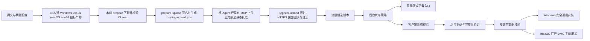

# 问学正式发布、消息通知与客户端更新实现计划

> 日期：2026-09-25
>
> 状态（2026-09-28）：P0 已完成；P1、P2、P3、P4、P5、P6、P7 整体仍未完成。beta.1 与 beta.2 候选均登记 verified，但该状态只证明清单与原字节验证。beta.1/beta.2 DMG 镜像校验及发布 SHA/大小均有效；只读检查发现两版 DMG 内 App 的严格代码签名验证均失败，用户反馈 beta.1 拖入 Applications 后打开提示“已损坏”。两版保持未发布，不再用于安装/升级验收。修复版 beta.3 的 CI run `36383077750`（source `4708213cf5afac26e22f3ba48731e86f4f893e2d`）四个 job 全绿，最终 DMG 内 App 严格签名门禁与本机 `verifyMacDmg` 均通过；prepare、五对象公开上传回读和候选登记成功，`electron:beta:0.1.1-beta.3` 为 verified。用户已反馈 beta.3 在 Mac 上正常打开；该反馈只确认首次打开，不证明 CfT 启动、资料/Profile 保留或自动升级。beta.4 CI run `36424859967`（source `eb5fbc3a6e8e5fe37c300515cbd1de3660e03d61`）四 jobs 全成功，最终 DMG 严格签名门禁、本机 prepare/prepare-upload、托管恢复与 register-upload 均通过，候选 `electron:beta:0.1.1-beta.4` 已 verified。用户确认覆盖全部符合资格 beta 用户后，root 于 21:20 CST 提交 beta/optional/100% rollout，当前发布中。Mac 已完成自动发现、后台下载、DMG 手动覆盖和 beta.4 目标启动；仅覆盖 P5.6 路径，不证明所有资料/Profile 项或完整 P5。CfT 账号交接的一次 15 秒 cold 超时发生在升级前的 beta.3，后续 warm/cold 测量成功，原因未复现。Windows 用户已确认从现有 beta.1 或 beta.2 正常退出再打开后为 beta.4，浏览器和资料正常；精确起始版本和 Windows build 未提供。后台最终检查 2/0、下载 2/0、交接 1/0、目标启动聚合计数 2。P4.5 的候选上传、复用、冲突拒绝和半成品恢复门禁已完成。详见[macOS 包签名故障日志](../../../log/2026-09-28-macos-bundle-signature.md)与[beta.4 rollout 验收日志](../../../log/2026-09-28-beta4-rollout-verification.md)。
>
> 产品边界已由用户在本会话确认；本文件将其整理为需求、设计约束、实施任务与验收门禁。详细接口和数据变更在 P2 登记到上游架构后再实现，不将计划中的建议冒充已经落地的能力。

## 1. 已确认的目标与范围

| 编号 | 需求                                               | 用户可见结果与验收条件                                                                                     |
| ---- | -------------------------------------------------- | ---------------------------------------------------------------------------------------------------------- |
| R1   | 继续使用 Electron + 内置 Chrome for Testing（CfT） | Chromium AI 浏览器重构方案已废弃；本次不实施重构或新旧浏览器迁移                                           |
| R2   | 打通正式发布                                       | 同一提交产生可追溯安装包，CI 注册候选，管理员从后台发布；官网与客户端由同一发布记录派生版本信息            |
| R3   | 恢复公告弹窗                                       | 管理员可向全体或指定账号发布；登录且在线时及时显示，离线用户下次登录补发未过期消息                         |
| R4   | 账号级公告确认                                     | 用户确认后，同账号其他设备停止展示该消息；重启不重复，切换账号不串消息；支持撤回、过期和单弹窗排队         |
| R5   | Windows 自动更新                                   | 支持 Windows x64 未签名 NSIS；后台下载，在安全的正常退出时安装，也可点击立即重启更新                       |
| R6   | macOS 下载与手动覆盖                               | 支持 Apple Silicon（arm64）未签名 DMG；后台下载，用户打开安装包并覆盖，界面不得声称已自动安装。Intel Mac 暂不适配 |
| R7   | 发布控制贯穿整个升级过程                           | 灰度、暂停、撤回对客户端生效；下载完成不等于取得永久安装许可；安装前无法获取有效策略时延后                 |
| R8   | 保护浏览器与本地数据                               | 安装前确认问学管理的 CfT 已退出；用户取消或无法确认退出时不安装；升级保留数据目录、Profile、历史与登录状态 |
| R9   | 旧用户可进入新流程                                 | 现有旧版先手动覆盖安装一次过渡版；验证旧版 → 过渡版 → 下一正式版的完整链路                                 |
| R10  | 发布结果可核对                                     | 区分候选、发布、下载、安装交接、目标版本启动与失败；保留脱敏证据、操作审计和分阶段执行记录                 |

范围补充：

- 公告只覆盖登录客户端；不要求应用完全退出后仍收到系统推送，不新增 OS 推送基础设施。
- 当前发布与实机验收目标仅为 Windows x64 与 macOS arm64；Intel Mac 暂不适配。暂不办理 Apple Developer 或 Windows 平台签名证书；保留 Ed25519 清单签名与文件完整性校验。二者不等同于平台签名。
- 已确定使用 GitHub 私有仓库免费路线：GitHub 只做无发布凭据的 main 手动首轮构建；`expected_commit` 必须是 40 位十六进制并匹配实际构建 SHA。仅从该 run 下载构建产物和 seal artifacts，保留 1 天。`prepare` 下载并核验 CI seal；`prepare-upload` 经安全注入签名私钥后生成签名候选和 `hosting-upload.json`；根 Agent 经现有 MCP 授权托管上传清单中的五个对象；`register-upload` 只做完整公网回读和注册，不执行上传。签名私钥不向 GitHub 暴露；不新建 CAM 身份或复制主 API Key。旧 COSCLI publish 流程保留为可选路径；原 `desktop-release-publish.yml` 退役，不等待 Pro 或付费 Environment。
- 第一阶段使用可延后更新体验；既有 mandatory 策略须在 P2 明确兼容处理，不能借此增加强制重启、强杀浏览器或离线自动安装。
- 不改 LLM 路由、Agent 能力、计费和账号体系；不引入整套替代后台，不顺带升级整套 Electron 技术栈。
- Windows ARM、Mac 自动安装、后台静默替换 DMG、自动降级均不属于本轮交付。

## 2. 基线与事实边界

本计划基于提交 `7362c7d3de419bdc96c30bf9609d7730b0c26ec3` 的已提交内容，以及本会话已核对的代码和文档。

| 已核对项                                                     | 现状                                                            | 本次处理                                                   |
| ------------------------------------------------------------ | --------------------------------------------------------------- | ---------------------------------------------------------- |
| `apps/desktop/electron-builder.yml`                          | 未签名 DMG/NSIS，Mac 公证关闭                                   | 保持本阶段未签名条件，扩展 Windows 更新所需产物            |
| `apps/desktop/package.json`                                  | Electron `^33.2.0`、builder `^26.0.12`，未依赖 electron-updater | P1 确认锁文件版本，P5 接入兼容更新器；不能直接套用 v27 API |
| `DesktopUpdateService`                                       | `manual-unsigned`，检查、下载、校验、打开安装包                 | 保留现有策略校验，新增自动下载与平台安装分支               |
| `DesktopAnnouncementService` / `DesktopReleaseSignalService` | 已有 watch、轮询、账号回执和更新检查意图                        | 先复现和修复断点，避免重复建立另一套服务                   |
| `AdminApi` / 管理后台                                        | 已有公告、候选、rollout 与发布操作                              | 验证线上可用性，再补充平台能力、状态和官网消费能力         |
| GitHub 候选工作流与本机发布工具                              | GitHub 构建/seal 与候选签名、托管上传、注册分段处理            | 构建只保留无发布凭据的工作流；本机工具承担 prepare-upload/register-upload |
| 历史计划与 ROADMAP                                           | 曾记录 GitHub/CAM、真实候选、实机升级等未完成                   | 作为排查线索；不得据此断言今天的生产配置仍相同             |
| 产品文档入口                                                 | 当前 PRD 仍指向 Chromium 重构                                   | P0 按用户已明确的废弃决定纠正有效文档入口                  |

2026-09-25 P1 只读核验及本地验证快照详见[核验记录](../../../log/2026-09-25-p1-release-readiness.md)，其平台和阻塞项是当日状态。**历史快照（2026-09-26 首次推送及配置前）**：GitHub 已认证，测试机可用，但远端仓库内容为空、无实际 main 提交/workflow/run，Environment、vars、secrets 均为空。该记录已由后续事件更新，不代表当前状态。两个测试账号经 CloudBase 精确匹配确认 ACTIVE；尚未进行客户端登录或公告端到端实验，不记录完整邮箱或 UID。Intel Mac 暂不适配。锁文件实际为 Electron 33.4.11、builder 26.15.3，后续按实际版本核对更新器。

2026-09-26 Windows x64/macOS arm64 矩阵实现与本地验证见[双目标矩阵记录](../../../log/2026-09-26-release-two-targets.md)：119 项 Admin API 测试、17 项发布脚本测试、API typecheck、完整 release lint 和 workflow YAML 解析通过。这只验证矩阵代码；P1、P2、P4 阶段仍未完成。

启动本计划时原工作区有一处已有改动：`apps/extension/src/agent/visualObserve.background.ts`。本计划保存在独立工作区，未复制、暂存或提交该改动。后续如需纳入新的已提交修复，先记录新的执行基线。

2026-09-26 同步本地 main 的固定提交 `2a55287`：保留其他任务已提交的插件格式、官网页脚以及产品版本/更新错误提示修复。此前计划/旧包记录中版本为 `0.1.0`；本次 CI 的源码及产物版本是 `0.0.1-beta`，低于 `0.1.0`，因此不能作为该旧包的升级候选，也不能改写旧包证据。后续候选版本须按 P4.6 的真实发布历史分配。

2026-09-26 首次 CI 与本机 prepare 验收：private repo 的 main 已推送，`WENXUE_GATEWAY_BASE_URL` 与 `WENXUE_RELEASE_ED25519_PUBLIC_KEY` 两个公开 repository variables 已配置，公钥校验通过；GitHub 仅配置公开变量，无 secrets。用户登录账单页后核实，构建前 GitHub Free Actions 用量为 0/2000 分钟、0/0.5 GB，Actions budget `$0` 且 Stop usage=Yes。run [36188670852](https://github.com/SmartSunruiyang/WenXue/actions/runs/36188670852) 的 attempt 1 由 `workflow_dispatch` 在 `main`、SHA `79b42ada2cd855ab645bab63aa01b27c7f463d70` 构建 `0.0.1-beta` / `beta`；`quality`、`macos`、`windows`、`seal-artifacts` 四个 job 均 success。本机 Node 22 从同 SHA clean worktree 执行 `publish-local-candidate.mjs prepare`，双目标 artifact 的 seal、原字节哈希、公钥等校验通过，生成 `release-review.json`；产物目录为 `/Users/outas/Downloads/WenXue-CI-36188670852`。完整记录见[首次 CI 构建日志](../../../log/2026-09-26-first-ci-build.md)。

上游与历史参考：

- [当前运行时架构](../../context/ARCHITECTURE.md)、[基础设施](../../context/TECH-INFRA.md)、[路线图](../../context/ROADMAP.md)、[开发规范](../../context/CONVENTIONS.md)。
- [历史消息与手动更新设计](../specs/2026-07-17-desktop-update-announcements-design.md)、[历史实施计划](2026-07-17-desktop-update-announcements.md)。历史文档中的双运行时、仅手动下载等条款需按本次范围在 P0/P2 同步，不直接照搬。

## 3. 设计约束与模块归属

### 3.1 发布与下载的唯一决策来源



- AdminApi 的发布策略负责版本、通道、平台、架构和稳定灰度资格；`DesktopUpdateService` 执行校验与操作编排。更新器仅负责执行获准版本的下载和安装。
- 不允许更新器再从全局 `latest.yml` 自行选择更高版本，从而绕过后台灰度、暂停和撤回。P2 确定适配方式，P5 实现并测试，既有后台分桶作为唯一灰度依据。
- 签名清单覆盖 releaseId、版本、通道、平台、架构、分发能力、产物 URL、大小和 SHA-512。Windows 更新元数据及其实际引用的安装器必须绑定同一候选，不能只签清单、另信任任意 YAML。
- 下载和安装使用的实际字节都要匹配已验签信息，缓存恢复不能跳过校验。生产配置与发布私钥不进入客户端；客户端只内嵌验签公钥。
- 官网展示当前有效的正式下载版本，测试版本不进入公开下载入口。灰度期间保留上一全量稳定版供新用户下载；灰度到全量后再切换官网指向。暂停/撤回时回退到明确保留的已验证稳定下载记录，不用“取最大版本”猜测。
- 保留现有不可变候选、通道互斥、最高版本门禁和追加审计。撤回后发布修复包必须使用更高版本；已升级用户不自动降级。

2026-09-26 托管分发核验：CloudBase 业务 bucket `7765-wenxue-d8gz76tacc3659f05-1427406869` 为 PRIVATE；静态托管公开文件 bucket `4877-static-wenxue-d8gz76tacc3659f05-1427406869` 为 public-online，`askwenxue.com` 根路径由 HTTP gateway 路由到现有静态托管。MCP 上传 300 MiB 无敏感探针后，匿名 HTTPS 完整下载 314572800 字节，SHA-256 `17a88af83717f68b8bd97873ffcf022c8aed703416fe9b08e0fa9e3287692bf0` 匹配，3.8 秒；探针对象已精确删除并复核。Range 返回 200 全文、不是 206，不能宣称续传通过。套餐 `EnableOverrun=false`，不新增购买且不承诺永久免费。正式发布路径使用现有托管上传授权，写入 `desktop-releases/electron/channel/version/`；应用层同路径同哈希复用、异哈希拒绝并将候选视为不可变，不代表底层 WORM。正式候选上传、完整公网回读与注册仍待执行。

### 3.2 公告与确认

- `AdminApi` 持久化公告和回执并校验目标账号；signal 仅携带 revision 等最小变更信息，不暴露正文或目标 UID。
- `DesktopAnnouncementService` 负责登录/重连补拉、监听与轮询、排队、账号切换和确认重试；展示层只消费状态和发送用户意图。
- 发布后的公告正文保持不可变；修改内容需发布新公告 ID，旧确认不能覆盖一条新消息。撤回和到期均停止交付。
- “已发布”“已展示”“已确认”语义分开。第一阶段若没有展示回执，就不在后台展示声称精确的送达率；不得用写入 signal 成功代表用户看过。
- 已收到的确认请求重试必须幂等；确认失败不能本地永久当成成功。多设备已打开的同一弹窗在回执同步后关闭，切号后旧回调作废。

### 3.3 下载完成与安装许可分离

- `DesktopUpdateService` 保留平台无关策略、状态、校验；Windows updater 适配放在该模块内部。若需要新增独立模块或 IPC，先在 P2 登记其职责和依赖。
- 默认禁止更新器绕过业务编排的退出安装。安全退出流程先拦截退出意图、异步复核策略，协调相关进程正常退出，最后重新确认候选仍有效、文件完整、无进程占用，再交接安装。
- 若只关闭窗口、仅退出启动器而保留 CfT、用户取消、浏览器退出超时、关机/注销、策略请求失败，则保持“已下载、待安装”，允许普通退出语义完成，不启动安装器。
- 立即重启更新需明确提示会关闭的问学浏览器。复用 `BrowserSupervisor` 的公开生命周期能力；不能按进程名杀所有 Chrome，也不能为了安装沿用超时强杀路径。关闭无法安全完成时延后更新。
- 覆盖多个 Profile、启动器重启后仍存活的问学 CfT、其他账号遗留进程的占用；只校验当前窗口或当前账号的进程不够。不借此扩大跨账号数据可见性。
- 暂停/撤回使下载缓存失去安装许可；应用重启后、手动打开包、立即安装、退出安装均需实时复核。断网不使用缓存许可自动安装。
- 安装器已启动，或用户自行打开应用之外保存的安装包后，服务端撤回无法保证取消；必须如实记录这一交接边界。

### 3.4 兼容与结果记录

- 老客户端只认识手动分发，不能直接向它发送不兼容的新模式。P2 确定版本/能力协商以及旧协议响应，保留到过渡版的手动安装路径，不原地改写旧候选。
- 应用标识、安装身份、用户数据路径和 Profile 路径保持兼容。升级遇到数据格式变化时另行设计迁移，不以复制/删除数据兜底。
- 持久化最小升级尝试信息，如 attemptId、原版本、目标 releaseId/版本和产物哈希；不存账号 token 或浏览内容。
- `downloaded`、`installer-started/handedOff` 不算安装成功。下一次进程启动且实际版本匹配目标后，才记录目标版本已启动；无后续上报应显示未知，不能直接计为失败。
- 现有 event token 绑定 release/runtime/platform/arch/fromVersion 与有效期。P2 设计跨版本启动后的结果关联和 token 更新/过期路径，不能简单复用过期或版本不匹配的旧 token。事件保持匿名、幂等、有限期保存，仍不作为可信证明或自动放量唯一依据。

2026-09-26 P5.7 实现已提交至 `bb4dc29` 并 push 至 `origin/main`；新桌面构建、候选发布与设备验收待完成：`DesktopUpdateService` 独占 `<userData>/update-install-attempt.json`，原子 mode `0600` 写；记录本地唯一 attemptId（不上传）、受签名 manifest/signature、fromVersion、targetVersion、releaseId、channel/platform/arch、artifactSha512、原 eventInstallIdHash、受限 eventToken、attemptedAt/expiresAt 及 `prepared | accepted | failed` handoff 阶段，最多保存 7 天，不含账号、硬件 ID 或安装路径。只有最后在线策略、签名候选及浏览器空闲复核通过后、实际交接前才写 `prepared`；写入失败取消本次安装交接，但正常退出仍可继续。交接成功更新 `accepted`，明确失败更新 `failed`。应用退出或重启中断时允许留下 `prepared`。同文件的写入/删除由 service 串行队列处理，attemptId 用于隔离旧异步清理和新尝试。macOS 的 accepted 仅代表打开 DMG。

打包版下次启动验签本机记录并核对实际版本、releaseId 与平台产物。仅实际 `app.getVersion() === targetVersion` 时，客户端不依赖当前 active policy，使用原有效 token 请求 API 按历史 verified candidate 核对版本及 manifest 对应平台 `artifactSha512`，再带原 fromVersion、eventInstallIdHash、eventToken 和 artifact SHA-512 匿名幂等上报 `target-started/success`。这只是版本与候选关联回报，不是可信遥测或运行中安装目录逐字节验证。恢复到 fromVersion 仅显示本地 `unconfirmed`，不报告失败；版本跳转、记录损坏/过期不得报告 success。回报网络错误或 5xx 可退避重试、不阻断启动；401、400 或过期则终止；stop 清理计时器且不重复回报。`UpdateState.lastInstallAttempt?` 只暴露 targetVersion 和 `unconfirmed | confirmed | failed` 状态；prepared/accepted 均显示为未确认，accepted 只表示交接成功。后台健康数据增加独立 `stages.targetStarted.success`，handoff 与 target-started 分开统计；旧服务端缺 `stages.targetStarted` 字段时显示未知；字段值 0 表示未收到确认，未知不计作失败。

## 4. 实施阶段与依赖

按阶段推进：完成当前阶段的任务、对应验证、文档同步和日志后，汇报证据与未完成项，再推进已获授权的下一阶段。阶段中允许独立检查并行，但不跨门禁宣布后续完成；遇到真实外部前置条件缺失或超出授权范围时再向用户说明。

2026-09-25 用户指定的执行分工：主 Agent Astra 负责方案判断、启发、难点处理、最终验收和必要的代码优化；简单文档/整理任务交给 `gpt-6-luna`，业务代码和测试代码编写交给 `gpt-6-sol`。所有子 Agent 遇到无法解决的问题或影响范围不清时，先向主 Agent 请教，不自行扩大任务或反复试错。主 Agent 审查实际变更与验证证据后才确认阶段完成。

| 阶段 | 目标                           | 依赖                   | 完成标志                                         |
| ---- | ------------------------------ | ---------------------- | ------------------------------------------------ |
| P0   | 纠正文档与固定执行基线         | 本计划                 | 当前产品路线、文档权威与任务范围一致             |
| P1   | 复现故障并确认生产就绪条件     | P0                     | 三条链路有可复现断点或明确缺失条件，无猜测性结论 |
| P2   | 固定发布、更新、兼容和结果契约 | P1                     | 协议与架构更新，边界测试可表达且通过已实现部分   |
| P3   | 恢复公告端到端闭环             | P2                     | 双端定向/全体、离线补发、跨设备确认验收通过      |
| P4   | 打通真实候选构建和注册         | P2；按顺序在 P3 后执行 | Windows x64 与 macOS arm64 两目标不可变候选可复现生成并进入后台 |
| P5   | 完成双端下载与安装行为         | P2、P4                 | Windows x64 自动更新与 macOS arm64 手动交接分别通过实装验证 |
| P6   | 补齐后台发布操作与官网入口     | P4、P5                 | 控制面与所有消费入口版本一致，暂停/撤回有效      |
| P7   | 两跳升级演练与受控正式发布     | P3–P6                  | 测试矩阵通过，有首个正式版本与后续发版操作记录   |

### P0 — 文档与执行基线

关联需求：R1、R10。

- [x] P0.1 核对干净工作区、当前提交、执行分支和旧改动边界；需创建分支时采用 `codex/` 前缀。后续代码基线变化要记录，不能悄悄混入旧工作区未提交内容。
- [x] P0.2 将 `.project.agents/AGENTS.md`、`CLAUDE.md`、`SELF_CONSTRAINTS.md`、`VIBECODING_GUIDE.md` 中仍有效指向 Chromium 目标路线的条款修正为当前 Electron 路线；保留与本任务无关的规则。
- [x] P0.3 恢复 `docs/context/PRD.md` 对当前产品的有效入口，写入 R1–R10；将 `docs/refactor/ai-browser/README.md` 标记为历史废弃入口，并处理仍将其视为当前权威的引用。不删除历史设计或伪改历史验收记录。
- [x] P0.4 在当前 ROADMAP 增补本轮交付阶段；历史 M4.7/M5.1 的“代码已完成”和“生产/实机待验收”分开保留。

出口：后续执行者能从当前规则和 PRD 找到本计划，不再被要求实施已废弃浏览器方案；文档差异只涉及路线、范围与入口。

### P1 — 复现与配置核验

关联需求：R2、R3、R5、R6、R10。

- [ ] P1.1 确认 Node/pnpm、锁文件中 Electron/builder、应用真实版本、操作系统支持范围和 Windows x64/macOS arm64 两个目标的可用测试环境；收集当前已分发旧版安装包及哈希。Intel Mac 暂不适配；没有实机证据的平台保持待验收。
- [ ] P1.2 分别记录公告发布/接收、后台候选发布、客户端下载/打开安装包的复现步骤、响应状态、脱敏错误码和所属模块；遵循“复现 → 架构 → 接口 → 单模块代码”排查顺序。
- [ ] P1.3 只读核验实际客户端内嵌网关、公钥、channel 与 server 配置是否匹配；验证官网域名、默认域名与实际使用的管理/client/internal 路由、CORS 和 HTTPS。不要根据历史域名路由数量推断齐全。
- [ ] P1.4 核验 Auth 的 ACTIVE 状态验证、管理员/viewer、普通用户与定向目标过滤；核对 announcement/release signal、NoSQL 规则/索引/TTL、监听读权限及轮询请求。
- [ ] P1.5 核对 GitHub 登录和仓库权限、免费私有仓库 Actions 加权分钟与共享 artifact 存储额度、超额时的阻断行为及 Actions 预算硬停止设置；2026-09-26 构建前用量为 0/2000 分钟、0/0.5 GB，Actions budget 为 $0 且 Stop usage=Yes。2026-09-27 首轮构建前账单页显示 35.7/2000 分钟、存储显示 0 GB/0.5 GB（页面取整）、当前应付 $0；N+1 CI 触发前显示 70.3/2000 分钟、存储 0 GB/0.5 GB（页面取整）、当前应付 $0，Actions budget $0、spent $0、Stop usage=Yes。相关配置均未修改。本机签名私钥已由 Keychain 核实并匹配现有公钥；CloudBase 业务 bucket 保持 PRIVATE，静态托管 bucket public-online；五对象托管上传、公开字节验证和候选登记已完成。GitHub 不配置发布 secrets；只记录配置项是否就绪，不输出凭据。P1 其他账号、公告时延与跨设备实测仍未完成。
- [ ] P1.6 核对公开更新端点的请求预算、限流和默认域名是否绕开既有保护；复用现有资源，记录真实外部阻塞及可继续的本地工作。
- [x] P1.7 产出三条链路故障表，区分已复现根因、代码缺口、配置缺口与待实机验证；配置修复和业务修复进入对应阶段，不能以顺手部署替代记录。

2026-09-25 的只读证据见[核验记录](../../../log/2026-09-25-p1-release-readiness.md)。159 项相关测试和桌面类型检查通过；P1.1–P1.6 的已核验部分、无法核验部分分别记录，未因部分通过将整项勾选。当前两个 ACTIVE 测试账号及 Windows x64/macOS arm64 测试机可用；Mac 测试 A 已由用户目视看到弹窗并点击确认，服务端回执独立核验、在线时延与跨设备去重仍待验收。GitHub 配置及两次 CI 结果见 2026-09-26/27 执行日志；P1 其余链路核验及出口仍未完成。

出口：每个“不可用”都有可定位证据或明确待补条件；建立测试管理员、至少两个普通测试账号及跨设备验证方法。真实公告实验只针对测试账号。

### P2 — 契约、状态机与服务端门禁

关联需求：R2、R4–R10。

主要范围：`packages/client-operations/index.mjs`、`index.d.ts`、对应测试；`apps/admin-api/src/adminApi.mjs`、`cloudbaseStore.mjs`；Gateway 路由；当前 ARCHITECTURE、TECH-INFRA、UIUX。

- [ ] P2.1 定义平台分发能力、升级状态与错误码，明确 Mac 手动交接和 Windows 自动安装的差别；共享包仅保存 wire types、纯校验与固定展示，不加入网络或 OS 副作用。
- [ ] P2.2 明确旧协议 → 过渡版 → 新协议的兼容策略、schema/capability 校验、发布先后顺序和撤回边界；写清 mandatory 旧行为在新客户端中的兼容约束。
- [ ] P2.3 扩展签名候选与构建证据，使 Windows updater 所需元数据、EXE 及实际需要的关联文件进入可信产物集合；不移除现有原字节 seal、公钥指纹与候选不可变检查。
- [ ] P2.4 定义单一更新策略到具体候选元数据的绑定方式；禁止全局 latest 或 updater 自有灰度再次作出不一致选择。增加无资格、跨通道/架构、清单/YAML/URL/哈希错配的拒绝测试。
- [ ] P2.5 定义安装前复核和撤回状态转换：已缓存、应用重启、下载中、退出中、候选变化、复核失败均不能漏过；明确安装交接后不保证撤回。
- [ ] P2.6 定义匿名升级尝试/目标版本启动结果的接口、持久化、幂等键、token 获取或更新与 TTL；保持日志无账号凭据，不将事件当成可信安装证明。
- [x] P2.7 定义官网的公开下载响应及稳定版本指针，仅返回公开版本/平台/链接/校验信息；与发布事务保持一致，灰度中不泄露测试候选为默认正式下载。2026-09-29 已实现同事务指针、显式保留历史与安全投影，AdminApi 193/193、Gateway 126/126 通过；线上 stable 完整流转演练归 P6.4/P7。
- [ ] P2.8 将变更登记进 ARCHITECTURE 的模块、状态、接口、数据和不变量，以及 TECH-INFRA 的打包协议；确定具体技术选择后先说明影响，再进入依赖它的实现。

出口：协议、状态机和兼容样例可供前后端共同实现；已实现契约测试通过，未实现项不得提前标通过。任何 schema/API 变更有明确客户端和服务端部署顺序。

### P3 — 消息通知闭环

关联需求：R3、R4、R10。

主要范围：`apps/admin/src/AnnouncementPage.tsx`、`adminApi.ts`；AdminApi/CloudBase store；`DesktopAnnouncementService.ts`、桌面消息接入；共享公告组件和现有测试。

- [ ] P3.1 按 P1 证据修复发布、pending、ack、鉴权、watch 或路由断点，保留唯一业务实现；验证 admin 可发布/撤回、viewer 只读、普通用户不可管理。
- [ ] P3.2 验证全体/指定账号、平台/版本条件、生效/过期时间及发布前预览；表单失败不显示成功，重试不重复创建消息。
- [ ] P3.3 补齐登录、网络恢复和应用恢复时的拉取，独立 watch 重试和轮询兜底；登录会话变化后旧请求与回调不得覆盖新账号状态。
- [ ] P3.4 完成单弹窗队列、重要程度排序、确认失败重试、跨设备回执同步，以及正在显示公告的撤回/过期处理。无内容的 revision 信号不能直接当公告展示。
- [ ] P3.5 对真实测试账号完成后台 → 已安装客户端 → 确认 → 另一设备去重的闭环；记录正常网络时延与监听失败时的补偿结果。

2026-09-26 客户端恢复实现已通过主 Agent 代码验收：`DesktopAnnouncementService` 在 `online`、窗口重新聚焦和页面重新可见时补拉，合并重复请求但保留新 revision 的补拉。确认成功后的迟到 pending 不再恢复弹窗；切号或停止服务后，旧 ack 的成功、HTTP 失败和网络异常均不影响新会话；当前账号确认失败仍可重试。18/18 个服务测试、typecheck、目标 lint 与 format 已独立复核通过，详见[恢复日志](../../../log/2026-09-26-announcement-recovery.md)。该恢复实现已进入本轮 `0.1.1-beta.1` 构建；P3 完整实机出口仍未完成。

真实后台曾返回 `Invalid JSON body`，原因是 AdminApi 适配器将 Functions Framework 直接传入的业务 `body` 误按 HTTP 包装体拆解。修复提交 `12ad186` 已部署至组合网关 037，实际定向公告发布及 signal 更新成功，Mac 测试 A 已观察到弹窗。随后用户明确回复已看到“弹窗目视确认 · 0926 1914”并点击确认；服务端回执独立核验、在线时延和跨设备去重仍待实证。详见[后台发布修复日志](../../../log/2026-09-26-announcement-body-adapter.md)。

出口：满足第 5 节 N 系列用例，后台发布和用户确认可核对；不使用向全体真实用户发送测试公告作为验收方式。

### P4 — 真实候选构建与注册

关联需求：R2、R5–R7、R9、R10。

主要范围：`.github/workflows/desktop-release-candidate.yml`（无发布凭据构建）；`desktop-release-publish.yml` 已退役；`apps/desktop/electron-builder.yml`、`apps/desktop/scripts/publish-local-candidate.mjs` 与既有 seal/evidence/candidate/upload/verify 工具。本机发布配置不进入 GitHub。

- [x] P4.1 完成本机发布凭据核验；GitHub Free 免费额度和超额停止预算已确认。用户已选择删除超大视频，首页/文档引用及 main 历史清理、首次推送已完成，不采用 LFS；原始历史有备份和 SHA 映射。GitHub 构建仅配置公开变量，不放签名私钥或发布凭据；原发布 workflow 已退役。签名私钥已在本机 Keychain 核验；不新建 CAM/COSCLI 专用身份，改用根 Agent 现有 MCP 托管上传授权。候选注册凭据/权限通过本轮 `register-upload` 验证。
- [x] P4.2 让 Windows 构建生成实际所需更新元数据和关联文件，并由 CI 保留原字节及 seal artifact；本机复核、签名，经 CloudBase 静态托管上传并公开回读。run `36260499160` 成功生成 DMG、NSIS 与 `beta.yml`，CI seal v3 与本机 prepare/prepare-upload 通过；manageHosting 上传五个对象后，register-upload 完成公开回读和登记。Mac 本阶段仍为手动 DMG，不为未承诺的自动安装增加 ZIP 发布要求。
- [x] P4.3 将产物的版本、channel、平台/架构、网关、公钥指纹和同一提交绑定；Windows x64 与 macOS arm64 两个目标均构建成功并由本机验证后才注册 verified 候选。版本不一致、缺包或签名失败均不能发布。候选 `0.1.1-beta.1` 绑定 commit `6fb2731a9e303e2ead81567b78d06c69b42e9a0c`、run `36260499160`；N+1 候选 `0.1.1-beta.2` 绑定 commit `1534b7c18a16ba7b92735a10cdd346c8ee3f8677`、run `36271403682`。两候选均按公钥指纹和双目标原字节公开回读后注册为 verified；候选登记不代表 rollout 已发布或实机升级完成。
- [ ] P4.4 更新候选验收证据模型，区分自动化完整性检查与真实安装/升级测试；保留受信 CI run/产物哈希绑定，不能只改证据名称就宣称经过安装测试。
- [x] P4.5 **候选上传、复用、冲突拒绝与半成品恢复门禁完成**：beta.1 run `36260499160` 与 beta.2 run `36271403682` 的 DMG 内 App 严格签名验证失败，二者不用于安装/升级验收。beta.3 run `36383077750`（source `4708213cf5afac26e22f3ba48731e86f4f893e2d`）和 beta.4 run `36424859967`（source `eb5fbc3a6e8e5fe37c300515cbd1de3660e03d61`）四 jobs 均全成功，最终 DMG 签名门禁及本机 prepare/prepare-upload/register-upload 通过，两个候选均 verified。beta.4 五对象上传曾部分恢复为 1 reuse + 4 upload，随后 5 reuse，SHA-512 与签名稳定。Sol 同长度异 SHA 冲突 mock 回归 1/1 通过。用户确认 beta.3 在 Mac 正常首次打开；另有一次 15 秒 CfT cold 交接失败，后续 warm 316 ms 和两次 cold 1.709/1.795 秒成功，原因未复现。上述 beta.3 阶段证据不验证 CfT 稳定性、资料/Profile 保留或自动升级；截至该阶段，Windows beta.1/2→beta.4 尚未实测。后续 beta.4 rollout 的 Windows 验收结果见本项后文及最新日志。缺少任一公网文件时 register-upload 拒绝的回归通过；本机完整注册已成功。P4.5 仅覆盖候选上传、复用、冲突拒绝与半成品恢复门禁，不表示 P4 整体完成。beta.4 发布范围及设备验收以[最新 rollout 验收日志](../../../log/2026-09-28-beta4-rollout-verification.md)为准：用户已确认覆盖全部符合资格的 beta 用户，Windows 用户已确认从 beta.1 或 beta.2 正常退出再打开后到达 beta.4，浏览器和资料正常；精确起始版本与 Windows build 未提供。Mac 完成 beta.4 自动发现、下载、手动覆盖和目标版本启动，但未逐项核对历史、书签与站点登录。详见[macOS 包签名故障日志](../../../log/2026-09-28-macos-bundle-signature.md)与[beta.4 rollout 验收日志](../../../log/2026-09-28-beta4-rollout-verification.md)。
- [ ] P4.6 准备可重复生成的旧版、过渡版 N、后续版 N+1；具体版本在执行时按真实最高发布版本分配，不把历史示例 `0.1.0 → 0.1.1` 当成当前必用版本。

出口：后台能看到 Windows x64 与 macOS arm64 两目标齐备且证据绑定的真实候选；仅注册候选不自动创建正式 rollout。后续客户端改动需要在冻结提交重新构建，不能复用与源码不一致的旧产物。

### P5 — 客户端自动下载与安全安装

关联需求：R5–R9。

验收注记（2026-09-28，最新结果见[rollout 验收日志](../../../log/2026-09-28-beta4-rollout-verification.md)）：beta.1/beta.2 的 macOS DMG 内 App 严格代码签名验证失败，不用于升级验收或发布。beta.4 已按用户确认提交 optional、beta 通道、100% rollout，覆盖全部符合资格的 beta 用户；最新日志记录状态为发布中。Mac 自动发现、后台下载、DMG 手动覆盖和目标版本启动路径通过；P5.6 已勾选，但历史、书签和站点登录未逐项核对。Windows 用户确认从现有 beta.1 或 beta.2 正常退出再打开后到达 beta.4，浏览器和资料正常；精确起始版本与 Windows build 未提供。该证据不覆盖 Windows 立即重启、占用/取消等异常路径，也不使 P5 整体完成。升级前 beta.3 上一次 CfT 15 秒 cold 超时，随后 warm/cold 测量成功，原因未复现。

主要范围：`apps/desktop/package.json`、锁文件、`DesktopUpdateService.ts`、`DesktopBridge`、`BrowserSupervisor`、`MainBootstrap`、`DesktopReleaseSignalService.ts` 和更新展示；复用现有模块边界。

- [x] P5.1 接入与锁定 builder 兼容的 electron-updater，仅在 Windows 分支使用；封装在现有更新模块内，渲染进程不得操作文件、安装器或 Node API。实现使用 6.8.9 / NsisUpdater，既有自动化与候选构建通过；beta.4 rollout 中，用户确认 Windows 正常退出再打开后到达 beta.4（起始版本为 beta.1 或 beta.2，具体未提供），浏览器和资料正常。该确认支持本项所述更新器及正常退出路径，不证明立即重启及其他异常路径通过。
- [ ] P5.2 让启动、定时、发布信号、联网恢复和手动检查统一进入策略门禁；验签且命中资格后自动下载，支持失败重试、并发去重、取消以及完整缓存恢复。
- [ ] P5.3 实现受控更新元数据适配；真正的下载 URL、大小、SHA-512 与已授权候选一致才允许下载。避免 updater 自动下载或已缓存文件路径提前绕过该检查。
- [ ] P5.4 接入正常退出/立即更新的异步协调，区分窗口关闭、保留 CfT 的启动器退出、完整退出、关机/注销；处理重入、用户取消、关闭超时和 app 重启后旧 CfT 占用。安装前按 §3.3 复核，禁止裸开默认退出安装。
- [ ] P5.5 Windows 验证当前用户安装、安装目录、未签名包生成配置及实际系统限制；仅 schema 2 error 且仍有对应已验签候选时允许“手动下载安装包”。每次点击独占在线复核策略、签名与安装器 artifactSha512 匹配后，仅打开已签 manifest 的 HTTPS URL；入口可按最近状态展示，撤回、离线或不匹配时点击后拒绝打开。此入口不操作缓存、不自动退出、不写 attempt 或表示已安装；不承诺跳过 UAC、SmartScreen 或组织策略。
- [x] P5.6 Mac 自动下载且校验通过后提供打开 DMG/稍后操作；打开前复核有效策略和浏览器状态，说明覆盖步骤与未签名提示。应用不执行绕过系统安全机制或后台替换应用的命令。beta.4 实测中 Mac 自动发现并下载，应用打开已验证 DMG 后交给用户手动覆盖；交接记录 accepted，原进程正常退出，用户确认完成后本机 Info.plist、About 与 `codesign --verify --deep --strict` exit 0 确认应用签名有效、应用和插件均为 beta.4。CfT 正常退出后 `ps` 显示内置 CfT 主进程为 0，新版问学仍打开。此项仅验收该手动交接和目标启动路径，不代表 P5 整体完成或历史、书签、站点登录等资料均逐项核验。证据见[rollout 验收日志](../../../log/2026-09-28-beta4-rollout-verification.md)。
- [ ] P5.7 实现 ARCHITECTURE §3.2/§4 的原子 attempt 记录、重启后严格目标版本及服务端对历史候选中对应平台 artifactSha512 的核验、幂等匿名上报和后台分阶段统计；旧版重启仅显示未确认，绝不伪造 installed 或上报失败。测试重试/终止条件、过期损坏、stop 清理及旧客户端未知状态。
- [ ] P5.8 为状态机、IPC、策略并发、撤回缓存、篡改和进程协调添加必要回归测试；用 P4 流水线重新构建本阶段代码并完成 Windows x64 与 macOS arm64 安装实验。

2026-09-26 本地实现同步（P5 仍未验收）：`DesktopUpdateService` 已接入 `electron-updater` 6.8.9 / `NsisUpdater`（Windows only）、schema 2 optional 自动后台下载和严格 metadata→EXE 大小/哈希复核；schema 1 手动路径及不超过 24 小时 mandatory 缓存策略门禁/下载保留，但离线缓存策略不能授权打开，schema 2 不接受 mandatory。安装动作由 `state.release.installAction` 表达；typed IPC 的 `openInstaller()` 保持 `UpdateMutationResult={ok,state,error?}`，立即重启走独立 `updates:restartInstall`。`withInstallGuard` 和 BrowserSupervisor 的 launch lock / 异步 `allProfilesIdleForInstall()` 检查负责下载后、缓存恢复和交接前的策略/浏览器占用复核；Windows 只关闭经 EXE 路径及 parent PID 核实、由本应用跟踪的 CfT，等待退出，不 kill；检查所有 profile 锁（含未跟踪实例）。`withInstallLaunchLock(operation, retainAfterSuccess?)` 在 Windows 已接受交接后保留至进程退出。OS session-end/shutdown 不安装，只有真正 `will-quit` 才停止 updater。普通退出使用 `quitAndInstall(true, false)`，明确立即重启才用 `(true, true)`；macOS 若 CfT 占用提示用户先手动关闭再打开 DMG。更新 UI 按 capability 渲染，network/窗口 online、focus、visible 恢复时去重检查。

根 Agent 前期独立验证：admin-api 146/146、Bridge/App 58/58、DesktopUpdateService 42/42、shared client-operations 17/17、desktop typecheck、lint:desktop-release、desktop build 与内嵌公钥验证通过。首次本地全仓测试曾因 extension 旧版本断言失败，修正后完成定向验证；CI run `36260499160` 在冻结提交 `6fb2731a9e303e2ead81567b78d06c69b42e9a0c` 上的完整 `pnpm -r test` 和质量门禁已通过。N+1 run `36271403682` 在冻结提交 `1534b7c18a16ba7b92735a10cdd346c8ee3f8677` 上 quality、macOS、Windows、seal-artifacts 四个 job 全成功；prepare、prepare-upload、五对象 CloudBase 上传、公开全量回读及 register-upload 成功，候选 `electron:beta:0.1.1-beta.2` 已登记 verified。GitHub beta.2 artifacts 按 1 天 retention 自动过期，2026-09-28 13:32 CST API `total_count=0`；不是本轮手动删除，本机备份和 CloudBase 对象保留。候选尚无 rollout，未进行自动升级或 N→N+1 实机验收。用户反馈 Windows 与 macOS 安装检查通过，但 beta.1 的设备和起始版本未对齐；本机 macOS 26.5 arm64 的 `/Applications/问学.app` 当前仍为 `0.0.1-beta`。旧 run `36260499160` 三个 artifacts 已精确删除且回查为 0，下载备份和 CloudBase 对象保留。

后台部署 039（BuildId `2607439703`、RunId `1xARiPgBq89D7p`，100% normal）对应代码 `bb4dc29`；后续 `6fb2731` 为文档提交。AdminConsole bundle `Cr1Z5t0W` 已上线；P5.5 手动下载兜底和 P5.7 启动确认已实现并进入 beta.2 候选。用户反馈 Windows 与 macOS 安装检查通过，但 beta.1 的实际设备/起始版本待对齐；本机 macOS 26.5 arm64 上运行的 `/Applications/问学.app` 仍为 `0.0.1-beta`。N+1 `0.1.1-beta.2` 已同步 desktop、extension 与 website 三个 package 版本元数据，保留三包版本一致断言并调整显示版本断言；无 UI/业务变化，未部署官网。根 Agent 独立通过候选脚本 2/2、extension options 11/11、website 6/6；Sol 已通过 frozen-lock 与 lint 检查。CI run `36271403682` 四 jobs 全成功，prepare、prepare-upload、五对象 CloudBase hosting 上传和 register-upload 公网全量回读通过，候选 `electron:beta:0.1.1-beta.2` 状态 verified。artifactSet SHA-512 为 `L9159hjWZ1hgDf7M9eGqbJTFEoZtFXpNmR0A9wPrx6RY731jeAmw0s99c/tgUZnI3AZJjbPiZCyXmjpk3+J8MA==`，公钥指纹为 `bbacf14f6a6de5f743cf499bd85ccad61434d83f8f110ae4119b2b02eb01c336`。证据和五对象位于 `/Users/outas/Downloads/WenXue-CI-36271403682`（含 `release-review.json`、`hosting-upload.json`、`hosting-operation-result.json`、`publication-result.json`）；beta.2 GitHub artifacts 后按 1 天 retention 自动过期，API 回查 `total_count=0`（非人工删除），下载备份与 CloudBase 对象保留。候选尚未发布版本；100% beta/optional 升级演练草案已填，正等待用户确认具体 scope，尚未点击“立即发布”。用户此前已明确在备份、校验并确认不再用于当前 prepare/签名/注册后可自动清理旧 CI 临时产物；旧 run `36260499160` 三项 artifact 已精确删除、回查剩余为 0，下载备份和 CloudBase 候选保留，证据在 `/Users/outas/Downloads/WenXue-CI-36260499160/github-artifact-cleanup.json`。新 CI 触发前账单快照为 GitHub Free、Actions 70.3/2000 分钟、存储 0 GB/0.5 GB（页面取整）、应付 `$0`、budget `$0`、spent `$0` 且 Stop usage=Yes，均未修改。P6 官网同源入口与完整发布、P7 两跳演练和受控正式发布仍待。详见[启动确认日志](../../../log/2026-09-26-update-startup-confirmation.md)、[候选登记日志](../../../log/2026-09-27-beta-candidate-registration.md)与[N+1 演练日志](../../../log/2026-09-27-nplus1-upgrade-rehearsal.md)。

出口：Windows 真正完成退出安装/立即更新；Mac 完成自动下载和人工覆盖；单纯 mock 或 `pnpm dev` 不能满足出口。

### P6 — 后台发布与官网下载一致性

关联需求：R2、R7、R10。

主要范围：`apps/admin/src/ReleasePage.tsx`、`types.ts`、`adminApi.ts`；AdminApi 发布事务和公开下载接口；`apps/website/src/App.tsx` 及现有下载入口。

- [ ] P6.1 展示候选的平台能力、版本、构建来源、测试证据和未签名说明；缺失必要产物或证据时禁止发布并解释原因。
- [ ] P6.2 校验发布、灰度扩大、暂停、恢复、撤回的状态流转、幂等和操作审计；界面只有收到成功结果或可靠回查后才显示已生效。
- [ ] P6.3 将当前正式下载指针与 rollout 规则实现为同源记录；官网按系统推荐并允许显式选择 Windows x64 与 macOS arm64 两个目标，不独立硬编码最新版本或安装包 URL。
- [ ] P6.4 制定策略/公开下载响应的缓存策略与更新方式；验证暂停、撤回、全量切换后 API/CDN/官网不会继续返回错误的候选，直达源站和正式域名结果一致。
- [ ] P6.5 后台分别展示下载、安装交接、目标版本启动及错误；样本不全明确显示未知，匿名上报不自动触发放量。
- [ ] P6.6 编写后续每次发版的简短操作步骤：版本变更 → 测试 → 构建注册 → 验收 → 后台灰度 → 全量；附暂停、撤回、发布更高修复版本的步骤。

出口：从后台发布一个测试版本，可在对应客户端验证资格与行为；全量后官网提供同一有效版本；撤回不会让未安装缓存包继续自动安装。

### P7 — 两跳演练与首个正式发布

关联需求：R2–R10。

- [ ] P7.1 冻结候选提交，在已安装的旧版、过渡版 N 和后续版 N+1 上完成第 5 节全部适用用例；保存平台、架构、系统版本、包哈希与操作记录。
- [ ] P7.2 验证覆盖安装和自动升级均保留 appId、数据目录、多个 Profile、网站登录状态与历史；启动真实内置 CfT 并验证插件注入，不用纯 UI 截图替代。
- [ ] P7.3 演练安装失败、文件被占用、进程崩溃、断网退出、磁盘空间不足和系统中断后的恢复路径；不得破坏用户资料或留下无法说明的成功状态。
- [ ] P7.4 演练暂停/撤回和更高版本修复包，验证官网稳定下载回退、旧客户端手动过渡入口以及新客户端灰度门禁；不承诺已安装版本自动降级。
- [ ] P7.5 在测试账号和受控测试设备完成公告与更新验证；准备实际拟发布版本、范围、说明和已有验收证据后，按该阶段明确的发布指令执行正式发布。
- [ ] P7.6 保存首发证据、发布配置清单、未完成事项和操作手册，更新 ROADMAP 与本计划。缺失 Windows x64 或 macOS arm64 实装证据时对应平台不得标已完成。

出口：首个正式发布可定位到提交与原字节产物；老用户能进入过渡版，新安装用户获取正确正式版本，并可重复完成下一次发版。

## 5. 关键验收矩阵

以下时延是本计划提出的验收目标，在 P1 固定测试环境后记录结果；如实际资源无法满足，应记录原因并调整目标，不能默默放宽。

| 用例                | 操作/前提                                                     | 必须观察到的结果                                                                                     |
| ------------------- | ------------------------------------------------------------- | ---------------------------------------------------------------------------------------------------- |
| N1 在线公告         | 桌面前台、已登录、网络正常、watch 已建立；后台发布            | 发布成功后 10 秒内显示或进入可观察队列；已有弹窗时不叠加                                             |
| N2 离线补发         | 离线发布，之后启动登录或恢复网络                              | 网络与鉴权就绪后 10 秒内拉取未确认且未过期公告；失败显示可诊断状态并重试                             |
| N3 监听中断         | 禁用 watch，HTTP 可用                                         | 轮询在设定的 15 分钟周期内补偿；恢复监听不重复展示已确认公告                                         |
| N4 定向权限         | A 为目标，B 为非目标                                          | A 可获取正文；B 的客户端和直接 API 请求均拿不到该定向正文                                            |
| N5 账号确认         | 同账号两个设备已收到消息；一端确认                            | 另一端正常在线时 10 秒内同步关闭；重启不重复；重复 ack 不生成多条回执                                |
| N6 生命周期         | 发布后撤回/到期，或弹窗期间切换账号                           | 重新获取时不返回撤回/过期内容；本地按到期时间停止展示；旧账号回调不污染新会话                        |
| U1 资格控制         | 未命中灰度、错误通道/架构或不支持版本                         | 不自动下载/安装；直接获取公共元数据不能改变客户端资格                                                |
| U2 可信字节         | 分别篡改签名、YAML、安装器 URL、哈希、大小或本地缓存          | 拒绝下载或安装，产生可定位错误，当前应用仍可使用                                                     |
| U3 撤回缓存         | 下载完后暂停/撤回，再重启或退出                               | 实时复核后不安装；策略不可达时同样延后，不复用旧许可                                                 |
| U4 Windows 安全退出 | 无 CfT 占用、下载完成、策略有效；正常退出                     | 交接 NSIS 安装；下次启动实际为目标版后才确认升级                                                     |
| U5 浏览器保护       | 多 Profile/CfT 运行、只关窗口、保留浏览器退出、关闭超时或取消 | 不启动安装；不杀无关 Chrome；用户数据保留                                                            |
| U6 立即更新         | 用户确认关闭相关问学浏览器并立即更新                          | 正常停止且确认退出，最终复核通过后安装重启；任一步失败不误装                                         |
| U7 系统结束         | 下载完成后关机/注销/退出重入                                  | 不在系统会话结束期间冒险安装，缓存保留且下次重新验证，无重复安装器                                   |
| U8 macOS 手动交接   | macOS arm64 下载与覆盖                                         | 打开正确 DMG；实际覆盖并重启后确认版本；未覆盖时不得上报安装成功                                     |
| U9 恢复             | 下载中断、磁盘不足、安装阻止、上报 token 过期                 | 可重试或明确手动恢复；失败不清空数据；无法确认的结果显示未知                                         |
| M1 两跳升级         | 实际旧版 → 过渡版 N → 后续版 N+1                              | Windows 首跳手动、次跳自动；Mac 两跳手动覆盖；Profile/登录状态/历史保留                              |
| R1 发布事务         | 缺一个平台、上传一半、同版本不同字节或注册超时重试            | 不发布半成品、不覆盖版本，幂等回查结果明确                                                           |
| R2 官网一致性       | 灰度 → 全量 → 暂停/撤回                                       | 灰度保留上一全量稳定下载，全量切换同源记录，撤回使用明确的可用稳定记录；首次无稳定版时显示暂不可下载 |

实际网络故障下不承诺秒级交付；轮询兜底时延需单独记录。暂停/撤回门禁止于应用控制的最终安装交接，不能撤销已经启动的系统安装器。

## 6. 验证命令与记录方式

按阶段影响范围运行已有检查，不为纯文档修改运行全套业务测试。以下命令已经从各包 scripts 核对；执行代码阶段先按锁文件安装依赖。

```sh
pnpm install --frozen-lockfile
pnpm -F @wenxue/client-operations test
pnpm -F admin-api test
pnpm -F admin-api typecheck
pnpm -F llm-gateway test
pnpm -F llm-gateway typecheck
pnpm -F desktop test
pnpm -F desktop typecheck
pnpm -F admin build
pnpm -F website test
pnpm -F website build
```

候选发布前运行已有完整质量门禁与真实构建：

```sh
pnpm lint:desktop-release
pnpm -r test
```

Windows x64 与 macOS arm64 两目标打包通过候选工作流执行，主进程、renderer 与 extension 的网关一致性和公钥绑定都要验证。运行脚本通过只证明对应检查通过；安装、升级、消息时延和数据保留以已安装应用的实测为准。

每阶段日志放在 `.project.agents/log/YYYY-MM-DD-<slug>.md`，包含：

- 本次任务编号、提交或“未提交”的原因、当前工作区基线。
- 修改的模块及同步文档，实际执行的命令与结果。
- 实机系统/架构、应用版本、候选 releaseId、产物哈希、CI run 和脱敏证据位置。
- 已完成/未完成/被外部条件阻塞的项目，下一步具体任务。

不得在日志中写入私钥、access/refresh token、CI token、用户浏览内容或完整会话数据。

## 7. 外部依赖和后续交接

| 依赖                                             | 需要时机            | 当前状态与处理                                                             |
| ------------------------------------------------ | ------------------- | -------------------------------------------------------------------------- |
| GitHub 私有仓库免费额度、预算、首推与构建权限 | P1 核验，P4 使用 | GitHub 已认证；超大视频及 main 历史已清理、首次推送成功，保留历史备份与 SHA 映射。两公开 repository variables 已配置且公钥校验通过。构建前账单 Actions 0/2,000 分钟、0/0.5 GB；2026-09-27 本轮构建前显示 35.7/2,000 分钟、0 GB/0.5 GB（页面取整）、当前应付 $0、Actions budget $0 且 Stop usage=Yes。不采用 LFS、不依赖付费 Environment 或分支保护。 |
| 本机签名、CloudBase 托管上传与候选注册          | P1 核验，P4 使用    | Keychain 私钥与既有公钥匹配；现有托管 bucket `4877-static-wenxue-d8gz76tacc3659f05-1427406869`（环境 `wenxue-d8gz76tacc3659f05`）通过 manageHosting 上传并由 askwenxue.com 公开回读验证五对象；候选 `electron:beta:0.1.1-beta.1` 已登记为 verified。业务 bucket 仍为 PRIVATE；未新建 CAM 身份或复制主 API Key。beta.4 已完成复用、冲突拒绝与半成品恢复演练，详见 P4.5 和 2026-09-28 rollout 验收日志。 |
| 测试管理员、两个普通账号与跨设备环境             | P1/P3               | 两个用户提供的普通账号经 CloudBase 精确匹配确认为 ACTIVE；Mac 测试 A 已由用户目视看到弹窗并点击确认；服务端回执独立核验、在线时延与跨设备去重仍待验收，完整邮箱/UID 不入文档 |
| macOS arm64、Windows x64 安装测试环境             | P1 准备，P5/P7 验收 | Windows x64 与 Apple Silicon 测试机可用；Intel Mac 暂不适配                 |
| 已分发旧版原始安装包                             | P1 收集，P7 迁移    | 已哈希核验本地 arm64 0.1.0 DMG；其他旧包与实际用户分发情况待确认           |
| 正式平台签名                                     | 后续独立阶段        | 用户明确暂不办理，不作为本阶段 Windows/Mac 手动交付的前置条件              |

**P0 已完成；P1、P2、P3、P4、P5、P6、P7 整体仍未完成。** 截至 2026-09-28，beta.4 已在 beta 通道 optional 100% 发布；Windows 正常退出升级和 Mac 自动下载后手动覆盖均通过，P4.5 候选复用/冲突/恢复门禁完成。beta.1/beta.2 的 Mac 包签名缺陷已由 beta.3 的最终 DMG 门禁修复，原候选不覆盖、不重新用于 Mac 验收。CI 临时产物已按长期授权在完整备份并校验后清理，CloudBase 文件和本机证据保留。当前权威验收结果见[beta.4 rollout 日志](../../../log/2026-09-28-beta4-rollout-verification.md)，此前各阶段文字仅保留历史语境。P4.4 证据模型、P6 官网与完整后台操作、P7 两跳及异常演练和首个 stable 发布仍待；2026-09-29 开始推进公开稳定下载指针与官网接入。

## 8. 技术核验来源

- [electron-builder v26 自动更新文档](https://www.electron.build/v26/docs/features/auto-update/)：macOS 签名要求、更新产物、NSIS 支持及发布通道。
- [v26 AppUpdater API](https://www.electron.build/v26/docs/api/electron-updater.class.appupdater/)：自动下载、退出安装和立即安装接口；避免混用 v27 的新 API。
- [v26.0.12 NsisUpdater 源码](https://github.com/electron-userland/electron-builder/blob/v26.0.12/packages/electron-updater/src/NsisUpdater.ts)、[BaseUpdater 源码](https://github.com/electron-userland/electron-builder/blob/v26.0.12/packages/electron-updater/src/BaseUpdater.ts)：未配置发布者时的未签名路径与正常退出安装实现。
- [Microsoft 应用信誉说明](https://learn.microsoft.com/en-us/windows/apps/package-and-deploy/smartscreen-reputation)：系统安全策略与安装体验约束。

以上用于明确平台能力边界。P1 已确认实际 builder 锁定为 26.15.3；26.0.12 源码只作为初始调研，不替代对实际兼容更新器版本和实机行为的验证。
