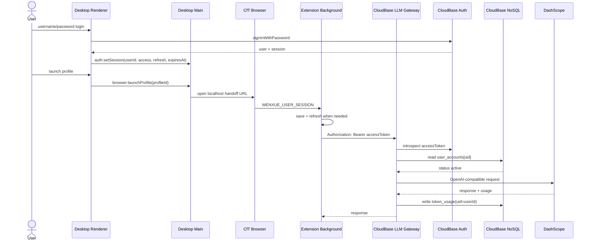

# User Session Auth Refactor Design

## Problem

The current M4.5 auth chain uses locally generated `wxm_` machine tokens, manual token display/copy/sync, `machine_accounts`, `machineId`, and `tokenHash` for LLM gateway authorization. This conflicts with the next product direction: WenXue desktop should be an account-based launcher, the extension should receive and refresh a user session automatically, and gateway/admin/tokens should all be user scoped.

## Scope

- Remove product and runtime dependence on generated machine tokens.
- Add desktop username/password login and registration with CloudBase Auth.
- Gate the desktop workbench and browser launch behind a real CloudBase session.
- Handoff user session data to the extension through the existing one-shot localhost + Chrome external messaging mechanism.
- Store and refresh the session in the extension so built-in model calls use `Authorization: Bearer <CloudBase accessToken>`.
- Change the LLM gateway to introspect CloudBase Auth access tokens, check `user_accounts.status`, and write `token_usage.uid` as the CloudBase user id.
- Change admin API/console and desktop token usage summary from machine scope to user scope.

## Non-Goals

- Subscription billing, quotas, payments, or per-plan entitlements.
- End-user email/phone/OTP flows.
- Admin-created user registration workflows beyond enabling/disabling `user_accounts`.
- Persisting prompts, completions, API keys, bearer tokens, or refresh tokens in logs.
- CloudBase console/MCP configuration changes in this code task; CloudBase username/password provider and publishable key remain deployment prerequisites.

## Requirements

### R1 Desktop Account Entry

User story: as a WenXue user, I sign in with a user id and password before reaching the launcher workbench.

Acceptance criteria:

- When no real CloudBase session exists, the desktop app shall show an independent login page and a register page instead of the main workbench.
- When the user registers, the desktop app shall call CloudBase Auth username/password registration without SMS, email OTP, or captcha.
- When the user signs in, the desktop app shall call CloudBase Auth username/password login and sync `{ userId, accessToken, refreshToken, expiresAt }` to the Electron main process.
- When the user signs out, the desktop app shall clear the CloudBase session and main-process session, then return to the login page.
- While no synced user session exists, the main process shall reject browser launch and cloud usage summary requests.

### R2 Automatic Extension Handoff

User story: as a signed-in user, I launch a browser profile and the extension receives my session automatically.

Acceptance criteria:

- When the desktop launches or focuses a target browser profile, the main process shall open a one-time `127.0.0.1` handoff page as the browser start URL.
- The handoff page shall send `WENXUE_USER_SESSION` to the fixed extension id through `chrome.runtime.sendMessage`.
- The handoff payload shall include `userId`, `accessToken`, `refreshToken`, `expiresAt`, and `gatewayBaseUrl`.
- The desktop UI shall not expose, copy, or manually sync any machine token.
- The handoff path shall not send Agent control commands to the extension.

### R3 Extension Session Ownership

User story: as a user, I can keep using the browser after handoff without returning to the desktop for every token refresh.

Acceptance criteria:

- When the extension receives `WENXUE_USER_SESSION`, it shall validate and save it in `chrome.storage.local`.
- When a built-in model is selected, the extension shall configure the OpenAI-compatible client with the gateway base URL and the current access token.
- When the access token is near expiry or expired, the extension shall refresh the session using the refresh token before using it when possible.
- When no valid session is available, the chat UI shall still initialize and let the user send a message; the gateway 401/403 error is surfaced in-chat as login expired/no permission guidance.
- Custom BYO-Key models shall remain direct and shall not use the WenXue user session.

### R4 Gateway User Authorization

User story: as an operator, I authorize LLM access per user, not per machine.

Acceptance criteria:

- When the gateway receives `/v1/chat/completions` or `/v1/usage/summary`, it shall require `Authorization: Bearer <CloudBase accessToken>`.
- The gateway shall introspect the CloudBase Auth access token and extract the CloudBase user id.
- Before calling DashScope, the gateway shall read `user_accounts[_id=uid]` and require `status=active`.
- When the user account is missing or `status=disabled`, the gateway shall return no-permission before calling DashScope.
- Successful usage records shall use `uid=<CloudBase user id>` and shall contain no prompt, content, API key, Authorization, Bearer value, refresh token, machine token, machine id, or token hash.

### R5 User-Scoped Usage

User story: as a user, I see my own token usage, and admins see user usage.

Acceptance criteria:

- The desktop tokens page shall request `/v1/usage/summary` with the current user access token.
- The desktop cloud summary cache shall be keyed by user id, not machine id.
- If cloud usage is unavailable, the desktop tokens page shall fall back to local sanitized telemetry/cache.
- Admin usage summary shall aggregate by user, model, and date.
- Admin recent usage rows shall display user id, not machine id.

### R6 Admin User Management

User story: as an admin, I can see users, token consumption, and enable or disable users.

Acceptance criteria:

- Admin API shall keep CloudBase Auth + `admin_users` for administrator authorization.
- Admin API shall expose user-list and user-status update endpoints backed by `user_accounts`.
- Admin Console shall replace machine list/permissions with user list/status.
- Admin users with `role=viewer` shall read dashboards and users but shall not mutate user status.
- Every status change shall write an audit record with admin uid, user id, before/after status, reason, and timestamp.

## Data Model

### CloudBase `user_accounts`

```ts
interface UserAccount {
	_id: string // CloudBase Auth uid
	uid: string
	status: 'active' | 'disabled'
	firstSeenAt?: string
	lastSeenAt?: string
	createdAt?: string
	updatedAt?: string
	note?: string
}
```

The gateway does not auto-create permissive accounts in this refactor. Access is granted only when the backend/admin-controlled row exists and is active.

### CloudBase `user_permission_audit`

```ts
interface UserPermissionAudit {
	_id: string
	uid: string
	adminUid: string
	before: { status: 'active' | 'disabled'; note?: string }
	after: { status: 'active' | 'disabled'; note?: string }
	reason?: string
	createdAt: string
}
```

### Local `WenXueUserSession`

```ts
interface WenXueUserSession {
	userId: string
	accessToken: string
	refreshToken: string
	expiresAt: number
	gatewayBaseUrl: string
}
```

## Architecture



## Security Notes

- Refresh tokens are only persisted in CloudBase SDK/session storage and extension storage; they are never written to launcher logs, token usage records, gateway logs, admin responses, or exported telemetry.
- The desktop main process holds only the current synced session needed for launch handoff and cloud usage calls.
- The gateway trusts only CloudBase introspection plus `user_accounts.status`; client-supplied user ids are ignored for authorization.
- `getLoginState()` is not used for route guards; desktop/admin use `auth.getSession()`.

## CloudBase Preconditions

- CloudBase Auth username/password login is enabled.
- A valid publishable key is configured for desktop/admin web auth builds.
- `user_accounts`, `admin_users`, `token_usage`, and `user_permission_audit` exist with appropriate CloudBase database permissions.
- Admin tooling or console controls `user_accounts.status`.
