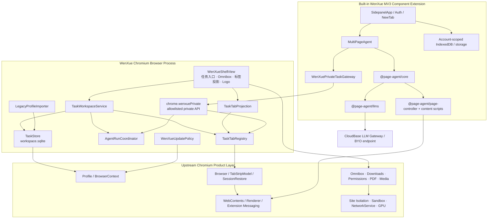
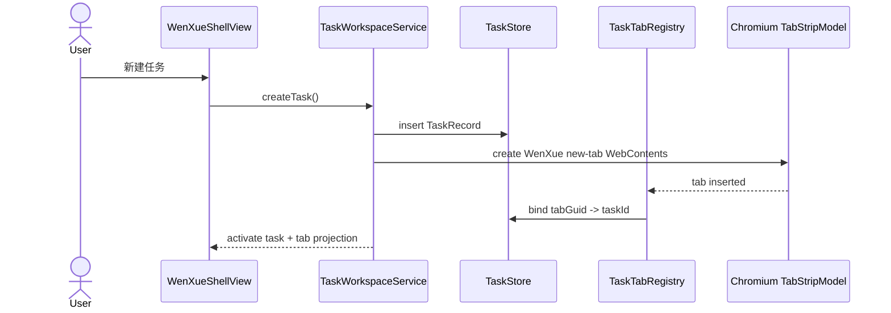

# 问学 Chromium AI 工作浏览器迁移技术设计

| 项       | 内容                                                                                                   |
| -------- | ------------------------------------------------------------------------------------------------------ |
| 状态     | 架构提案，待用户评审后冻结                                                                             |
| 日期     | 2026-07-14                                                                                             |
| 上游需求 | [PRD v0.2](../../context/PRD.md)                                                                       |
| 配套计划 | [迁移实施计划](../plans/2026-07-14-ai-browser-migration.md)                                            |
| 冻结基线 | extension 1.9.1 @ `8a29557797e9ffbbc7fbe1d88de463529c6f0820`；CfT `149.0.7827.55` / revision `1625079` |

> 本文定义目标架构与迁移边界，不定义 UI 视觉、尺寸、颜色和动效。本文通过评审前，
> `ARCHITECTURE.md`、`TECH-INFRA.md` 和 `ROADMAP.md` 仍描述当前
> “Electron 启动器 + Chrome for Testing + MV3 插件”实现；评审通过后的第一项工作是同步这些
> 上游文档，之后才允许改业务代码。

## 1. 决策摘要

### D1. 正式运行时采用最小化 Chromium 分支

问学 P0 正式运行时采用 Chromium `//chrome` 产品层分支，保留 Chromium 的多进程模型、
`Profile`、`Browser`、`TabStripModel`、Session Restore、Omnibox、下载、权限、PDF、媒体、
扩展系统与 GPU 管线，只在产品层增加问学任务、任务标签投影、Agent 桥接和品牌外壳。

- 正式运行时不再由 Electron 拉起外部 Chrome for Testing。
- CEF 不作为正式运行时，也不作为扩展兼容兜底。
- Chrome for Testing 继续作为冻结旧版基线和同版本性能对照，不作为最终用户浏览器。
- 在先行 Spike 未证明可行前，本决策保持“推荐方案”状态；任何大规模迁移都受 G1/G2 门禁约束。

选择依据：

- Chrome for Testing 官方定位是自动化与测试专用，并明确不用于常规浏览；它适合作为对照基线，
  不适合作为问学长期产品运行时。[Chrome for Testing 官方说明](https://developer.chrome.com/blog/chrome-for-testing/)
- Electron 官方只承诺 Chrome Extensions API 的子集，并明确“完美兼容 Chrome 扩展”不是其目标，
  无法支撑 CAP-01～CAP-13 的等价承诺。
  [Electron 扩展支持说明](https://www.electronjs.org/docs/latest/api/extensions/)
- CEF 的优势是嵌入式浏览控件和稳定宿主 API，但问学需要的是浏览器产品层、完整标签体系与现有
  MV3 行为；采用 CEF 会把这些浏览器职责重新交给问学实现。
  [CEF 项目定位](https://github.com/chromiumembedded/cef)
- Chromium 原生提供 WebUI、组件扩展、私有扩展 API 和现有 Side Panel 基础，允许在保留浏览器
  能力的同时做产品级定制。
  [WebUI](https://chromium.googlesource.com/chromium/src/+/main/docs/webui/webui_explainer.md)、
  [组件扩展](https://chromium.googlesource.com/chromium/src/+/main/extensions/docs/component_extensions.md)、
  [扩展 API 规范](https://chromium.googlesource.com/chromium/src/+/main/chrome/common/extensions/api/schemas.md)

### D2. 保留 Agent 为内置 MV3 组件扩展

现有问学插件不整体重写为 C++。首版将其构建为固定 ID 的内置组件扩展，并由原生问学 Logo 打开
其侧边栏页面。Agent 循环、LLM 客户端、页面控制、视觉观察、学习通、对话 UI 和大部分存储逻辑
继续使用 TypeScript/React 代码。

组件扩展若在 Spike 中无法同时满足 MV3 service worker、Side Panel 与所需 API，则允许在同一
Chromium 分支内改为“随浏览器预装且按 ID allowlist 的内置扩展”；该替代不允许退回 Electron/CEF，
也必须通过相同 CAP 门禁。

### D3. 原生浏览器拥有任务与标签归属，扩展只获得任务能力令牌

任务、活动任务、标签归属、任务切换和全局单 Agent 运行约束属于浏览器产品层。扩展不得依赖
`chrome.tabs.query({ currentWindow: true })` 推断任务边界，而是通过只对问学扩展 ID 开放的
`chrome.wenxuePrivate` 能力 API 操作当前任务标签。

每次 Agent 运行由浏览器签发不可伪造、短生命周期的 `TaskCapability`。所有枚举、读取、切换、
新建、关闭和截图动作都必须携带该能力；浏览器进程在动作发生前验证“令牌 → AgentRun → Task →
Tab”关系。新运行时必须对固定问学扩展 ID 禁止或加上 browser-process 任务守卫，覆盖所有可通过
raw tab/window id 绕过边界的标准扩展能力，包括 `chrome.tabs`、`tabGroups`、`webNavigation`、
`scripting`、截图与 tab messaging；旧 CfT 兼容构建只在 `ChromeTabsTaskGateway` 中保留这些能力。

任务切换请求到达时，浏览器先把旧能力标为 `pausing` 并立即阻断全部标签动作，再使用独立的
`pauseNonce` 请求扩展保存 checkpoint；收到确认或超时后撤销旧能力，最后才激活新任务。

### D4. 采用双仓协作但单一发布清单

- 当前 WenXue 仓库继续承载 Agent、React 页面、CloudBase 服务、能力矩阵、迁移工具和产品文档。
- 新建 `wenxue-chromium` 仓库跟踪 Chromium `src` 上游，承载 `//wenxue` 原生模块、品牌配置和
  少量集成补丁；不把完整 Chromium checkout 提交到当前 pnpm 仓库。
- 每个发布由一个不可变发布清单同时锁定 Chromium 上游 revision、`wenxue-chromium` commit、
  WenXue commit、内置扩展 hash、工具链和平台产物 hash。

### D5. 迁移期间双运行时并存，完成门禁后再移除启动器

当前 CfT 启动链在迁移期作为回归基线和用户回退通道保留。新增 Agent 平台适配层后，同一套
Agent 测试可以分别跑在旧 `ChromeTabsTaskGateway` 与新 `WenXuePrivateTaskGateway` 上。只有完整
发布门禁通过并经历至少一个稳定回退窗口，才删除 Electron/CfT 正式入口。

迁移证据同时维护两类对照：**语义基线**固定“冻结扩展 commit +
`apps/desktop/browser.lock.json` 中的 CfT
版本”，用于证明用户功能没有退化；**同 revision 引擎对照**把冻结扩展运行在与目标 Chromium
revision 一致的 CfT 上，用于归因内核、构建与性能差异。两者不得混为一个 baseline。

## 2. 范围与非目标

### 2.1 本设计范围

- 浏览器内核路线、仓库边界、模块边界和依赖方向。
- 通用任务、任务标签集合、任务切换和单 Agent 运行的原生模型。
- 现有插件的复用、适配和等价验证策略。
- 账号隔离、数据持久化、旧画像迁移和失败回滚。
- Chromium 构建、更新、签名、性能、安全和发布门禁。
- 从当前启动器到问学浏览器的阶段性迁移顺序。

### 2.2 非目标

- 不定义左侧任务区、地址栏、标签、侧边栏或新标签页的视觉方案。
- 不在本设计中实现任何代码或创建 Chromium 仓库。
- 不开放 Chrome Web Store、第三方扩展、Chrome Sync 或 Google 账号登录。
- 不支持 P0 同时运行多个 Agent、任务级 Cookie 隔离或无人值守后台任务。
- 不承诺 Google 专有服务；Safe Browsing、地理位置、编解码器等能力必须分别完成 API、许可和
  可用性评审。自定义 Chromium 构建的 Google API 能力受官方密钥与配额约束。
  [Chromium API Keys 文档](https://chromium.googlesource.com/chromium/src/+/main/docs/api_keys.md)

## 3. 架构需求与验收标准

以下需求从 PRD 派生，使用 EARS 风格描述。实现任务必须引用对应 AR 编号。

### AR-01 Chromium 产品层基线

- 当构建问学正式运行时时，系统应从锁定的 Chromium Stable revision 构建 `//chrome` 目标，
  不通过 Electron 或 CEF 托管网页内容。
- 当对比问学与 CfT 时，系统应使用相同 Chromium revision、OS、硬件、干净画像与发布优化参数。
- 当未修改的问学 Chromium 基线不能满足 PRD F14 性能阈值时，团队应停止产品功能开发并先修复
  构建优化、PGO/ThinLTO 或测试条件。

### AR-02 现有插件能力等价

- 当内置 Agent 扩展加载时，系统应继续支持 CAP-01～CAP-13 所需的 MV3 service worker、
  content/main-world 注入、Side Panel、tabs、frame、截图、存储和 IndexedDB 行为。
- 当任一 CAP 能力缺少旧版基线、预期结果、新版结果或证据时，迁移应保持未完成状态。
- 当替换浏览器适配层时，`@page-agent/*` 的 Agent 核心、LLM 和页面控制公共语义应保持不变。

### AR-03 任务与标签所有权

- 当任意用户页或系统页标签被创建时，浏览器应在提交给 UI 或 Agent 前为其分配且仅分配一个
  `TaskId`。
- 当用户切换任务时，顶部标签投影应只展示目标任务标签，并恢复其活动标签。
- 当创建用户可见任务时，系统只响应用户显式新建或恢复既有任务；搜索、Agent 子步骤、新建 AI
  会话和网页打开标签均不得自动创建或拆分用户任务。
- 当网页、用户或 Agent 在当前任务打开新标签时，新标签应自动归属该任务。
- 当新标签具有可信 opener、用户动作或 Agent capability 来源时，系统应继承该来源任务；当来源
  无法判定时，系统应把它分配给保留的内部 `QuarantineTaskId`，形成不可被 Agent 访问的隔离恢复
  域，直到用户明确归属或关闭。
- 当浏览器恢复会话时，系统应先恢复稳定标签标识与任务映射，再允许 Agent 运行。

### AR-04 Agent 隔离与运行状态

- 当 Agent 开始运行时，浏览器应只为当前活动任务签发一个短生命周期能力令牌。
- 当 Agent 请求标签动作时，浏览器应验证令牌、运行、任务和标签归属；任一不匹配均应拒绝且不
  执行动作。
- 当用户切换离开运行中的任务时，系统应先把旧能力标为 `pausing` 并立即拒绝全部标签动作，再
  通过独立 `pauseNonce` 请求扩展保存上下文；暂停确认或超时撤销后才应激活新任务。
- 当暂停确认在限定时间内未返回时，系统应撤销旧能力、把运行标为“异常暂停”，并允许用户回到
  原任务检查或恢复；延迟确认与延迟标签动作均不得重新激活旧能力。
- 当一个 Agent 已运行时，其他任务的开始请求应被拒绝，直到前一运行完成、停止或暂停。

### AR-05 浏览器基础能力

- 当 AI 未运行时，地址与搜索、导航、下载、上传、权限、PDF、音视频、历史、页面查找、缩放和
  崩溃恢复应直接复用 Chromium 产品层能力。
- 当问学修改浏览器外壳时，系统不得绕过 Chromium 的 Site Isolation、sandbox、网络服务、GPU
  进程或标准权限决策链。
- 当 Agent 空闲时，系统不得持续扫描 DOM、截图或轮询标签。

### AR-06 账号与数据边界

- 当用户登录时，系统应把任务、AI 历史、模型配置、BYO Key、快捷入口、日志设置与用量缓存映射
  到该账号的 `AccountNamespace`。
- 当用户退出或切换账号时，系统应先冻结并撤销当前 Agent 运行，保存当前账号任务会话，再从活动
  `TabStripModel` 分离并关闭其 live `WebContents`；只有目标账号任务可以重新挂载与恢复。
- 当用户退出并由另一账号登录时，系统不得向新账号展示前一账号的问学数据或 live 标签；原账号
  再次登录时只恢复原账号的任务与标签会话。
- 当账号切换时，网站 Cookie、登录态和缓存应继续属于共享 Chromium Profile，不随问学账号
  自动清除。
- 当保存 BYO Key 或用户 session 时，系统应使用 OS 级密钥服务封装，且不得进入日志、tokens、
  崩溃注释或发布清单。

### AR-07 数据迁移与回滚

- 当首次启动检测到旧启动器画像时，系统应枚举全部来源并要求用户选择一个主来源。
- 当执行迁移时，系统应在 staging 目录完成复制、版本升级和校验，成功后再原子切换正式目录。
- 当迁移失败或进程崩溃时，系统应保留旧画像与 staging journal，并允许重试或回到旧启动器。
- 当存在未选画像时，系统应只写保留清单，不修改其内容。
- 当 macOS/Windows 加密 Cookie 或凭据无法可靠迁移时，系统应明确列为未迁移项，不得声称登录态
  已保留。

### AR-08 更新与供应链

- 当上游 Chromium Stable 发布安全更新时，问学公开版目标应在 7 天内完成同步、构建、回归和
  分阶段发布；未满足时应记录阻塞和风险。
- 当任一发布构建时，发布清单应锁定并校验所有源码与内置扩展输入。
- 当更新安装失败时，更新器应保留可启动的上一版本并禁止破坏用户画像。
- 当 Chromium revision 变化时，CAP 等价、迁移、性能和安全测试应自动重新进入发布门禁。

### AR-09 平台与性能

- 当在 macOS Apple Silicon 与 Windows x64 运行 release 产物时，系统应满足 PRD F14 的启动、
  Web 基准、内存、空闲 CPU、加载、切换与进程回收阈值。
- 当构建 release 产物时，应启用适用于目标平台的 official optimization、ThinLTO，并在可获得且
  许可允许时使用匹配 revision 的 PGO 数据。
- 当不具备 H.264/AAC 等常见编解码能力的合法分发条件时，团队应在发布前完成法律/许可决策，
  不得仅通过构建开关绕过。

### AR-10 可回退切换

- 当新浏览器尚未通过全部 P0 门禁时，旧启动器与旧插件基线应保持可构建、可测试和可启动。
- 当正式切换后发现阻断性回归时，用户应能在不降级或覆盖新画像的情况下启动上一稳定入口。
- 当回退窗口完成且迁移成功率、崩溃率和 CAP 通过率满足发布要求时，团队才可删除 Electron/CfT
  运行时代码。

### AR-11 配套系统兼容

- 当浏览器调用内置模型时，现有 CloudBase Gateway 应继续用用户 session 鉴权，并在联系模型厂商
  前校验用户启用状态；厂商 Key 只存在服务端，流式正文不得持久化。
- 当模型调用完成时，Gateway 应按 uid 记录不含正文和敏感凭据的 tokens，并只向当前账号返回脱敏
  汇总；浏览器来源字段和版本字段不得改变既有计量语义。
- 当管理员操作用户状态时，现有后台应继续要求内部管理员登录并写审计记录，且不得展示 prompt、
  response、API Key 或用户 session。
- 当 G5 stable 产物发布时，官网应指向匹配发布清单的双平台签名产物和版本说明；官网 UI 重设计
  不属于本迁移。

## 4. 路线对比

| 维度                     | Chromium `//chrome` 分支                      | CEF 自定义壳                                | Electron 内嵌                        |
| ------------------------ | --------------------------------------------- | ------------------------------------------- | ------------------------------------ |
| 现有 MV3/Chrome API 等价 | 最高，直接保留 Chrome 产品层扩展系统          | 需逐 API 验证并补宿主行为                   | 官方只支持子集                       |
| 浏览器基础功能           | 直接复用 Omnibox、标签、Session、下载、权限等 | 多数产品层需自行组装                        | 多数产品层需自行组装                 |
| UI 自定义                | Native Views + WebUI，改动成本高但上限最高    | 宿主 UI 自由度高                            | React UI 自由度高                    |
| 性能上限                 | 最接近 CfT，同 Blink/V8/多进程产品层          | Blink/V8 接近，宿主与浏览器层差异需测       | Blink/V8 接近，额外壳与 API 差异需测 |
| 上游维护成本             | 最高，需要持续 rebase 和安全发版              | 中等，需要跟 CEF 分支                       | 较低，但能力不满足 P0                |
| P0 重构面                | 原生壳与任务模型重写，Agent 大量复用          | 浏览器壳、标签、扩展宿主与 Agent 边界均重写 | 扩展 API 与浏览器壳均重写            |
| 结论                     | **推荐；先 Spike 后冻结**                     | 不选，除非 PRD 放弃插件等价                 | 排除                                 |

## 5. 当前代码复用评估

当前 `apps/extension/src` 约 14.9k 行生产 TS/TSX，其中约 31 个文件、6.5k 行直接触达
`chrome.*`；vendor 四包生产代码约 6.2k 行；Electron desktop 生产代码约 5.8k 行。以下为设计期
区间估算，最终以 G2 适配 Spike 和能力矩阵为准。

| 当前范围                                | 预计直接/轻改复用 | 迁移策略                                                                  |
| --------------------------------------- | ----------------: | ------------------------------------------------------------------------- |
| `@page-agent/core`                      |           85%–95% | 保留 Agent 循环、上下文压缩、人工接管与工具语义；只接受浏览器网关依赖注入 |
| `@page-agent/llms`                      |          90%–100% | 保留 OpenAI-compatible 客户端、流式与兼容策略                             |
| `@page-agent/page-controller`           |           80%–95% | 保留 DOM 序列化与动作；替换目标 Tab/Frame 的宿主路由                      |
| `@page-agent/ui`                        |           70%–90% | 继续服务侧边栏；视觉变更留给 UIUX                                         |
| content/main-world/frame 脚本           |           80%–95% | 继续作为扩展内容脚本，仅收紧消息授权                                      |
| `MultiPageAgent` / `useAgent`           |           65%–80% | 保留编排，改为依赖 `BrowserTaskGateway` 与运行能力令牌                    |
| `TabsController` 与 background tab 路由 |           20%–40% | 主要重构点；从窗口级 `chrome.tabs` 改为任务级私有 API                     |
| Sidepanel 对话、历史、设置组件          |           65%–85% | 保留 React 组件和状态语义，替换宿主入口与账号命名空间                     |
| NewTabHome                              |           60%–80% | 快捷入口和搜索逻辑复用，改为内置新标签页资源与原生搜索设置                |
| 插件 session / 存储 / 日志              |           40%–70% | 增加账号命名空间、OSCrypt 封装、任务归因和迁移版本                        |
| Electron renderer                       |           25%–50% | 登录、日志、tokens 的 React 逻辑可转 WebUI/扩展页；窗口壳不复用           |
| Electron main                           |            0%–20% | 生命周期与测试经验复用；Supervisor、CfT argv、handoff 最终退役            |
| CloudBase Gateway / Admin / Website     |          90%–100% | API 契约基本不变，仅客户端来源和版本字段变化                              |

结论：需要重写的是“浏览器产品壳 + 任务/标签安全边界”，不是 Agent 智能核心。迁移应先抽离浏览器
适配层，再逐步替换宿主，避免同时重写 Agent 与浏览器。

## 6. 目标系统架构



### 6.1 运行时进程边界

| 进程/上下文                                   | 主要职责                                              | 问学业务模块的数据禁区                                                                                                       |
| --------------------------------------------- | ----------------------------------------------------- | ---------------------------------------------------------------------------------------------------------------------------- |
| Chromium browser process                      | 任务元数据、标签归属、运行令牌、窗口与浏览器服务      | 不把 prompt、模型响应、截图、API Key 或 access/refresh token 作为问学原生业务状态或日志；Chromium 渲染瞬时像素不属于业务状态 |
| Extension service worker / extension renderer | Agent 编排、账号 session、模型调用、AI 历史、脱敏日志 | 跨账号明文数据、截图持久化、未脱敏凭据                                                                                       |
| Web content renderer                          | 页面执行、DOM 序列化、动作反馈                        | 其他任务上下文、用户模型配置                                                                                                 |
| CloudBase Gateway                             | session 鉴权、厂商转发、tokens 计量                   | prompt/响应持久化、厂商 Key 下发                                                                                             |

## 7. 原生模块边界

### 7.1 `TaskStore`

- 职责：版本化持久化任务元数据、标签稳定标识、活动位置、运行元数据和迁移 journal。
- 不负责：不保存对话正文、DOM、截图、Cookie、API Key 或用户 token。
- 依赖：Chromium `sql::Database`、Profile 路径服务。
- 输出：`TaskWorkspaceService`、`LegacyProfileImporter`。

### 7.2 `TaskWorkspaceService`

- 职责：创建、切换、重命名、关闭、恢复和删除任务；编排切换前暂停；维护当前账号与活动任务；账号
  激活时只挂载该账号任务，切出时序列化会话并分离其 live 标签。
- 不负责：不渲染 UI，不直接执行标签或 Agent 工具。
- 依赖：`TaskStore`、`TaskTabRegistry`、`AgentRunCoordinator`。
- 关键约束：所有状态变化串行化到 browser UI sequence。

### 7.3 `TaskTabRegistry`

- 职责：维护稳定 Tab GUID 到 `TaskId` 的一对一映射；验证用户、网页和 Agent 创建的新标签归属；
  向 Session Restore 提供恢复映射。Tab GUID 写入 `WebContents` user data，并通过 Chromium
  SessionService 的扩展会话数据序列化，绝不依赖进程内临时 tab id。
- 不负责：不决定 UI 排版，不保存网页正文，不调用 LLM。
- 依赖：`Browser`、`TabStripModel`、`WebContents` 生命周期观察器。

### 7.4 `TaskTabProjection`

- 职责：从单个物理 `TabStripModel` 产生“仅当前任务可见”的标签投影；把 Ctrl/Cmd+Tab、关闭、
  重开和拖动等命令限制在当前任务。
- 不负责：不改变网页进程，不复制 `WebContents`，不决定任务业务状态。
- 关键选择：P0 使用单 Profile、单 Browser 窗口、单物理 TabStrip；非活动任务标签继续存在但不在
  顶部投影中显示，可由 Chromium 内存节省机制 discard 并在需要时恢复。该描述只适用于当前已认证
  账号；其他账号任务没有 live `WebContents` 挂载到 TabStrip。

### 7.5 `AgentRunCoordinator`

- 职责：保证全局单运行；签发、校验、撤销 `TaskCapability`；处理 pause/resume/stop 状态机和超时。
- 不负责：不保存 Agent history，不解释 prompt，不执行网页动作。
- 依赖：单向 `AgentRunEventSink`；事件 sink 由扩展私有 API 适配器实现，避免反向依赖环。

### 7.6 `WenXuePrivateApi`

- 职责：只向固定问学扩展 ID 暴露任务上下文、运行状态、任务标签动作、frame/page-command/script
  代理、可见视口截图与密钥封装；在 browser process 做所有能力校验，且不向扩展暴露 raw tab id。
- 不负责：不暴露任意系统文件、任意其他任务标签、prompt/response 存储或远程模型调用。
- 实现依据：Chromium 私有扩展 API 可通过 schema、feature allowlist 和 C++ ExtensionFunction 实现，
  且仍需独立安全与隐私审查。
  [Writing a New Extension API](https://chromium.googlesource.com/chromium/src/+/main/extensions/docs/writing_a_new_api.md)

### 7.7 `LegacyProfileImporter`

- 职责：只读发现旧画像、生成迁移清单、staging 复制、版本迁移、完整性校验、原子切换和回滚。
- 不负责：不静默选择画像，不在旧浏览器运行时修改画像，不删除未选来源。

### 7.8 `WenXueShellView`

- 职责：消费服务状态并发送用户意图；承载任务入口、原生 Omnibox/导航、当前任务标签投影和问学
  Logo/Side Panel host。
- 不负责：不写任务业务规则，不直接访问数据库或扩展存储。
- 技术：浏览器 chrome 使用 Native Views；新标签、登录、设置、历史等内容页使用 WebUI 或内置
  扩展 React 页面，以复用现有前端代码。

### 7.9 `WenXueUpdatePolicy`

- 职责：品牌化 Chromium Updater 注册、通道、签名更新清单、版本回退保护和更新后健康检查。
- 不负责：不决定 Agent 功能，不修改用户画像 schema。
- 基础：优先复用 Chromium Updater 与平台 installer，而不是另起一套进程更新器。
  [Chromium Updater 规范](https://chromium.googlesource.com/chromium/src/+/main/docs/updater/functional_spec.md)

## 8. 扩展侧适配边界

新增 `BrowserTaskGateway`，使 Agent 核心不依赖具体浏览器宿主：

```ts
interface BrowserTaskGateway {
	currentContext(): Promise<TaskContext>
	beginRun(): Promise<TaskCapability>
	listTabs(capability: TaskCapability): Promise<TaskTab[]>
	openTab(capability: TaskCapability, url: string): Promise<TaskTab>
	activateTab(capability: TaskCapability, tabHandle: string): Promise<void>
	closeTab(capability: TaskCapability, tabHandle: string): Promise<void>
	captureVisibleTab(capability: TaskCapability, tabHandle: string): Promise<string>
	listFrames(capability: TaskCapability, tabHandle: string): Promise<TaskFrame[]>
	dispatchPageCommand(
		capability: TaskCapability,
		tabHandle: string,
		frameHandle: string,
		command: PageCommand,
	): Promise<PageCommandResult>
	executeTaskScript(
		capability: TaskCapability,
		tabHandle: string,
		frameHandle: string,
		world: 'ISOLATED' | 'MAIN',
		source: string,
	): Promise<ScriptResult>
	acknowledgePause(pauseNonce: string, checkpoint: AgentCheckpoint): Promise<void>
	onPauseRequested(listener: (request: { runId: string; pauseNonce: string }) => void): () => void
	onContextChanged(listener: (context: TaskContext) => void): () => void
	onCapabilityRevoked(listener: (runId: string) => void): () => void
}
```

实现：

- `ChromeTabsTaskGateway`：迁移期间运行于旧 CfT，以当前窗口作为合成单任务；封装现有
  `TAB_CONTROL`、`chrome.tabs`、`tabGroups` 与 `webNavigation`。
- `WenXuePrivateTaskGateway`：运行于问学 Chromium，仅调用 `chrome.wenxuePrivate`；不直接查询
  全窗口标签。新运行时 manifest/feature policy 不向固定扩展 ID 暴露可绕过 gateway 的标准标签
  枚举与变更能力；旧 CfT manifest 只为 legacy gateway 保留它们。

`TabsController`、`RemotePageController`、`visualObserve` 与 `chaoxing` 只能消费 gateway 提供的
句柄。扩展 background 可保留 PAGE_CONTROL 的语义路由；新运行时必须由私有 API 在校验能力后
代理 frame discovery、content-script messaging 和 isolated/main-world 执行，不向 TypeScript 层
返回内部 tab id。旧 gateway 才能把相同语义映射到标准扩展 API。

## 9. 私有 API 最小契约

下列为语义契约，不锁定最终 IDL 字段拼写：

```ts
// 只有固定 component extension id 可访问。
wenxuePrivate.getContext(): Promise<{
	accountState: 'signed_out' | 'authenticated'
	accountNamespace: string | null
	taskId: string | null
	activeTabHandle: string | null
	runState: 'idle' | 'running' | 'waiting_for_user' | 'pausing' | 'paused' | 'completed' | 'error'
}>

wenxuePrivate.beginRun(): Promise<{ capability: string; runId: string; taskId: string }>
wenxuePrivate.listTaskTabs({ capability }): Promise<TaskTab[]>
wenxuePrivate.openTaskTab({ capability, url }): Promise<TaskTab>
wenxuePrivate.activateTaskTab({ capability, tabHandle }): Promise<void>
wenxuePrivate.closeTaskTab({ capability, tabHandle }): Promise<void>
wenxuePrivate.captureVisibleTaskTab({ capability, tabHandle }): Promise<string>
wenxuePrivate.listTaskFrames({ capability, tabHandle }): Promise<TaskFrame[]>
wenxuePrivate.dispatchPageCommand({ capability, tabHandle, frameHandle, command }): Promise<PageCommandResult>
wenxuePrivate.executeTaskScript({ capability, tabHandle, frameHandle, world, source }): Promise<ScriptResult>
wenxuePrivate.acknowledgePause({ pauseNonce, checkpointVersion }): Promise<void>
type WenXueAccountState =
	| { state: 'authenticated'; accountNamespace: string }
	| { state: 'signed_out' }
wenxuePrivate.setAccountState(accountState: WenXueAccountState): Promise<void>
wenxuePrivate.sealSecret({ plaintext }): Promise<string>
wenxuePrivate.unsealSecret({ ciphertext }): Promise<string>

wenxuePrivate.onPauseRequested // { runId, pauseNonce }
wenxuePrivate.onContextChanged
wenxuePrivate.onCapabilityRevoked
```

安全规则：

1. `beginRun` 不接受客户端提供的 `taskId`，只绑定 browser process 当前活动任务；未认证或任务仍在
   激活/卸载事务中时必须拒绝。
2. 能力值使用 CSPRNG，browser process 只保存 hash，并绑定扩展 ID、Profile、runId、taskId 与过期时间。
3. 进入 `pausing` 后，旧 capability 的所有标签动作立即失败；暂停确认只接受与 run 绑定的一次性
   `pauseNonce`，确认本身不恢复 capability。
4. 切换任务、停止、扩展重载、浏览器锁屏/退出和账号切换均撤销能力。
5. `tabHandle` 为不可推断句柄，不把其他任务的 Chromium tab id 暴露给扩展。
6. 新运行时必须在 manifest、API feature 或 browser-process guard 层拒绝固定扩展通过标准
   tabs/tabGroups/webNavigation/scripting/capture/tab messaging 枚举、读取或变更 raw tab/window id；
   不能只依赖 TypeScript 调用约定。
7. `setAccountState` 仅允许固定扩展调用，原生层永不接收 access/refresh token；`sealSecret` 和
   `unsealSecret` 自动绑定 browser process 当前已认证 `AccountNamespace`，并拒绝其他 namespace
   产生的 ciphertext，客户端不得传入 namespace 覆盖绑定。
8. 截图完成后再次校验活动 Tab GUID、TaskId 与 URL 导航版本；不一致则丢弃图片并失败。
9. private API 的 browser tests 必须覆盖伪造令牌、过期令牌、跨任务句柄、扩展 ID 冒用、标准标签
   API 绕过、错误账号 ciphertext 和 TOCTOU。

安全威胁模型把固定签名的内置扩展包、browser-process 私有 API 与其内容脚本视为可信计算基；隔离
承诺覆盖不可信网页、模型输出、过期/伪造消息和正常产品代码路径的越界，不承诺在签名扩展本身被
恶意替换后仍保密。因此发布签名、扩展 artifact hash 和 updater 完整性属于同一个 P0 安全门禁，
标准扩展 API 的原生守卫仍作为纵深防御保留。

## 10. 数据模型与持久化

### 10.1 原生任务数据库

位置：Chromium Profile 内的 `WenXue/workspace.sqlite`，由 `TaskStore` 独占写入。

```ts
interface TaskRecord {
	id: string
	accountNamespace: string
	name: string
	state: 'open' | 'closed' | 'deleting' | 'deleted'
	activeTabGuid: string | null
	activeConversationId: string | null
	agentState: 'idle' | 'running' | 'waiting_for_user' | 'pausing' | 'paused' | 'completed' | 'error'
	createdAt: number
	updatedAt: number
	lastActiveAt: number
}

interface TaskTabRecord {
	tabGuid: string
	taskId: string
	position: number
	createdBy: 'user' | 'web' | 'agent' | 'restore'
	lastNavigationVersion: number
}

interface AgentRunRecord {
	runId: string
	taskId: string
	state: 'running' | 'waiting_for_user' | 'pausing' | 'paused' | 'completed' | 'error'
	checkpointVersion: number
	startedAt: number
	updatedAt: number
}

interface MigrationJournal {
	migrationId: string
	sourceProfilePathHash: string
	stage: 'inventory' | 'copied' | 'upgraded' | 'verified' | 'activated' | 'rolled_back'
	sourceVersion: string
	targetVersion: string
	startedAt: number
	updatedAt: number
}
```

数据库不保存 prompt、模型响应、网页正文、截图或凭据。URL 与页面标题继续由 Chromium Session/History
持有，不在任务数据库重复存明文。

### 10.2 Agent 数据库

现有 IndexedDB 升级为账号与任务复合键：

- `sessions`: `[accountNamespace, taskId, conversationId]`
- `logs`: `[accountNamespace, taskId, ts, id]`
- `model-config`: `accountNamespace` 级；BYO Key 和 session 字段使用 `sealSecret` 结果。
- `quick-links` 与日志设置：`accountNamespace` 级。
- onboarding 完成标志可以保持 Profile 级，因为它只用于避免重复引导，不承载任务或账号内容。

### 10.3 网站 Profile

Chromium 标准 Cookie、HTTP cache、权限、History、Downloads 和密码能力（若 P0 后续批准）仍位于
同一个 Browser Profile，并在任务与问学账号之间共享。任务标签 Session Restore 虽物理位于同一
Profile，但其扩展会话数据必须携带 `AccountNamespace + TaskId + TabGuid`，恢复、最近关闭标签和
投影命令都按当前账号与任务过滤；不得把任务标签会话误当成账号共享的网站状态。

### 10.4 删除事务

任务删除采用可恢复的两阶段流程：

1. `TaskStore` 将任务标记为 `deleting` 并撤销 Agent capability。
2. 扩展按 `accountNamespace + taskId` 清理 AI 数据，只向 browser process 返回成功/失败和计数。
3. 浏览器关闭任务标签并写 `deleted` tombstone。
4. 任一步崩溃后，启动恢复器从 `deleting` 继续；不得影响其他任务或共享 Cookie。

## 11. 关键状态流程

### 11.1 新建任务



### 11.2 运行中切换任务

```mermaid
sequenceDiagram
    actor U as User
    participant W as TaskWorkspaceService
    participant R as AgentRunCoordinator
    participant E as Agent Extension
    participant P as TaskTabProjection

    U->>W: switch A -> B
    W->>R: beginPause(A)
    R->>R: capability A -> pausing; block tab actions
    R->>E: onPauseRequested(runA, pauseNonce)
    E->>E: 保存 checkpoint
    E-->>R: acknowledgePause(pauseNonce, version)
    R->>R: revoke capability A
    R-->>W: paused
    W->>P: activate projection B
    W-->>E: onContextChanged(B)
```

超时路径：能力在等待 checkpoint 期间已经无法执行标签动作；`beginPause` 超时后撤销能力并记录
`paused/error`，再允许切换。撤销后的延迟确认和延迟动作均由私有 API 拒绝。

### 11.3 恢复 Agent

用户切回已暂停任务并显式恢复时，`AgentRunCoordinator` 校验任务仍为活动任务、旧能力已失效、
checkpoint 可读取，然后签发新能力；扩展不得复用旧令牌。

## 12. 旧版画像迁移设计

### 12.1 迁移对象

| 数据                                          | P0 策略                                                  |
| --------------------------------------------- | -------------------------------------------------------- |
| 选中 CfT 画像的 Cookie/登录态/History/Session | 同 revision staging 复制并验证；OSCrypt 兼容需平台 Spike |
| 固定扩展 ID 的 IndexedDB / storage            | 在 staging 画像内由新扩展执行版本化 schema migration     |
| 模型配置与 BYO Key                            | 映射到当前登录账号；Key 重新 seal 后才写新存储           |
| AI 历史与日志                                 | 映射到当前账号和导入任务；保留旧来源标记                 |
| 快捷入口与日志配置                            | 映射到当前账号 namespace；保留 schema 版本与来源         |
| 启动器画像元数据                              | 只用于发现与清单，不直接变成多个 P0 Browser Profile      |
| 未选画像                                      | 不改动，只记录路径 hash、版本、大小和保留状态            |

旧运行时没有用户任务维度，因此选中画像中可恢复的标签、AI 历史和配置统一进入一个明确标记来源的
“导入任务”；迁移器不得根据窗口、域名或历史记录猜测并拆分出多个用户任务。

### 12.2 原子迁移流程

1. 只读解析旧 `<userData>/browsers.json`、画像目录与版本，检查 ProcessSingleton/lock。
2. 用户选择主来源并确认当前问学账号映射。
3. 创建新的随机 staging 目录，完整复制源画像；源目录全程只读。
4. 使用与源画像兼容的 Chromium revision 启动一次性迁移模式，执行原生 schema 与扩展 schema 升级。
5. 建立单个导入任务，校验数据库完整性、扩展记录计数、任务映射、Session 可恢复、Cookie 可解密性
   和关键浏览器页。
6. 写迁移报告；成功后原子切换正式 Profile 指针，失败则保留 journal 和源目录。
7. 首次正常启动完成健康检查后才标记 `activated`；在此之前允许一键回滚。

禁止直接解析或改写扩展 LevelDB 内部键作为正式迁移方案。若同 ID、同 revision 的原位 schema
迁移不可行，应由冻结旧扩展提供显式版本化导出协议，而不是依赖私有文件格式。

## 13. 构建、更新与发布供应链

### 13.1 仓库与 revision

`wenxue-chromium` 采用以下分支模型：

- `upstream/<milestone>`：只跟踪 Chromium Stable branch-head。
- `wenxue/<milestone>`：在对应上游之上的问学提交。
- `integration/<milestone>`：升级期间临时冲突处理，验证后 fast-forward/merge 到 `wenxue/*`。

问学原生代码尽量放在 `//wenxue`；修改 `//chrome` 的提交只允许用于装配点、品牌、Tab 投影、
Side Panel/Toolbar 接入和 updater。P0 目标是在 `//wenxue` 外不超过 25 个直接修改文件；超过时必须
重新评审可维护性，而不是继续扩大补丁面。

### 13.2 发布清单

```ts
interface BrowserReleaseManifest {
	version: string
	channel: 'dev' | 'beta' | 'stable'
	chromiumVersion: string
	chromiumRevision: string
	wenxueChromiumCommit: string
	wenxueProductCommit: string
	extensionArtifactSha256: string
	toolchainRevision: string
	platformArtifacts: Record<string, string>
}
```

### 13.3 构建配置

- 开发构建：component build、有限 symbols、快速增量链接。
- 发布构建：`is_official_build=true`、非 component、ThinLTO、匹配平台 release 配置；PGO 作为 G1
  性能验证项。
- macOS Apple Silicon 与 Windows x64 分别在原生 runner 构建，不把交叉编译产物作为发布证据。
- Windows 复用 Chromium `mini_installer` 品牌能力；macOS 产出签名、公证的 `.app` 与 DMG/更新包。
  [Windows mini_installer](https://chromium.googlesource.com/chromium/src/+/main/chrome/installer/mini_installer/README.md)

### 13.4 更新通道

- dev：每次可用构建，保留更多诊断。
- beta：通过 CAP、迁移和性能自动门禁后小范围发布。
- stable：签名清单、分阶段百分比、健康检查、可回滚上一版本。
- updater 只替换程序文件，不对 Profile 数据执行不可回滚降级；schema migration 必须前向兼容上一
  稳定版本的程序回退窗口。

## 14. 性能设计

1. G1 先测“未加问学功能”的自构建 Chromium。若它相对同 revision CfT 已低于 95%，优先定位
   official build、ThinLTO、PGO、编解码、沙箱或测试噪声。
2. 任务模型只监听 tab/session 事件，不做定时轮询；非活动任务只是标签投影不可见，不复制页面。
3. Agent service worker 空闲时可休眠；Side Panel 收起不停止运行，但没有运行时不得唤醒 DOM 扫描。
4. 截图只由显式 `visual_observe` 或学习通含图题触发，并在返回结构化结果后释放内存。
5. 每个里程碑都记录相对 G1 的增量，不等到发布前一次性发现性能回归。

固定测量：Speedometer、JetStream、MotionMark、10 标签稳定内存、空闲 5 分钟 CPU、页面加载、任务内
标签切换、任务切换、冷启动/暖启动与 10 次进程回收；版本与硬件写入证据。

## 15. 测试与能力等价

### 15.1 测试层级

| 层级                   | 必测内容                                                                               |
| ---------------------- | -------------------------------------------------------------------------------------- |
| C++ unit tests         | TaskStore、TaskWorkspaceService、TaskTabRegistry、Projection、RunCoordinator、Importer |
| Chromium browser tests | 私有 API allowlist/令牌/跨任务拒绝、Session Restore、Side Panel、权限、下载、崩溃恢复  |
| Extension vitest       | 双 gateway、Agent 运行状态、页面路由、账号/任务存储、现有全部回归                      |
| CAP 自动化             | CAP-01～CAP-13 的旧/新双运行时用例和证据采集                                           |
| 迁移 fixtures          | 单画像、多画像、损坏数据、旧 schema、Cookie 加密、崩溃中断、回滚                       |
| 真机 E2E               | macOS arm64、Windows x64 的 research/答题/登录/下载/上传/权限/更新                     |
| 性能                   | PRD F14 固定条件与统计方法                                                             |

### 15.2 能力矩阵记录

每条记录至少包含：

```ts
interface CapabilityEvidence {
	capabilityId: `CAP-${string}`
	caseId: string
	baselineKind: 'semantic' | 'same_revision_engine'
	baselineCommit: string
	baselineBrowserVersion: string
	baselineArtifactHash: string
	targetBrowserVersion: string
	modelConfigId: string
	fixture: string
	expected: string
	baselineResult: 'pass' | 'fail'
	targetResult: 'pass' | 'fail' | 'needs-review'
	evidencePaths: string[]
}
```

G2 先验证最容易决定路线成败的 CAP-04/05/06/07/10/13；最终发布仍要求 CAP-01～CAP-13 全部
100% 通过。

## 16. 分阶段门禁

| Gate             | 必须证明                                                   | 失败处置                               |
| ---------------- | ---------------------------------------------------------- | -------------------------------------- |
| G0 架构批准      | 用户确认 D1～D5、仓库边界与任务标签投影                    | 修改设计，不写实现                     |
| G1 Chromium 基线 | 双平台 release 构建、基础浏览、性能 ≥ PRD 阈值、可签名方案 | 停止功能迁移，修供应链或重新评审路线   |
| G2 宿主与投影    | 内置扩展、私有 API 与单 TabStrip 投影 Spike 通过高风险 CAP | 停止大规模重构，重新评审宿主或投影方案 |
| G3 任务隔离      | 原生任务恢复、跨任务拒绝、切换自动暂停、单运行             | 不进入用户数据迁移                     |
| G4 数据迁移      | 多画像选择、同 revision staging、OSCrypt、失败回滚         | 保留旧启动器，不开放升级               |
| G5 发布          | CAP 全绿、浏览器基础、性能、安全、更新、真机场景全部通过   | 不标记 P0 完成                         |

## 17. 风险与缓解

| 风险                             | 影响                 | 缓解与退出条件                                                            |
| -------------------------------- | -------------------- | ------------------------------------------------------------------------- |
| Chromium 上游 rebase 成本        | 安全更新延迟         | 双仓、`//wenxue` 集中、外部补丁文件数预算、每版自动 rebase smoke          |
| 组件扩展行为差异                 | 插件能力降级         | G2 先测；允许同 fork 内 allowlisted 预装扩展替代                          |
| 单 TabStrip 任务投影侵入 UI/命令 | 标签错乱或恢复失败   | G2 前置投影 Spike；Registry/Projection 独立，browser tests 覆盖命令与恢复 |
| 私有 API 权限过强                | 跨任务或数据泄漏     | allowlist、能力令牌、opaque handle、browser-process 校验、模糊测试        |
| Cookie/OSCrypt 迁移失败          | 网站重新登录         | G4 平台 Spike；失败时逐项报告、保留源画像，不伪造成功                     |
| 自构建性能低于 CfT               | 无法达到 PRD F14     | G1 在功能代码前验证 official build/ThinLTO/PGO                            |
| Google 服务/媒体专有能力缺失     | 网站兼容性下降       | 单独 API/许可清单；不依赖 Chrome Sync；编解码器发布前法律评审             |
| updater/签名链不成熟             | 安全版本无法及时交付 | 先完成 dev/beta 自动更新和回滚演练，再开放 stable                         |
| 双运行时长期并存                 | 维护成本增加         | 设 G5 与稳定回退窗口，满足后按计划退役旧入口                              |

## 18. 评审后必须同步的上游文档

G0 通过后、任何业务代码之前，必须在同一文档变更中完成：

1. `ARCHITECTURE.md`：同时登记 legacy runtime 与 target runtime、DAG、实体、接口、不变量和目录。
2. `TECH-INFRA.md`：替换 CfT 正式供应链，登记双仓、Chromium 构建、签名、updater、PGO、codec
   与 7 天安全跟版机制。
3. `ROADMAP.md`：冻结旧 Demo milestones，新增本计划 G1～G5 迁移里程碑。
4. `CONVENTIONS.md`：增加 C++/GN、Chromium patch、双仓提交与浏览器测试规范。
5. `UIUX.md`：暂不做视觉设计；只在后续独立阶段补交互与视觉规则。

## 19. 待用户确认的架构点

本 Spec 建议一次确认以下三项：

1. 正式路线冻结为最小化 Chromium `//chrome` 分支 + 固定 ID 内置 MV3 Agent + 私有任务 API，排除
   Electron/CEF 作为最终运行时。
2. 采用“单物理 TabStrip + 当前任务标签投影”，而不是一个任务一个 OS 窗口。
3. 采用 WenXue 产品仓库 + `wenxue-chromium` 上游跟踪仓的双仓模式，并在 G5 与稳定回退窗口完成前
   保留旧 CfT 双运行时。

确认后进入配套计划 Task 0；未确认前不得创建 Chromium 仓库或改运行时代码。
