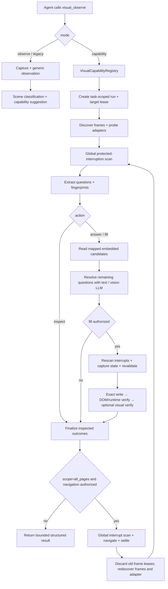

# visual_observe Question Solver Spec

> 状态：Design 已于 2026-07-17 经用户确认，并通过独立架构 / 测试复核；2026-07-18 已完成实现与
> 本地 fixture 验证。当前证据为 23/23 production variant `fixture_verified`、0/23 `live_verified`；未使用
> 真实平台账号，也未执行加载扩展后的真实 Chromium smoke。
> 现有上游行为基线：`../../refactor/ai-browser/01-product/PRD.md` F5–F7、F9–F10、F12–F14；
> 本文新增的 VO capability registry 与多平台范围是本次已批准的产品需求扩展，并已同步上游 PRD。
> 当前运行时依据：`../../context/ARCHITECTURE.md` 的 `MultiPageAgent`、`VisualObservation`、
> `chaoxing/*`、`ExtensionEntrypoints` 模块。
> 关联历史设计：`2026-07-04-visual-observe-tool-design.md`、
> `2026-06-17-chaoxing-exam-solver-design.md`。

## 1. 问题陈述

当前 `visual_observe` 是通用的当前视口观察工具，能够把截图转换为结构化视觉证据，但不能根据页面
场景进入受控的专项能力。学习通答题则是一个与 `visual_observe` 平级的独立工具，平台检测、题目
抽取、视觉输入、LLM 调用和确定性回填均与视觉能力分离。

本需求将 `visual_observe` 扩展为通用视觉能力入口，并在其能力注册表中提供
`question_solver`。`question_solver` 不是新的平级 Agent 工具；Agent 无论已知或经观察发现题目
环境，都通过一次显式的 `visual_observe` capability 调用进入统一答题流水线。普通视觉观察不得
因为截图中出现题目而擅自生成答案或回填。

同时，以 OCSJS 4.0 已有实现为行为研究基线，把问学现有学习通经验推广至其已完成答题实现的平台，
并利用 screenshot、跨 frame JavaScript 与 main-world JavaScript 提升图片题、动态页面和页面
更新后的可靠性。

## 2. 目标

1. 保持 `visual_observe` 的通用观察语义，同时允许它显式调用可注册的视觉场景能力。
2. 新增统一 `question_solver` capability，负责识别平台、读取题目、生成结构化答案、确定性回填、
   翻页、验证和汇总。
3. 保留 DOM/平台契约作为首选事实来源，以 JavaScript 和 screenshot 作为增强及降级手段。
4. 一次性覆盖 OCSJS 4.0 中已经存在可执行答题流程的平台，并优化现有学习通实现。
5. 在没有真实平台测试环境时，建立足以覆盖图片题、图文混排、跨 frame、受控输入和页面防护中断
   的本地测试体系。
6. 保持用户最终控制权：系统只生成并回填，不自动提交或交卷。

## 3. 范围

### 3.1 本期支持的平台族

| 平台族                  | OCSJS 基线范围                                                                                        | 本期要求                                            |
| ----------------------- | ----------------------------------------------------------------------------------------------------- | --------------------------------------------------- |
| 超星 / 学习通           | 作业、考试、章节测试、OCSJS 已登记镜像域及其分页 DOM 契约                                             | 迁入统一内核并增强 frame、截图、稳定身份和翻页验证  |
| 智慧树                  | `gxkWorkAndExam`、`xnkWork`、`smartWork`、`smartExam`、`fusioncourseWork`、`hikeWork`、`hikeHomework` | 为每个已有答题流程的页面世代分别提供适配            |
| 职教云 ZJY              | OCSJS 旧版作业 / 考试页面                                                                             | 适配 OCSJS 已实现页面；新版仅在取得可验证契约后启用 |
| 智慧职教 ICVE           | 标准作业 / 考试与 AI 课程页面                                                                         | 提供对应适配                                        |
| 中国大学 MOOC / iCourse | 作业、考试、章节测试页面                                                                              | 提供串行可靠回填适配                                |
| U校园经典版             | OCSJS exploration 中已经实现的选择、填空、下拉、连线等任务                                            | 提供对应适配，并明确跳过上传等非答题任务            |

### 3.2 明确不宣称支持

- 雨课堂 OCSJS 源码标记“自动答题开发中”，本期只允许识别并报告“暂无可靠适配”，不得宣称完成。
- U校园 iPublish 新版 OCSJS 流程未完成，本期不得以不完整源码作为可用适配。
- OCSJS 没有可验证 DOM 契约的平台不得仅凭相似页面名称加入“已支持”列表。

### 3.3 支持的题目内容

- 纯文本题干与纯文本选项。
- 图片题干、图片选项、公式图片、材料图片。
- 题干、选项和图片交错出现的混合内容。
- Canvas、CSS background-image 或 DOM 文本不完整时的可见视口视觉降级。
- 单选、多选、判断、填空 / 简答、下拉、连线、完形、阅读材料及平台已经实现的子题结构。

### 3.4 OCSJS adapter variant 基线

下表冻结本期必须进入实现 / fixture 的 variant 清单。Design Phase 应为每一行补充 URL / DOM
检测契约、题型、保存 / 翻页语义、fixture ID 与实现状态，不能通过少声明 variant 缩减范围。

| Stable variant ID               | OCSJS 来源                                                    | 本期行为范围                                           |
| ------------------------------- | ------------------------------------------------------------- | ------------------------------------------------------ |
| `chaoxing.modern_work_exam`     | `projects/cx.ts` 的 `.questionLi` work worker                 | 作业 / 考试、现代题型、当前页 / 全部页                 |
| `chaoxing.chapter_test`         | `projects/cx.ts` 的 `JobRunner.chapter` / `.TiMu` worker      | 章节测试题读取、回答与回填                             |
| `zhs.gxk_work_exam`             | `projects/zhs.ts::gxkWorkAndExam`                             | 共享课作业 / 考试及必要的公开题目状态读取              |
| `zhs.xnk_work`                  | `projects/zhs.ts::xnkWork`                                    | 校内课逐题作业                                         |
| `zhs.smart_work`                | `projects/zhs.ts::smartWork`                                  | 新形态课程逐题作业 / 掌握度                            |
| `zhs.smart_exam`                | `projects/zhs.ts::smartExam`                                  | 新形态课程考试                                         |
| `zhs.fusioncourse_work`         | `projects/zhs.ts::fusioncourseWork`                           | 融合课程作业                                           |
| `zhs.hike_work`                 | `projects/zhs.ts::hikeWork`                                   | 教学空间 AI 智慧课程作业 / 考试                        |
| `zhs.hike_homework`             | `projects/zhs.ts::hikeHomework`                               | 教学空间题目作业                                       |
| `zjy.legacy_work_exam`          | `projects/zjy.ts::workOrExam`                                 | OCSJS 旧版作业 / 考试 URL 矩阵；新版只检测并报告不支持 |
| `icve.standard_work_exam`       | `projects/icve.ts::work`                                      | 标准作业 / 考试、分页、普通及多空填空                  |
| `icve.ai_work`                  | `projects/icve.ts::aiWork`                                    | AI 课程作业逐题读取与填写                              |
| `icourse.chapter_test`          | `projects/icourse.ts::workAndExam('chapter-test')`            | 章节测试                                               |
| `icourse.work`                  | `projects/icourse.ts::workAndExam('work')`                    | MOOC / SPOC 作业                                       |
| `icourse.exam`                  | `projects/icourse.ts::workAndExam('exam')`                    | 旧 / 新考试页面与串行可靠填写                          |
| `unipus.reading_fill`           | `projects/unipus/exploration.ts::doUnderstandingText`         | 阅读理解填空                                           |
| `unipus.reading_choice`         | `projects/unipus/exploration.ts::doReading`                   | 阅读理解选择                                           |
| `unipus.normal_choice`          | `projects/unipus/exploration.ts::doChoice`                    | 普通选择                                               |
| `unipus.completion_translation` | `projects/unipus/exploration.ts::doCompletion`                | 普通填空 / 翻译                                        |
| `unipus.banked_cloze_input`     | `projects/unipus/exploration.ts` input banked-cloze branch    | 输入式选词填空                                         |
| `unipus.banked_cloze_dropdown`  | `projects/unipus/exploration.ts` dropdown banked-cloze branch | 下拉式选词填空                                         |
| `unipus.free_fill`              | `projects/unipus/exploration.ts` free-fill branch             | 单 / 双列自由填空                                      |
| `unipus.line_matching`          | `projects/unipus/exploration.ts` line-matching branch         | 拖拽排序式连线配对                                     |

U校园上传任务不是答题，必须明确跳过；OCSJS 原本跳过的图片题可由本期 screenshot 策略尝试读取，
但只有能建立稳定控件映射时才允许回填，否则进入 `needsReview`。

### 3.5 支持成熟度

| 状态               | 定义                                                                             |
| ------------------ | -------------------------------------------------------------------------------- |
| `implemented`      | adapter 代码和契约已经实现                                                       |
| `fixture_verified` | 本地 DOM / 浏览器 fixture、LLM fake 和安全用例已经通过                           |
| `live_verified`    | 已使用真实账号、真实浏览器和真实平台页面完成 smoke，并记录 selector drift / 证据 |

本期在缺少真实平台环境时可以完成到 `fixture_verified`。在获得 `live_verified` 之前，对外只能声明
“实验性、fixture 已验证适配”，不能把本地 fixture 通过描述为真实平台已验证支持。

截至 2026-07-18，23 个 production variant 均只有来源标注的本地 fixture 证据。该证据验证每个
variant 的 probe / extract 基线；image-only 与 mixed-reader 两个专项 synthetic suite 各自覆盖了
`inspect | answer | fill`，但不代表每个 variant、每种题型都完整跑过三种动作，更不代表真实
selector drift、登录态、平台 autosave 或页面升级已经验证。

## 4. 非目标

- 不增加 Research、答题等用户可见固定模式。
- 不因普通 `visual_observe` 识别到题目就自动调用模型、选择答案或修改页面。
- 不让视觉模型直接执行任意点击、输入、翻页或 JavaScript。
- 不自动点击提交、交卷、确认提交或其他不可逆动作。
- 不绕过登录、验证码、滑块、人脸识别、2FA、权限确认或反滥用检查。
- 不移植 OCSJS 的随机答案、模糊猜测或自动提交策略。
- 不承诺在没有适配器、没有可见完整题目且无法可靠定位控件的未知平台上完成整份试卷。

## 5. 角色与用户故事

### US-1：通用视觉观察

作为使用通用网页 Agent 的用户，我希望 `visual_observe` 在非答题页面继续只返回视觉证据，不因
加入 solver 而产生额外页面修改。

### US-2：明确答题任务

作为学习者，我希望明确要求答题后，Agent 可以从统一视觉能力入口调用 `question_solver`，完成
与我授权动作一致的读取、生成答案或回填，而无需我选择平台模式。

### US-3：视觉发现题目环境

作为学习者，我希望当 Agent 尚不确定页面类型时，视觉观察能够识别这是题目环境并建议使用
`question_solver`，但在没有答题授权时保持只读。

### US-4：复杂与图片题

作为学习者，我希望图片选项、图文混排、Canvas 或动态页面中的题目也能被可靠读取；系统无法可靠
识别时应标记人工复核，而不是猜测。

### US-5：用户最终核对

作为学习者，我希望 Agent 在填完后报告完成情况，并始终把最终提交权保留给我。

## 6. 术语

| 术语                   | 定义                                                                         |
| ---------------------- | ---------------------------------------------------------------------------- |
| Observe mode           | `visual_observe` 的只读观察、确认或审计行为                                  |
| Capability mode        | `visual_observe` 显式调用已注册专项能力的行为                                |
| `question_solver`      | 统一答题专项能力，不是一个用户可见任务模式                                   |
| `inspect`              | 只读取和结构化题目，不请求答案、不修改页面                                   |
| `answer`               | 读取题目并生成结构化答案，但不修改页面                                       |
| `fill`                 | 读取、生成答案并按 adapter 确定性回填；仅在用户明确授权页面填写时允许        |
| Embedded answer        | 当前页面按正常业务流程已经加载到 DOM、页面运行时或已收到响应中的平台答案数据 |
| Known adapter          | 有明确域名、页面世代、抽取、填写和翻页契约的平台适配器                       |
| Generic fallback       | 未命中 known adapter 时，仅针对当前可见、可可靠定位题目的保守求解路径        |
| `needsReview`          | 系统不应自动回填或无法确认填写正确，需要用户核对的题目状态                   |
| Protected interruption | 登录、验证码、滑块、人脸、2FA、权限或反滥用检查等必须人工处理的状态          |

## 7. 功能需求与 EARS 验收标准

### R1. visual_observe 向后兼容

- 当调用方使用现有 `purpose/reason/target/checks` 输入时，系统应保持现有观察结果语义，不进入
  `question_solver`。
- 当 Agent 调用 solver 时，公开工具名仍应是 `visual_observe`，并通过向后兼容的判别输入明确
  `mode = capability`、`capability.name = question_solver`、`action` 和 `scope`；不得把
  `question_solver` 注册成新的平级 Agent 工具。
- 当 capability 未显式指定时，系统应把 `visual_observe` 视为只读操作。
- 当现有观察调用执行时，系统不得因 capability 注册表存在而增加页面点击、输入或 JavaScript 写操作。
- 当返回 capability 结果时，系统应提供可判别的 capability/result 类型；Observe mode 的既有输出
  字段和错误语义应保持兼容。

### R2. 场景识别与建议

- 当 Observe mode 的截图中可见练习、作业或考试题目时，系统应在结构化结果中标记题目场景，并可
  建议 `question_solver`。
- 当视觉证据不足以确认题目场景时，系统应返回未知或低置信度，不得猜测平台。
- 当只读观察发现题目场景但用户任务未授权答题时，系统不得自动进入 capability mode。

### R3. 明确的 solver 调用

- 当用户指令已明确要求处理题目时，Agent 应可通过一次 `visual_observe` capability 调用直接进入
  `question_solver`，无需先进行一次冗余截图观察。
- 当 Agent 通过 Observe mode 发现题目环境且用户任务允许答题时，Agent 应可在下一步显式调用
  `question_solver`。
- 当用户只要求读取、识别、总结或解释题目时，Agent 应选择 `inspect`，系统不得调用答案模型或
  修改页面。
- 当用户只要求给出答案或解析但未要求填写页面时，Agent 应选择 `answer`，系统不得修改页面。
- 当且仅当用户明确要求填写、完成当前题目页面或自动回填时，Agent 才应选择 `fill`。
- 当用户意图无法可靠区分 `answer` 与 `fill` 时，系统应采用 `answer` 的只读页面行为或向用户确认，
  不得默认写入页面。
- 当 `inspect` 或 `answer` 使用 `all_pages` 时，系统只可执行读取所需的非提交导航；若平台必须先
  写入答案或保存作答状态才能继续，系统应停止在当前范围并报告限制，不得升级为 `fill`。
- 当调用 `question_solver` 时，系统应记录明确的 capability 名称、范围和结果摘要，而不把截图
  data URL 写入 Agent 历史。

### R4. 平台检测与适配器选择

- 当页面命中已支持平台的域名和页面契约时，系统应选择对应 known adapter。
- 当一个平台存在多个页面世代时，系统应根据页面契约选择具体 variant，不得仅根据 hostname
  假设 DOM 结构。
- 当 adapter 声明支持某个 variant 时，系统应为该 variant 记录可验证的检测、读取、填写、翻页
  契约和 fixture，不得用一个宽泛平台名称掩盖未实现页面世代。
- 当 hostname 命中但页面契约不匹配时，系统应报告“不支持的页面版本”或进入 generic fallback，
  不得运行错误 variant 的填写逻辑。
- 当超星页面使用 OCSJS 已登记镜像域且页面契约匹配时，系统应允许选择超星 adapter；不得继续把
  支持范围硬编码为单一 `chaoxing.com` host。
- 当页面位于 iframe 中时，系统应先发现目标 frame，再把读取和填写绑定到同一 frame 身份。

### R5. 题目读取优先级

- 当 known adapter 能从 DOM 或页面运行时状态取得完整题目时，系统应优先使用结构化数据而不是
  整页截图 OCR。
- 当简化 DOM 缺失动态内容时，系统应可使用受控的 isolated/main-world JavaScript 读取目标
  frame 的 DOM、框架状态或平台已知数据。
- 当 adapter 使用 main-world JavaScript 时，系统应只运行 adapter 内固定、版本化、可测试的脚本；
  不得执行由 LLM 生成的任意 JavaScript。
- 当当前页面按正常业务流程已经把正确答案送达 DOM、页面运行时或当前页面已收到的 XHR/fetch
  响应时，adapter 可以只读提取 allowlist 中的 embedded answer，不要求该字段已经显示在 UI。
- 当 adapter 提取 embedded answer 时，系统不得主动重放 / 构造未由页面正常发起的答案请求、伪造
  作答 / 提交 / 评分状态、提升权限，或读取与当前试卷无关的数据。
- 当页面运行时对象同时包含题目、答案、评分和其他用户数据时，系统应只读取匹配当前 attempt、题目
  和选项映射所需的最小字段。
- 当图片、Canvas、CSS 背景或字体渲染导致结构化读取不完整时，系统应只对必要题目启用 screenshot
  视觉补全。
- 当 screenshot 只能看到部分题目时，系统应把视觉结果绑定到当前题目标识和页面指纹，不得误配
  到其他题目。

### R6. 统一题目模型

- 当适配器读取题目时，系统应产生包含稳定题目标识、题型、顺序化内容片段、选项 key、空位、
  子题、图片状态和来源定位的统一题目结构。
- 当题目含图文混排时，系统应保留文本与图片的语义顺序和图片所属的题干、选项或材料标签。
- 当无法建立稳定题目标识时，系统应将该题标记 `needsReview`，不得仅依赖易漂移的页内序号进行
  跨步骤回填。

### R7. LLM 路由与结构化答案

- 当 adapter 提供 embedded answer 时，系统应先校验 attempt / 试卷版本、题目标识、题干指纹、题型
  和选项 key 映射；全部匹配后才可把它作为 `embedded_answer` 答案证据。
- 当 embedded answer 通过完整映射校验时，系统应优先于 LLM 使用该答案，并记录来源和映射证据，
  避免无意义的模型调用。
- 当 embedded answer 与当前题目无法稳定映射、多个内嵌来源互相冲突、疑似旧缓存或选项乱序未能
  还原时，系统应进行二次映射验证；仍不确定则忽略该来源并进入 LLM 或 `needsReview`。
- 当题目不含必须视觉理解的内容时，系统应使用文本模型。
- 当题目需要理解图片或截图补全内容时，系统应使用视觉模型。
- 当所需模型不可用时，系统应标记 `needsReview`，不得用能力不匹配的模型强制作答。
- 当模型回答时，系统应按题型使用受约束的结构化 schema，并验证所有选项 key、空位数量和子题
  索引。
- 当模型响应缺少工具调用、结构非法、置信度不足或与题目 schema 不一致时，系统应在限定次数内
  重试或使用视觉补全；仍失败时应停止该题自动回填。
- 当提供商不支持 named tool choice 时，系统应使用现有兼容降级策略，且同一配置的兼容结论应可
  复用。

### R8. 确定性填写

- 当结构化答案通过校验时，系统应由 adapter 按题目标识和选项 key 执行确定性填写，不得让 LLM
  自行选择 DOM index 或生成任意页面脚本。
- 当页面已经存在旧选项、旧文本或半填状态时，adapter 应把控件设置为结构化答案的精确目标状态：
  选择题移除不属于答案的选择并选中全部目标项，文本输入替换而不是追加；若无法安全取得精确状态，
  系统应保持现状并标记未填写。
- 当平台使用 React、Vue 或其他受控输入时，系统应使用平台可验证的 setter 和 input/change/blur
  事件完成填写。
- 当填写前页面指纹已改变时，系统应重新读取并校验题目身份，不能继续使用过期定位。
- 当填写后 DOM 状态与答案不一致时，系统应重试一次可靠填写；仍失败时应区分
  `fill_failed` 与 `filled_unverified`，并明确页面是否可能已被部分修改。
- 当一题处理结束时，系统应使用至少
  `needsReview_notFilled | filled_verified | fill_failed | filled_unverified` 的可区分状态，不能把
  所有异常压缩成普通 `needsReview`。
- 当视觉验证只在高风险或 DOM 无法确认的题目上有必要时，系统应按需截图确认，而不是每题强制
  增加一次视觉调用。
- 当平台已知会丢弃过快或并发的交互时，adapter 应按平台契约串行化或节流页面写操作，不得以提高
  模型并发为由并发修改 DOM。

### R9. 翻页与页面稳定

- 当 scope 为 `current_page` 时，系统应只处理当前页面或当前题块，不触发下一页。
- 当 scope 为 `all_pages` 且 adapter 确认存在下一页时，系统应填写并验证当前页后再导航。
- 当导航后旧题目 DOM 仍暂时存在时，系统应等待页面或题目指纹发生预期变化，不得仅以选择器仍
  存在作为加载完成。
- 当达到页数上限、页面指纹循环、导航失败或任务取消时，系统应停止并返回已完成部分汇总。

### R10. 未知平台降级

- 当没有 known adapter 但当前可见区域包含完整、可可靠定位的标准 HTML 题目时，系统应进入
  generic fallback，并按 `inspect | answer | fill` 的授权边界处理当前可见题目。
- 当 generic fallback 无法证明题目、选项和控件之间的稳定映射时，系统应仅返回建议答案或
  `needsReview`，不得自动回填。
- 当未知平台需要滚动、分页或跨不可访问 frame 才能完成整份题目时，系统不得宣称完成全部页面。

### R11. 防护、中断与人工接管

- 当出现登录、验证码、滑块、人脸识别、2FA、权限确认或反滥用检查时，系统应立即停止 solver 并
  请求用户接管。
- 当页面使用字体、Canvas 或图片渲染内容但没有出现 protected interruption 时，系统可使用视觉
  OCR 用户当前已经可见的渲染像素，也可按 R5/R7 读取已送达当前页面的 embedded answer；但不得
  伪造状态、提升权限、隐藏自动化、伪造指纹或绕过验证流程。
- 当用户完成接管后，系统应重新观察并重新校验页面 / 题目指纹，再决定是否继续。

### R12. 提交边界

- 当 solver 完成题目填写时，系统应停留在最终提交之前。
- 当页面出现“提交、交卷、确认提交”等不可逆动作时，系统不得自动点击。
- 当平台的“保存当前题”是继续翻页所必需且不等于最终提交时，adapter 可以执行，并应在设计中
  明确区分保存与提交。

### R13. 取消、并发与幂等

- 当用户停止、暂停或 AbortSignal 触发时，系统应取消待执行的模型请求、截图、读取、填写和导航，
  不再开始新的题目。
- 当同一题目已经以相同答案成功填写时，重复执行应识别现状并避免重复切换已选项。
- 当多个题目可并行调用模型时，系统可限制并发；同一页面的 DOM 填写与导航应保持确定性顺序。
- 当两个任务的 Agent 同时运行时，solver 的 tab、frame、截图和模型结果不得串到另一个任务。
- 当后台任务需要截图但无法在不抢占用户当前任务的情况下取得正确视觉表面时，系统应把该任务置为
  等待前台或请求用户切回，不得自行激活其他任务的标签页。

### R14. 隐私、日志与诊断

- 当 solver 捕获截图或内联题目图片时，图片本体应只存在于单次处理内存，不写历史、IndexedDB 或
  常规日志。
- 当视觉模型处理题目时，系统应只发送完成当前题块所需的最小截图区域或必要图片，不向模型发送
  tab URL/title。
- 当题目图片 URL 含凭据、签名参数、token 或其他敏感查询参数时，系统不得把原始 URL 作为模型
  文本或诊断信息发送；应优先内联安全图片数据，失败则进入 `needsReview`。
- 当 solver 调用视觉模型时，请求只能发往当前配置解析出的视觉端点，不得建立第二条未受模型配置
  和日志策略约束的旁路。
- 当截图前后 tab、frame 或 URL 身份发生变化时，系统应丢弃该截图结果，不能把它绑定到原题目。
- 当 LLM 请求包含图片 data URL 时，日志应沿用视觉观察的正文省略和凭据脱敏规则。
- 当 solver 返回结果时，历史中只保留结构化摘要、错误码和人工复核原因，不回灌图片本体或长
  base64。
- 当 embedded answer 来自页面运行时或响应对象时，日志和历史只保留来源类型、题目标识、映射
  结果与哈希，不保存原始响应正文、session、签名参数或其他题目 / 用户数据。
- 当诊断失败时，系统应保留平台、variant、题目标识和阶段等非敏感信息，以便定位问题。

### R15. 结果汇总

- 当 solver 结束时，系统应至少报告平台 / variant、处理页数、发现题数、成功生成数、成功回填数、
  `needsReview` 数、跳过数和中断原因。
- 当某题未填写时，系统应提供可定位的题目标识及原因，不得把整次任务笼统报告为成功。
- 当全部已支持题目填写完成时，系统仍应提示用户核对并手动提交。

### R16. 兼容迁移

- 当现有代码级调用或旧测试使用 `chaoxing_solve` facade 时，系统应在迁移期保持可用，并转发到统一
  `question_solver` 内核，保持原工具“求解并回填、不提交”的兼容语义；该 facade 不注册进 Agent
  `customTools`，也不出现在新 Agent 的工具 schema 中。
- 当新 Agent 提示选择答题能力时，系统应优先使用统一 capability，不再要求每个平台暴露一个平级
  Agent 工具。
- 当历史记录包含已完成的 `chaoxing_solve` 事件时，系统应把它保留为只读历史；不得自动重放尚未
  完成的旧工具调用。需要继续时，Agent 应新建一次 `visual_observe` capability 调用。
- 当迁移完成后，现有学习通文本 / 视觉模型路由、结构化 schema、provider 兼容和
  `needsReview` 行为不得退化。

### R17. 测试环境

- 当没有真实平台账号或测试环境时，系统应提供每个平台 variant 的本地 HTML / DOM fixture，并以
  OCSJS 选择器和公开页面契约作为来源标注。
- 当运行 fixture 测试时，至少应覆盖纯文本选择、图片选项、题干图文混排、材料图片、填空、
  受控输入、原地翻页和失败转人工复核。
- 当测试 capability 授权时，应分别断言 `inspect` 零答案模型调用 / 零页面写入、`answer` 可生成
  答案但零页面写入、`fill` 只在明确授权后执行确定性写入。
- 当测试 embedded answer 时，应覆盖正确映射、选项乱序、旧 attempt 缓存、跨题错配、多来源冲突、
  通过后跳过 LLM，以及失败后回退 LLM / `needsReview`。
- 当运行浏览器集成测试时，应覆盖跨 origin iframe、main-world 状态、Canvas / background-image、
  页面指纹变化、截图与目标 tab 绑定。
- 当运行 LLM 测试时，应使用 fake OpenAI-compatible endpoint 覆盖文本 / 视觉路由、结构化工具调用、
  provider tool choice 降级、重试、超时和 AbortSignal。
- 当运行安全回归时，应断言验证码 / 人脸等 protected interruption 不被绕过，最终提交永不自动点击。
- 当 variant 尚无真实环境时，应保留 `live_verified = false` 的验证清单；未来真实 smoke 应记录页面
  版本、selector drift、成功 / 失败结果和非敏感证据。

## 8. 质量要求

### QR-1. 正确性优先

任何无法可靠建立“题目 → 结构化答案 → 页面控件”映射的情况都必须降级为 `needsReview`，不得以
覆盖率为由猜测或随机填写。

### QR-2. 成本控制

DOM / 页面状态读取应优先于 screenshot；视觉模型只处理真正需要视觉理解的题目。共享材料图片应
在同一顶层题块中复用，避免对子题重复发送。

### QR-3. 可扩展性

新增平台或页面世代应通过注册 adapter / variant 完成，不应复制 solver 编排、LLM 兼容、截图、
取消和汇总逻辑。

### QR-4. 可观测性

每个处理阶段应使用稳定错误码和非敏感上下文记录失败点，使 fixture 与未来真实平台问题能够区分
为检测、读取、视觉、模型、填写、验证、翻页或中断错误。

### QR-5. 兼容性

普通 `visual_observe` 的现有调用、结果安全限制和隐私行为必须保持兼容；新 capability 不得降低
普通页面 Agent 的可靠性。

### QR-6. 来源与运行时独立

OCSJS 4.0 作为 MIT 授权的行为研究和 DOM 契约来源。移植的选择器或平台操作应保留可追溯出处；
问学不得在运行时依赖 OCSJS Worker、题库 UI 或随机 / 模糊答案引擎，也不得修改随仓附带的 OCSJS
研究源码来掩盖适配缺口。

## 9. 发布验收矩阵

| 验收组          | 最低通过条件                                                                                                     |
| --------------- | ---------------------------------------------------------------------------------------------------------------- |
| VO 兼容         | 现有 `visual_observe` 单测全部通过；只读调用零页面写操作                                                         |
| Capability 路由 | 唯一公开入口为 `visual_observe`；`inspect/answer/fill` 权限测试通过；仅视觉发现时只建议、不擅自回答或填写        |
| 平台覆盖        | 超星、智慧树、ZJY、ICVE、iCourse、U校园经典版均有端到端 fixture；每个声明支持的 adapter variant 都有独立契约测试 |
| 多模态          | 图片选项、题干图文混排、材料图、Canvas / background-image 降级均有用例                                           |
| JS / Frame      | isolated/main world、目标 frame、跨 origin fixture、受控输入与原地翻页均通过                                     |
| 安全            | 登录 / 验证码 / 人脸转人工；随机填写为 0；自动最终提交为 0                                                       |
| 可靠性          | schema 非法、模型缺失、低置信度、页面漂移全部进入 `needsReview` 或结构化失败                                     |
| 隐私            | 截图 / 内联图片持久化泄漏为 0；视觉请求日志正文泄漏为 0                                                          |
| 回归            | 现有学习通、VO、Agent、模型兼容测试无退化；extension test 与 build 通过                                          |

本功能可以按平台分批实现和验证，但只有六个平台族及其声明支持的全部 variant 均达到上述门禁时，
整体实现任务才可标记完成。该完成状态表示 `fixture_verified`，不自动等同于 `live_verified`。

## 10. Design Phase 必须冻结的参数

Design Phase 不得把下列行为留为实现时临时判断：

- capability 判别输入 / 输出 schema，以及 legacy Observe 输入的默认映射；
- `inspect | answer | fill` 的授权判定和系统提示规则；
- 稳定题目标识与页面 / frame 指纹算法；
- 置信度来源、最低自动填写阈值和 `needsReview` 判定；
- 模型 schema 重试次数、填写重试次数、截图失败重试与退避；
- `all_pages` 的最大页数、指纹循环检测和页面稳定超时；
- LLM 并发上限、页面写入串行 / 节流规则；
- screenshot 裁剪、滚动、题目绑定和视觉验证触发条件；
- `filled_verified | fill_failed | filled_unverified | needsReview_notFilled` 状态机；
- 每个 adapter variant 的检测、读取、精确填写、保存 / 翻页和验证契约。

## 11. 上游文档影响（Requirements 确认后执行）

1. `docs/refactor/ai-browser/01-product/PRD.md`
   - 把本次用户批准的需求记录为冻结基线的显式产品变更并更新文档版本。
   - CAP-07 从纯观察扩展为通用视觉能力入口，但保持只读默认。
   - CAP-13 / F9 从学习通专项扩展为统一答题能力及平台支持矩阵。
2. `docs/context/ARCHITECTURE.md`
   - 把 `VisualObservation`、`chaoxing/*` 演进为视觉 capability registry、共享
     `QuestionSolver` 与 adapter registry。
3. `docs/refactor/ai-browser/02-design/ARCHITECTURE.md`
   - 更新迁移能力矩阵中的 VO、solver 和 adapter 边界。
4. `docs/refactor/ai-browser/03-delivery/PLAN.md`、`TESTING.md`、`MIGRATION.md`
   - 增加统一答题能力的迁移、fixture、等价和双任务隔离门禁。
5. `docs/context/TECH-INFRA.md`
   - 更新 screenshot、main-world / frame 路由和视觉模型使用边界。

## 12. Requirements Phase 决策记录

- `visual_observe` 保持通用工具，不新增用户可见“答题模式”。
- `question_solver` 作为 VO capability；新 Agent 唯一公开入口仍是 `visual_observe`，不是每个平台
  各暴露一个平级工具。
- capability 区分 `inspect | answer | fill`；只有 `fill` 可以修改页面。
- 普通观察发现题目只返回场景和能力建议；明确动作授权后才允许生成答案或回填。
- 已知平台走 adapter；未知平台只提供保守的当前可见区域降级。
- DOM / JS 优先、screenshot 补全、确定性回填、按需视觉验证。
- 已送达当前页面且通过 attempt / 题目 / 选项映射验证的 embedded answer 优先于 LLM；禁止通过
  越权请求或伪造状态主动获取答案。
- 永不自动最终提交；protected interruption 一律人工接管。
- 本期平台范围以 OCSJS 已完成答题流程为准，不把未完成源码包装成支持。
- 缺少真实平台环境时交付状态为 `fixture_verified`，真实支持声明必须等待 `live_verified`。

---

## 13. Design 总览

### 13.1 核心决策

1. Agent 工具表继续只公开一个正式视觉入口 `visual_observe`；工具协议本身仍是扁平的，所谓“子工具”
   由插件内部 capability registry 实现。
2. `visual_observe.ts` 保留为兼容 facade；截图、普通观察、scene classification 和 capability dispatch
   拆成独立内部模块。
3. `QuestionSolver` 是共享流水线；平台差异全部收敛在 adapter variant，不复制 LLM、截图、取消、
   汇总和错误处理。
4. known adapter 使用固定、版本化代码；LLM 只产生结构化答案，不产生点击坐标、DOM index 或可执行
   JavaScript。
5. embedded answer 是正式答案源：只被动读取当前页面已经收到的数据，完整映射通过后优先于 LLM。
6. 读题 / 回答 / 填写使用同一流水线，但由 `inspect | answer | fill` 在阶段边界截断，避免只读意图
   意外修改页面。
7. screenshot 是按题兜底，不是所有题目的默认 OCR；填写后优先 DOM 验证，视觉验证按风险触发。
8. 每次 capability 调用创建独立 `taskEpoch + runId`，target tab 来自该 Agent 实例的 task-scoped
   lease；`chrome.storage.local.currentTabId` 只保留 UI 兼容用途，不能作为 solver 的授权或路由依据。
9. main world 只通过 `chrome.scripting.executeScript({ world: 'MAIN' })` 执行源码内固定 operation；
   不再复用面向 Agent 的任意字符串 JavaScript executor。为此扩展 manifest 增加 `scripting` permission。
10. 不在未调用 solver 时预读网络响应。被动 embedded capture 只在 active run 内按 adapter allowlist
    临时启用；已经结束且页面未保留的启动响应不可恢复，直接回退 DOM/runtime/LLM，不自动刷新页面。

### 13.2 数据流



`inspect` / `answer` 的 `all_pages` 也经过 Q；它们只能选择 manifest 声明的 read-only navigation。
任何 navigation 都使旧 frame/document token 失效，流程必须从 frame discovery 重新开始，而不是向旧
`frameId` 继续发送 extract。

## 14. visual_observe 工具契约

### 14.1 输入

现有调用无需修改；缺少 `mode` 时预处理为 Observe mode：

```ts
type LegacyVisualObserveInput = {
	purpose: 'observe' | 'confirm' | 'audit'
	reason: string
	target?: string
	checks?: string[]
}

type VisualObserveInput =
	| (LegacyVisualObserveInput & { mode?: 'observe' })
	| {
			mode: 'capability'
			reason: string
			capability: {
				name: 'question_solver'
				action: 'inspect' | 'answer' | 'fill'
				scope: 'visible' | 'current_page' | 'all_pages'
				continuationToken?: string
				resumeToken?: string
			}
	  }
```

`action` 在 capability 分支为必填，不设置默认值。这样模型无法通过省略字段把只读请求升级为填写。
两个 token 互斥并绑定原 taskEpoch/action/scope：`continuationToken` 只读取已经完成并脱敏的下一结果
chunk，不访问页面、不调用模型、不写入；`resumeToken` 从上次因总结果上限而停下的 stable cursor 开始
新 run。无 token 是正常首次执行。

### 14.2 Observe 输出兼容

普通页面继续返回现有 `VisualObservationResult`。题目场景可额外返回以下可选字段；非题目场景省略，
因此现有消费方和测试不需要迁移：

```ts
interface VisualSceneSuggestion {
	scene?: {
		kind: 'assessment' | 'form' | 'article' | 'media' | 'unknown'
		confidence: 'high' | 'medium' | 'low'
		evidence: string[]
	}
	suggestedCapabilities?: Array<{
		name: 'question_solver'
		reason: string
	}>
}
```

Observe 的 system prompt 仍只允许陈述可见事实，不得在这一调用内生成答案。

### 14.3 Capability 输出

```ts
type WireQuestionOutcomeStatus =
	| 'inspected'
	| 'answered_notFilled'
	| 'needsReview_notFilled'
	| 'filled_verified'
	| 'fill_failed'
	| 'filled_unverified'
	| 'skipped'

type WireContentPart =
	| { kind: 'text'; text: string; truncated: boolean }
	| {
			kind: 'image'
			label: string
			resolution: 'inline' | 'screenshot' | 'failed'
			requiredForAnswer: boolean
	  }

interface WireQuestionView {
	stem: WireContentPart[]
	material?: WireContentPart[]
	options: Array<{ key: string; content: WireContentPart[] }>
	blankKeys?: string[]
	subQuestionPaths?: string[]
}

type WireAnswerPart =
	| { kind: 'choice'; questionPath: string; selectedOptionKeys: string[] }
	| {
			kind: 'text'
			questionPath: string
			values: Array<{ blankKey: string; value: string }>
	  }
	| {
			kind: 'dropdown'
			questionPath: string
			values: Array<{ blankKey: string; optionKey: string }>
	  }
	| {
			kind: 'line'
			questionPath: string
			pairs: Array<{ leftKey: string; rightKey: string }>
	  }

interface WireStructuredAnswer {
	parts: WireAnswerPart[]
}

interface WireAnswerEvidence {
	source: 'embedded_answer' | 'visible_solution' | 'llm_text' | 'llm_vision'
	sourceRefHash?: string
	mappingConfidence: number
	modelConfidence?: number
	warningCodes: string[]
}

type WirePageEffect =
	| 'none'
	| 'already_exact'
	| 'written_and_verified'
	| 'restored'
	| 'possibly_modified'

interface WireOutcomeProblem {
	code: string
	stage:
		| 'detect'
		| 'extract'
		| 'embedded'
		| 'image'
		| 'model'
		| 'fill'
		| 'verify'
		| 'navigation'
		| 'interrupt'
		| 'privacy'
	message: string
	retryable: boolean
	requiresReview: boolean
}

interface QuestionOutcomeSummary {
	adapter: AdapterRef
	questionFingerprint: string
	pageOrdinal: number
	questionOrdinal: string
	type: QuestionType
	status: WireQuestionOutcomeStatus
	question: WireQuestionView
	answer?: WireStructuredAnswer
	evidence?: WireAnswerEvidence
	pageEffect: WirePageEffect
	problem?: WireOutcomeProblem
	warningCodes: string[]
}

interface QuestionSolverResult {
	mode: 'capability'
	capability: 'question_solver'
	action: 'inspect' | 'answer' | 'fill'
	scope: 'visible' | 'current_page' | 'all_pages'
	status: 'completed' | 'partial' | 'blocked' | 'failed'
	executionStatus: 'completed' | 'partial' | 'blocked' | 'failed'
	platform: string
	adapters: Array<{
		ref: AdapterRef
		maturity: 'implemented' | 'fixture_verified' | 'live_verified'
		pages: number
	}>
	counts: {
		pages: number
		discovered: number
		inspected: number
		answered: number
		answeredNotFilled: number
		filledVerified: number
		needsReviewNotFilled: number
		fillFailed: number
		filledUnverified: number
		skipped: number
	}
	questions: QuestionOutcomeSummary[]
	delivery: {
		chunkIndex: number
		hasMore: boolean
		remainingQuestionCount: number
		continuationToken?: string
	}
	resumeToken?: string
	blocker?: { code: string; message: string; requiresTakeover: boolean }
	finalSubmissionPerformed: false
}
```

`questionPath` 使用 `root`、`sub/0`、`sub/0/sub/1`；复合题在 wire 中扁平化。`questionOrdinal`
使用 `1`、`2.1` 等展示定位。公开结果不包含 DOM selector / 引用、URL、attempt 原值、截图、图片
data URL、原始响应、页面 store 或 embedded answer 原始对象。

`platform` 是本 run 的唯一 platform；`allowedNextVariants` 禁止跨 platform，因此 navigation 后若平台
改变就 partial 停止。`adapters[]` 按首次出现顺序汇总本 run 实际命中的每个 variant / version / maturity，
每个 outcome 的 `adapter` 精确指向所属项；不能用首个 variant 冒充后续 U校园 task。

输出约束固定如下：

- `answer/evidence` 对 `answered_notFilled | filled_verified | fill_failed | filled_unverified` 必填，
  对其他状态禁止出现；`inspect` 因此绝不泄漏答案。
- `problem` 对 `needsReview_notFilled | fill_failed | filled_unverified | skipped` 必填。
- 当 `action=fill` 却以 `answered_notFilled` 结束时，`problem` 也必填，用于说明 writer / snapshot /
  navigation 授权限制；普通 `action=answer` 的 `answered_notFilled` 不需要 problem。
- `inspected | answered_notFilled | needsReview_notFilled | skipped` 的 `pageEffect='none'`；
  `filled_verified` 只能是 `already_exact | written_and_verified`；`fill_failed` 只能是
  `none | restored`；`filled_unverified` 必须是 `possibly_modified`。
- 文本 part 每项最多 1,000 UTF-16 code units、每题最多 32 个 option、每个答案值最多 2,000、单个
  outcome 最多 8 KiB；若结构化答案本身无法在单题上限内无损表示，该题不得 fill，进入
  `needsReview_notFilled/result_too_large`。
- 单次返回 JSON budget 为 96 KiB。完整脱敏 outcomes 按发现顺序放入 task-scoped 内存 ResultStore，
  分 chunk 返回；不能为缩短 history 丢弃成功答案。`delivery.hasMore=true` 时必须给随机
  `continuationToken` 和准确 remaining count，下一次同 capability 调用只读取下一 chunk。
- ResultStore 最多 8 MiB / 2,000 outcomes、TTL 10 分钟；不含图片、原始题目 DOM/store/response。
  若执行将超过总上限，solver 在开始下一题或下一页之前停下，`executionStatus='partial'` 并返回绑定
  当前 stable page/question cursor 的 `resumeToken`；Agent 先取完 chunks，再用 token 开始新 run。
- `resumeToken` 是调用侧 task-scoped `ResumeCursorStore` 的随机、不透明引用；store 记录原
  `targetTabId`、`managedTabLeaseId`/lease digest、taskId/epoch、action/scope、platform/variant、所选
  navigation profile、logical page fingerprint、最后一个已终结题目 fingerprint、ordered-prefix hash
  和 expiry。续跑必须仍由同一 `TabsController` task lease 管理同一 tab；target 或 lease 改变返回
  `resume_target_mismatch`，尤其 `fill` 永不跨 tab 续跑。新 run 必须重新 challenge/probe/extract；只有
  当前题序列存在完全相同的已处理前缀时才从下一题继续，否则返回 `resume_cursor_mismatch`，不得跳题
  或重放旧写入。新 run 的 counts 只统计本次续段，Agent 可在 history 中合并两次结果。
- `ResumeCursorStore` 与结果分块的 `ResultStore` 分离：读完最后一个 continuation chunk 只清除对应
  ResultStore，不删除 resume cursor。resume claim 以新 runId 原子占用，前缀通过且下一处理单元开始时
  消费；在任何页面/模型/effect 之前校验失败可释放 claim 重试，开始处理后旧 token 不可再次使用。
  新续段若再次达到容量上限会签发新 token。task stop/replace、TTL 或成功穷尽 scope 时清除 cursor。
- `delivery.hasMore=true` 时当前 envelope `status='partial'`，不论 underlying executionStatus；最后一
  chunk 的 `status=executionStatus`。无更多 chunk 时禁止 continuationToken。token 过期 / task epoch
  不匹配返回 `continuation_expired`，不得重新执行旧 fill。
- capacity stop 产生的同一个 `resumeToken` 必须原样出现在该 ResultStore 的每个 chunk envelope（包括
  最后一 chunk）；因此 continuation drain 不会令调用方丢失续跑入口。没有 capacity stop 时禁止该字段。
- system prompt 要求 Agent 在汇报完成前先顺序取完全部 continuation chunks；只有用户停止、task cancel
  或 token 失效才可中断。拿到 `resumeToken` 时也必须先 drain 当前 ResultStore，再按相同用户授权开始
  新 run；不能并发 continuation 与 resume。
- `problem.message` 只从本地安全模板生成，不透传平台、模型或异常正文。

`executionStatus` 按以下优先级唯一归约；“scope exhausted”表示 intended visible/current/all-pages 已完成，
不是“全部题都答对”：

| 优先级 | 条件                                                                                                                                                                    | `executionStatus` |
| -----: | ----------------------------------------------------------------------------------------------------------------------------------------------------------------------- | ----------------- |
|      1 | protected interruption / login / captcha / face / permission / waiting-for-foreground 等需要用户接管的 blocker，且 scope 尚未结束                                       | `blocked`         |
|      2 | 已有至少一个 stable page / terminal outcome，但因 cancel、unsupported read-only navigation、page cycle/limit、result capacity、tab busy、provider/协议/页面错误提前停止 | `partial`         |
|      3 | 用户在任何 stable page 前 cancel，且不存在 fatal invariant                                                                                                              | `partial`         |
|      4 | fatal schema/protocol/lease/registry invariant 或完全无法检测题目，且没有 stable page / terminal outcome，也不是人工接管状态                                            | `failed`          |
|      5 | scope exhausted，所有 discovered question 均进入任一合法终态，且没有未解决 blocker / resume capacity stop                                                               | `completed`       |

已产生部分 outcomes 后再遇 fatal system error 归 `partial`，不是 `failed`；全部题都是
`needsReview_notFilled` 但 scope 已穷尽仍是 `completed`。若用户 cancel 到达时 scope 已经穷尽，忽略迟到
cancel 并保持 `completed`。chunk envelope 的 `status` 再按前述 delivery 规则覆盖，不能反向改变
`executionStatus`。

令七个互斥终态数量为 `I,A,N,V,F,U,S`，汇总必须满足：

```text
discovered = I + A + N + V + F + U + S
inspected = I
answeredNotFilled = A
needsReviewNotFilled = N
filledVerified = V
fillFailed = F
filledUnverified = U
skipped = S
answered = A + V + F + U
```

`inspect` 还必须满足 `answered=A=V=F=U=0`；`answer` 满足 `I=V=F=U=0` 且所有
`pageEffect=none`；`fill` 满足 `I=0`。`pages` 只统计成功取得稳定 logical page fingerprint 的唯一页面，
settle 重试不增加该值。每个 delivery chunk 重复同一 underlying run 的完整 counts/adapters/blocker，
不按本 chunk 的 `questions[]` 重算。

## 15. 内部模块与依赖

```text
apps/extension/src/agent/
  visualObserve.ts                    # 兼容 facade + 单一 Agent 工具
  visualObserve.background.ts         # 现有 target-tab 截图协议
  visualCapabilities/
    types.ts                          # capability 输入/输出公共类型
    registry.ts                       # capability 注册与 dispatch
    sceneClassifier.ts                # Observe 结果中的场景与建议
  questionSolver/
    types.ts                          # Question / Answer / Evidence / Outcome
    capability.ts                     # question_solver capability 入口
    orchestrator.ts                   # inspect→answer→fill→verify→navigate
    fingerprints.ts                   # attempt/question/page 指纹
    answerResolver.ts                 # embedded → text/vision LLM 策略
    llm.ts                            # 结构化 OpenAI-compatible 请求
    schema.ts                         # 按题型答案 schema
    serialize.ts                      # 交错文本/图片消息
    images.ts                         # 图片内联、截图裁剪、敏感 URL 处理
    imageAssetStore.ts                # caller task 内存图片、专用 chunk transport/ref/释放
    bridge.ts                         # tab/frame 定向 RPC
    bridge.background.ts              # QUESTION_SOLVER_CONTROL 路由
    adapterHost.content.ts            # 每个 frame 的轻量 adapter host
    mainWorldOperations.ts            # chrome.scripting MAIN world 固定 operation allowlist
    passiveCapture.content.ts         # active-run embedded candidate 的隔离世界缓冲
    frameAnchors.content.ts           # cross-origin frame parent-chain anchor 映射
    runRegistry.background.ts         # task lease、run/request、cancel 与 stale-result 门禁
    tabEffectLock.background.ts       # tab-scoped capture/write/restore/navigation mutex + capture rate
    resultStore.ts                    # task-scoped 脱敏 outcome chunks / continuation / resume
    captureTransaction.ts             # 前台所有权、滚动快照、frame rect、crop、恢复
    adapters/
      registry.ts
      generic.ts
      chaoxing.ts
      zhihuishu.ts
      zjy.ts
      icve.ts
      icourse.ts
      unipus.ts
  chaoxing/
    tools.ts                          # 不注册到 Agent 的代码级 chaoxing_solve facade
```

依赖方向固定为：`visualObserve facade → capability registry → QuestionSolver → adapter interface`。
adapter 不得反向依赖 Agent 工具或 `MultiPageAgent`；`QuestionSolver` 不依赖某个平台实现。

### 15.1 模型配置迁移

`MultiPageAgentConfig` 新增：

```ts
questionSolverModels?: { text: LLMConfig; vision?: LLMConfig }
/** @deprecated 仅供旧集成一版迁移 */
chaoxingModels?: { text: LLMConfig; vision?: LLMConfig }
visualObservationModel?: VisualModelConfig
```

solver 模型逐字段解析顺序固定为：显式 `questionSolverModels` → 旧 `chaoxingModels` → text 回退
Agent 主模型、vision 回退 `undefined`。`visualObservationModel` 只属于普通 Observe，不自动作为 solver
vision fallback；UI 默认可以把同一已选视觉配置分别传给二者，但运行时依赖保持可独立配置。

`RuntimeAgentModels` 同时返回 `questionSolverModels={text:active, vision}` 和一版 deprecated
`chaoxingModels` alias，二者共享 named-tool-choice 能力记忆。`visual_observe` facade 必须先按 input union
dispatch capability，再检查普通 Observe 的 vision model；所以 `inspect` 不需要任何答案模型，纯文本
`answer/fill` 也不会因为普通 Observe 的视觉模型缺失而失败。只有具体题块需要视觉理解时才检查 solver
vision model。

### 15.2 单一公开工具与旧入口

`MultiPageAgent.customTools` 移除 `...createChaoxingTools(...)`，只注册增强后的 `visual_observe`。
`chaoxing/tools.ts` 暂时导出代码级 `runLegacyChaoxingSolve()`，供旧单元测试或内部调用映射到
`question_solver(action='fill')`；它不产生 Agent tool schema。历史中已经完成的旧工具事件只读保留，
未完成事件不重放。这样“唯一公开入口”与迁移 facade 不再冲突。

## 16. 统一数据模型

```ts
type QuestionType =
	| 'single'
	| 'multiple'
	| 'judgement'
	| 'completion'
	| 'dropdown'
	| 'line'
	| 'fill'
	| 'reader'
	| 'translation'
	| 'unknown'

interface ImageAssetRef {
	assetId: string
	runId: string
	questionFingerprint: string
	sha256: string
	mimeType: 'image/jpeg' | 'image/png' | 'image/webp'
	width: number
	height: number
	byteLength: number
}

type ContentPart =
	| { type: 'text'; text: string }
	| {
			type: 'image'
			label: string
			anchorKey: string
			asset?: ImageAssetRef
			contentHash?: string
			requiredForAnswer: boolean
			resolution: 'inline' | 'screenshot' | 'failed'
	  }

interface QuestionLocator {
	platform: string
	variant: string
	adapterVersion: number
	tabId: number
	frameId: number
	attemptId?: string
	platformQuestionId?: string
	fingerprint: string
}

interface Question {
	locator: QuestionLocator
	type: QuestionType
	stem: ContentPart[]
	material?: ContentPart[]
	options: Array<{ key: string; platformId?: string; content: ContentPart[] }>
	blanks?: Array<{ key: string }>
	subQuestions?: Question[]
	hasRequiredVisuals: boolean
	visibility: 'fully_visible' | 'partially_visible' | 'offscreen' | 'unknown'
	visualAnchorKeys: string[]
	extractionWarnings: string[]
}

type AnswerSource = 'embedded_answer' | 'visible_solution' | 'llm_text' | 'llm_vision'

interface AnswerEvidence {
	source: AnswerSource
	questionFingerprint: string
	attemptId?: string
	sourceRefHash?: string
	mappingConfidence: number
	modelConfidence?: number
	warnings: string[]
}

interface StructuredAnswer {
	questionFingerprint: string
	type: QuestionType
	selectedOptions?: string[]
	blanks?: string[]
	linePairs?: Array<{ leftKey: string; rightKey: string }>
	subAnswers?: StructuredAnswer[]
	evidence: AnswerEvidence
}

type QuestionOutcomeStatus =
	| 'inspected'
	| 'answered_notFilled'
	| 'needsReview_notFilled'
	| 'filled_verified'
	| 'fill_failed'
	| 'filled_unverified'
	| 'skipped'

type QuestionProcessingState =
	| 'discovered'
	| 'resolving'
	| 'answer_resolved'
	| 'fill_ready'
	| 'verifying'
	| QuestionOutcomeStatus
```

跨 RPC 不传 DOM 引用。任何页面写入都必须以 `QuestionLocator` 重新定位，并在写入前重算 fingerprint。
`anchorKey` 是 adapter 在当前 document token 内生成的短期标识，只用于同一次 capture transaction；
不进入公开结果，document 变化后立即失效。

## 17. Adapter 与 frame RPC

### 17.1 Adapter 接口

```ts
type JsonPrimitive = string | number | boolean | null
type JsonValue = JsonPrimitive | JsonValue[] | { [key: string]: JsonValue }
type LogicalPageFingerprint = string
type BindingFingerprint = string
type NavigationProfileId = 'default' | 'chaoxing.modern.preview' | 'chaoxing.modern.serial'

type MainWorldSetterOperationId =
	| 'common.native_input_set'
	| 'common.vditor_set'
	| 'icve.ueditor_set'
	| 'unipus.controlled_input_set'

type MainWorldLifecycleOperationId = 'common.passive_capture_arm' | 'common.passive_capture_disarm'

type MainWorldReadOperationId =
	| 'common.network_quiet_snapshot'
	| 'chaoxing.runtime_read'
	| 'zhihuishu.gxk_project_exam_response'
	| 'zhihuishu.runtime_read'
	| 'icourse.runtime_read'

type MainWorldOperationId =
	| MainWorldSetterOperationId
	| MainWorldLifecycleOperationId
	| MainWorldReadOperationId

interface AdapterMatch {
	matched: boolean
	score: number
	ref: AdapterRef
	navigationProfileId: NavigationProfileId
	surfaceFingerprint: string
	localRootRectCssPx: { x: number; y: number; width: number; height: number }
	questionRootCount: number
	evidenceCodes: string[]
}

interface InterruptResult {
	blocked: boolean
	kind?: 'login' | 'captcha' | 'slider' | 'face' | '2fa' | 'permission' | 'anti_abuse'
	evidenceCodes: string[]
}

interface EmbeddedAnswerCandidate {
	source: 'dom' | 'runtime' | 'passive_response' | 'visible_solution'
	attemptRefHash?: string
	paperVersionRefHash?: string
	platformQuestionId?: string
	questionFingerprint?: string
	type: QuestionType
	selectedPlatformOptionIds?: string[]
	selectedStableKeys?: string[]
	blankValues?: Array<{ blankKey?: string; value: string }>
	linePairs?: Array<{ leftPlatformId: string; rightPlatformId: string }>
	sourceRefHash: string
}

interface ReadinessResult {
	ready: boolean
	logicalPageFingerprint?: LogicalPageFingerprint
	bindingFingerprint?: BindingFingerprint
	networkQuietObserved: boolean
	warningCodes: string[]
}

interface InternalImageEnvelope {
	kind: 'question_solver_image_asset'
	assetId: string
	runId: string
	questionFingerprint: string
	mimeType: 'image/jpeg' | 'image/png' | 'image/webp'
	base64: string
	sha256: string
	width: number
	height: number
	byteLength: number
}

interface QuestionImageResolveRequest {
	identity: RunIdentity
	target: FrameRef
	adapter: AdapterRef
	locator: QuestionLocator
	expectedBindingFingerprint: BindingFingerprint
	anchorKey: string
	policy: 'inline_then_bound_crop' | 'bound_crop_only'
}

type AdapterImageResolveResponse =
	| { kind: 'resolved'; envelope: InternalImageEnvelope }
	| { kind: 'capture_required'; preparation: VisualCapturePreparation }
	| { kind: 'failed'; warningCodes: string[] }

interface QuestionImageService {
	resolve(request: QuestionImageResolveRequest): Promise<{
		asset?: ImageAssetRef
		resolution: 'inline' | 'screenshot' | 'failed'
		warningCodes: string[]
	}>
}

interface RunIdentity {
	taskId: string
	taskEpoch: number
	runId: string
}

interface FrameRef {
	tabId: number
	frameId: number
	parentFrameId: number
	documentId?: string
	documentToken: string
	urlFingerprint: string
}

interface AdapterRef {
	platform: string
	variant: string
	version: number
}

interface FixedMainWorldRuntime {
	execute<T extends JsonValue>(operationId: MainWorldReadOperationId, args: JsonValue): Promise<T>
	execute<T extends JsonValue>(
		operationId: MainWorldLifecycleOperationId,
		args: JsonValue,
		effect: { transactionId: string },
	): Promise<T>
	execute<T extends JsonValue>(
		operationId: MainWorldSetterOperationId,
		args: JsonValue,
		effect: {
			transactionId: string
			snapshotDigest: string
			questionFingerprint: string
		},
	): Promise<T>
}

interface ContentAnchorRegistry {
	registerImage(args: {
		questionFingerprint: string
		role: 'stem' | 'material' | 'option'
		optionKey?: string
		element: Element
	}): string
}

interface AdapterContext {
	identity: RunIdentity
	frame: FrameRef
	action: 'inspect' | 'answer' | 'fill'
	scope: 'visible' | 'current_page' | 'all_pages'
	navigationProfileId?: NavigationProfileId
	signal: AbortSignal
	mainWorld: FixedMainWorldRuntime
	anchors: ContentAnchorRegistry
}

type SaveEffect = 'none' | 'draft_reversible' | 'draft_irreversible'

interface NavigationProfile {
	id: NavigationProfileId
	readOnly: 'none' | 'next'
	afterFill: 'none' | 'next'
	advanceEffect: SaveEffect
	nextSelectorId?: string
	allowedNextVariants: string[]
}

interface AdapterManifest {
	ref: AdapterRef
	maturity: 'implemented' | 'fixture_verified' | 'live_verified'
	sourceAttribution: Array<{
		license: 'MIT'
		path: string
		symbols: string[]
	}>
	probe: {
		hosts: string[]
		routePatternIds: string[]
		requiredDomSignatures: string[]
		minimumScore: number
	}
	typeSupport: Partial<
		Record<QuestionType, 'inspect_only' | 'inspect_answer' | 'inspect_answer_fill'>
	>
	maxModelConcurrency: number
	questionDelayMs: number
	readiness: {
		timeoutMs: number
		pollMs: number
		quietWindowMs: number
		requireNetworkQuiet: boolean
	}
	navigationProfiles: NavigationProfile[]
	fill: {
		exactState: true
		snapshot: 'required'
		saveEffect: SaveEffect
		visualControlVerification: boolean
	}
	embedded: {
		domProjectionIds: string[]
		runtimeOperationIds: MainWorldOperationId[]
		passive?: {
			endpointAllowlist: Array<{ method: 'GET' | 'POST'; routePatternId: string }>
			projectionOperationId: MainWorldOperationId
			maxCandidates: number
			maxSerializedBytes: number
			ttlMs: number
		}
	}
}

interface FillCommand {
	locator: QuestionLocator
	expectedLogicalPageFingerprint: LogicalPageFingerprint
	expectedBindingFingerprint: BindingFingerprint
	answer: StructuredAnswer
}

type ControlValue =
	| { kind: 'choice'; questionFingerprint: string; selectedOptionKeys: string[] }
	| {
			kind: 'text'
			questionFingerprint: string
			values: Array<{ blankKey: string; value: string }>
	  }
	| {
			kind: 'dropdown'
			questionFingerprint: string
			values: Array<{ blankKey: string; optionKey: string }>
	  }
	| {
			kind: 'line'
			questionFingerprint: string
			pairs: Array<{ leftKey: string; rightKey: string }>
	  }

interface ControlSnapshot {
	transactionId: string
	snapshotDigestVersion: 1
	snapshotDigest: string
	logicalPageFingerprint: LogicalPageFingerprint
	bindingFingerprint: BindingFingerprint
	values: ControlValue[]
	restoreCapability: 'exact' | 'dom_only' | 'none'
}

interface ControlTransactionRef {
	transactionId: string
	snapshotDigestVersion: 1
	snapshotDigest: string
}

interface FillAttempt {
	questionFingerprint: string
	result: 'already_exact' | 'written' | 'not_written'
	changed: boolean
	warningCodes: string[]
}

interface VerificationResult {
	questionFingerprint: string
	dom: 'matched' | 'mismatch' | 'unavailable'
	runtime: 'matched' | 'mismatch' | 'unavailable'
	observed?: ControlValue
	warningCodes: string[]
}

interface RestoreResult {
	restored: boolean
	verified: boolean
	pageMayRemainModified: boolean
	warningCodes: string[]
}

interface VisualCapturePreparation {
	transactionId: string
	anchorKey: string
	localRectCssPx: { x: number; y: number; width: number; height: number }
	viewportCssPx: { width: number; height: number }
	fullyVisibleInFrame: boolean
	scrollWasChanged: boolean
}

interface NavigationState {
	profileId: NavigationProfileId
	hasNext: boolean
	mode: 'none' | 'read_only' | 'after_fill'
	advanceEffect: SaveEffect
	nextControlFingerprint?: string
}

interface NavigationResult {
	initiated: boolean
	oldDocumentExpectedToUnload: boolean
	warningCodes: string[]
}

interface QuestionPlatformAdapter {
	readonly manifest: AdapterManifest

	probe(ctx: AdapterContext): Promise<AdapterMatch>
	probeInterrupts(ctx: AdapterContext): Promise<InterruptResult>
	extract(ctx: AdapterContext): Promise<Question[]>
	readEmbeddedAnswers(
		ctx: AdapterContext,
		questions: Question[],
	): Promise<EmbeddedAnswerCandidate[]>
	prepareVisualCapture(
		ctx: AdapterContext,
		locator: QuestionLocator,
		anchorKey: string,
		allowScroll: boolean,
	): Promise<VisualCapturePreparation>
	restoreVisualCapture(ctx: AdapterContext, transactionId: string): Promise<void>
	captureControlState(ctx: AdapterContext, commands: FillCommand[]): Promise<ControlSnapshot>
	setExactAnswers(
		ctx: AdapterContext,
		transaction: ControlTransactionRef,
		commands: FillCommand[],
	): Promise<FillAttempt[]>
	verify(ctx: AdapterContext, commands: FillCommand[]): Promise<VerificationResult[]>
	restoreControlState(
		ctx: AdapterContext,
		transaction: ControlTransactionRef,
		snapshot: ControlSnapshot,
	): Promise<RestoreResult>
	getNavigation(ctx: AdapterContext): Promise<NavigationState>
	gotoNext(
		ctx: AdapterContext,
		authorization: 'read_only' | 'after_fill',
		before: LogicalPageFingerprint,
	): Promise<NavigationResult>
	waitReady(ctx: AdapterContext, before?: LogicalPageFingerprint): Promise<ReadinessResult>
}
```

除仅在 content host 内构造、含 `AbortSignal/mainWorld` service 的 `AdapterContext` 外，所有 RPC payload /
result 类型都能 JSON clone；`ContentAnchorRegistry` 与 `Element` 只存在于 content host 内，DOM handle、
函数、Error、Response、data URL 不跨普通 RPC。唯一图片例外是
第 17.6 节的限额 `InternalImageEnvelope` 原始 base64 通道。`MainWorldOperationId`、
`routePatternId`、`projectionOperationId` 和 selector ID 都是编译期 union，manifest 校验拒绝未注册 ID，
不能从模型、远端配置或页面字符串生成。`saveEffect='draft_irreversible'` 仍不是最终提交，但意味着失败
后不能保证撤销服务器端草稿；结果必须按实际状态进入 `filled_unverified`。任何 manifest 若声明最终
提交操作，registry 初始化即失败。每个 manifest 至少一个 navigation profile；除
`chaoxing.modern_work_exam` 外只允许一个 `id='default'`。Chaoxing modern 必须恰有
`chaoxing.modern.preview` 与 `chaoxing.modern.serial`。`probe` 在尚无 profile 的 context 中运行并返回
`navigationProfileId`；之后所有 adapter context 都携带该 id，`getNavigation()` 返回相同 id，否则
`navigation_profile_mismatch` fail-closed。profile 的 `allowedNextVariants` 必须引用 registry 中同 platform
的 variant；空数组表示 navigation 后不允许继续，自身继续也必须显式列出。

`typeSupport` 没有条目的题型按 unsupported；`inspect_answer` 表示可以读题 / 求解但没有安全 exact
writer，`fill` 请求必须终结为 `answered_notFilled`。因此 smart-exam/fusion/hike-work 的 completion
不会因为 adapter 能识别题型就被误写。

不需要 embedded answer、视觉或分页的 adapter 返回空结果 / `hasNext=false`，不以异常表示正常缺省。
`captureControlState` 在每次 first write 前强制执行；若返回 `restoreCapability='none'`，solver 拒绝
写入并把已解出的答案标为 `answered_notFilled`。`dom_only` 允许继续，但若平台会即时保存不可逆草稿，
任何验证 / 恢复不确定都必须进入 `filled_unverified`，不能把 DOM 恢复伪装为服务端已恢复。
capture 成功还必须表示 content journal 已 admission；solver 从 snapshot 构造完全相同的
`ControlTransactionRef` 传给 `setExactAnswers`，adapter 内所有 MAIN setter 也必须透传该 ref 与当前
question fingerprint。transaction/digest 任一不一致都在首次页面写入前返回
`control_transaction_mismatch`。restore 同样只能使用原 transaction ref + snapshot。

### 17.2 发现与选择

1. `QuestionSolverBridge` 先经 background `webNavigation.getAllFrames` 取得 parent tree。background 对
   `(tabId, frameId, documentId?)` 生成一次性 nonce，并用 webNavigation 得到的 frameId 只发送
   `FRAME_HELLO_CHALLENGE`；它不是 SolverRequest，不需要尚未建立的 FrameRef。
2. 收到 challenge 的 content host 主动调用 `chrome.runtime.sendMessage({type:
'QUESTION_SOLVER_FRAME_HELLO_REGISTER', nonce, documentToken, urlFingerprint})`。background 此时从真实
   `MessageSender.tab.id/frameId/documentId` 取得权威身份，核对 nonce、task tab lease 和预期 parent 后
   建立 FrameRef 并回 ack。nonce 单次使用、5 秒过期；调用方自报 tab/frame 字段不参与注册。
3. `adapterHost.content.ts` 在 `document_end`、`allFrames=true`、`matchOriginAsFallback=true` 初始化
   （生成的 manifest 必须为 `match_origin_as_fallback: true`），但仅在收到 active-run probe 时运行轻量
   检测。`about:blank`、`data:`、`blob:`、`filesystem:` frame 只有其 initiator/parent chain 最终落到
   allowlisted origin 且仍通过 required DOM signature 时才可匹配；无法证明 inherited origin 就
   `unsupported_frame_origin` fail-closed。main-world operation 由 background 通过
   `chrome.scripting.executeScript` 定向相同 tab/frame；不要求页面与 top frame 同源。
4. background 有 `documentId` 时只用 `chrome.tabs.sendMessage(tabId,message,{documentId})`；没有时才用
   `{frameId}`。host 在同一 JS task 内先比较 request documentToken 再执行 operation；token 不同立即
   拒绝。没有 `documentId` 的 frame 只允许 `probe/interrupts/extract/embedded_read/navigation/ready`
   等只读 operation；`visual_prepare/fill/save/state_restore/next` 等可能改变页面的 operation 必须返回
   `document_identity_unavailable`。这既解决现有超星 top-frame 限制，也避免 frameId 复用后的误写。
5. adapter probe 同时使用 allowlisted hostname / route 与必需 DOM / runtime signature。known adapter
   `score >= 0.80` 才命中；`<0.05` 冲突只在**同一个 frame** 的 adapter 候选集合内计算。该 frame 的
   前两名差值过小就标为 `ambiguous_adapter_in_frame` 且不写该 frame，不会把另一个合法题目 frame
   错判为 adapter 冲突。
6. 每个 frame 最多选一个 adapter/profile；tab 聚合器把已选 frame 按其 parent-chain 映射到 top viewport
   的题目根 `top/left`、再按 tree depth、最后按 frameId 稳定排序并串行处理。相同
   `(documentToken, surfaceFingerprint)` 只处理一次；多个合法题目 frame 可以同时贡献 current page 的
   outcomes，但本 run 只允许一个 platform。遇到第二个平台时在已完成 outcomes 后以
   `multiple_platform_surfaces` partial 停止。
7. `all_pages` 必须先终结当前 page 的全部已选 frame。只有恰好一个 frame 的所选 navigation profile
   声明并实际报告可前进时，它才是 navigation owner；多个 frame 同时报 next 返回
   `ambiguous_navigation_owner` partial。`visible/current_page` 永不因其他 off-scope frame 自动扩展范围。
8. 没有任何 frame 的 known adapter 命中时才尝试 `generic.standard_html`；它必须以 `score >= 0.85`
   证明题干、选项和控件一一对应，否则只返回 `needsReview`。
9. 每次页面 navigation、frame detach 或 documentToken 改变都废弃该 tab 的 solver frame leases，重新
   `list_frames → hello → probe → select`；允许同一平台 variant/profile 重选，不复用旧
   DOM/anchor/response。

### 17.3 RPC 协议

新通道使用 `QUESTION_SOLVER_CONTROL` v1。所有 request / response 都使用统一 envelope：

```ts
interface FrameHelloChallenge {
	type: 'QUESTION_SOLVER_FRAME_HELLO_CHALLENGE'
	protocolVersion: 1
	nonce: string
	taskId: string
	taskEpoch: number
}

interface FrameHelloRegister {
	type: 'QUESTION_SOLVER_FRAME_HELLO_REGISTER'
	protocolVersion: 1
	nonce: string
	documentToken: string
	urlFingerprint: string
}

interface SolverRequest {
	type: 'QUESTION_SOLVER_CONTROL'
	protocolVersion: 1
	kind: 'request'
	identity: RunIdentity
	requestId: string
	requestSeq: number
	laneKey?: string
	generation?: number
	supersedesRequestId?: string
	phase?: 'business' | 'cleanup'
	leaseToken: string
	target: FrameRef
	adapter?: AdapterRef
	operation:
		| 'probe'
		| 'interrupts'
		| 'extract'
		| 'image_resolve'
		| 'embedded_arm'
		| 'embedded_read'
		| 'embedded_disarm'
		| 'visual_prepare'
		| 'visual_restore'
		| 'state_capture'
		| 'fill'
		| 'verify'
		| 'state_restore'
		| 'navigation'
		| 'next'
		| 'ready'
	payload?: JsonValue
}

interface MainWorldRequest {
	type: 'QUESTION_SOLVER_MAIN_WORLD'
	protocolVersion: 1
	kind: 'request'
	identity: RunIdentity
	requestId: string
	parentRequestId: string
	phase: 'business' | 'cleanup'
	leaseToken: string
	target: FrameRef
	adapter: AdapterRef
	operationId: MainWorldOperationId
	transactionId?: string
	snapshotDigestVersion?: 1
	snapshotDigest?: string
	questionFingerprint?: string
	args: JsonValue
}

type MainWorldResponse<T extends JsonValue> =
	| {
			ok: true
			identity: RunIdentity
			requestId: string
			parentRequestId: string
			targetDocumentToken: string
			data: T
	  }
	| {
			ok: false
			identity: RunIdentity
			requestId: string
			parentRequestId: string
			targetDocumentToken?: string
			error: {
				domain: 'protocol' | 'embedded' | 'fill' | 'verify' | 'navigation' | 'privacy'
				code: string
				message: string
				retryable: boolean
				requiresTakeover: false
			}
	  }

interface SolverRecoveryRequest {
	type: 'QUESTION_SOLVER_RECOVERY'
	protocolVersion: 1
	recoveryId: string
	runId: string
	operation: 'inventory' | 'state_restore' | 'verify' | 'visual_restore' | 'embedded_disarm'
	recoveryCapability: string
	target: FrameRef
	transactionId?: string
	snapshotDigestVersion?: 1
	snapshotDigest?: string
}

interface SolverCancelRequest {
	type: 'QUESTION_SOLVER_CONTROL'
	protocolVersion: 1
	kind: 'cancel'
	identity: RunIdentity
	leaseToken: string
	reason: 'user' | 'abort_signal' | 'task_replaced' | 'navigation' | 'interrupt'
}

type SolverResponse<T extends JsonValue> =
	| {
			ok: true
			identity: RunIdentity
			requestId: string
			requestSeq: number
			laneKey?: string
			generation?: number
			targetDocumentToken: string
			data: T
	  }
	| {
			ok: false
			identity: RunIdentity
			requestId: string
			requestSeq: number
			laneKey?: string
			generation?: number
			targetDocumentToken?: string
			error: {
				domain:
					| 'protocol'
					| 'detect'
					| 'extract'
					| 'embedded'
					| 'image'
					| 'fill'
					| 'verify'
					| 'navigation'
					| 'interrupt'
					| 'privacy'
				code: string
				message: string
				retryable: boolean
				requiresTakeover: boolean
			}
	  }
```

`MainWorldRequest` 是 content host 的 `FixedMainWorldRuntime` 到 background 的唯一 MAIN-world 子通道，
不是 Agent/页面可直接构造的 Solver operation。background 必须同时验证：`sender.id`、真实
`MessageSender.tab.id/frameId/documentId` 与 target FrameRef 一致；lease/run 仍 active 或合法 cleanup；
`parentRequestId` 正在该 content host 执行且尚未关闭；adapter/profile 与父请求一致；operationId 同时在
manifest allowlist 和静态 `PARENT_OPERATION_TO_MAIN_WORLD_IDS[parent operation]` 中。effectful setter 要求
`documentId + transactionId + snapshotDigest + questionFingerprint`，且 transaction/digest 必须与父
`state_capture` ledger 及 content journal admission 一致；dispatch 前写 effect ledger。cleanup 只允许
`passive_capture_disarm` 等静态 cleanup operation。background 只把固定、打包进 extension 的 handler
函数及已校验 args 交给 `chrome.scripting.executeScript({world:'MAIN'})`，从不接受函数源码、脚本文本、
页面返回的 operation id 或模型生成内容。result 在 256 KiB 前后限额与 operation-specific schema 校验后
才回 content host。

外层 cancel 会令未 dispatch 的 MAIN 子请求取消；`executeScript` 已 dispatch 后不能物理中止，其返回
按 parent/run/document stale 规则丢弃业务结果，但 effect ledger 仍必须结算并触发第 17.4 节 restore /
quarantine。MAIN 子请求不能脱离 parent request 延长 run，也不能以新的 parentRequestId 重放。

### 17.4 task lease、取消与迟到结果

1. `TabsController.init(task)` 为每次 task 生成单调递增 `taskEpoch` 和随机 `leaseToken`，把该实例管理的
   tab 集合 / 当前 target 注册到 `TaskTabLeaseRegistry`；切 tab 时更新，task/dispose 时撤销。
   `currentTabId` 的 storage mirror 不能参与校验。
2. capability 开始时从同一 `TabsController` 实例取得 target，创建 UUID `runId`；background 对来自
   extension orchestration page 的 outer request 要求 extension-origin sender，对 frame register / MAIN
   子请求则要求 `sender.id===chrome.runtime.id` 并使用真实 `MessageSender.tab/frame/document`，两者都要求
   有效 leaseToken、taskId/epoch 完全匹配且 `target.tabId` 在 lease。frame request 还必须命中第 17.2 节
   由实际 sender 建立的 FrameRef。
3. run lifecycle 固定为 `active → cancelling → cleanup → (closed | quarantined → closed)`。content host 以
   `(taskEpoch,runId,requestId)` 保存业务 AbortController；cancel 先进入 `cancelling`、中止业务 signal、
   停止新模型 / 图片 / 导航 / 写入，再进入 `cleanup`。cleanup 只允许
   `state_restore | visual_restore | embedded_disarm`，使用独立、不可被业务 signal 取消的 cleanup
   controller 和 3 秒**用户侧返回 deadline**；deadline 到时可返回 `filled_unverified`，但若仍有已
   dispatch 且未 settle 的 effectful promise，run 进入 `quarantined` 而不是 `closed`。
4. 任一 `fill/save/main-world setter` 只要已经 dispatch，就保守标记 `effectMayHaveOccurred=true`；即使
   cancel 后其 response 被丢弃，也必须用写前 snapshot 尝试 restore。restore 无法完整确认时对应题为
   `filled_unverified`。cleanup operation 对 cancelling run 是唯一合法的新 request。
5. Chrome messaging / `captureVisibleTab` / `executeScript` 本身不能被 AbortSignal 强制终止。普通 response
   只有仍在 pending set、run identity/documentToken 相同才可接受。`requestSeq` 只作诊断，不定义全局
   完成顺序；并发 probe/image/interrupt 即使乱序也合法。只有同一 `laneKey`（例
   `question:<fp>:verify`）的更高 generation 或显式 `supersedesRequestId` 才使旧 request stale。
6. 任一 response 只允许对应 request resolve 一次。background 把未知 payload、错误 documentToken、
   非 managed tab、网页 sender、closed run 和已完成 / 同 lane 被 supersede 的 request fail-closed；错误
   message 使用本地模板。
7. `quarantined` run 继续持有 tab mutation barrier，拒绝任何新 run 的 write/navigation；只有所有旧
   effectful promise settle 且 verify/restore 完成，或 webNavigation/tab lifecycle 权威确认原
   document 已 commit-away、frame removed 或 tab closed，才能释放 owner 并进入 `closed`。仅 cleanup
   timeout、普通 TTL 或新 task 到来都不能释放。若 service worker 已失去 promise，rehydrate recovery
   仍按 effect ledger 视为 unsettled，直到恢复握手完成或原 document 失效。
8. ResultStore 位于调用侧 extension task 内存而非 page/background；continuation 请求不复活 run，也不
   接触页面。task 完成/替换/用户 stop、TTL 或读完最后 chunk 时清除；它不拥有或清除独立的
   ResumeCursorStore。普通 run cancel 后只保留已经形成的终态摘要供当前 envelope 返回，不保留图片或
   非终态对象。

### 17.5 MV3 session rehydrate

`TaskTabLeaseRegistry` 和 active run 的最小 metadata 同步到 `chrome.storage.session`，字段只包含
taskId/epoch、managed tab ids、target tab、leaseToken 的 salted SHA-256、runId/action/scope/lifecycle、
更新时间、registry schema version，以及 effect ledger 的 requestId、operation、documentId/token hash、
parentRequestId、transactionId、snapshotDigest、question fingerprint 和 `dispatched/settled` 标志；不包含 snapshot control value、题目、
答案、图片、frame DOM、模型配置或凭据。effectful dispatch 前先原子写 `dispatched`，结果结算后再写
`settled`。普通 active metadata TTL 为 15 分钟，task/dispose/closed 时删除；未结算 effect 到期时转成
只含 tab/document/effect digest 的 document quarantine barrier，不能因 TTL 删除，直到第 17.4 节的
settle/recovery 或权威 document invalidation。

salt 由 background 每个浏览器 extension session 生成 128-bit 随机值，与 schema version 一同保存在
`chrome.storage.session` 的独立 registry header；`leaseTokenHash = SHA-256(salt || UTF8(leaseToken))`。
salt 不算凭据但不得写日志，所有 active lease/quarantine 清空后可轮换。rehydrate 必须先读同一 salt
重算 caller token hash；salt 缺失/格式错误时旧 lease 不恢复，存在未结算 effect 则保留按
tab/document 标识的 fail-closed quarantine，而不是生成新 salt 后误认旧 lease。

完整 `ControlSnapshot` 的 primary owner 是调用侧 run 内存；`state_capture` 同时让 content host 在同一
document 的 `PendingControlJournal` 暂存一份 exact snapshot，按 `(runId,transactionId,snapshotDigest)`
索引，最多 64 条 / 512 KiB / 15 分钟，不写 storage、不记录日志。digest v1 固定为
`SHA-256(UTF8("wenxue-control-snapshot-v1\0" + RFC8785(snapshot-without-digest)))`；hash 输入包含
transactionId、logical/binding fingerprints、restoreCapability，以及按 questionFingerprint / blankKey /
optionKey 稳定排序的 values。content journal 必须先完成 admission 并返回相同 digest，background 才能
原子写 effect ledger `dispatched` 并执行 setter；journal admission 失败时不得写页面。正常
verify/restore settle 后两端立即删除；存在 quarantine 时 journal 不按普通 TTL 删除，直到 effect
settle/restore 或其 document 被权威确认失效。

每个 effectful run 另生成 256-bit `recoveryCapability`，只保存在 trusted background
`chrome.storage.session` run record 与 content journal 的 SHA-256 hash 中，不返回 Agent、不进日志。
它授权 background 在 caller 消失后发送专用 `QUESTION_SOLVER_RECOVERY` v1
`inventory | state_restore | verify | visual_restore | embedded_disarm` 请求；请求必须定向 ledger 的原
documentId，并携带 runId、transactionId、snapshotDigest 与 capability。content 仅在 capability hash、
journal、document token 全匹配时接受，且该通道没有 fill/setter/next operation。这样 rehydrate cleanup
不需要伪造原始 leaseToken，也不能用 recovery capability 发起新业务写入。

service worker 冷启动先 schema 校验并 rehydrate；frame leases 永不从 storage 恢复，必须重做第 17.2
节 challenge。若 active run 在慢 LLM 期间被 rehydrate，orchestrator 在任何 effectful request 前重新
global interrupt、probe、extract 和 binding fingerprint；只有 attempt/question/option 完全一致时才可
复用调用侧内存中的已完成模型答案。未结算 effect 的恢复顺序固定为：重新 challenge 同一 document →
`QUESTION_SOLVER_RECOVERY inventory` 只返回 transactionId/snapshotDigest/availability → 优先使用调用侧
snapshot，缺失时让 recovery `state_restore` 按 digest 使用 content journal → verify。若
caller/content host 都无法提供 snapshot，
不得声称可 restore：对应结果为 `filled_unverified`，旧 run 保持 document quarantine；只有 effect 后续
settle 并可验证，或原 document 权威失效，才释放 mutation barrier。storage 缺失/损坏但发现旧
quarantine marker 时同样 fail-closed。

### 17.6 图片 asset 专用通道

adapter extract 通过 `ctx.anchors.registerImage()` 把已验证的 DOM element 注册到 content-local
`AnchorRegistry`，得到短期 `anchorKey`；registry 条目绑定 run/document/question fingerprint/role/option，
题目终态、document 变化、cancel 或 60 秒即删除。URL、selector、DOM handle 和页面自报 rect 都不进入
公开 Question 或调用侧请求。

调用侧 `QuestionImageService.resolve()` 只接受冻结的 `QuestionImageResolveRequest`：locator、anchorKey、
expected binding 和 acquisition policy；禁止任意 URL/selector。`image_resolve` 到 content host 后重新验证
FrameRef、question fingerprint、binding 和 AnchorRegistry ownership；credentialed image fetch 在本 frame
内完成并先 downsample。成功返回 `InternalImageEnvelope`；fetch 不可用时，content 返回绑定同一
request/transaction/anchor 的 `VisualCapturePreparation` 给正在代理该 outer request 的 background。

prepare→capture→restore 不暴露第二段 caller RPC。background 在同一个已认证 `image_resolve`
SolverRequest 内建立 one-shot `CaptureTransaction`，持有 tab effect lock，使用 registry 中的 preparation
rect 捕获/裁剪 PNG，并在 `finally` 以 cleanup phase 调 `visual_restore` 后才兑现 outer response；caller
取消、消息 port 消失或 crop 失败都不跳过 finally。transaction 单次消费、5 秒 deadline，并把最小
run/document/transaction/restore-pending ledger 写 session；service worker 中断时 rehydrate 先 restore，
无法恢复则进入 document quarantine。caller 只能收到最终 asset envelope 或已完成 restore/quarantine
的错误，不能改写 rect、直接请求 `capture_crop` 或遗留 scroll lock。

只有 `image_resolve` 响应和 background 内部 capture result 可以携带 `InternalImageEnvelope`：raw base64
（无 data-URL prefix）、单 asset ≤2 MiB、单 run ≤16 MiB、宽高/byteLength/hash 必须与解码结果一致。
每个 envelope 的 assetId 必须由 caller `EphemeralImageStore` 绑定原 run/question/anchor；不能挂到另一题
或另一 option。message router 对该类型整段 hard-omit 日志，不经过通用 debug serializer。

调用侧 `EphemeralImageStore` 校验 identity 后保存 bytes 并返回 ref；serializer 只在发送当前题模型
请求的瞬间从 ref 组装 provider data URL。模型结束、题目终态、cancel 或 run 结束即 release；共享材料
只在同一顶层题请求内引用一次。base64/envelope 绝不进入 Question/QuestionSolverResult/ResultStore/
history/IndexedDB。超限、hash/尺寸错误或 assetRef 跨 run 都进入 `needsReview`。

### 17.7 tab effect lock 与 capture throttle

background 持有按 tabId 的 `TabMutationOwner` 与 FIFO `TabEffectLock`。`fill` 或任何 action 的
`all_pages` navigation 在第一次可能写 / 导航前取得 run-scoped mutation ownership，并保持到 run
closed；另一 task/run 对同 tab 的 mutation 直接 `tab_owned_by_other_run`，不能排队后悄悄接管。
普通 Observe / answer 的视觉 capture 可以等待 owner 最多 10 秒，超时 `tab_busy`。

owner 内部，capture prepare→scroll→capture→restore、control snapshot→write→verify→restore/save、
navigation→settle 仍逐 transaction 持有 FIFO exclusive lock；同 run cleanup 可重入并优先完成。纯
probe/extract 可并发，但每个 write 前仍需重新绑定。只有 run 确实 `closed` 才释放 owner；cleanup timeout
且存在未 settle effect 时转为第 17.4 节 document quarantine 并继续占有 mutation barrier。
service-worker rehydrate 先从 session metadata 恢复 owner/quarantine 标记并完成 recovery/verify/cleanup，
不能先放行新 run。

全扩展 `captureVisibleTab` 开始时间间隔至少 550ms（严格低于 2 次/秒）；per-tab lock 之外再经过这个
global limiter。rate-limit/capture failure 最多一次 retry，等待下一个 550ms slot；等待期间若 target
失去前台、binding 变化或 run cancel，取消 retry。

旧 `CHAOXING_CONTROL` 不再作为 background 兼容通道；代码级 facade 在调用端直接进入新内核，避免
维护一条缺少 run identity 的并行协议。

## 18. 指纹与页面一致性

优先使用平台提供的 `attemptId/questionId/optionId`。缺失时使用 SHA-256 派生：

```text
questionFingerprint = sha256(
  platform + variant + adapterVersion +
  normalize(questionType) + normalize(stemText) +
  ordered(optionStableIdsOrContentHashes) + ordered(blankKeys)
)

logicalPageFingerprint = sha256(
  platform + variant + adapterVersion +
  hash(attemptId?) + hash(paperVersion?) +
  hash(stablePlatformPageCursor?) + ordered(questionFingerprints)
)

bindingFingerprint = sha256(
  tabId + frameId + documentId? + documentToken + urlFingerprint +
  adapterVersion + hash(attemptId?) + logicalPageFingerprint
)
```

规范化只去除表现性空白、题号和 adapter 明确声明的冗余词；不能做模糊语义匹配。图片使用内联内容
hash，不能把含签名参数的 URL 写入指纹日志。

`logicalPageFingerprint` 不含 tab/frame/document 临时身份，只用于去重、页数与 cycle；平台重建 iframe
后回到同一题目集合仍会命中 cycle。`bindingFingerprint` 专门用于 TOCTOU/capture/write，任一 frame /
document/navigation 变化都会失效。

写入前必须满足：document-target FrameRef 仍存在、binding fingerprint、adapter version、attempt 和
question fingerprint 全部相同。任一失败都重新 challenge/probe/extract；第二次仍不一致则
`needsReview_notFilled`。日志只记录 attempt/paper 的 hash，不记录原值。

## 19. Embedded answer 策略

### 19.1 允许的来源

- 当前题 root 内、由 manifest `domProjectionId` 精确声明的答案字段；
- 页面按正常业务流程已经收到并保留在 manifest 固定 main-world runtime operation 可读 store 中的字段；
- active run 期间 known adapter 在页面正常请求发生时被动观察并只保留 endpoint / projection allowlist
  后的当前题答案字段；
- 用户已经进入公开解析 / 回顾页面后可见的标准答案。

adapter 不得为取答案主动构造、重放或修改请求，不得调用提交 / 评分函数，不得伪造 attempt 状态。
被动观察 hook 只允许 known adapter 的固定 main-world 脚本，按 endpoint / 字段 allowlist 解析；原始
response body 用完即弃。

OCSJS 本次冻结的 23 个生产 variant 中没有任何可核实的“正确答案字段” allowlist，因此本期这些
manifest 的 embedded **answer** projection 全部为空。`zhs.gxk_work_exam` 可在 active run 中观察页面
自己发出的以下响应，但字段 allowlist 仅用于补强题目 identity / stem，不是答案源：

```text
POST /taurusExam/gateway/t/v1/student/doExam
POST /studentExam/gateway/t/v1/student/doHomework
projection: rt.examBase.workExamParts[].questionDtos[].name
```

核心 embedded-answer 映射器仍以 synthetic contract adapter 测试。未来只有取得真实、可复现的字段
语义和 live checklist 后，才能先更新本 Design 的 variant manifest 再启用某个平台答案 projection；
不得把名为 `answer` 的未知字段猜成正确答案。这个限制不影响读取当前 UI 已公开显示的解析文本。

### 19.2 映射门禁

候选答案自动采用前必须同时通过：

1. attempt / paper version 相同（平台无此字段时明确记为缺失）；
2. platform question id 相同，或题干 fingerprint 完全相同；
3. 题型兼容；
4. 选项优先按 platform option id 映射；无 id 时按本次抽取的稳定 key + 内容 hash 映射；
5. 多选数量、空位数量、子题数量通过 schema；
6. 来源不是旧缓存，且没有第二个同身份来源给出冲突答案。

全部通过：`mappingConfidence=1`，来源优先于 LLM。缺 attempt id 但其余完整匹配：最高 0.90，允许
使用；缺 question id 且图片 / 文本 fingerprint 不完整：不得自动采用。若已经得到 LLM 结果后出现
冲突，先重新 extract 和映射；embedded 仍完整匹配则采用 embedded，否则 `needsReview`。

### 19.3 active-run hook 生命周期

本期不增加常驻 `document_start` 网络读取器。content script 仍在 `document_end` 初始化；只有
`action=answer|fill`、known adapter 已选中且其 manifest 声明 passive projection 时，orchestrator 才：

1. 生成本 run/frame 的随机 channel token，调用固定 MAIN-world `embedded.arm.<variant>` operation；
2. operation 只包装本页 `fetch` / XHR，匹配固定 method + routePatternId 后 clone 正常 response；
3. 固定 projection 在 MAIN world 立即删除非 allowlist 字段，原 body 引用随调用结束释放；
4. 通过带 run token 的 `CustomEvent` 把候选送到 isolated content host。该事件不是跨页面安全边界，
   所以 isolated host 仍完整执行第 19.2 节映射，不能因 token 正确就信任候选；
5. 每 frame/run 最多 64 个候选、合计 256 KiB、TTL 10 分钟。达到任一上限后停止接收并返回
   `embedded_buffer_limit`，不驱逐后继续静默收集；
6. run cancel/completed、task epoch 更换、frame navigation、TTL 或显式 disarm 时，恢复原 fetch/XHR、
   移除 listener 并清空 MAIN/isolated 两侧 buffer。零 active registration 时不得继续解析响应。

如果 solver 调用前的启动响应已经完成，而页面 DOM/runtime 未保留它，系统明确视为不可恢复；不得
为了捕获它自动 reload、重放请求或构造答案 endpoint，只能使用剩余来源或 LLM。

### 19.4 MAIN-world operation 边界

manifest 增加 `scripting` permission，并由 background 对 `MainWorldOperationId` 做 exhaustive switch；
每个 case 直接引用源码内纯函数。FrameRef 有 Chrome documentId 时，调用
`chrome.scripting.executeScript({target:{tabId,documentIds:[documentId]},world:'MAIN',func,args})`；
`documentIds` 与 `frameIds` 不同时填写。没有 documentId 时只允许 read-only operation 以 frameId
fallback；native setter、save、passive hook arm/disarm 等可能产生副作用的 MAIN operation 直接返回
`document_identity_unavailable`，不得在可能已导航的新 document 上尝试后验校验。

调用方只能传 schema 校验后的 JSON args，不能传函数、源码字符串、selector 字符串、URL regex 或
远端配置。返回值先按 operation schema 验证和 256 KiB 上限裁决，再进入 RPC envelope。documentId /
documentToken 和 run identity 在执行前后都复核。现有任意字符串 executor 继续只服务显式 Agent
`execute_javascript` 工具，QuestionSolver 永不调用它。

## 20. DOM、JavaScript 与 screenshot 分层

### 20.1 读取优先级

1. adapter DOM / 已知 runtime state；
2. 页面图片 `alt/title/data-latex` 等语义文本；
3. 带当前 session 的图片 fetch → canvas 降采样 → 第 17.6 节 ephemeral asset ref；
4. 当前题滚入视口后的 screenshot crop；
5. 无法建立题目与截图绑定则 `needsReview`。

known adapter 的 main-world 读取 / 写入脚本固定在源码中并有独立测试。通用 Agent 的
`execute_javascript` 继续存在，但 QuestionSolver 不接受答案模型输出的脚本，也不把任意脚本存在
adapter 配置中。

### 20.2 screenshot 上下文

视觉读取使用完整 capture transaction，不能把未绑定的整视口当无条件 fallback：

1. **前台所有权。** background 查询 target tab、其 window 与 last-focused active tab。只有 target
   正是用户当前可见 tab 时才继续；否则返回 `waiting_for_foreground`。不得调用 `tabs.update`、
   `windows.update` 或以截图为由抢焦点。普通 Observe 和 solver 共用这个前台所有权 / PNG capture
   primitive；普通 Observe 的明确语义仍是整张当前视口，solver 才强制执行下述题块 anchor/crop，
   不能把 Observe 的整视口语义借作 solver fallback。
2. **局部准备。** adapter 通过 `prepareVisualCapture` 保存目标题所在 frame 的 scroll 状态，并返回
   anchor local rect / viewport。`scope=visible` 的 `allowScroll=false`；题块未完全可见即 review。
   `current_page/all_pages` 可以只滚动到该题，不得滚动到另一个 page/task。
3. **跨 frame 映射。** background 按 `webNavigation.parentFrameId` 从 child 向 top 逐层建立 anchor。
   child host 只发送一次随机 nonce 的 `postMessage`；parent host 用 `event.source === iframe.contentWindow`
   找到直接 child iframe，返回 iframe rect、`clientLeft/clientTop/clientWidth/clientHeight` 和 transform。
   每层 parent 在允许时保存并调整自己的 scroll，再返回新 rect。只接受平移 + 独立 x/y scale；旋转、
   skew、零尺寸、无法定位多个相同 source 或任一 documentToken 改变均为 `visual_anchor_unavailable`。
4. **可见裁切。** 每层把 child viewport 与 iframe content box 求交并累积 scale/translation；最终 top
   rect 必须完全位于 top viewport。跨 origin 由各 frame 自己的 host 计算，不读取 child DOM 内容。
   无法完整定位时返回 `needsReview_notFilled`；不发送整屏兜底。
5. **源截图与比例。** capture 前后重算 top viewport metrics、logical/binding fingerprint 和完整 frame-anchor
   chain；`captureVisibleTab` 使用 lossless PNG。加载 bitmap 后以
   `bitmap.width/topViewportCssWidth`、`bitmap.height/topViewportCssHeight` 实测 x/y scale，不使用 DPR
   猜测；比例非有限、两次 viewport 不一致或 crop 越界即丢弃。
6. **内存裁剪。** 用 OffscreenCanvas 按实测比例裁出题块并留 24 CSS px 上下文；最长边降到 1600px，
   最终编码 JPEG quality 0.85，经第 17.6 节专用 envelope 进入 EphemeralImageStore 并只向 solver 返回
   `ImageAssetRef`。PNG 源、crop、bitmap 和 raw base64 只在本题内存存在。
7. **恢复。** `finally` 中按 top→child 的反向准备顺序恢复所有 scroll transaction。若 navigation 已
   销毁 context，记录 `visual_scroll_restore_context_lost`；如果同一 document 仍在但恢复失败，停止
   后续自动写入并请求复核。

**2026-07-18 实现边界：** 第 3–4 项仍是待真实扩展集成验证的目标。当前没有 extension-only 的
authenticated cross-origin geometry，因此跨 origin child frame 需要 screenshot 时会 fail-closed 为
review，不会降级发送未绑定整屏；同 frame screenshot 与 inline image resolution 仍受支持。

不向视觉模型发送 tab URL/title；含 token / 签名的原始图片 URL 不进入 prompt。普通 DOM 验证充分
时不做 post-fill screenshot。Canvas 控件、manifest 声明 visual verification 或 DOM/runtime 都无法
确认时才进行第 22.4 节的视觉验证。

## 21. 答案解析与 LLM 策略

### 21.1 最小请求单元

一个顶层题块（含共享材料、图片和全部子题）是一条请求；共享材料只发送一次。无图走 text model，
必须视觉理解的题块走 solver vision model。serializer 按 `material → stem → options → subQuestions` 和
每个 `ContentPart` 原始顺序发出明确 label / path；图片不得脱离所属 option key。`inspect` 不读取
embedded answer、不调用答案 schema；若 DOM 无法转写可见图片，它可以调用同一 vision endpoint 的
只读 `transcribe_question` schema，但该 schema 不含 answer 字段，结果只补充 `Question` 内容。

### 21.2 结构化调用

- `temperature = 0`；每种题型使用专用 Zod schema 和 `submit_answer` function tool；
- schema 强制选项 key、空位数量、子题索引与 `confidence: 0..1`；
- named tool choice 不兼容时复用现有 endpoint + model 记忆并降级 `required`；
- Qwen text thinking 与 tool choice 冲突时沿用现有 auto / required 兼容路径；
- 缺工具调用、JSON 解析或 schema 错误只重试一次；第二次失败即 `needsReview`；
- API / provider 错误不把错误正文或凭据回灌 Agent history。
- 每次模型请求都绑定 `runId + questionFingerprint + requestId + lane generation`；返回后再次校验 active run，迟到的
  text/vision 响应不得进入 answer/fill。

### 21.3 自动采用门禁

- 完整验证的 embedded answer：按第 19 节使用，不调用 LLM；
- LLM `confidence >= 0.75` 且所有确定性 schema / 映射门禁通过：可用于 `answer/fill`；
- `0.55 <= confidence < 0.75`：只允许一次针对不确定点的复核请求；两次答案完全一致且复核
  `confidence >= 0.75` 才采用；
- `confidence < 0.55`、两次答案冲突或关键图片缺失：`needsReview_notFilled`。

模型自报 confidence 不是唯一依据；任何 question fingerprint、key、数量或页面状态门禁失败都覆盖
模型置信度。

## 22. 精确填写、验证与恢复

### 22.1 Exact-state writer

`setExactAnswers` 必须把页面控件设置为答案的完整目标状态：

- single / judgement：目标项选中，其余项未选；
- multiple：目标 key 集合与页面选中集合完全相等，多余项必须取消；
- text / translation：替换完整值，不追加；
- dropdown：每个 blank 的当前值与目标完全相等；
- line / reorder：最终映射 / 顺序与答案完全一致；
- reader / fill：每个子题独立验证。

如果平台控件无法安全清除旧状态，adapter 在写入前返回不可精确填写，不能做合并式“尽量点击”。

### 22.2 受控输入

React/Vue 输入使用 adapter 固定实现的 native value setter，并按平台契约派发
`input → change → blur`；必要时通过 main-world 触发页面自己的公开保存函数。保存当前题必须与
最终提交分开建模，adapter manifest 以 `SaveEffect` 明确 `none | draft_reversible |
draft_irreversible`。registry 中不存在 submit operation；按钮文本 / aria-label 规范化后包含“提交、
交卷、完成考试、submit exam”的控件不能被声明为 next/save。

### 22.3 验证状态机

| From               | 条件 / 事件                                                 | 页面效果              | To                                                     |
| ------------------ | ----------------------------------------------------------- | --------------------- | ------------------------------------------------------ |
| `discovered`       | `action=inspect` 且题目读取完整                             | 无                    | `inspected`                                            |
| `discovered`       | identity / 内容 / 控件映射不完整                            | 无                    | `needsReview_notFilled`                                |
| `discovered`       | `action=answer/fill`                                        | 无                    | `resolving`                                            |
| `resolving`        | embedded 完整映射或 LLM 通过全部门禁                        | 无                    | `answer_resolved`                                      |
| `resolving`        | 图片 / 模型 / schema / 映射最终失败                         | 无                    | `needsReview_notFilled`                                |
| `answer_resolved`  | `action=answer`                                             | 无                    | `answered_notFilled`                                   |
| `answer_resolved`  | `action=fill` 但 adapter 无 exact writer 或 snapshot=`none` | 无                    | `answered_notFilled`                                   |
| `answer_resolved`  | `action=fill` 且 snapshot 可用                              | 无                    | `fill_ready`                                           |
| `fill_ready`       | 页面已经处于精确目标状态                                    | 无                    | `filled_verified` (`already_exact`)                    |
| `fill_ready`       | 两次 re-extract 后 fingerprint 仍漂移                       | 无                    | `needsReview_notFilled`                                |
| `fill_ready`       | 开始 exact-state write                                      | 已写或可能已写        | `verifying`                                            |
| `verifying`        | DOM/runtime 明确匹配，且必要视觉验证也匹配                  | 保留                  | `filled_verified`                                      |
| `verifying`        | 首次 mismatch，重新定位仍是同题且允许一次重写               | 可能改变              | `verifying`                                            |
| `verifying`        | DOM/runtime 明确 mismatch；第二次仍失败                     | 尝试恢复写前 snapshot | 恢复完全确认则 `fill_failed`，否则 `filled_unverified` |
| `verifying`        | DOM/runtime unavailable，视觉验证满足采用门禁               | 保留                  | `filled_verified`                                      |
| `verifying`        | DOM/runtime unavailable，视觉验证失败 / 不可用              | 尝试恢复              | 恢复完全确认则 `fill_failed`，否则 `filled_unverified` |
| 写入前任一非终态   | cancel / protected interruption                             | 不再新增写入          | 未解题 `skipped`；已有有效答案 `answered_notFilled`    |
| 写入后 `verifying` | cancel / protected interruption                             | 立即尝试恢复          | 完全恢复 `fill_failed`；否则 `filled_unverified`       |
| 任一终态           | 同一次 run 的迟到结果                                       | 禁止改变              | 保持原终态                                             |

重复调用是新 run；若页面已经精确匹配同一答案，应直接得到
`filled_verified + pageEffect=already_exact`，不得再次 toggle 控件。

### 22.4 视觉验证 schema 与采用规则

```ts
interface VisualVerificationResult {
	questionFingerprint: string
	captureTransactionId: string
	bindingValid: boolean
	observed: ControlValue | null
	verdict: 'matched' | 'mismatch' | 'unreadable'
	confidence: number
	occluded: boolean
	warningCodes: string[]
}
```

- 只有 capture 前后 binding/question/frame 全部有效、`occluded=false`、`verdict='matched'`、
  `confidence>=0.90` 且 `observed` 与目标 exact state 相等时，视觉结果才算通过。
- DOM/runtime 明确 `mismatch` 时，视觉结果不能覆盖它；先重写一次，仍 mismatch 就走恢复。
- DOM/runtime `unavailable` 且 manifest 允许 visual control verification 时，视觉可以成为成功证据。
- DOM/runtime `matched` 但 manifest 要求视觉双验证时，两者必须同时通过；视觉 mismatch/unreadable
  进入恢复，不得只信其中一个。
- 视觉 verifier 只返回控件状态，不重新解题；其 prompt 不包含“修改 / 点击 / 执行脚本”指令。

### 22.5 action 权限表

| 阶段                                           |            inspect |             answer |                fill |
| ---------------------------------------------- | -----------------: | -----------------: | ------------------: |
| probe / global interrupt / extract             |                 是 |                 是 |                  是 |
| 题目图片 fetch / bound screenshot / transcribe |                 是 |                 是 |                  是 |
| embedded answer 读取                           |                 否 |                 是 |                  是 |
| 答案 LLM                                       |                 否 |                 是 |                  是 |
| control snapshot / exact write / save          |                 否 |                 否 |                  是 |
| 写后 verify / restore                          |                 否 |                 否 |                  是 |
| `all_pages` navigation                         | 仅 `readOnly=next` | 仅 `readOnly=next` | 仅 `afterFill=next` |
| 最终提交                                       |                 否 |                 否 |                  否 |

## 23. 翻页、全局中断、取消与并发

### 23.1 scope 与 navigation authorization

- `visible` 不滚动、不点 next，只处理 extraction 时完全位于当前可见区域的题；
- `current_page` 可以在同一 document/page 内滚动题块，但不点 next；
- `all_pages` 在当前页 outcomes 终结后读取 `NavigationState`。`inspect/answer` 仅当
  probe 选中的 navigation profile 满足 `readOnly='next'` 且 `advanceEffect='none'` 时调用
  `gotoNext('read_only')`；平台若
  必须填写或保存才能继续，就返回 `read_only_navigation_unsupported` partial，不能升级为 fill；
- `fill` 仅当当前页每题已进入终态且所选 profile 的 `afterFill='next'` 时调用
  `gotoNext('after_fill')`。只有该 profile 已冻结为非最终提交的 draft/next 控件才允许；
- `MAX_PAGES=100`；同一 logical page fingerprint 再次出现立即停止为 `page_cycle`。点击 next 后每 250ms
  检查、最多 10s，要求 old fingerprint 消失 / 改变且新 adapter readiness 通过；
- navigation 可能正常销毁 content context。background 通过 webNavigation/frame detach 把旧请求标为
  `context_replaced`，不当作平台错误；随后重新 `list_frames → hello → probe → global interrupt → extract`。
  新页面必须仍命中同一 platform 且 variant 在上一**已选 navigation profile** 的
  `allowedNextVariants` 中，否则停止 partial。新 probe 可以选择新 variant 自己的 profile；每题 outcome
  记录实际 AdapterRef，结果 `adapters[]` 按 ref 汇总页数；因此跨 U校园任务切换 variant 时不会把全部题
  错误标成首个 variant。

### 23.2 protected interruption 全 frame 聚合

orchestrator 在以下三个 checkpoint 执行 tab-global scan：首次任何题目读取 / embedded 之前、每个
control transaction first write 之前、每次 read-only 或 after-fill navigation 之前。每次 scan：

1. 重新取得 top frame 和所有当前 frame leases；
2. 每个 frame 运行共享 login/captcha/slider/face/2FA/permission/anti-abuse detector；
3. 命中平台的 frame 再运行 adapter-specific detector（例如 `.yidun_popup`）；
4. 聚合所有结果；任一命中就 cancel 整个 run，已写题按第 22.3 节恢复 / 汇总，其他题不再处理；
5. 写入前若原本可达的相关 frame 无响应或 scan 不完整，fail-closed 为
   `interrupt_scan_incomplete`，不能只检查题目所在子 frame。top overlay 因此不会被 iframe 题目漏掉。

### 23.3 settle、并发与节流

- LLM 默认并发 4，adapter manifest 可下调；同一顶层复合题一条请求。DOM write、verify、restore、
  save 和 navigation 对同一 run 始终并发 1；
- iCourse 固定 `questionDelayMs=5000`、quiet window 500ms。active tracker 必须在触发交互前安装，统计
  随后由 fetch/XHR wrapper 看见的 pending 请求、PerformanceResourceTiming `responseEnd` 和目标 DOM
  mutation；连续 500ms 无 pending / 新 entry / mutation 才 ready。document 已在 tracker 安装前完成的
  启动请求不宣称被观察，仍由 DOM readiness + 5s gate 兜底；
- 其他 adapter 只使用自己 manifest 的 `questionDelayMs/readiness`，不套全局盲等；
- screenshot / schema / exact-write 各最多一次 retry；provider named→required 兼容重建不计业务 retry；
- AbortSignal 在 probe、图片 fetch、capture prepare/crop/restore、LLM、fill、verify、restore、settle 全链路
  检查。取消后不启动新题，且按第 17.4 节丢弃所有迟到结果；
- 后台任务无法取得自己的当前可见 surface 时进入 `waiting_for_foreground`，不得激活其他任务标签。

## 24. Platform adapter 设计要点

| Adapter   | 设计要点                                                                                                                                                                                                     |
| --------- | ------------------------------------------------------------------------------------------------------------------------------------------------------------------------------------------------------------ |
| Chaoxing  | 支持 OCSJS 镜像域；现代 `.questionLi` 与章节 `.TiMu` 分 variant；按 frameId 初始化；平台 id 优先、fingerprint 兜底；翻页等待内容变化；图片 / Canvas / 可见字体走视觉补全；旧 solve 只保留不注册的代码 facade |
| Zhihuishu | 七个 variant 独立 probe；`gxk` active-run response allowlist 只补题干 / identity，不冒充正确答案；smart/hike 使用受控输入；网易易盾等验证码立即 takeover                                                     |
| ZJY       | 仅 `legacy_work_exam`；按 work/exam 标题契约与 radio/checkbox/input 识别；input 事件填写；检测新版时返回 unsupported variant                                                                                 |
| ICVE      | standard 与 AI work 分 variant；支持 `.fillblank_input`、textarea、UEditor 和逐题分页；AI 图片内容接 vision                                                                                                  |
| iCourse   | chapter/work/exam 三 variant；所有页面写入串行，network idle + 5s 题间节流；icon 判断题转语义文本；最终提交关闭                                                                                              |
| U校园     | 八类 variant；受控 keyboard / dropdown / drag reorder；上传任务跳过；图片任务仅在 screenshot + 控件映射可靠时处理                                                                                            |
| Generic   | 只处理当前可见、标准 HTML 且映射分数达门禁的题；无 adapter 分页、无隐藏 API；不可靠时返回答案建议或 review                                                                                                   |

每个 adapter manifest 包含 `sourceAttribution`，指向 OCSJS 4.0 MIT 文件和函数；运行时不依赖 OCSJS。

### 24.1 冻结 route 与共享约定

`CX_DOMAINS` 是 OCSJS 4.0 冻结列表：

```text
chaoxing.com, edu.cn, org.cn, xueyinonline.com, hnsyu.net, qutjxjy.cn,
ynny.cn, hnvist.cn, fjlecb.cn, gdhkmooc.com, cugbonline.cn, zjelib.cn,
cqrspx.cn, neauce.com, zhihui-yun.com, cqie.cn, ccqmxx.com, jxgmxy.com,
jnzyjsxy.cn, sslibrary.com

ZHS_HIKE_HOSTS = [zhihuishu.com, hike-teaching-center.polymas.com]
ZJY_HOSTS = [icve.com.cn, zjy2.icve.com.cn, zyk.icve.com.cn]
ICVE_HOSTS = [icve.com.cn, ai.icve.com.cn, course.icve.com.cn, courshare.cn, webtrn.cn]
ICOURSE_HOSTS = [icourse163.org]
UNIPUS_HOSTS = [unipus.cn]
```

所有 route 必须与 allowlisted host 和 required DOM signature 同时命中，不能复刻 OCSJS 的裸 substring
判断。下表中 `RO` 是所选 navigation profile 的 `readOnly`，`FILL` 是其 `afterFill`，`effect` 是
profile `advanceEffect` / manifest `saveEffect`。源码未证明服务端草稿可回滚时一律冻结为
`draft_irreversible`。
所有 variant 的最终提交恒为不存在 / 禁止。

U校园 `U_NEXT` 仅指当前题按钮 `normalize(text)=="下一题"`；之后可按
`.pc-header-tasks-row .pc-task → .pc-tab-row .tab → .pc-slider-content
[data-role="micro"|"node"]` 发现下一个任务。任何文本为“提交”的按钮不属于 `U_NEXT`。

navigation profile 与 `allowedNextVariants` 精确冻结如下：

```text
chaoxing.modern.preview:
  RO none, FILL none, allowedNextVariants=[]
chaoxing.modern.serial:
  RO none, FILL next, allowedNextVariants=[chaoxing.modern_work_exam]

DEFAULT_SELF = [current variant]
  zhs.xnk_work, zhs.smart_work, zhs.smart_exam, zhs.hike_work
  icve.standard_work_exam, icve.ai_work

UNIPUS_ALL = [
  unipus.reading_fill, unipus.reading_choice, unipus.normal_choice,
  unipus.completion_translation, unipus.banked_cloze_input,
  unipus.banked_cloze_dropdown, unipus.free_fill, unipus.line_matching
]
  前七个声明 U_NEXT 的 default profile 使用 UNIPUS_ALL；line_matching 自身为空。

EMPTY = []
  其余全部 variant 的 default profile。
```

Chaoxing modern probe 必须用 route + next-control signature 决定两个 profile：任一 preview route 恒选
`chaoxing.modern.preview`，仅逐题 route 且存在固定 `getTheNextQuestion(1)` 控件才选
`chaoxing.modern.serial`；不得仅因 variant 相同就把 preview 升级为 serial。其余 adapter probe 只能返回
manifest 内唯一的 `default`。

任何其他跨 variant transition 都不允许。navigation 后若遇到 U校园上传 / 录音等非答题 task，返回
`unsupported_next_task` partial 并停止，不把它动态加入 allowlist。

### 24.2 23 个生产 variant 契约

| Variant                         | route + required DOM probe                                                                                                                                                                                                                                                                                                                                         | 题型 / writer                                          | navigation / save                                                                                                                                                                     | embedded allowlist                                           | fixture / 交付状态                                                                                                                   |
| ------------------------------- | ------------------------------------------------------------------------------------------------------------------------------------------------------------------------------------------------------------------------------------------------------------------------------------------------------------------------------------------------------------------ | ------------------------------------------------------ | ------------------------------------------------------------------------------------------------------------------------------------------------------------------------------------- | ------------------------------------------------------------ | ------------------------------------------------------------------------------------------------------------------------------------ |
| `chaoxing.modern_work_exam`     | `CX_DOMAINS`; `/mooc2/work/dowork`, `/mooc2/exam/preview`, `exam-ans/exam/test/reVersionTestStartNew`, `mooc-ans/exam/test/reVersionTestStartNew`; root `.questionLi`; work type `input[id^=answertype]`, exam type `input[name^=type]`                                                                                                                            | 单/多/判/填/连/完/阅；exact choice/text/line writer    | `chaoxing.modern.preview`: RO/FILL none；`chaoxing.modern.serial`: RO none、FILL `[onclick="getTheNextQuestion(1)"]`，completion save `[onclick*=saveQuestion]`，`draft_irreversible` | answer none                                                  | `qsfx.cx.modern.mixed-image`, `.frame-paging`, `.preview-no-next`, `.profile-selection`, `.exact-state`; existing→`fixture_verified` |
| `chaoxing.chapter_test`         | `CX_DOMAINS`; `/knowledge/cards` task frame；root `.TiMu`; title `.Zy_TItle .clearfix`; type `input[id^=answertype]`; line `.thirdUlList .dept_select`                                                                                                                                                                                                             | 单/多/判/填/连                                         | RO/FILL none；completion 可调用非提交 `[onclick*=saveQuestion]`，`draft_irreversible`; OCSJS submit 不迁移                                                                            | answer none                                                  | `qsfx.cx.chapter.choice-line`, `.completion-save`, `.no-submit`; →`fixture_verified`                                                 |
| `zhs.gxk_work_exam`             | `zhihuishu.com/stuExamWeb.html#/webExamList/{dohomework,doexamination}`；root `.examPaper_subject`; title `.subject_describe > div,.smallStem_describe > div:nth-child(2)`; option `.subject_node .nodeLab`; type `.subject_type`                                                                                                                                  | 单/多/判/填                                            | RO/FILL page next none；fill 后用 `.answerCard_list ul li` + `div.examPaper_box > div.switch-btn-box > button:nth-child(2)` 逐题草稿保存，`draft_irreversible`                        | 两个 §19.1 endpoint 仅 `...questionDtos[].name`，answer none | `qsfx.zhs.gxk.embedded-title`, `.image-save`, `.captcha`; →`fixture_verified`                                                        |
| `zhs.xnk_work`                  | `zhihuishu.com/atHomeworkExam/stu/homeworkQ/exerciseList`, `/stu/examQ/examexercise`; root `.questionBox`; title `.questionContent`; option `.optionUl label`                                                                                                                                                                                                      | 单/多/判/填                                            | RO none；FILL `span.Topicswitchingbtn:nth-child(2)`；`draft_irreversible`                                                                                                             | none                                                         | `qsfx.zhs.xnk.choice-completion-paging`; →`fixture_verified`                                                                         |
| `zhs.smart_work`                | `smartcourseexam.zhihuishu.com/ReviewExam`, `studentexamcomh5.zhihuishu.com/studentReviewTestOrExam`; root `.questionContent`; title `.questionName .centent-pre`; options `.radio-view li.clearfix,.checkbox-views label.el-checkbox,.fillAnswer`; type `.letterSortNum`                                                                                          | 单/多/判/填；native setter + events                    | RO none；FILL first `[role=treeitem] .font-sec-style-node`, next `.next-topic.next-t`; `draft_irreversible`                                                                           | none                                                         | `qsfx.zhs.smart-work.controlled-input`, `.paging`; →`fixture_verified`                                                               |
| `zhs.smart_exam`                | `examloop.zhihuishu.com/exam`; root `.question-area-content`; type `div.flex.items-center.mb-\\[16px\\]`; title `div.flex-1 .mb-\\[32px\\] .text-mainText.font-medium`; options `label.user-select.group`                                                                                                                                                          | 单/多/判；填空 detect-only→review                      | RO none；FILL first `.grid.grid-cols-7 > button`, next button text “下一题”；`draft_irreversible`                                                                                     | none                                                         | `qsfx.zhs.smart-exam.choice-paging`, `.completion-review`; →`fixture_verified`                                                       |
| `zhs.fusioncourse_work`         | `fusioncourseh5.zhihuishu.com/exam`, `studywisdomh5.zhihuishu.com/exam`, `wisdom-mooc.zhihuishu.com/exam`; root `.exam-item`; type `.quest-type`; title `.quest-title .option-name`; options `label`                                                                                                                                                               | 单/多/判；填空 detect-only→review                      | RO/FILL none；控件可能 autosave，`draft_irreversible`                                                                                                                                 | none                                                         | `qsfx.zhs.fusion.choice-allpage`, `.completion-review`; →`fixture_verified`                                                          |
| `zhs.hike_work`                 | `ZHS_HIKE_HOSTS` + `/stu-hike/stuHomeworkDo`; root `.q_main`; type `.question_score`; title `.question-topic`; options `label`                                                                                                                                                                                                                                     | 单/多/判；填空 detect-only→review                      | RO none；FILL first `.card_ul .card_li`, next `.check_btn:not(.is-disabled)`；`draft_irreversible`                                                                                    | none                                                         | `qsfx.zhs.hike-work.choice-paging`, `.completion-review`; →`fixture_verified`                                                        |
| `zhs.hike_homework`             | `ZHS_HIKE_HOSTS` + `/stu/answer-homework`; root `.question-item`; type `.title-box,.combination-title`; title `.qeustion-content > span,.combination-content > span`; options `.option-item,.vditor-content`                                                                                                                                                       | 单/多/判/问答；Vditor `.vditor-reset` fixed operation  | RO/FILL none；autosave 未证明可回滚，`draft_irreversible`                                                                                                                             | none                                                         | `qsfx.zhs.hike-homework.choice`, `.vditor`; →`fixture_verified`                                                                      |
| `zjy.legacy_work_exam`          | `ZJY_HOSTS` + `study/{spockeepTest,spocjobTest,spoctest,courseteaching/test/homeWork}` 或 `icve-study/{coursePreview/jobTes,coursePreview/test,test,coursePreview/keepTest}`；wait `.subjectList,.subjectListTest`; root `.subjectDet`; work title `h2…h6`, exam `.titleTest span:not(.xvhao)`; options `.optionList div,.tkInput .el-input,.tkInput .el-textarea` | 单/多/判/填；input events                              | RO/FILL none；页面状态可能 autosave，`draft_irreversible`; `zjy2.icve.com.cn/study/v2/` 仅 unsupported                                                                                | none                                                         | `qsfx.zjy.legacy.work`, `.exam`, `qsfx.zjy.v2.unsupported`; →`fixture_verified`                                                      |
| `icve.standard_work_exam`       | `ICVE_HOSTS` + `/exam`; root `.q_content`; title `.divQuestionTitle,[name=fillblankTitle]`; options `.questionOptions .q_option,.questionOptions.divTextarea,.answerOption`                                                                                                                                                                                        | 单/多/判/填、多空；textarea/UEditor/input exact writer | RO none；FILL `.paging_next`；`draft_irreversible`                                                                                                                                    | none                                                         | `qsfx.icve.standard.choice`, `.fillblank-ueditor`, `.paging`; →`fixture_verified`                                                    |
| `icve.ai_work`                  | `ai.icve.com.cn/preview-exam`; root `.content-item`; title `.questions-content [class*=title-content]`; options `label[class*=group-item],.ivu-input-wrapper input`                                                                                                                                                                                                | 单/多/判/填；受控 input                                | RO none；FILL `div.center_btn > button:nth-child(2)`，disabled 结束；`draft_irreversible`                                                                                             | none                                                         | `qsfx.icve.ai.image-choice`, `.controlled-completion`, `.paging`; →`fixture_verified`                                                |
| `icourse.chapter_test`          | `icourse163.org/{learn,spoc/learn}` + hash `/learn/content?type=detail`; `.u-questionItem` quiz/video popup                                                                                                                                                                                                                                                        | 单/多/判/填                                            | RO/FILL none；`.j-submit` 禁止；interaction quiet + 5s；`draft_irreversible`                                                                                                          | none                                                         | `qsfx.icourse.chapter.inline-quiz`, `.no-submit`, `.serial-network`; →`fixture_verified`                                             |
| `icourse.work`                  | `icourse163.org/{learn,spoc/learn}` + hash `/learn/quiz`，排除 `/learn/quizscore`; root `.u-questionItem`; title `.j-title .j-richTxt`; options `.choices li,.inputArea`                                                                                                                                                                                           | 单/多/判/填                                            | RO/FILL none；每次 interaction quiet + 5s；`draft_irreversible`                                                                                                                       | none                                                         | `qsfx.icourse.work.choice-completion`, `.serial-network`; →`fixture_verified`                                                        |
| `icourse.exam`                  | `ICOURSE_HOSTS` + `/learn/examObject` 且非 `examObjectScore`，或 `/mooc/main/newExam`; root `[class*=questionBody]`; title `[class*=questionInfo]`; options `[class*=index-module__optionBody]`                                                                                                                                                                    | 单/多/判/填                                            | RO/FILL none；每次 interaction quiet + 5s；`draft_irreversible`                                                                                                                       | none                                                         | `qsfx.icourse.exam.legacy`, `.new`, `.serial-network`; →`fixture_verified`                                                           |
| `unipus.reading_fill`           | `unipus.cn/_explorationpc_default/pc.html`; material/reply/textarea signatures；root `.question-common-abs-reply`; title `.question-inputbox-header`                                                                                                                                                                                                               | 阅读材料多空填答                                       | RO none；FILL `U_NEXT` only；`draft_irreversible`                                                                                                                                     | none                                                         | `qsfx.unipus.reading-fill.material-textarea`, `.mixed-image`; →`fixture_verified`                                                    |
| `unipus.reading_choice`         | same route；`.layout-material-container + .layout-reply-container + .option-wrap`; root `.question-common-abs-choice`; title `.ques-title,.option-wrap`; option `.option-wrap .option .content`                                                                                                                                                                    | 单/多                                                  | RO none；FILL `U_NEXT` only；choice autosave，`draft_irreversible`                                                                                                                    | none                                                         | `qsfx.unipus.reading-choice.single`, `.multiple-material`; →`fixture_verified`                                                       |
| `unipus.normal_choice`          | same route；reply + option，reading probe 未命中；root `.question-common-abs-choice`; title `.ques-title`; option `.option-wrap .option .content`                                                                                                                                                                                                                  | 单/多                                                  | RO none；FILL `U_NEXT` only；autosave，`draft_irreversible`                                                                                                                           | none                                                         | `qsfx.unipus.normal-choice.single`, `.multiple`; →`fixture_verified`                                                                 |
| `unipus.completion_translation` | same route；`.layout-reply-container + .full + textarea`; root `.question-common-abs-reply`; title `.question-inputbox-header`; inputs `.question-inputbox-body textarea`                                                                                                                                                                                          | 填空/翻译                                              | RO none；FILL `U_NEXT` only；`draft_irreversible`                                                                                                                                     | none                                                         | `qsfx.unipus.completion-translation.textarea`, `.replace-old`; →`fixture_verified`                                                   |
| `unipus.banked_cloze_input`     | same route；`.question-material-banked-cloze-reply + .input-wrapper`; candidates `.option-wrapper .option,.option-placeholder`; inputs `.question-wrap .input-wrapper input`; material `.question-material-banked-cloze-scoop`                                                                                                                                     | 多空选词                                               | RO none；FILL `U_NEXT` only；native keyboard/input，`draft_irreversible`                                                                                                              | none                                                         | `qsfx.unipus.banked-input.multi-blank`, `.exact-state`; →`fixture_verified`                                                          |
| `unipus.banked_cloze_dropdown`  | same route；`.input-wrapper .ant-dropdown-trigger`; blanks `.scoop-select-wrapper`; candidates `.scoop-select-wrapper i`; menu `.ant-dropdown-menu-item`                                                                                                                                                                                                           | 下拉选词                                               | RO none；FILL `U_NEXT` only；exact dropdown，`draft_irreversible`                                                                                                                     | none                                                         | `qsfx.unipus.banked-dropdown.multi-blank`, `.old-selection`; →`fixture_verified`                                                     |
| `unipus.free_fill`              | same route；`.layout-reply-container + .fe-scoop .scoop-input-wrapper + input`; material optional `.layout-material-container`                                                                                                                                                                                                                                     | 单/双列自由填空                                        | RO none；FILL `U_NEXT` only；native input，`draft_irreversible`                                                                                                                       | none                                                         | `qsfx.unipus.free-fill.single-column`, `.double-column`; →`fixture_verified`                                                         |
| `unipus.line_matching`          | same route；`.sequence-reply-view-item-text`; prompt `.sequence-view,.abs-direction`; draggable `.question-wrap .sequence-reply-view-item-text`                                                                                                                                                                                                                    | 连线/排序；exact drag order                            | RO/FILL none；OCSJS `submitAnswer` 不迁移，填写后停下人工提交                                                                                                                         | none                                                         | `qsfx.unipus.line-matching.reorder`, `.no-submit`, `.rollback`; →`fixture_verified`                                                  |

表中 `embedded` 表示正确答案来源，不把 zhs gxk 的题干 response 误记为答案。所有 fixture 在 source
header 标注 OCSJS 文件 / symbol / selector；它们只证明本地契约，不把 maturity 升为 `live_verified`。

## 25. 安全、隐私与诊断

- login/captcha/slider/face/2FA/permission 命中即 `blocked` + manual takeover；字体 / Canvas 的可见内容
  OCR 与 embedded answer 被动读取不归为 takeover；
- 可见验证码 / OTP 由 DOM preflight 阻断，generic 输入路径拒绝 challenge / login secret，capability
  输出对敏感值执行脱敏；这些防线只负责停止和保护数据，不尝试识别、填写或绕过验证；
- 不实现自动提交；最终结果常量 `finalSubmissionPerformed: false`，adapter contract 没有 submit action；
- 被动 response hook 只保留 allowlist 后的当前题候选，原始 response、Authorization、Cookie、token、
  签名 URL 不进入 bridge result、日志或 history；
- screenshot / 内联图片只在一次题块处理内存中存在；日志发现 image content 时请求 / 响应正文均省略；
- 错误码按 `detect/extract/embedded/image/model/fill/verify/navigation/interrupt/privacy` 分域；记录 platform、
  variant、adapter version、frameId、question fingerprint 和阶段，不记录题目正文；
- 所有 capability 输出继续执行现有 base64 / data URI / 最大 JSON 防回灌校验。

## 26. 测试架构

### 26.1 单元 / DOM fixture

- source-attributed variant factory 位于
  `apps/extension/src/agent/questionSolver/test/fixtures.ts`，23 variant matrix 位于同目录的
  `platformMatrix.test.ts`；
- 可由本地 server 提供的页面 fixture 位于 `apps/extension/test-fixtures/question-solver/`：
  `assessment-lab.html`、`assessment-frame.html`、`cross-origin-top.html`、
  `cross-origin-frame.html`、`assets/*.svg` 与 `fixtureServer.mjs`；
- 每个第 3.4 节 variant 至少一个来源标注的 fixture；复杂 variant 按题型拆分；
- adapter probe、extract、embedded mapping、exact fill、verify、interrupt、navigation 分别测试；
- 公共测试套件强制所有 adapter 满足：稳定 fingerprint、错误状态清晰、no submit、AbortSignal、精确
  目标状态、重复运行幂等；
- 公共 state-machine 套件枚举第 22.3 节全部边，检查 action 允许终态、`pageEffect`、answer/problem
  presence 和第 14.3 节 counts 不变量；迟到 request / model / screenshot 不能改变终态；
- ResultStore 测试覆盖 96 KiB chunk 边界、顺序无丢失/无重复、每 chunk 完整 counts、最后 chunk status、
  token task/action/scope 绑定、TTL、stop 清理、8 MiB/2,000 上限前 stable resume cursor；continuation
  期间 page/model/write 调用均为 0；另断言 drain 最后一 chunk 后 resume cursor 仍可用、同 tab/lease
  才能 claim、跨 tab 返回 `resume_target_mismatch`、并发双 claim 只允许一个、新续段再次满额签发新 token；
- navigation contract suite 断言 probe 返回的 profile 属于 manifest、后续 context/state id 一致；Chaoxing
  preview 永远选择 `.preview` 且不能 next，逐题 route 只有固定控件存在才选择 `.serial`；
- production 23 variant 的 embedded answer allowlist 均为空；synthetic contract adapter 单独覆盖正确
  hidden-answer mapping，确保核心可用但不虚构平台字段；zhs gxk response fixture 断言只有 `name` 能过
  projection，任何 `answer/rightAnswer` 字段都被删除；
- 图片用例覆盖 image-only option、图文混排、材料图、公式 alt/LaTeX、fetch 403、敏感 URL、Canvas、
  background-image；
- embedded 用例覆盖正确映射、option shuffle、旧 attempt、跨题、冲突、通过后零 LLM 调用。

### 26.2 真实 Chromium 本地集成（待验证）

本地 `fixtureServer.mjs` 已能以两个 loopback origin 提供 top page、cross-origin iframe 和 sandboxed
opaque-origin fixture，server 行为已有自动化测试。以下清单仍需在真实 Chromium 中加载构建后的扩展
执行；当前 jsdom / fake Chrome API / server 测试和 WXT build 均不能替代这项 smoke，也不能作为
`live_verified` 证据：

当前跨 origin child frame 的 inline image resolution 可用；但 screenshot fallback 因缺少
extension-only authenticated geometry 而 fail-closed。下列 parent-chain screenshot 项仍属于待验证 / 待补齐
能力，不应从 fixture server 存在推导为已完成。

- `QUESTION_SOLVER_CONTROL` tab/frame 路由；
- content→background `QUESTION_SOLVER_MAIN_WORLD` 子 RPC 的 parent/sender/lease/document/operation allowlist、
  256 KiB schema、effect ledger 与取消迟到结果；伪造 parent 或 script string 均拒绝；
- task lease、request envelope、cancel 广播、content AbortController、service-worker registry 丢失和 stale
  response discard；两个 run 故意交换 tab/frame/documentToken 均应 fail-closed；
- cleanup 3 秒后故意延迟 setter：旧 run 返回 unverified 但 mutation quarantine 不释放，新 run write 被
  拒绝，直到旧 promise settle+restore 或旧 document commit-away；
- service-worker restart 分别覆盖 caller snapshot、content `PendingControlJournal` snapshot、两者都丢失；
  digest 使用固定 canonical vector，journal 未 admission 时 setter=0；background recovery capability 可在
  无 caller/原 leaseToken 时只做 restore/verify，错误 capability 和任何 fill/next 均拒绝；最后一种保持
  quarantine 而不是伪造 restore；
- main-world Vue/React store、native setter 与事件；
- active-run MAIN-world fixed-operation allowlist、passive hook arm/disarm/TTL/buffer limit；solver 调用前已完成
  且未保留的 response 不重放；任意 script string operation 被拒绝；
- 当前题滚动、跨 origin parent-chain anchor、CSS scale、截图实测 bitmap ratio、target tab TOCTOU、
  非前台 `waiting_for_foreground`、零 `tabs.update`、scroll finally restore；
- image service 只接受 locator/anchor/binding，拒绝 URL/selector/跨题 asset；inline fetch→asset 与
  bound preparation→background internal capture→finally restore 两条链均校验 question ownership；在
  prepare 后模拟 caller port 消失/cancel/worker restart，仍必须 restore 或留下 quarantine，effect lock
  不得静默释放；
- 同 frame adapter 差值冲突与跨 frame 非冲突、多题目 frame 稳定顺序、双 navigation owner 停止；
  `about:blank/data/blob/filesystem` inherited-origin frame 在 `match_origin_as_fallback` 下成功注册，无法证明
  allowlisted parent 的特殊 frame fail-closed；
- 原地分页旧 DOM 残留与 fingerprint settle；
- Canvas / background-image 视觉请求；
- top-frame captcha / face overlay + child-frame question 的全 frame 人工接管与 no-submit；
- 两个 Agent task 的 tab/frame/screenshot/result 不串扰。

### 26.3 模型 fake

使用 fake OpenAI-compatible endpoint 覆盖 text/vision 路由、forced tool、Qwen thinking、
named→required、schema retry、低置信复核、AbortError、CloudBase error envelope 和视觉日志省略。

### 26.4 强制多模态全链路

`qsolver.e2e.image_only_options` 使用 Chaoxing modern fixture：文字题干 + 四个无 alt/title 的纯图片
选项，图片 fetch 403 强制 bound crop；初始错误选 A，fake vision 以 0.92 返回 B。必须逐项断言：

1. extract 保留 A–D stable key 与图片归属；capture 的 tab/frame/page binding 前后相同且 crop 只含题块；
2. text model 0 次、vision 1 次，multimodal payload 的 A–D label 顺序不变；
3. `answer` 返回 B 且 DOM byte-for-byte 不变；`fill` 取消 A、选 B、verify 为 `filled_verified`；
4. submit click=0，history/log 中 data URL/base64/signed URL=0，三种 action counts 均满足不变量。

`qsolver.e2e.mixed_reader` 使用 Chaoxing modern reader/completion fixture：共享材料 `text→image→text`，两个子题，
题干 / 选项分别含 `text→image` 与 `image→text`；初始有错误 choice 和旧 text。必须逐项断言：

1. extract 后所有 ContentPart 顺序、所属 material/stem/option、sub path 不变；
2. serializer 只产生一条顶层 multimodal 请求，共享材料图片恰好发送一次；fake endpoint 对全部文本块、
   图片块、option key 和 path 顺序做 exact match；
3. `inspect` 答案模型 / embedded / page write 均 0；`answer` vision 1 次且返回完整扁平 answer，write=0；
4. `fill` 清除错误 choice、替换旧 text 而非追加、每个子题独立 verify；
5. 任一关键图缺失或 fake 返回错误 sub path 时为 `needsReview_notFilled` 且页面保持原状；成功为
   `filled_verified`，submit/persisted screenshot/cross-question image reuse 均 0。

2026-07-18 实际结果：上述 image-only 与 mixed-reader 两个文件共 7 个测试通过；两个 suite 均分别覆盖
`inspect`、`answer`、`fill`。这是两个指定 synthetic flow 的动作覆盖，不外推为全部 23 variant 或全部
题型的三动作覆盖。

### 26.5 成熟度证据

fixture 通过后 adapter 标记 `fixture_verified`。真实平台 checklist 单独保存 URL pattern、页面版本、
selector drift、模型配置、成功 / 失败和非敏感证据；没有 checklist 不得改为 `live_verified`。

2026-07-18 的实际成熟度为：23/23 local source-attributed `fixture_verified`，0/23 `live_verified`。
自动化结果为 question-solver 32 files / 231 tests、extension 80 files / 691 tests、
`@page-agent/page-controller` 2 files / 17 tests；production-scope ESLint 通过，WXT build 通过且仅输出
既有 `es2025` / React OXC warning。Extension `tsc --noEmit` 仍因 solver 之外同样 10 个既有错误退出
非零，没有新增 question-solver TypeScript 错误。真实账号平台 smoke 与加载扩展后的 Chromium smoke
均未执行。

## 27. 兼容与迁移

1. 第一阶段让现有 `visual_observe` legacy 测试原样通过，再增加 capability union。
2. `QuestionSolver` 先接入 Chaoxing adapter；代码级 `runLegacyChaoxingSolve` facade 映射
   `{ action:'fill', scope }`，但从 `MultiPageAgent.customTools` 和 system prompt 移除旧 tool schema。
3. 现有 Chaoxing schema、serialize、image、LLM 逻辑迁到共享层后，原文件只保留 adapter / facade；每次
   迁移都跑现有 Chaoxing 回归。
4. 其他 adapter 按 variant matrix 接入，但整体任务只有全部达到 `fixture_verified` 才完成。
5. 新 `QUESTION_SOLVER_CONTROL` 一开始就包含 task/run/request/cancel envelope；代码 facade 直接调用
   新内核，不保留缺少隔离字段的 `CHAOXING_CONTROL` background route。
6. manifest 新增 `scripting` permission；普通 VO capture 同时迁到“仅当前可见 tab + PNG source +
   实测比例” primitive。现有会主动激活 tab 的行为不作为兼容契约保留。
7. 目标 Chromium 迁移保留标准 tabs/scripting/webNavigation/captureVisibleTab 语义，并把 capability
   evidence 纳入 CAP-07/CAP-13 等价矩阵。

## 28. Design 固定参数

| 参数                           |                      值 | 说明                                                                    |
| ------------------------------ | ----------------------: | ----------------------------------------------------------------------- |
| known adapter 最低 probe score |                    0.80 | hostname + 必需页面 signature                                           |
| probe 冲突差值                 |                    0.05 | 小于该差值不写页面                                                      |
| generic adapter 最低 score     |                    0.85 | 必须证明题目 / 选项 / 控件映射                                          |
| LLM 自动采用 confidence        |                    0.75 | 仍受全部确定性门禁约束                                                  |
| 低置信复核区间                 |               0.55–0.75 | 最多一次复核且答案必须一致                                              |
| LLM schema 重试                |                       1 | 共最多两次响应                                                          |
| screenshot 重试                |                       1 | tab/page 变化不重用旧截图                                               |
| fill 重写                      |                       1 | 第二次失败进入失败状态                                                  |
| LLM 默认并发                   |                       4 | adapter 可下调                                                          |
| 页面写入并发                   |                       1 | fill / verify / navigation 串行                                         |
| 最大页数                       |                     100 | 另有 fingerprint cycle 提前停止                                         |
| 翻页 settle                    |             10s / 250ms | 必须 fingerprint 改变                                                   |
| source screenshot              |                     PNG | `captureVisibleTab` 无损源；禁止自动激活 tab                            |
| screenshot crop                |      1600px / JPEG 0.85 | 内存裁剪，24 CSS px 上下文边距                                          |
| 视觉验证采用                   |                    0.90 | binding 有效、无遮挡、exact observed state                              |
| capability wire budget         |                  96 KiB | counts 永不随 questions 截断                                            |
| 单 outcome budget              |                   8 KiB | 答案本身超限则不填                                                      |
| ResultStore                    |   8 MiB / 2,000 / 10min | 仅 task 内存脱敏 outcomes，支持 continuation chunks                     |
| ResumeCursorStore              |     task-scoped / 10min | 独立于 ResultStore，绑定 tab + managed lease，原子 claim                |
| image asset                    | 2 MiB each / 16 MiB run | raw base64 只走 hard-omitted internal envelope                          |
| image anchor                   |                     60s | 绑定 run/document/question/role，终态即提前释放                         |
| capture transaction            |           5s / one-shot | background 托管 capture + finally restore                               |
| MAIN-world result 上限         |                 256 KiB | schema 前后均检查                                                       |
| passive candidate buffer       |    64 / 256 KiB / 10min | 任一上限命中即停止接收并清理                                            |
| cancel cleanup deadline        |                      3s | 用户侧返回 deadline；未 settle effect 转 document quarantine            |
| PendingControlJournal          |    64 / 512 KiB / 15min | content 内存 snapshot；quarantine 时延长到 settle/document invalidation |
| MV3 run metadata TTL           |                   15min | `chrome.storage.session`，无题目 / 答案 / 图片                          |
| tab effect wait                |                     10s | mutation owner 冲突直接拒绝，read-only visual 可等待                    |
| capture global interval        |                   550ms | 全扩展严格低于 2 次/秒                                                  |
| iCourse quiet window           |                   500ms | active tracker 的 request/resource/mutation quiet                       |
| iCourse 题间节流               |                      5s | fake clock 测试，不用于其他平台                                         |

上述参数若在实现中变更，必须先更新 Design 与对应测试，不能只改常量。
