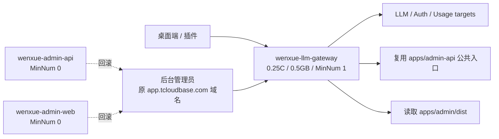

# CloudBase 云托管降耗设计

## 目标架构

`wenxue-llm-gateway` 成为唯一常驻 CloudRun 组合运行时，同时承载：

- 原有 LLM、注册、激活、用户用量与健康检查 targets
- AdminApi 四个公网精确路由 targets
- AdminConsole `/admin` HTML 与 `/admin/assets/*` 构建产物

`wenxue-admin-api` 与 `wenxue-admin-web` 保留为回滚服务，但 `MinNum=0`。
统一 HTTP 域名继续暴露原 `/admin` 和 `/api/admin/v1/*` 路径。

当前线上由 Gateway 配置发布版本 `024` 承载全部流量；该版本复用已完成灰度验证的组合运行时 `023` 镜像。旧后台服务分别保留 `wenxue-admin-api` 版本 `009` 与 `wenxue-admin-web` 版本 `006`，但不再保有常驻实例。



## 模块边界

### CloudBaseLlmGateway

作为 CloudRun 组合根，新增以下职责：

- 将 AdminApi 的 `me`、`usageSummary`、`users`、`userStatus` 公开函数以别名导出，避免与现有用户 usage target 重名。
- 通过 `/admin` 前缀 target 提供 AdminConsole：根路径返回 `index.html`，`/admin/assets/*` 返回构建产物，静态文件以 Promise 单飞缓存，拒绝非 GET/HEAD、目录穿越与未知深路径。

它不复制 AdminApi 的业务逻辑，不改变 LLM Gateway 现有鉴权和限流，也不在服务端实现管理员登录逻辑。

### AdminApi

`apps/admin-api` 继续作为 AdminApi 唯一源码和独立回滚部署单元。组合镜像通过保持以下目录拓扑直接复用其公开入口：

```text
/app/apps/llm-gateway/src
/app/apps/admin-api/src
```

### AdminConsole

仍以 `VITE_BASE_PATH=/admin/` 构建，并显式清空 `VITE_WENXUE_ADMIN_API_BASE_URL`，从而继续调用原域名下的 `/api/admin/v1/*`。构建脚本固定 CloudBase env/region，并清空外部 access-key 覆盖，避免操作者 shell 中残留的 `VITE_*` 污染生产 bundle。

构建产物复制到组合镜像 `/app/apps/admin/dist`，由 Gateway 的 AdminConsole target 返回。浏览器地址、文档 origin、登录存储与现有书签均保持不变。

## 构建与发布

### 白名单 staging

部署前在仓库内生成临时 staging 目录，仅包含：

- 组合 Dockerfile
- `apps/llm-gateway/package.json`
- `apps/llm-gateway/cloudbase-functions.json`
- `apps/llm-gateway/src`
- `apps/admin-api/src`
- `apps/admin/dist`

准备脚本先删除旧输出，再在同目录临时 staging 中构建、扫描并原子重命名；构建失败不会留下可误部署的旧目录。staging 不进入 Git，CloudBase 构建上下文不包含仓库其他文件。

### 灰度发布

组合运行时版本 `023` 按以下阶段完成灰度与切流；发布前先回滚了不完整且未承接流量的版本 `022`：

1. 旧后台 HTTP 路由保持指向旧服务；新版本 5%，只验证既有 Gateway 路径、健康 revision 与回归指标。
2. 新版本 25% 与 50%，重复验证既有 Gateway 路径并观察错误。
3. 提升新版本至 100%。
4. 通过 Gateway 直连域名验证 `/admin`、JS/CSS 与四条 AdminApi 边界。
5. 批量把现有七条后台 HTTP 路由的上游切到 `wenxue-llm-gateway`。

旧版 Gateway 不含 Admin targets，因此不得在新版本达到 100% 前切后台路由。任何灰度阶段失败，立即把流量切回旧版本并执行 rollback；后台路由切换失败则先恢复七条旧上游。

### 资源配置

先在现有 0.5C / 1GB 规格完成组合版本灰度，确认行为等价后再把唯一常驻服务滚动调整为：

```json
{
	"Cpu": 0.25,
	"Mem": 0.5,
	"MinNum": 1,
	"MaxNum": 2,
	"PolicyDetails": [
		{ "PolicyType": "cpu", "PolicyThreshold": 60 },
		{ "PolicyType": "mem", "PolicyThreshold": 60 }
	]
}
```

随后逐个把旧服务 `MinNum` 调整为 0。每次只变更一个服务，并在下一步前验证主路径。唯一 Gateway 始终保持 `MinNum=1`，不采用会影响 LLM、登录或后台首次请求的冷启动方案。

生产实施中，Gateway 的规格调整通过配置发布版本 `024` 生效，并复用 `023` 的已验证镜像；最终保持 0.25C / 0.5GB、`MinNum=1`、`MaxNum=2` 以及 CPU/内存 60% 扩缩容阈值。`wenxue-admin-web` 版本 `006` 和 `wenxue-admin-api` 版本 `009` 的 `MinNum` 均已降为 0。按该最小实例配置估算，固定计算消耗约为 21,420 点/月；该数字不是账单实扣值。

## 安全与回滚

- 不把任何 CloudRun `EnvParams`、Tencent Cloud 临时凭据或业务密钥写入代码、命令参数、日志和提交。
- 已有服务部署省略 `EnvParams`，由 CloudBase 保留线上值。
- 旧服务不删除、旧版本不清理、原 HTTP 路由清单在切换前记录。
- 回滚顺序：恢复 HTTP 路由上游 → 恢复旧服务 `MinNum=1` → 切回旧 gateway 版本。

## 验证策略

- Gateway 与 AdminApi 单元测试、typecheck 全通过。
- AdminConsole typecheck 与 Vite build 通过。
- 本地 Functions Framework 验证所有新增 AdminApi targets。
- 本地 Functions Framework 验证 `/admin`、构建生成的 JS/CSS MIME、缓存头、HEAD、405、404 与路径穿越边界。
- 生产灰度验证：
  - `/healthz` 返回 200。
  - 注册非法输入仍返回 400；激活无 bearer 仍返回 401；CORS preflight 仍返回 204。
  - AdminApi 四条路由无 bearer 均返回 401。
  - `/admin` 返回 200 HTML，引用的 JS/CSS 返回 200 且 MIME 正确。
  - 不使用真实管理员凭据做自动化登录；本次因无可用管理员凭据，只验证登录页正常渲染，不把真实登录和登录后操作计入自动化通过项。

## 生产落地状态（2026-07-17）

- `022` 已回滚；组合运行时 `023` 已完成 5% → 25% → 50% → 100% 灰度并通过直连回归。
- `/admin`、`/admin/`、`/admin/assets/*` 及四条 `/api/admin/v1/*` HTTP 路由均已切换至 `wenxue-llm-gateway`，原域名页面、静态资源和未登录 API 边界回归通过。
- 配置发布 `024` 复用 `023` 镜像，Gateway 最终为 0.25C / 0.5GB、`MinNum=1`、`MaxNum=2`；旧 AdminWeb `006` 与 AdminApi `009` 均为 `MinNum=0`。
- 服务和旧版本继续保留，回滚链路未删除；本次没有购买资源包，也没有开启超限按量计费。
